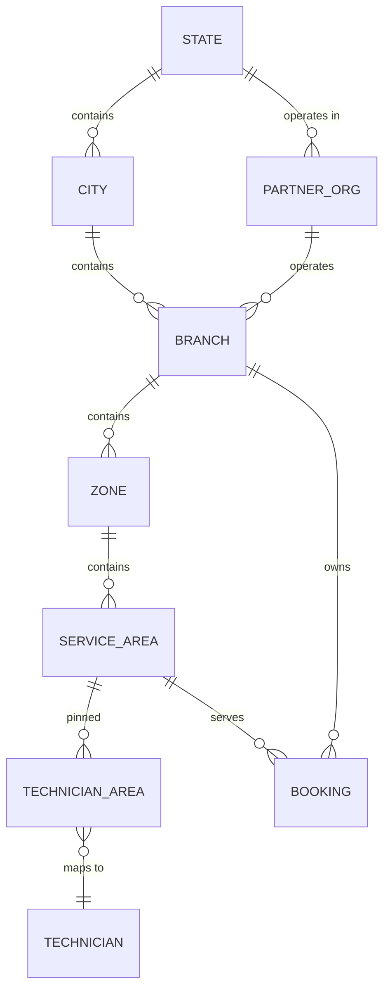
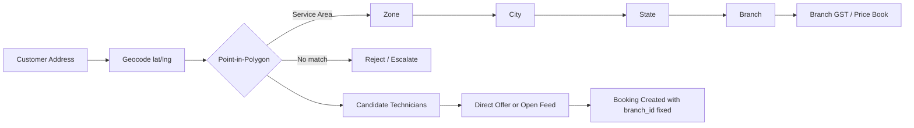

# 02 — Organization & Location Hierarchy

| Field | Value |
|---|---|
| Document ID | AMM-SVC-DOC-02 |
| Version | 1.1 |
| Status | Approved for Design & Development |
| Owner | Product Lead + Engineering Lead |
| Classification | Internal — Confidential |
| Last Updated | 2026-10-21 |
| Depends On | `00`, `01` |

---

## 1. Why Location Is the Foundation

AmmPal is a **physical service** platform. Almost every business rule is location-dependent:

- A technician only receives jobs inside the service areas they cover.
- A price is a function of **State → City → Zone** (plus service-area overlays).
- GST depends on the **place of supply** (the customer's state) and the **branch's state registration**.
- Commission accrues against the **branch** that owned the job.
- A partner branch's entire business is a **territory**.

Therefore location is modelled **first** in the data model, and the tenancy/scope model is built on
top of it (see `09` §2 and `03` §5).

---

## 2. The Hierarchy

```
STATE  (Odisha)
 ├── CITY  (Bhubaneswar)
 │    ├── BRANCH  OD-BBI-001  (Headquarters, company-owned)
 │    │    ├── ZONE  OD-BBI-001-Z01
 │    │    │    └── SERVICE AREA  OD-BBI-001-Z01-A01
 │    │    │         └── pinned technicians, service availability
 │    │    ├── ZONE  OD-BBI-001-Z02
 │    │    │    └── SERVICE AREA  OD-BBI-001-Z02-A01 …
 │    │    └── ZONE  OD-BBI-001-Z03 …
 │    ├── BRANCH  OD-BBI-002  (company-owned, sub-branch)
 │    │    └── ZONE  OD-BBI-002-Z01 …
 │    └── BRANCH  PT-OD-0042  ← platform-partner branch (Puri territory)
 │         └── ZONE  PT-OD-0042-Z01 …
 └── CITY  (Cuttack)
      └── BRANCH  OD-CTC-002  (company-owned)
           └── ZONE  OD-CTC-002-Z01 …
```

### 2.1 Entity Definitions

| Entity | Meaning | Owns | Key Attributes |
|---|---|---|---|
| **Legal Entity** | The **invoicing party**. A branch is *not* a legal entity and carries no tax identity of its own (`ADR-003`, BR-09) | PAN, GST registrations per state, bank account, contracts | `code`, `name`, `legal_name`, `pan`, `entity_type` (PLATFORM / PARTNER_ORG), `bank_account_encrypted`, `status` |
| **Tax Registration** | A legal entity's registration in one state — the source of the GSTIN and the applicable tax treatment | GSTIN, tax rate, place-of-supply applicability | `legal_entity_id`, `state_id`, `gstin`, `tax_rate_bps`, `is_ecommerce`, `effective_from`, `effective_to` |
| **State** | A state/UT in India | Platform presence | `code` (OD), `name`, `is_active` |
| **City** | A city within a state | City-level price band overrides | `code` (BBI), `name`, `state_id`, `latitude`, `longitude` |
| **Branch** | The **operational unit**. Owns jobs, technicians, settlement and P&L. References a legal entity but holds no GST identity | Technicians, service areas, price book, coupons, settlement | `code` (OD-BBI-001), `type` (COMPANY / PARTNER), `legal_entity_id`, `partner_org_id`, `city_id`, `state_id`, `status` |
| **Zone** | A named geographic cluster within a city (e.g. "Patia", "Sahapur") | Zone-level price overlays, capacity targets | `code`, `name`, `branch_id`, `geo_polygon` |
| **Service Area** | The smallest operational geography. The unit of **job distribution** and technician coverage | Pinned technicians, coverage radius, area-level service availability | `code`, `name`, `zone_id`, `branch_id`, `geo_polygon`, `is_active` |
| **Partner Organization** | The external business entity operating one or more partner branches | KYC, contracts, bank account, settlement terms | `code` (PT-OD-0042), `legal_entity_id`, `status` |

> **Rule ORG-LOC-01** — A branch is **never** automatically a separate legal entity or a separate GST
> registration. It references a legal entity; the legal entity holds the tax registrations. The
> supplier shown on a customer invoice is resolved from the booking's owning branch → its legal entity →
> the registration applicable to the **place of supply**. If no such registration exists, invoicing is
> blocked (`ADR-003-05`) — which is why tax registration is a city-activation gate (`ADR-017`).

### 2.1a Ownership Chain

```
Legal Entity (PAN, GST registrations per state)
   │
   ├── Branch (operational unit — no tax identity of its own)
   │      └── Zone → Service Area → pinned Technicians
   │
   └── Partner Organisation (external operator of partner branches)
          └── Branch (type = PARTNER)
```

A **platform** legal entity operates company branches. A **partner organisation** legal entity
operates partner branches. A partner organisation may operate branches in more than one state, each
state requiring its own tax registration for that state.

### 2.2 Branch Types

| Type | Owner | P&L | Sets Local Price | Approves Technicians | Settles |
|---|---|---|---|---|---|
| `COMPANY` | AmmPal Central | AmmPal | Yes, within band | Yes (via Operator) | From platform wallet |
| `PARTNER` | Authorised platform partner | Partner | Yes, within band | Yes (own team) | To partner bank account, after platform commission |

A `PARTNER` branch **must** reference a `partner_org_id`. A `COMPANY` branch must not.

**Both types reference a `legal_entity_id`.** The branch type determines *operational* ownership and
the settlement flow; the legal entity determines *who invoices and who is the supplier*
(`ADR-003`, BR-09). A partner branch bills through its partner organisation's legal entity, subject
to the unresolved principal-vs-agent question (`ADR-024`, `21` OD-07-03).

### 2.2a Central Fallback Operation `[PROPOSED]`

> A central operations team may act as the operating branch for a territory **only** where that
> territory has been explicitly approved for central operation. Approval requires, per territory:
> a legal entity holding a tax registration for the place of supply; a defined contract position with
> the technicians served; a published price band and commission rule; and an operational readiness
> sign-off (`ADR-022`).
>
> A territory without a compliant branch is **not bookable**. It enters a waitlist
> (`ADR-023`) and its enquiries are held for a future city launch.

### 2.3 Why Zones and Service Areas Both Exist

| Granularity | Answers | Configured by | Frequency of change |
|---|---|---|---|
| City | "What price band applies here?" | Super Admin | Rare |
| Zone | "Which cluster inside the city gets a local price overlay / capacity target?" | Super Admin / Admin | Occasional |
| Service Area | "Which technicians cover this polygon, and is the service offered here?" | Branch Manager / Partner Branch Admin | Frequent |

Keeping the **service area** as the job-distribution unit means a technician's coverage is a
**set of pinned polygons**, not a radius heuristic — this is what makes "nearest available
technician" accurate in dense Indian cities.

---

## 3. Launch Footprint

### 3.1 Odisha — Phase Order

| Phase | Cities | Branches | Branch Codes |
|---|---|---|---|
| Phase 1 | Bhubaneswar | 1 HQ + 1 sub-branch | `OD-BBI-001`, `OD-BBI-002` |
| Phase 2 | Bhubaneswar (more zones), Cuttack | 1 | `OD-CTC-002` |
| Phase 3 | Puri, Rourkela, Sambalpur, Berhampur | 1 each | `OD-PUR-003`, `OD-RKL-004`, `OD-SBP-005`, `OD-BRM-006` |
| Phase 4 | Partner-branch territories (one per territory) | as required | `PT-<STATE2>-<NNNN>` |

> Branch code sequence within a state is assigned centrally and **never reused**, even if a branch
> is closed. Codes are append-only identifiers, not ordinal ranks.

### 3.2 Multi-State Model

A new state is added by creating a `State` record plus its registrations and at least one branch.
No schema change, no deployment. State-level configuration includes:

- Platform GST registration (used for commission invoicing)
- Customer-facing GST treatment (place of supply)
- Per-state price band defaults
- Per-state coupon rules
- Per-state legal entity (if operating through separate registrations)

---

## 4. Scope & Tenancy Model

### 4.1 Scope Types

| Scope | Meaning | Example roles |
|---|---|---|
| `GLOBAL` | All branches, all states | Super Admin |
| `STATE` | All branches in one state | Regional Finance (future) |
| `BRANCH` | Exactly one branch | Branch Manager, Partner Branch Admin, Accountant (branch) |
| `SERVICE_AREA` | One service area | Field Supervisor (future) |

### 4.2 Scope Resolution Rules

| Rule | Statement |
|---|---|
| SR-01 | A user account has **exactly one** scope value (`GLOBAL`, `STATE:<id>`, `BRANCH:<id>`, `SERVICE_AREA:<id>`). |
| SR-02 | Access is granted by **intersection** of the user's role permissions and the user's scope. Permissions are never widened by scope. |
| SR-03 | Every tenant-scoped table carries `branch_id`. Every row-level query filters by the caller's scope. |
| SR-04 | `GLOBAL` scope implies read across all; write actions still require the explicit permission. |
| SR-05 | Cross-scope access attempts are logged as `SCOPE_VIOLATION` and return `403`. |
| SR-06 | A technician's effective scope is derived from their **pinned service areas**, not from a user-assigned scope. |
| SR-07 | A customer has no internal scope; their access is limited to their own data via ownership checks. |
| SR-08 | Finance data has an additional dimension: **entity scope**. The platform invoices commission for all branches; a branch accountant sees only their branch's settlement. |

### 4.3 Data Scoping Matrix

| Entity | GLOBAL | STATE | BRANCH | SERVICE_AREA |
|---|:--:|:--:|:--:|:--:|
| Technician | R/W | R | R/W | R (own area) |
| Booking | R/W | R | R/W | R |
| Price book | R/W | R | R (local only) | — |
| Commission ledger | R/W | R | R (own) | — |
| Settlement | R/W | R | R (own) | — |
| Coupon | R/W | R | R/W (own) | — |
| Customer | R/W | R | R | R (own area) |
| Support ticket | R/W | R | R/W | R/W |
| Master data | R/W | R | R | R |

---

## 5. Territory Allocation & Conflict Rules

| Rule | Statement |
|---|---|
| TA-01 | A service area belongs to **exactly one branch** at a time. |
| TA-02 | Allocation is performed by **Operator** or **Super Admin** only (`03` §3.2). |
| TA-03 | The system warns on overlap (a polygon intersecting another branch's polygon) and requires an explicit override reason, which is audited. |
| TA-04 | Reallocating a service area **moves** its active bookings to the new branch but **does not** move completed/settled history — those remain attributed to the original branch for commission and P&L. |
| TA-05 | A technician's service-area pins are validated against their home branch's areas. A technician pinned to another branch's area requires an explicit cross-branch assignment with a reason. |
| TA-06 | Partner branches may request additional service areas; approval follows the Operator → Super Admin chain. |

---

## 6. Job Distribution Logic (Location-Aware)

> Serviceability is resolved **before** distribution and is defined with six ordered conditions and
> reason codes in `23-Workflow-State-Machines-and-Transition-Tables.md` §5 (`ADR-004`, BR-10).
> The steps below are step 6 of that resolution — the availability leg.

```
0. Serviceability gate (ADR-004) — 6 conditions, all must pass
   Otherwise → 422 SERVICE_NOT_AVAILABLE with a reason code
      → offer an approved alternative: another service · waitlist entry · callback · enquiry

1. Resolve customer address → lat/lng  (Google Geocoding, cached 30 days)
2. Point-in-polygon → service_area  → zone → city → state → branch
3. Candidate technicians =
      active (approved, documents valid)
    ∧ has required skill + category
    ∧ pinned to the resolved service_area (or within travel tolerance)
    ∧ service enabled for that area
    ∧ accepting new jobs
    ∧ capacity_available(slot)
    ∧ score (distance, rating, completion rate, response rate) above threshold
4. If the selected technician exists → direct offer (acceptance window 5 min)
   Else → open feed to top N candidates (window 10 min), broadcast to the branch
5. On expiry → next candidate; if the feed is exhausted → Branch Manager / Operator alert
```

**Rule JD-01** — Distance is computed using PostGIS `ST_Distance` on the address point and the
technician's current location (when available) or their service-area centroid (fallback).

**Rule JD-02** — The **assigned branch is fixed at booking creation** and does not change if a
technician from another branch accepts. Commission and P&L follow the assigned branch.

**Rule JD-03** — Google Maps proximity contributes only to step 3 and to ranking. It **never**
satisfies serviceability conditions 1–5.

**Rule JD-04** — A booking is owned by exactly one branch at any instant. Cross-branch ownership is
impossible; a deliberate transfer is an audited operation (`ADR-005`, `23` §7).

---

## 7. Change Management & History

| Change | Effect on existing data | Migration |
|---|---|---|
| Service area created | None | — |
| Service area deactivated | Existing bookings continue; no new jobs offered | `is_active = false` |
| Service area reassigned to another branch | Active bookings move; history stays | `booking.branch_id` updated only where status ∈ {REQUESTED, ACCEPTED, EN_ROUTE, STARTED} |
| Technician pinned to multiple areas | Job feed widens | Additive |
| Branch deactivated | No new bookings; existing jobs continue | `status = INACTIVE` |
| Branch closed | History preserved; settlement finalised | `status = CLOSED` |
| City/Zone renamed | Display only | — |
| Price band changed | **Only new bookings** use the new band | Snapshot protects history |

---

## 8. Configuration Ownership

| Configuration | Set By | Approved By | Applied To |
|---|---|---|---|
| States, cities, GST registrations | Super Admin | Super Admin | All branches in scope |
| Zones | Super Admin / Admin | Admin | One city |
| Service areas & coverage | Branch Manager / Partner Branch Admin | Operator (for partner branches) | One branch |
| Price bands (min/max/default) | Super Admin / Admin | Admin | State → City → Service |
| Local price customisation (in band) | Branch Manager / Partner Branch Admin | Auto (server validation) | One branch |
| Coupons | Marketing & Ops (platform-funded), Branch (partner-funded/shared) | Admin for shared | Scope of the creator |
| Commission rate | Super Admin / Accountant | Super Admin | Versioned, effective-dated |
| Workflow templates | Super Admin | Super Admin | Service category |
| Technician skill & category | Technician (self) | Operator / Super Admin | Technician |

---

## 9. Diagrams





---

## 10. Open Points

| ID | Question | Owner | Deadline |
|---|---|---|---|
| OD-LOC-01 | Should a technician be allowed to accept jobs from a service area of a **partner** branch while being registered to a **company** branch? | Product | Before Phase 2 |
| OD-LOC-02 | Coverage radius fallback when the technician has no live GPS (offline) — use centroid distance or pin? | Engineering | Phase 1 |
| OD-LOC-03 | Do city-level price overrides exist, or only state-level + branch-level? | Product + Finance | Before Phase 2 |
| OD-LOC-04 | Is a service area allowed to span two branches of different types during transition? | Product | Phase 3 |
| OD-LOC-05 | Should a **company branch** and a **partner branch** be permitted to operate in the same city simultaneously? | Founder | Before Phase 3 |
| OD-LOC-06 | Can a partner organisation operate branches in two states under one legal entity, or must each state have its own entity? | Legal + Finance | Before Phase 3 |

---

## 11. Revision History

| Version | Date | Author | Summary | Sections changed |
|---|---|---|---|---|
| 1.1 | 2026-10-21 | Product Lead | Introduced the legal entity / tax registration separation (`ADR-003`, BR-09); added the ownership chain and the central fallback rule (`ADR-022`); replaced the job distribution logic with the six-condition serviceability gate (`ADR-004`); added JD-03 and JD-04; added OD-LOC-05 and OD-LOC-06. | §2.1, §2.2, §2.2a, §6, §10, §11 |
| 1.0 | 2026-10-21 | Product Lead | Initial issue. | All |
