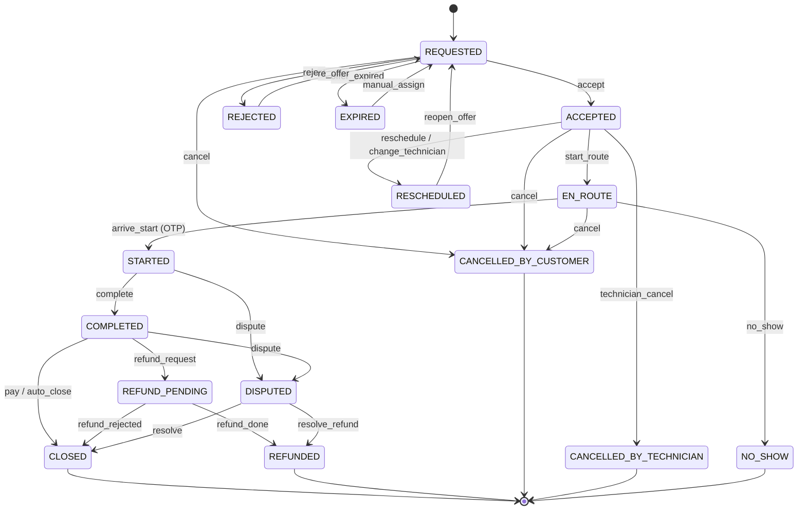

# 04 — Booking Lifecycle Workflow

| Field | Value |
|---|---|
| Document ID | AMM-SVC-DOC-04 |
| Version | 1.2 |
| Status | Approved for Design & Development |
| Owner | Product Lead |
| Classification | Internal — Confidential |
| Last Updated | 2026-10-21 |
| Depends On | `01` §4.3–4.4, `02` §6, `07` |

---

## 1. Overview

The booking lifecycle is the spine of AmmPal. It runs from **Search** to **Settlement** and touches
all four actor families. The canonical lifecycle is:

> Search → Book → Accept → Travel → Serve → Invoice → Pay → Review → Commission → Settlement

The **nine stages** below are the business stages. The **six canonical status codes** are the
persisted machine states. The distinction matters: stages are narrative, statuses are data.

---

## 2. Nine-Stage Lifecycle

| # | Stage | Owner | System Action | Target Time |
|---|---|---|---|---|
| 1 | **Search & Select Service** | Customer | Resolve location → available services → price range | 1–3 min |
| 2 | **Find Technicians & Compare** | Customer | Rank eligible technicians by score; show rating, jobs, price, ETA | 2–5 min |
| 3 | **Book Service & Pay Advance** | Customer + Platform | Validate coupon, snapshot price, create booking, process advance | 1–2 min |
| 4 | **Partner Accept** | Technician | Receive offer, accept or reject within the acceptance window | Few seconds |
| 5 | **Technician Travels** | Technician | Start route, share live location, notify customer | As per distance |
| 6 | **Start Service & Complete Work** | Technician + Customer | OTP-verify arrival, execute checklist, add parts, collect evidence | As per service |
| 7 | **Generate Invoice & Collect Payment** | Platform + Technician | Auto-generate invoice from snapshot, collect remaining | 5–30 min |
| 8 | **Customer Review & Rating** | Customer | Rate technician, write review, report issues | 1–2 min |
| 9 | **Commission Calculation & Settlement** | Platform Finance | Accrue commission, generate weekly settlement, issue invoice, pay out | Weekly cycle |

---

## 3. Stage Detail

### 3.1 Stage 1 — Search & Select Service

**Trigger:** customer opens the app/web, or calls the toll-free number.

> **Serviceability gate.** Before any service or price is shown, the backend evaluates serviceability
> — six ordered conditions with explicit reason codes (`ADR-004`, BR-10, `23` §5). Proximity alone
> never proves serviceability. If the gate fails, the API returns `422 SERVICE_NOT_AVAILABLE` and the
> customer is offered an approved alternative rather than a dead end.

```
Resolve location
 ├── GPS / manual pin (app)          → reverse-geocode → lat/lng
 ├── Typed address (web)             → forward-geocode → lat/lng
 └── Caller number (IVR)             → number → address → city/branch
      │
      ▼
Point-in-polygon (PostGIS) → service_area → zone → city → state → branch
      │
      ├── Serviceability gate fails → 422 SERVICE_NOT_AVAILABLE + reason code
      │     → offer: another service · waitlist entry · callback · enquiry
      ▼
Available services = catalog ∩ branch enabled ∩ area enabled ∩ (≥1 eligible technician)
      │
      ▼
Show service cards with price range (min–max for the location) and "from ₹X"
```

**Rules**
- SR-01 — Location is resolved **before** any service or price is shown.
- SR-02 — A service with zero eligible technicians is **not shown** (FR-CAT-03).
- SR-03 — The displayed price range is derived from the **location's effective price band**, not a global default.
- SR-04 — A confirmed booking for a non-serviceable location is impossible. The booking is rejected at creation, not at execution.
- SR-05 — Non-serviceable demand is captured, not discarded — it feeds the coverage dashboard and the expansion decision (`ADR-023`).

### 3.2 Stage 2 — Find Technicians & Compare

**Input:** service + variant + location + slot.

**Candidate filter**

```
eligible = technician.is_active
        ∧ technician.verification_state = APPROVED
        ∧ documents_valid(now)
        ∧ skills ∩ (service.required_skills) ≠ ∅
        ∧ category = service.category
        ∧ service_area.pins ∋ resolved_service_area
        ∧ accepts_new_jobs
        ∧ capacity_available(slot)
```

**Ranking score** (weights admin-configurable, default shown)

| Signal | Default weight | Notes |
|---|---:|---|
| Distance | 35% | PostGIS distance from address to technician (live location, else centroid) |
| Rating | 25% | Normalised 0–5 |
| Completed jobs | 15% | Log-scale normalised |
| Acceptance rate | 15% | Accepted ÷ offered, last 30 days |
| On-time arrival | 10% | Started within SLA, last 30 days |

**Displayed card:** name, photo, skills, rating + count, completed jobs, price range, next available ETA,
verified badges (KYC, Police-verified `[PROPOSED]`, Company-employed).

**Fallback:** if fewer than 3 candidates, show the branch's "all technicians" list with a
"longer wait" hint and offer the **open feed** path (Stage 4) rather than blocking the customer.

### 3.3 Stage 3 — Book Service & Pay Advance

```
1. Validate service available at address
2. Validate slot within technician availability
3. Compute price snapshot           (07 §3)
4. Validate coupon                  (FR-BK-05)
5. Determine advance requirement    (per service / branch config)
6. Create booking                   → status REQUESTED (1)
7. If advance > 0 → create gateway order → return payment link
8. On payment success → confirm booking, dispatch offer
9. Emit notifications
```

**Price snapshot** — the single most important object in the system

```jsonc
{
  "currency": "INR",
  "labour":  { "amount": 60000, "source": "PARTNER_CUSTOM", "basis": "CUSTOM_PRICE" },
  "visiting":{ "amount": 9900,  "source": "PLATFORM",    "basis": "FIXED" },
  "parts":   { "amount": 0,     "source": "PENDING_ACTUAL", "basis": "MRP_OR_MARGIN" },
  "discounts": [
    { "code": "AMM-PLAT-8FK2M", "amount": 5000, "funding": "PLATFORM",
      "affectsCommissionBase": false },
    { "code": "AMM-DFUND-3HJ1K", "amount": 0, "funding": "PARTNER",
      "affectsCommissionBase": true }
  ],
  "tax": {
    "placeOfSupply": "Odisha",
    "cgst": { "rateBps": 900, "amount": 8504 },
    "sgst": { "rateBps": 900, "amount": 8504 },
    "igst": { "rateBps": 1800, "amount": 0 }
  },
  "totals": {
    "subtotal": 64900, "tax": 17008, "grandTotal": 81908,
    "advance": 9900, "balanceDue": 72008
  },
  "commission": {
    "rateBps": 1500, "basis": "LABOUR_ONLY",
    "eligibleLabour": 60000, "estimatedCommission": 9000
  },
  "snapshotVersion": 1,
  "computedAt": "2026-10-21T09:14:22Z"
}
```

> **Invariant INV-01** — the snapshot is written once and is **immutable**. Later configuration
> changes never alter it. The final invoice is derived from the snapshot plus explicitly recorded
> adjustments (actual parts, technician change fee, late-cancellation penalty), each of which is a
> separate, itemised line.

### 3.4 Stage 4 — Partner Accept

| Path | Trigger | Acceptance window | Fallback |
|---|---|---|---|
| **Direct assign** | Customer chose a specific technician | 5 min | Expiry → offer to the next ranked candidate → open feed |
| **Open feed** | Customer chose "first available", or direct assign expired | 10 min | Expiry → next candidate → Branch Manager/Operator alert |

**Rejection reasons** (mandatory, drive re-routing and the technician's rejection metric)

`UNAVAILABLE` · `OUT_OF_AREA` · `TOO_FAR` · `INSUFFICIENT_SKILL` · `SLOT_CONFLICT` · `NOT_INTERESTED` · `OTHER`

**Rules**
- AR-01 — The offer carries the full booking summary (service, address, slot, distance, estimated earnings).
- AR-02 — Rejection **never** penalises the technician unless the reason is `NOT_INTERESTED` within a rate threshold.
- AR-03 — If the feed exhausts, the booking enters `EXPIRED` → re-routed to the branch coordinator for manual assignment, and the customer is notified within 5 minutes.

### 3.5 Stage 5 — Technician Travels

```
Technician taps "Start Route"
  → status EN_ROUTE (3)
  → live location published via WebSocket (throttled: every 15 s or 25 m moved)
  → customer notified (push + optional WhatsApp with map link)
  → ETA recomputed from live position
```

**Rules**
- TRK-01 — ETA is advisory; the customer always sees the technician's live position, not only a time.
- TRK-02 — If the technician goes offline for > 20 min while `EN_ROUTE`, the branch is alerted.
- TRK-03 — The customer's tracking screen must work with a polling fallback if the socket drops.

> These were numbered `TR-01…03` until the audit pass 3 renamed them. `TR-xx` is the prefix
> `23` §7 uses for **booking transfer** rules and is what `28` §2 maps to `23`; the tracking rules and
> the transfer rules were colliding on the same three identifiers. No rule changed meaning.

### 3.6 Stage 6 — Start Service & Complete Work

```
Technician arrives → "Start Service"
   → customer receives OTP (4 digits) → technician enters it
   → OTP verified → status STARTED (4)
   → checklist from the service workflow template becomes active
   → technician works through checklist, adds parts, uploads evidence
   → "Complete Service" enabled only when all mandatory checklist items + evidence exist
   → status COMPLETED (5)
```

**Rules**
- SV-01 — Customer OTP is mandatory for start. It is the customer's proof of attendance.
- SV-02 — Additional customer approval is required for **parts replacement** and for any work whose cost exceeds the snapshot estimate by > 20% (configurable). Approval is recorded (OTP or in-app confirm).
- SV-03 — Parts added are recorded against a platform rule (MRP or allowed margin), never arbitrary.
- SV-04 — The job cannot complete with a blocked checklist item; blocked items require an explicit override with a reason, which is audited and visible to the branch.

**Service-type variation** — see `06` §4.

### 3.7 Stage 7 — Generate Invoice & Collect Payment

```
On COMPLETED:
  1. Final invoice = price snapshot + itemised adjustments
  2. Invoice issued (immutable, gapless number sequence)
  3. Customer notified (app + WhatsApp + email + SMS as preference)
  4. Technician requests remaining payment → gateway link
  5. Payment recorded against the booking and the invoice
  6. Invoice → PAID; booking → CLOSED (6)
```

**Allowed adjustments**

| Adjustment | Reason code | Affects commission base? | Requires approval |
|---|---|---|---|
| Actual parts | `PARTS_ACTUAL` | No | No (if within margin rule) |
| Technician change fee | `TECH_CHANGE_FEE` | No | No |
| Late cancellation penalty | `LATE_CANCEL_PENALTY` | No | Branch Manager if > threshold |
| Diagnostic charge | `DIAGNOSTIC` | Yes (it is labour) | No |
| Discount applied post-booking | `POST_DISCOUNT` | Per funding type | Admin |

**Rules**
- INV-02 — The invoice is generated by the system; the technician cannot hand-edit prices.
- INV-03 — A payment cannot exceed the invoice balance (overpayment is recorded as a separate credit, not silently absorbed).
- INV-04 — An invoice is never deleted. A corrected invoice is a credit note against the original.

### 3.8 Stage 8 — Customer Review & Rating

```
Booking CLOSED → customer prompted (push + WhatsApp)
  → rating (1–5 stars) + review text + category attributes
  → technician rating, score and leaderboard recalculated
  → booking marked REVIEWED
```

**Rules**
- RV-01 — One rating per booking.
- RV-02 — A rating window of 7 days is offered; after that the booking is auto-closed without a rating.
- RV-03 — Reviews are moderated (auto-flag for abuse, manual review by `MARKETING_OPS` / `CCO`); a moderated review is never deleted silently.
- RV-04 — A customer may raise a complaint **instead of** rating; the complaint path takes precedence.

### 3.9 Stage 9 — Commission Calculation & Settlement

Detailed in `07`. Summary:

```
COMPLETED booking
  → eligible labour identified (per funding rules)
  → commission = eligible labour × rate (versioned, pinned at completion)
  → commission ledger entry (immutable, booking-referenced)
  → partner wallet credited (display) and accrual bucket updated
  → weekly cycle: Mon–Sun accrual → statement (following Monday) → commission invoice + GST
  → partner pays within 7 calendar days → reconciliation → settlement closed
```

---

## 4. Status Model

> **Authoritative reference: `23-Workflow-State-Machines-and-Transition-Tables.md`.**
> That document holds the two-layer model (`ADR-002`), the full 37-row transition table with actors,
> guards, side effects, notifications and audit events, the timeout/recovery table, and the concurrency
> protections. This section is the business-facing summary.
>
> **Two layers.** Layer 1 is the **canonical status** below (six codes plus nine exception states) —
> the vocabulary the business, the partner app and reporting already speak. Layer 2 is the
> **operational phase** (`AWAITING_PARTNER`, `ARRIVED`, `DIAGNOSIS`, `AWAITING_CUSTOMER_APPROVAL`,
> `IN_PROGRESS`, …), which refines a status for SLA timers and support tooling. A phase never
> contradicts a status; a client can never assert either.

### 4.1 Canonical Statuses

| Code | Status | Terminal | Description |
|---|---|:--:|---|
| 1 | `REQUESTED` | No | Booking created; awaiting technician acceptance or advance payment |
| 2 | `ACCEPTED` | No | Technician accepted; job not yet started |
| 3 | `EN_ROUTE` | No | Technician travelling to the customer |
| 4 | `STARTED` | No | Customer OTP verified; work in progress |
| 5 | `COMPLETED` | No | Work finished; invoice generated; payment pending |
| 6 | `CLOSED` | Yes | Payment collected, rating window opened, commission accrued |

### 4.2 Exception States

| Code | Status | Meaning | Leads to |
|---|---|---|---|
| 7 | `CANCELLED_BY_CUSTOMER` | Customer cancelled | Refund per policy |
| 8 | `CANCELLED_BY_TECHNICIAN` | Technician cancelled | Re-route / penalty per policy |
| 9 | `REJECTED` | Technician rejected the offer | Next candidate |
| 10 | `EXPIRED` | No technician accepted in the window | Manual assignment or auto-cancel |
| 11 | `NO_SHOW` | Nobody attended | Penalty per policy |
| 12 | `RESCHEDULED` | Temporary state during a reschedule | Returns to `REQUESTED`/`ACCEPTED` |
| 13 | `REFUND_PENDING` | Refund requested, under process | `REFUNDED` |
| 14 | `REFUNDED` | Money returned | Terminal |
| 15 | `DISPUTED` | Under complaint/dispute review | Resolved to `CLOSED` or `REFUNDED` |

### 4.3 Transition Table

| From | Event | To | Actor | Guard |
|---|---|---|---|---|
| — | `create` | `REQUESTED` | Customer / Coordinator / CCO | Service available; slot valid; price snapshot computed |
| `REQUESTED` | `advance_paid` | `REQUESTED` | System | Payment gateway callback verified |
| `REQUESTED` | `offer_expired` | `EXPIRED` | System | All candidates exhausted |
| `REQUESTED` | `accept` | `ACCEPTED` | Technician | Within acceptance window; technician eligible |
| `REQUESTED` | `reject` | `REJECTED` | Technician | Reason mandatory |
| `REQUESTED` | `cancel` | `CANCELLED_BY_CUSTOMER` | Customer / CCO | Policy check |
| `ACCEPTED` | `start_route` | `EN_ROUTE` | Technician | — |
| `ACCEPTED` | `cancel` | `CANCELLED_BY_CUSTOMER` | Customer / CCO | Policy check; fee may apply |
| `ACCEPTED` | `technician_cancel` | `CANCELLED_BY_TECHNICIAN` | Technician | Penalty may apply; re-route |
| `ACCEPTED` | `reschedule` | `RESCHEDULED` → `REQUESTED` | Customer / Branch | Policy check |
| `ACCEPTED` | `change_technician` | `RESCHEDULED` → `REQUESTED` | Customer / CCO | Eligibility + fee check |
| `EN_ROUTE` | `arrive_start` | `STARTED` | Technician | **Customer OTP verified** |
| `EN_ROUTE` | `cancel` | `CANCELLED_BY_CUSTOMER` | Customer / CCO | Policy check |
| `STARTED` | `complete` | `COMPLETED` | Technician | Checklist satisfied; parts/evidence captured |
| `STARTED` | `dispute` | `DISPUTED` | Customer / CCO | Ticket linked |
| `COMPLETED` | `pay` | `CLOSED` | System / Technician | Payment = invoice balance |
| `COMPLETED` | `auto_close` | `CLOSED` | System | Rating window expired |
| `COMPLETED` | `refund_request` | `REFUND_PENDING` | Customer / CCO | Policy eligibility |
| `REFUND_PENDING` | `refund_done` | `REFUNDED` | Accountant | Gateway refund confirmed |
| `DISPUTED` | `resolve` | `CLOSED` or `REFUNDED` | CCO / Admin | Resolution recorded |
| any terminal | `reopen` | `RESCHEDULED` → `REQUESTED` | Admin only | Reason mandatory; audited |

### 4.4 State Machine



---

## 5. Swimlane View

| Stage | Customer (App/Web) | Platform System | Technician (Partner App) | Branch / Operations | Finance |
|---|---|---|---|---|---|
| 1 Search | Search & select service | Show location-based services & technicians | Not involved | Manage service areas & active technicians | — |
| 2 Compare | View & compare technicians | Apply pricing rules, ratings & availability | Not involved | Monitor incoming bookings | — |
| 3 Book | Book & pay advance | Create booking, process advance payment | View new booking & accept/reject | Support customer & technician | Payment gateway reconciliation (advance) |
| 4 Accept | Get confirmation & track technician | Send notification to technicians | Accept/reject | Handle exceptions | Booking recorded in commission ledger |
| 5 Travel | Monitor technician & communicate | Enable real-time tracking (WebSocket) | Navigate to customer | — | — |
| 6 Serve | Verify service | Update job status | Reach customer, start service, add spare parts | Verify job completion (if required) | Track job completion & eligible labour |
| 7 Pay | Verify service & pay remaining | Generate invoice auto-calculate | Complete service, generate invoice, collect payment | Resolve customer issues & quality check | Calculate commission (15% on eligible labour) |
| 8 Review | Give rating & review | Update job status & ratings | Receive rating & earnings | Quality check | — |
| 9 Settle | — | Record commission & include in weekly settlement | Commission added to partner ledger | Branch performance reports | Generate weekly statement → invoice → partner payment (due in 7 days) → reconciliation |

---

## 6. Cancellation, Refund & Reschedule Policy

Parameters are **configuration**, not code. Defaults shown.

### 6.1 Cancellation Windows

| Elapsed from booking | Customer cancellation | Technician cancellation | Refund of advance | Penalty |
|---|---|---|---|---|
| < 30 min | Free | Free | 100% | None |
| 30 min – 2 h | Free | Allowed | 100% | None |
| 2 h – 4 h | Allowed | Allowed | 50% | None |
| > 4 h / technician en route | Allowed | Allowed | 0% | Customer: ₹100 or 10% of labour, whichever is lower |
| After `STARTED` | Not permitted | Not permitted | n/a | Work done is charged; dispute path only |

### 6.2 Rules

- CX-01 — Penalty is computed by the system, never entered manually.
- CX-02 — Every cancellation notifies **both** customer and technician, in both directions.
- CX-03 — A cancellation triggers **re-booking assistance**: the system offers the next available technician at no extra cost.
- CX-04 — Penalties are ledger entries; they are never netted silently inside a settlement.
- CX-05 — Repeated technician cancellation beyond a threshold (default 3/month) triggers a score penalty and possible suspension.

### 6.3 Refund Timelines

| Method | SLA |
|---|---|
| Gateway refund to original instrument | T+1 to T+3 business days |
| Bank transfer (manual) | T+3 to T+5 business days |
| Wallet credit | Instant (if the partner wallet is enabled) |

Refund is **asynchronous** to the cancellation: `CANCELLED_BY_CUSTOMER` → `REFUND_PENDING` → `REFUNDED`.

---

## 7. Notifications Triggered by the Lifecycle

| Transition | Push | SMS | WhatsApp | Email | In-app | Who |
|---|:--:|:--:|:--:|:--:|:--:|---|
| Booking created | ✔ | ✔ | ✔ | — | ✔ | Customer, Technician |
| Advance paid | ✔ | — | — | ✔ | ✔ | Customer |
| Offer received | ✔ | ✔ | — | — | ✔ | Technician |
| Accepted | ✔ | ✔ | ✔ | — | ✔ | Customer |
| En route (+ map link) | ✔ | — | ✔ | — | ✔ | Customer |
| Arrived / OTP | ✔ | ✔ | ✔ | — | ✔ | Customer |
| Completed | ✔ | — | ✔ | ✔ | ✔ | Customer, Technician |
| Invoice issued | ✔ | — | ✔ | ✔ | ✔ | Customer |
| Payment received | ✔ | — | ✔ | ✔ | ✔ | Customer, Technician |
| Rating requested | ✔ | — | ✔ | — | ✔ | Customer |
| Cancelled / rescheduled | ✔ | ✔ | ✔ | ✔ | ✔ | Customer, Technician, Branch |
| Settlement issued | ✔ | — | ✔ | ✔ | ✔ | Technician, Branch |

Template catalogue and delivery rules: `11`.

---

## 8. SLAs & Timers

| Timer | Default | Trigger | Breach action |
|---|---|---|---|
| `ACCEPTANCE_WINDOW` | 5 min direct / 10 min feed | Offer sent | Next candidate |
| `ARRIVAL_SLA` | P1 60 min, P2 4 h, P3 24 h (by zone) | Accepted | Branch alert + customer notification |
| `OTP_VALIDITY` | 10 min | OTP issued | Re-issue. `[OPEN]` — `21` `OD-SMS-03` recommends **5 min**; this row and `23` §3.3 say 10 and neither cites the other (`OD-DOC-24`). Set the window in `21`, not here. |
| `ON_TIME_START_BUFFER` | 15 min | Accepted | Score penalty for technician, else waiver |
| `RATING_WINDOW` | 7 days | Closed | Auto-close |
| `REFUND_SLA` | 72 h | Refund request | Finance alert |
| `SETTLEMENT_DUE` | 7 calendar days | Statement issued | Reminder at D+5, escalation at D+7 |
| `TICKET_SLA` | Per priority (see `05` §7) | Ticket created | Escalation |

Timers are **configurable per branch** and stored on the branch record so local reality (traffic,
distance, category) can be honoured.

---

## 9. Idempotency & Concurrency

| Concern | Rule |
|---|---|
| Payment callbacks | Idempotent by gateway reference; duplicates ignored |
| Booking creation | Client submits an `Idempotency-Key`; repeated submits return the same booking |
| Status transitions | Optimistic concurrency on `version`; stale updates return `409 STATE_CONFLICT` |
| Coupon usage counters | Incremented inside the same transaction as the booking; unique constraint on (coupon, technician, booking) |
| Commission accrual | Keyed by `booking_id`; a unique constraint guarantees a booking accrues at most once |
| Settlement generation | Unique on (partner_org_id, branch_id, period) — regeneration is impossible |

---

## 10. Open Points

| ID | Question | Owner | Deadline |
|---|---|---|---|
| OD-BK-01 | Is the customer OTP mandatory for **beauty/salon** services (privacy/awkwardness at premises)? | Product | Phase 2 |
| OD-BK-02 | Do we support "first available" (open feed) bookings at launch, or only named-technician booking? | Product | Phase 1 |
| OD-BK-03 | What is the maximum advance percentage permitted per category? | Finance | Phase 1 |
| OD-BK-04 | Is a **cash** collection mode required at launch (technician collects cash, records later)? | Finance + Product | Phase 2 |
| OD-BK-05 | Should rescheduling be free before `ACCEPTED`, and chargeable after? | Product | Phase 2 |

---

## Revision History

| Version | Date | Author | Summary | Sections changed |
|---|---|---|---|---|
| 1.2 | 2026-10-21 | Product Lead + Engineering Lead | Audit pass 3. Renamed the technician-tracking rules **`TR-01…03` → `TRK-01…03`**, because `23` §7 already owns `TR-xx` for booking-**transfer** rules and `28` §2 maps that prefix to `23` — three identifiers meant two different things. No rule changed meaning; `09` and `23` updated to the new names in the same pass. Cross-referenced `23` §3.4, which registers the two tracking gaps this section exposes (technician no-show, and no arrival clock after `EN_ROUTE`) as `OD-DOC-12` and a named timer rule. | §3.5, Revision History |
| 1.1 | 2026-10-21 | Product Lead + Engineering Lead | Documentation audit and consolidation. Added the two-layer status model pointer (ADR-002) and the authoritative transition-table reference; added the six-condition serviceability gate to Stage 1 with the non-serviceable alternatives (ADR-004, ADR-023); added the backend-enforced serviceability rules SR-04 and SR-05. | All |
| 1.0 | 2026-10-21 | Product Lead | Initial issue. | All |
