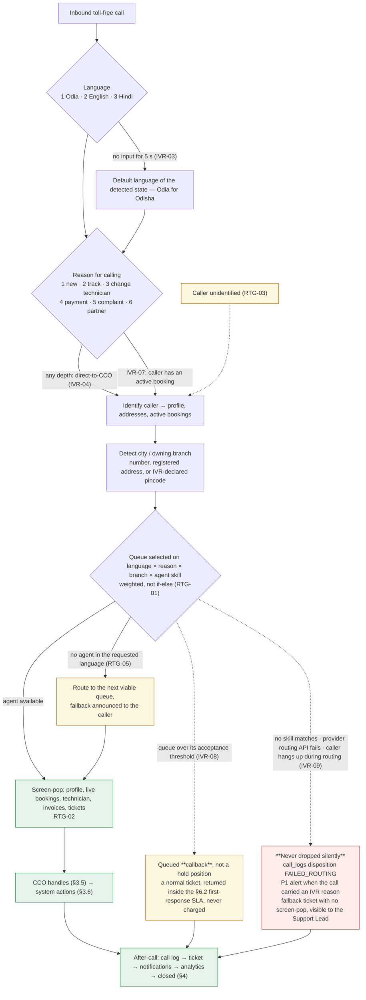

# 05 — Call Support & CCO Workflow

| Field | Value |
|---|---|
| Document ID | AMM-SVC-DOC-05 |
| Version | 1.3 |
| Status | Approved for Design & Development |
| Owner | Support Lead + Engineering Lead |
| Classification | Internal — Confidential |
| Last Updated | 2026-10-21 |
| Depends On | `03` §2.1 (CCO), `04` |

---

## 1. Purpose

AmmPal operates a **toll-free voice channel** (1800-XXX-XXXX) that is a **first-class booking and
support channel**, not merely a complaint line. A customer who calls should be able to book, track,
reschedule, pay, complain or request a technician change without installing an app.

This document defines the call journey from ring to case closure.

---

## 2. Channel Position

| Channel | Share of contact volume (target) | Primary use |
|---|---:|---|
| **App** | 45% | Full self-service, repeat customers |
| **Web** | 25% | Desktop booking, partner registration, dashboard |
| **Phone (toll-free)** | 25% | New bookings, urgent issues, assisted payment |
| **WhatsApp / SMS** | 5% | Status updates, deep links back into the app |

> The IVR, routing and CCO workflow are modelled as **first-class platform capabilities**, not as
> an outsourced call centre. The call console is a module of the Control Center.

---

## 3. Inbound Call Stages

```
 ① Customer Calls → ② IVR Welcome & Language → ③ IVR Reason for Calling
   → ④ Smart Routing → ⑤ Customer Care Officer (CCO) → ⑥ System Integration
```

### 3.1 Stage ① — Customer Calls

| Attribute | Rule |
|---|---|
| Number | Single toll-free number (1800-XXX-XXXX) for **all cities** |
| Cost | Free to the customer (reverse toll-free / DID) |
| Availability | 24×7 as per policy; staffing hours configured per branch |
| Use case | New booking **or** existing service |

**Design note** — a single national number avoids the "which city do I call?" problem and keeps
brand recall high, which is critical for Odisha's tier-2/tier-3 market where competitor apps use
city-specific numbers.

### 3.2 Stage ② — IVR — Welcome & Language

```
    ┌──────────────────────────────────────────────┐
    │  "Welcome to AmmPal Service"                 │
    │  Press 1 for Odia (ଓଡ଼ିଆ)                  │
    │  Press 2 for English                          │
    │  Press 3 for Hindi                            │
    └──────────────────────────────────────────────┘
```

| # | Language | Notes |
|---|---|---|
| 1 | Odia (ଓଡ଼ିଆ) | Primary launch language for Odisha |
| 2 | English | Urban + partner-facing |
| 3 | Hindi | Migrant workforce & northern-India callers |

**Rules**
- IVR-01 — The IVR is powered by the cloud-telephony provider; AmmPal controls the flow via provider APIs/webhooks.
- IVR-02 — Language selection also sets the language of subsequent SMS/WhatsApp notifications for that interaction.
- IVR-03 — A caller with no input for 5 s is routed to the default language of the detected state (Odia for Odisha).
- IVR-04 — Direct-to-CCO option available at any menu depth.

### 3.3 Stage ③ — IVR — Reason for Calling

| Key | Reason | Primary Route | CCO Skill |
|---|---|---|---|
| 1 | New booking / Service enquiry | New Booking | Sales |
| 2 | Existing booking / Track service | Booking Support | Support |
| 3 | Change or reschedule technician | Change Technician | Support |
| 4 | Payment / Invoice / Refund | Payment Desk | Finance Support |
| 5 | Complaint / Service quality | Complaints | Escalation |
| 6 | Partner / Technician support | Partner Desk | Partner Support |
| 0 | Speak to Customer Care Officer | General | General |

**Rules**
- IVR-05 — Reason selection drives both the **queue** and the **screen-pop content** the agent sees.
- IVR-06 — Reasons map to the six documented use cases (§5).
- IVR-07 — A caller with an **active booking** is prioritised for reason 2 regardless of selection.
- IVR-08 — A caller who selects the human-agent key and reaches a queue that is over its
  acceptance threshold is offered a **queued callback** rather than a hold position. The callback
  is a normal support ticket, is returned within the priority's first-response SLA (§6.2), and
  the caller is not charged for it. `[PROPOSED]` — the queue threshold and the maximum callback
  wait are open (`OD-SUP-*`, `21`).
- IVR-09 — A call that cannot be routed — no agent skill matches, the provider's routing API fails,
  or the caller hangs up during routing — is **never dropped silently**. It raises a `P1` alert if
  the call carried an IVR reason, is logged in `call_logs` with a `FAILED_ROUTING` disposition, and
  produces a screen-pop-free fallback ticket so the loss is visible to the Support Lead.
  `[PROPOSED]` — see `25` §5.

> **Open conflict — which key reaches a human.** This document assigns the human-agent key as
> `0` (§3.3, no key `7`); `README` §10.1 assigns it as `7` ("Human agent or callback") and omits
> `0`. The two are incompatible and neither has been approved. Registered as **`OD-DOC-05`** in
> `21` §7; the IVR key map is `[OPEN]` and must not be configured with the provider until closed.

### 3.4 Stage ④ — Smart Routing

```
 ┌─ Identify caller ────────────────────────────────────────────┐
 │  • Caller number → customer lookup (exact, then fuzzy by 3+)  │
 │  • Fetch customer profile (name, addresses, service area)     │
 │  • Find active bookings (REQUESTED…COMPLETED)                │
 └───────────────────────────────────────────────────────────────┘
 ┌─ Detect city & branch ────────────────────────────────────────┐
 │  • By phone number (registered address)                       │
 │  • By caller-registered address                               │
 │  • By IVR-declared pincode → city                             │
 └───────────────────────────────────────────────────────────────┘
 ┌─ Route to right queue ────────────────────────────────────────┐
 │  • Language        → Odia / English / Hindi queue             │
 │  • Issue type      → §3.3 reason                               │
 │  • Branch / region → owning branch's queue                    │
 │  • Agent availability & skill → available agent               │
 └───────────────────────────────────────────────────────────────┘
```

**Rules**
- RTG-01 — Routing inputs are combined with priority weights, not a rigid if-else chain.
- RTG-02 — If the caller is identified and has an active booking, the agent's screen-pop shows: customer profile, active bookings with live status, technician details, recent invoices, recent tickets, and the wallet/settlement summary for technician callers.
- RTG-03 — If the caller is unidentified, the agent can still proceed — the identity is captured during the call and verified by OTP before any sensitive change.
- RTG-04 — Routing decisions are logged with the chosen agent and the reason score, so routing quality is measurable.
- RTG-05 — Language routing takes precedence over issue routing when an agent is unavailable in the requested language (fallback announced to the caller).

### 3.5 Stage ⑤ — Customer Care Officer (CCO)

**Core responsibilities**

| Responsibility | Detail |
|---|---|
| Answer with context | Screen-pop of customer, bookings, payments, history |
| Verify identity | OTP before sensitive changes (see `Policy P1`) |
| Resolve directly | Perform the supported action within role permission |
| Coordinate | Escalate to branch, technician, or finance when required |
| Record | Every action is written to the support ticket + call log |
| Confirm | Close the call only after the customer confirms resolution |

**What a CCO may do directly**

| Action | Condition |
|---|---|
| Create a booking on behalf of a customer | Service available at the address; price band visible to the customer |
| Share technician options | From the candidate list (`04` §3.2) |
| Issue a payment link | For a pending invoice; the customer pays on the gateway |
| Reschedule a booking | Within policy; no fee without customer consent |
| Cancel a booking | Within policy; penalty explained and accepted |
| Raise a technician change request | Within eligibility rules |
| Register a complaint | Always; creates a ticket with category and priority |
| Apply a goodwill credit | Within a configured limit; above it → `ADMIN` |

**What a CCO may not do**

- Change prices, commission, or the price band.
- Issue or approve a settlement statement.
- Override a technician suspension.
- Apply a goodwill credit above the configured limit.
- Delete a ticket, invoice, or call recording.

### 3.6 Stage ⑥ — System Integration

| System | Use in the call flow |
|---|---|
| **Booking System** | Create, reschedule, cancel, query bookings |
| **Partner / Technician App** | Notify technician of assignment, change, cancellation; push and SMS |
| **Payment Gateway** | Create orders, generate links, check status, initiate refunds |
| **SMS / WhatsApp / Email** | Send confirmations, links, updates, invoice, ticket updates |
| **Google Maps** | Live technician location for "track my technician" |
| **Notifications (Firebase)** | Push to customer and technician apps |
| **Call Recording (Provider)** | Recording retrieval for QA and dispute evidence |
| **CRM & Support Ticket** | Ticket creation, assignment, status, notes |
| **Reports & Analytics** | Call volume, queue time, agent performance, CSAT |

### 3.7 The Whole Call Path, Including Both Escape Hatches

Rules IVR-01…IVR-09 and RTG-01…RTG-05 describe a path with two places a call can go wrong — a queue
over its acceptance threshold (IVR-08) and a route that cannot be resolved at all (IVR-09). The ASCII
stages above show the happy path; this shows the failure paths, because a silently dropped call is the
outcome this document exists to prevent. **No new rule is stated here.**



> **The human-agent key is still `[OPEN]`.** The diagram draws the reason menu as §3.3 defines it,
> which has **no key `7`**; `README` §10.1 says `7` is the human agent and omits `0`. That is
> `OD-DOC-05` and it is unresolved (`DEC-03`) — the node labelled *direct-to-CCO (IVR-04)* is the one
> whose digit is in dispute. Nothing here may be configured with the provider until the founder closes
> it, and closing it means amending one of the two documents, not both (`DEC-01`).

---

## 4. After-Call — System Actions

```
 Call Log Recorded → Support Ticket → Notifications → Monitoring & Analytics → Case Closed
```

| Step | What is captured |
|---|---|
| **Call Log** | Call ID, timestamp, duration, direction, caller number, IVR path, recording reference, disposition, linked customer, linked ticket, agent |
| **Support Ticket** | Auto-created when the reason requires follow-up (categories 3, 4, 5, 6). Manual creation otherwise. Fields: category, priority, assigned team, status, SLA due, notes, resolution |
| **Notifications** | SMS / WhatsApp / email to the customer; notification to the technician or branch; in-app + web status update |
| **Monitoring & Analytics** | Call volume, queue time, agent performance, missed calls and callbacks, CSAT |
| **Case Closed** | Issue resolved; customer confirmation captured; data available for audit, QA and improvement |

---

## 5. The Six Call Use Cases

### Use Case A — New Booking via Call

| Step | Action | Detail |
|---|---|---|
| A1 | CCO collects customer details | Name, phone, address (with landmark), city; select category & service; confirm the appliance/type and the problem statement |
| A2 | Check service availability | Verify branch & service area for the address; confirm the category is enabled; show the **estimated price range** from the location's price band |
| A3 | Find and share technicians | Nearest available technicians with rating, completed jobs, estimated price and time; confirm the customer's preference |
| A4 | Create booking & take advance | Create the booking; if an advance is required, send a payment link (or use the agent-assisted payment link); confirm the customer completed the payment |
| A5 | Confirm booking | Booking ID generated and read out; technician notified; customer notified (SMS + WhatsApp) |
| A6 | Follow-up and track | Monitor acceptance and service progress; update the customer proactively on any change |

**Rules**
- A-01 — The price **range** is communicated verbally; the exact price is confirmed at booking in the app/invoice.
- A-02 — The CCO never quotes a price outside the visible band; if the customer's expectation is outside it, the call is transferred to the branch for a special approval.
- A-03 — An advance collected verbally (cash/card) must be recorded against the gateway order or as an explicit manual payment with a reference.

### Use Case B — Existing Booking Support

| Step | Action | Detail |
|---|---|---|
| B1 | Identify booking | By booking ID or phone number; show booking details & status |
| B2 | Provide real-time update | Technician accepted / on the way; share a live location tracking link |
| B3 | Modify if required | Reschedule date/time; update address & contact; add special instructions |
| B4 | Handle delays | Call the technician or the branch; provide a revised ETA; send an SMS/WhatsApp update |
| B5 | Ticket & follow-up | Create a support ticket if needed; keep the customer informed; close the ticket after resolution |

**Rules**
- B-01 — Address changes are permitted only before `STARTED`; after that, a dispute/rework path applies.
- B-02 — Every ETA given verbally is also sent as a written notification, creating a record.

### Use Case C — Change Technician

| Step | Action | Detail |
|---|---|---|
| C1 | Customer requests change | Reason (delay, behaviour, wrong skill); verify the booking and current status |
| C2 | Check eligibility | **Before service start:** free change. **After arrival/diagnosis:** as per policy (may charge) |
| C3 | Find new technician | Available technicians with rating, price, time |
| C4 | Confirm and reassign | Cancel the current assignment; send a new request; notify the customer with the new technician's details |
| C5 | Update booking & notify | Booking history maintained; **both** technicians informed |

**Rules**
- C-01 — The original technician receives a `CANCELLED_BY_TECHNICIAN`-equivalent reassignment event and is **not** penalised when the change was customer-initiated.
- C-02 — The fee (if any) is auto-computed and shown to the customer **before** the change is confirmed.
- C-03 — A technician-change request while `EN_ROUTE` triggers a live re-route; the customer must be told the new ETA.
- C-04 — Reassignment is capped at 2 changes per booking before manual branch involvement (configurable).

### Use Case D — Payment / Invoice / Refund

| Step | Action | Detail |
|---|---|---|
| D1 | Identify booking & payment status | Show advance paid, remaining balance; view invoices and transactions |
| D2 | Send payment link (if pending) | UPI / card / gateway link; confirm payment status in real time |
| D3 | Generate or resend invoice | Send by WhatsApp/email; explain the charges (labour, parts, visiting, tax) |
| D4 | Handle refund request | Verify policy eligibility; initiate the refund subject to approval; update status; notify |
| D5 | Close case with confirmation | Payment/refund completed; send a confirmation message |

**Rules**
- D-01 — The CCO explains the invoice using the itemised breakdown. Raw totals are never read out.
- D-02 — Refunds above the CCO's limit require `ACCOUNTANT` approval and enter `REFUND_PENDING` immediately.
- D-03 — A refund is always linked to the original payment transaction, never applied as an unlinked credit.

### Use Case E — Complaint / Service Quality

| Step | Action | Detail |
|---|---|---|
| E1 | Register complaint | Understand the issue; verify the booking and technician |
| E2 | Take action | Call the technician for clarification; escalate to the Branch Manager; arrange rework/refund as per policy |
| E3 | Keep customer updated | Provide a resolution timeline; send SMS/WhatsApp updates |
| E4 | Verify resolution | Confirm with the customer; optional follow-up call |
| E5 | Close complaint ticket | Record the action taken; update the rating and the quality report; notify the partner via app/SMS |

**Rules**
- E-01 — A complaint ticket is created **immediately** — before resolution is attempted — so the SLA clock starts at the customer's first contact, not at the resolution.
- E-02 — Rework is assigned to a different technician by default, unless the customer explicitly accepts the original technician.
- E-03 — A complaint always suppresses the automatic rating prompt until the complaint is closed; the rating then reflects the outcome.
- E-04 — Critical complaints (safety, data misuse, harassment) escalate to `ADMIN` immediately, bypassing SLA queues.

### Use Case F — Partner / Technician Support

| Step | Action | Detail |
|---|---|---|
| F1 | Partner calls support | Verify partner identity (OTP); show the partner profile |
| F2 | Handle issues | Booking not received; payment/wallet query; app usage help; KYC or document update |
| F3 | Resolve or escalate | Guide through the process; raise an internal ticket if needed; escalate to Partner Management |
| F4 | Update partner | Provide the resolution details; share next steps |
| F5 | Close ticket | Mark resolved; notify the partner via app/SMS |

**Rules**
- F-01 — Technicians calling about a **specific job** are routed to the branch queue; technicians calling about **earnings/KYC** are routed to Partner Support.
- F-02 — Wallet and settlement balances shown to a technician on a call must match the app exactly; a mismatch raises a finance-alert ticket.

---

## 6. Support Ticket Model

### 6.1 Categories

| Code | Category | Default Priority | Category resolution SLA |
|---|---|---|---|
| `BOOKING_ISSUE` | Booking not created / wrong details | P2 | 24 h |
| `TECHNICIAN_ISSUE` | Technician not assigned / not reachable | P1 | 2 h |
| `TECH_CHANGE` | Technician change request | P2 | 4 h |
| `PAYMENT_ISSUE` | Payment failed / double charged / refund pending | P1 | 8 h |
| `INVOICE_ISSUE` | Invoice discrepancy / missing invoice | P2 | 24 h |
| `QUALITY_COMPLAINT` | Service quality / rework | P1 | 4 h |
| `DELAY` | Technician delayed / no-show | P1 | 2 h |
| `PARTNER_SUPPORT` | KYC, wallet, app, documents | P3 | 48 h |
| `TECHNICAL_APP` | App/web defect | P3 | 48 h |
| `OTHER` | Unclassified | P3 | 72 h |

**How the two tables combine.** Every value in §6.1 is a **resolution** SLA, not a response SLA —
the magnitudes (2 h…72 h) line up with §6.2's resolution ladder, not its response ladder
(15 min/1 h/4 h). §6.1 therefore overrides §6.2 for the named category; §6.2 is the fallback when a
category carries no value or when an agent raises or lowers a ticket's priority manually (§6.3,
`priority` override). A ticket's `sla_due_at` is computed from the **category value where one
exists**, and from the priority row otherwise. Where the two disagree, the **tighter** clock governs
the first-response obligation (§6.2) and the **category clock** governs resolution.

> **Open.** `PAYMENT_ISSUE` is `P1` with an 8 h resolution clock while `P1` is 4 h in §6.2, and
> `TECH_CHANGE` is `P2` with 4 h against a 24 h `P2` default. Whether a category is allowed to set a
> resolution clock **looser** than its own default priority is a support-policy decision, not a
> documentation fact — it directly sets what may be promised to a paying customer. Registered as
> `OD-SUP-06`. `[OPEN]`

### 6.2 Priorities `[PROPOSED]`

| Priority | Response SLA | Resolution SLA | Escalation |
|---|---|---|---|
| P1 Critical | 15 min | 4 h | `ADMIN` immediately |
| P2 High | 1 h | 24 h | Branch Manager at 50% of SLA |
| P3 Normal | 4 h | 72 h | Partner Support Lead |

> These are internal working targets proposed by this document. **No ticket SLA in this table is a
> committed service level**: `26` does not include a support SLA in the delivered scope and
> `OD-RM-*` has not fixed the launch commitments. Until a signed agreement says otherwise, quoting
> any of these figures to a partner or customer as a guarantee is out of scope (master rule: do not
> record confirmed SLAs without evidence — `21` DEC-03).

### 6.3 Ticket Status Lifecycle

```
NEW → TRIAGED → IN_PROGRESS → PENDING_CUSTOMER ⇄ IN_PROGRESS
                 → RESOLVED → CLOSED
                 → ESCALATED → IN_PROGRESS
```

| Field | Notes |
|---|---|
| `category` | From §6.1 |
| `priority` | Default from category, manually overridable by `CCO`/`ADMIN` (reason logged) |
| `assigned_team` / `assigned_to` | Queue and individual |
| `source` | `CALL` · `APP` · `WEB` · `WHATSAPP` · `EMAIL` · `AUTO` |
| `call_id` | Link to the call log |
| `booking_id` | Link to the booking when relevant |
| `sla_due_at` | Computed from priority and created_at |
| `resolution` | Structured: `code`, `note`, `refund_id`, `rework_booking_id` |
| `csat` | 1–5 post-close rating |

---

## 7. Telephony Integration Contract

| Event | Direction | Payload |
|---|---|---|
| `call.initiated` | Provider → AmmPal | `call_id`, `from`, `to`, `timestamp` |
| `call.ivr.entered` | Provider → AmmPal | `call_id`, `digit`, `menu_path` |
| `call.routed` | Provider → AmmPal | `call_id`, `agent_id`, `queue`, `wait_seconds` |
| `call.connected` | Provider → AmmPal | `call_id`, `agent_id`, `timestamp` |
| `call.recorded.available` | Provider → AmmPal | `call_id`, `recording_url`, `duration_seconds` |
| `call.completed` | Provider → AmmPal | `call_id`, `end_timestamp`, `disposition` |
| `call.missed` | Provider → AmmPal | `call_id`, `from`, `callback_requested` |
| `call.recording.fetch` | AmmPal → Provider | `call_id` → signed URL |

**Rules**
- TEL-01 — AmmPal treats the telephony provider as an **external system**, not a source of truth. AmmPal stores `call_id` (the provider's identifier) as the canonical key and reconciles via webhooks.
- TEL-02 — Webhooks are **idempotent** (deduplicated by `call_id` + event type).
- TEL-03 — Recordings are stored in the provider's encrypted store with a **signed, expiring URL**; AmmPal never proxies the media.
- TEL-04 — Retention follows the recording-retention policy (default 90 days; disputes are extended).
- TEL-05 — The provider is called asynchronously; a telephony outage must **not** block in-app booking.

---

## 8. Key Features & Policies

### 8.1 Key Features

| # | Feature |
|---|---|
| KF-01 | Single toll-free number for all cities |
| KF-02 | Automatic branch & location detection from the caller's number |
| KF-03 | Multi-language IVR (Odia, Hindi, English) |
| KF-04 | Customer & booking screen-pop on the agent console |
| KF-05 | Call recording and secure storage |
| KF-06 | Real-time technician tracking shared on the call |
| KF-07 | Integrated booking, payment and refund from the console |
| KF-08 | Unified support ticket system across all channels |
| KF-09 | Callback scheduling for missed calls |
| KF-10 | Supervisor dashboard and reports |
| KF-11 | Integration with the partner app, SMS, WhatsApp and email |
| KF-12 | Scalable across multi-state, multi-branch operation |

### 8.2 Important Policies

| # | Policy |
|---|---|
| P1 | Verify customer identity for sensitive changes (OTP) |
| P2 | Follow the cancellation and refund policy exactly |
| P3 | Charge for a technician change if applicable — disclose before action |
| P4 | Maintain call and ticket records for the full retention period |
| P5 | Escalate critical complaints immediately |

---

## 9. Staffing & Capacity Model `[PROPOSED]`

| Queue | Peak concurrency (per 100 bookings/day) | Shift pattern |
|---|---:|---|
| New Booking | 1 agent per 60 calls/day | 09:00–21:00 |
| Booking Support | 1 per 80 calls/day | 09:00–21:00 |
| Complaints | 1 per 40 calls/day | 10:00–19:00 |
| Partner Desk | 1 per 100 calls/day | 10:00–19:00 |
| Out-of-hours | 1 on-call | 21:00–09:00 (callback-only) |

**Target metrics**

| Metric | Target |
|---|---|
| Average speed of answer | ≤ 20 s |
| Average handle time | ≤ 6 min |
| First-call resolution | ≥ 70% |
| Abandonment rate | ≤ 5% |
| CSAT | ≥ 4.3 / 5 |
| Ticket reopen rate | ≤ 8% |

---

## 10. Open Points

| ID | Question | Owner | Deadline |
|---|---|---|---|
| OD-SUP-01 | Native telephony integration in the Control Center, or deep-link to the provider's console? | Support + Engineering | Phase 2 |
| OD-SUP-02 | Is agent-based assisted payment (agent link) in scope at launch? | Finance + Product | Phase 1 |
| OD-SUP-03 | Should the IVR support a callback-request flow for out-of-hours? | Support | Phase 2 |
| OD-SUP-04 | Recording retention period — 90 days or aligned to statutory book-retention (8 years)? | Legal | Phase 2 |
| OD-SUP-05 | Do we need a dedicated Odia-language agent workforce from Day 1? | Operations | Phase 1 |
| OD-SUP-06 | May a ticket **category** carry a resolution clock looser than its own default priority (§6.1 `PAYMENT_ISSUE` 8 h vs §6.2 `P1` 4 h)? | Support Lead + Product | Phase 1 — it sets what can be promised |

---

## Revision History

| Version | Date | Author | Summary | Sections changed |
|---|---|---|---|---|
| 1.3 | 2026-10-21 | Support Lead + Engineering Lead | Audit pass 3 (continued). **§3.7 added: the whole call path as one Mermaid flowchart, including both failure branches** — queue-overflow callback (IVR-08) and unresolvable routing (IVR-09) — which the §3.2–§3.6 ASCII stages show only as the happy path. The section states no new rule; every node cites IVR-01…IVR-09, RTG-01…RTG-05 or §4. A note below the diagram marks the human-agent key as still `[OPEN]` (`OD-DOC-05`) and says which node in the picture is the one in dispute, so the diagram cannot be handed to a telephony provider as though it were approved. No IVR rule, routing weight, SLA or after-call action changed. | §3.7, Revision History |
| 1.2 | 2026-10-21 | Support Lead + Engineering Lead | Audit pass 3. Recorded IVR-08 (queue-overflow callback) and IVR-09 (failed routing is never silent); flagged the IVR human-agent key conflict between §3.3 (`0`) and `README` §10.1 (`7`) as `OD-DOC-05` rather than silently picking one; renamed the §6.1 SLA column to state that it is a **resolution** clock and documented how §6.1 and §6.2 combine; marked §6.2 `[PROPOSED]` because no ticket SLA is contractually committed; added `OD-SUP-06`. Corrected the v1.1 entry below, which claimed an "option 7" had been added to the reason menu — §3.3 has never contained one. | §3.3, §6.1, §6.2, §10, Revision History |
| 1.1 | 2026-10-21 | Product Lead + Engineering Lead | Documentation audit and consolidation. Added call events, callbacks and missed-call callback handling; cross-referenced the bounded financial permissions (ADR-016) and the recording-retention open decision. *(This entry originally also claimed to have "added the human-agent / callback IVR option (option 7) to the reason menu"; §3.3 uses key `0` and defines no key `7`, so that claim was inaccurate and has been removed — see v1.2.)* | §3.3, §7, §8 |
| 1.0 | 2026-10-21 | Product Lead | Initial issue. | All |
