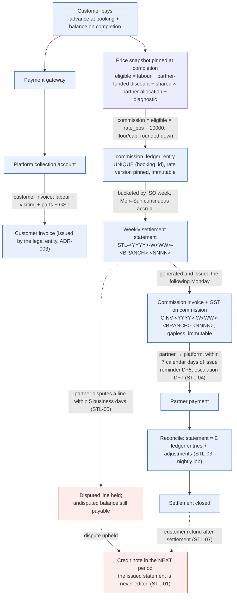

# 07 — Pricing, Billing, Commission & Settlement

| Field | Value |
|---|---|
| Document ID | AMM-SVC-DOC-07 |
| Version | 1.3 |
| Status | Approved for Design & Development |
| Owner | Finance Lead + Product Lead + Engineering Lead |
| Classification | Internal — Confidential |
| Last Updated | 2026-10-21 |
| Depends On | `04`, `06` |
| Review Required By | Finance + Tax advisor before Phase 2 billing goes live |

---

## 1. Purpose

This document is the **financial contract** of AmmPal. It defines how a price is set, shown,
snapshotted, invoiced, and split between the platform and the partner, and how money reaches the
technician.

**Nothing in this document may be implemented approximately.** The arithmetic described here is
the arithmetic that must be implemented exactly, and it is covered by golden-master tests
(`15` §5.3).

---

## 2. Price Lifecycle

```
 ① Platform Sets Base Pricing          (Central Admin)
        ↓
 ② Partner Customizes Price            (Branch / Partner Admin, within band)
        ↓
 ③ Customer Books Service              (App / Website / Call)
        ↓  price snapshot frozen here
 ④ Service Execution                   (Technician)
        ↓
 ⑤ Customer Invoice                    (sent to customer)
        ↓
 ⑥ Commission Calculation              (Platform Backend)
        ↓
 ⑦ Weekly Commission Invoice to Partner
        ↓
 ⑧ Partner Pays within 7 Days
        ↓
 ⑨ Reconciliation Complete
```

---

## 3. Price Components

| # | Component | Who sets it | Range / rules | In commission base? |
|---|---|---|---|---|
| 1 | **Labour charge** | Platform sets band; partner sets value **within** band | min / max / default per geography & service | **Yes** |
| 2 | **Visiting charge** | Platform (fixed or range) | Usually fixed per category/branch | No |
| 3 | **Diagnostic charge** | Platform or partner (optional) | Fixed; billed only if a diagnosis is performed | **Yes** (it is labour) |
| 4 | **Spare parts** | Platform rules | MRP or allowed margin; per-part min/max | No (unless platform policy says otherwise) |
| 5 | **Transport / material charge** | Platform rules | Fixed or percentage | No |
| 6 | **Emergency / after-hours charge** | Platform rules `[PROPOSED]` | Fixed or percentage uplift, applied when the slot is outside working hours, on a public holiday, or flagged urgent | **Yes** (it is labour) |
| 7 | **Discounts / coupons** | Platform / partner / shared | Min & max discount, validity, usage caps | **Depends on funding** (§5) |
| 8 | **GST** | Law + tax registration | CGST+SGST intra-state, IGST inter-state, on the customer invoice | No |
| 9 | **Advance payment** | Platform (optional) | 0 / fixed / % of total | n/a |
| 10 | **Penalties** (late cancel, no-show, technician change fee) | Platform policy | Configurable | No |
| 11 | **Payment gateway charge** | Platform / gateway agreement `[PROPOSED]` | A platform fee or a pass-through charged to the customer or absorbed by the platform | No — never in the partner's base |

> **Note on the gateway charge.** It is a **platform cost**, not partner labour. It must never enter the
> commission base, and it must never be silently deducted from the partner's earnings. If it is
> passed through to the customer it is a separate invoice line (`FEE`); if absorbed, it is a platform
> cost account in the general ledger. The treatment is an open decision (`21` OD-COM-04 area).

> **Note on the emergency / after-hours charge.** It is labour performed outside normal hours and is
> therefore part of the eligible labour base, subject to the configured band and the customer's
> explicit acceptance at booking. `[PROPOSED]` — see `21`.

### 3.1 The six-stage price model

| Stage | Actor | Authority |
|---|---|---|
| ① Platform Sets Base Pricing | Central Admin | Creates the service catalogue; sets base labour price (min/max/default), visiting-charge rules, spare-part handling rules, service-area and city policies, allowed partner margin, discount and coupon rules, tax and invoice rules; publishes to selected states/cities |
| ② Partner Customizes Price | Branch / Partner Admin | Views the platform base price and range; sets a custom labour price **within** the range; sets/confirms the visiting charge; sets an optional diagnostic charge; sets availability by service area; offers partner-funded discounts; previews expected earnings after commission; saves and publishes for the branch/city |
| ③ Customer Books Service | Customer | Selects city, location and service; views the final price breakdown; applies a coupon; sees the estimated total; pays the advance if required; confirms |
| ④ Service Execution | Technician | Accepts the booking; visits; diagnoses; gets customer approval for the work; adds spare parts if used; completes the service; generates the final invoice in-app; collects the remaining payment |
| ⑤ Customer Invoice | System → Customer | Detailed invoice with the breakdown: labour, visiting, spare parts, discounts applied, GST per branch/state, payment details, service warranty; downloadable via app/email/SMS; rating and review prompt |
| ⑥ Commission Calculation | Platform Backend | Takes the eligible labour amount; applies the platform commission; excludes visiting charge, spare parts and GST; applies the discount rules; records the commission in the ledger; includes it in the weekly settlement; generates the commission invoice to the partner |

### 3.2 Platform-set base pricing — illustrative configuration

**AC Repair (General Service)**

| Field | Value |
|---|---|
| Base labour price | ₹500 |
| Visiting charge | ₹99 (fixed) |
| Allowed partner range | ₹400 – ₹700 |
| Platform commission | 15% on labour |

### 3.2a The advance — an example, not a fixed amount

The business has discussed advance amounts such as **₹27 and ₹99**. These are **examples of the
mechanism**, not universal fixed amounts, and they are not a confirmed policy.

| Property | Rule |
|---|---|
| Configurability | The advance is set by approved policy — per service, per category, per branch or per city — and may be zero, a fixed amount, or a percentage of the total. |
| Current decision | **OPEN** — `21` OD-BK-03 (maximum advance percentage) and OD-07-06 (maximum advance, and whether the advance is a deferred-revenue liability until the job completes). |
| Accounting treatment | An advance is a **payment against the booking**, not earned revenue and not partner commission. It sits as a liability against the booking until the job completes or the advance is refunded. |
| Application to the final invoice | The advance is applied against the invoice balance at completion. If the final invoice is **less** than the advance, the difference is refunded, not retained. |
| Failed payment | A failed advance does not create a confirmed booking. The booking stays `REQUESTED` for the retry window, then expires and any captured amount is auto-refunded. |
| Duplicate callbacks | Payment callbacks are idempotent on `(provider, provider_ref)`. A duplicate callback never advances the booking twice. |
| Cancellation | The refundable proportion of the advance is computed by the cancellation policy (§6 of `04`) and refunded asynchronously. |
| CCO-assisted collection | An agent may send an agent-assisted payment link (`21` OD-SUP-02). The money still moves through the gateway; the agent never handles it directly. |

### 3.3 Partner-customised price — illustrative configuration

**Cuttack Branch**

| Field | Value |
|---|---|
| Labour price (within range) | ₹600 |
| Visiting charge | ₹99 |
| Diagnostic charge | ₹0 |
| Partner-funded discount | None |

### 3.4 Pricing Rules

| # | Rule |
|---|---|
| PR-P01 | The platform sets **minimum, maximum and default** prices per service per geography. |
| PR-P02 | A branch or partner may set a custom price **only** within `[min, max]`. Out-of-range values are rejected server-side with `PRICE_OUT_OF_RANGE`. |
| PR-P03 | The visiting charge is platform-set (fixed or range). A partner may confirm it but not exceed the range. |
| PR-P04 | Spare-part pricing follows a platform rule: `MRP` or `ALLOWED_MARGIN` with per-part min/max. |
| PR-P05 | Price changes are **effective-dated** and never retroactively applied to an existing booking's snapshot. |
| PR-P06 | Different rules may apply per service and per geography. |
| PR-P07 | The system prevents **underpricing** (below min) and **overpricing** (above max) at both the UI and API layers. |
| PR-P08 | An out-of-band price may only be applied with `branch:priceBook:setOutOfBand` + a reason; it is fully audited and raises a finance alert (`03` §5, FL-08). |
| PR-P09 | Every effective price resolution returns a **provenance chain**: `default → state override → city override → branch custom`, so any displayed price can be explained. |

### 3.5 Price resolution precedence

PR-P09 names four levels but `09` §4.3 gives `price_book_entries.scope_type` **five**
(`STATE`, `CITY`, `ZONE`, `SERVICE_AREA`) and `branch_price_overrides` adds a sixth, while
`commission_rate_versions.scope_type` (`09` §4.10) has a different set again
(`PLATFORM`, `CATEGORY`, `BRANCH`, `PARTNER_ORG`). A quote therefore cannot be computed until the
resolution order is defined for both axes. The chain below is that definition; it is the algorithm the
`POST /quotes` path implements, and the provenance chain of PR-P09 is its output.

**Price (the customer pays this)**

| Order | Level | Source | Status |
|---:|---|---|---|
| 1 | Platform default band | `price_book_entries` with the broadest scope, no narrower row in force | `[CONFIRMED]` PR-P01 |
| 2 | **State** override | `scope_type = STATE` | `[CONFIRMED]` |
| 3 | **City** override | `scope_type = CITY` | `[OPEN]` — `OD-LOC-03` recommends *not* building this level for v1.0 because a branch is effectively city-scoped. The schema supports it; the resolution must skip it if the decision holds |
| 4 | **Zone** override | `scope_type = ZONE` | `[OPEN]` — no rule currently authorises a zone-level price |
| 5 | **Service-area** override | `scope_type = SERVICE_AREA` | `[OPEN]` — as above |
| 6 | **Category** default | `categories.default_commission_bps` is commission-only; there is **no** category price default column | `[OPEN]` — see below |
| 7 | **Service / variant** default | `06` §2 gives a Service Variant a `price_overrides` attribute; `09` §4.3 does **not** declare that column | `[OPEN]` — the catalogue document and the schema disagree. Either the variant override lives on `price_book_entries` at a service/variant scope, or `service_variants.price_overrides` must be added. Do not build both |
| 8 | **Branch** custom price | `branch_price_overrides`, validated against the band in force | `[CONFIRMED]` PR-P02 |
| 9 | **Add-on** price | `06` §2 ADD-01, added on top of the resolved base, never re-resolving it | `[PROPOSED]` `OD-06-07` |

**Commission (the partner is charged this)** — resolved on its own axis, `PLATFORM → CATEGORY →
BRANCH → PARTNER_ORG`, most specific wins, and the winning `effective_from` row is **pinned onto the
job at completion** (`09` §4.10, `07` §7.1). It is *not* re-resolved at settlement, because a rate
changed mid-week must not move a job that already earned it.

**Rule PR-P10** — Resolution is **narrower-wins**, evaluated from level 1 downward, and the first row
in force at the booking instant is the answer. Two rows at the same level for the same scope and
overlapping window are impossible by the GiST exclusion in `09` §4.3 — the database, not the service,
guarantees the chain is unambiguous.

**Rule PR-P11** — Precedence resolves the **band**, and a branch custom price is then validated
*against the resolved band*, not against the platform default. A zone or city override may therefore
narrow a range; it may never widen one beyond the state band without `branch:priceBook:setOutOfBand`
(PR-P08).

**Rule PR-P12** — The resolved chain is written into `price_snapshots.provenance` as an ordered list of
`(level, scope_id, price_book_entry_id, effective_from)` — one entry per level that actually applied,
not one per level that exists. `POST /quotes` returns it as `provenance`; the example in `10` §5.1 shows the chain abbreviated to `"DEFAULT", "STATE:OD", "BRANCH:OD-BBI-001"`, which is not enough to reproduce a price — it must carry the entry id and the effective window per level. It is the only way a ₹600 on the invoice
can be explained eighteen months later (`ADR-006`).

**Rule PR-P13** — Levels 3–6 are `[OPEN]`. Building a price change that silently reads them would make
an unapproved override live in production the day a row is inserted, so the resolver treats an
`[OPEN]` level as **absent**: it skips it, and a write to it is rejected with a validation error that
names the open decision.

**Commission-base reminder.** The precedence chain decides *amounts*. What enters the base is decided
independently by §3 (labour, diagnostic and emergency yes; visiting, parts, transport, gateway fee and
penalties no) and by the funding type of a discount (§5). Two jobs with identical prices can have
different commission bases, and that is correct, not a defect.

---

## 4. Worked Example — AC Repair Booking

### 4.1 Components

| Component | Amount (₹) | Included in commission? | Notes |
|---|---:|---|---|
| Labour charge | 600 | **Yes** | Partner custom price (within ₹400–₹700 band) |
| Visiting charge | 99 | No | Platform fixed charge |
| Spare part (capacitor) | 250 | No | Customer billed separately |
| Platform coupon (optional) | −50 | No | Absorbed by the platform |
| Partner coupon (optional) | 0 | **Yes (reduces base)** | If applied |
| **Subtotal (before GST)** | **949** | | |
| GST (18%) | 170.82 | No | Customer invoice GST |
| **Customer total** | **1,119.82** | | |

### 4.2 Customer view at booking

| Line | Amount (₹) |
|---|---:|
| Labour price | 600 |
| Visiting charge | 99 |
| Platform coupon (optional) | −50 |
| Partner coupon (optional) | −0 |
| **Estimated total (before GST)** | **649** |
| GST (18%) | 116.82 |
| **Total to pay** | **765.82** |
| Advance payment (e.g. ₹99) | 99 |
| **Pay remaining after service** | **666.82** |

### 4.3 Service completed

| Line | Amount (₹) |
|---|---:|
| Final labour charge | 600 |
| Visiting charge | 99 |
| Spare parts (e.g. capacitor) | 250 |
| Subtotal (before GST) | 949 |
| GST (18%) | 170.82 |
| **Customer grand total** | **1,119.82** |
| Advance already paid | −99 |
| **Remaining to collect** | **1,020.82** |

### 4.4 Commission calculation

| Description | Amount (₹) | Formula / notes |
|---|---:|---|
| Eligible labour amount | 600 | Final labour after partner discount |
| Platform commission (15%) | 90 | 600 × 15% |
| GST on commission (e.g. 18%) | 16.20 | 90 × 18% *(illustrative)* |
| **Total commission invoice to partner** | **106.20** | Payable by the partner (weekly) |
| **Partner labour earnings** | **510.00** | 600 − 90 |

> **Note.** The GST rate, place of supply (CGST/SGST or IGST) and tax treatment must follow the
> approved tax configuration for the relevant entity and state. The figures above are illustrative.

### 4.5 Commission base — what is in and what is out

| Included in commission base | Excluded from commission base |
|---|---|
| Approved labour charge | Visiting charge |
| Diagnostic charge (it is labour) | Spare parts *(unless platform policy says otherwise)* |
| Spare parts *(only if platform policy says so)* | Transport charge |
| | Customer invoice GST |
| | Cancelled or refunded labour |
| | Non-labour fees |

---

## 5. Discounts — Three Funding Types

| Type | Who bears it | Customer sees | Commission base | Commission effect |
|---|---|---|---|---|
| **Platform Funded** | The platform | Reduced total | Unchanged (pre-discount labour) | Commission is calculated on the **pre-discount** labour amount *(policy-based)* |
| **Partner Funded** | The partner | Reduced total | Reduced | Commission is calculated on the **reduced** labour amount; the partner earns less |
| **Shared Funded** | Split per an allocation rule | Reduced total | Per the allocation rule | Platform and partner contributions are **recorded separately** |

### 5.1 Rules

| # | Rule |
|---|---|
| DSC-01 | Every discount records its **funding type**, the funding entity, and its effect on the commission base. |
| DSC-02 | A platform-funded discount **does not reduce partner earnings**. |
| DSC-03 | A partner-funded discount **does** reduce partner earnings and the commission base. |
| DSC-04 | A shared discount uses a configured allocation (e.g. 50/50) and stores each side's contribution separately so the ledger reconciles. |
| DSC-05 | Platform-funded discounts are a **cost to the platform** and are reported separately from revenue. |
| DSC-06 | Coupons are validated at **booking and at billing** (auto-validation), never trusted from the client. |

### 5.2 Coupon Rule Set

| Rule | Description |
|---|---|
| Funding | Platform · Partner · Shared |
| Applicability | Category-wise, service-wise, variant-wise, geography-wise |
| Minimum order value | Optional |
| Minimum / maximum discount | Both absolute and percentage bounds |
| Validity window | Start and end date/time (expiry enforced) |
| Usage caps | Per technician, per customer, per branch, total |
| Opt-in | Some coupons require the technician to opt in before the customer can use them |
| Stackability | Whether it can combine with other coupons (default: no) |
| Auto-validation | Re-validated at booking and at billing |
| **Target component** | Which price component the discount applies to — `LABOUR`, `VISITING`, `TOTAL`, or a specific set. A discount that does not specify a target applies to `LABOUR` first, then `VISITING`. **`[PROPOSED]`** — see `21` |
| **Reservation and release** | Usage is **reserved** at booking and **released** on cancellation — see §5.3 |

### 5.3 Coupon Usage — Reservation and Release (`ADR-008`)

A naive usage counter permits oversubscription under concurrency and permanently burns a coupon on a
booking that is later cancelled. The reservation model prevents both.

| Stage | Action | Effect on counters |
|---|---|---|
| **1 — Reserve** | At booking confirmation, a `coupon_reservations` row is created **inside the same transaction** as the booking | `reserved_count` incremented |
| **2 — TTL** | The reservation has a TTL (default 15 min) | On expiry, the reservation is released automatically |
| **3 — Release** | On booking cancellation, the reservation is released | `reserved_count` decremented; the coupon is usable again |
| **4 — Convert** | On booking completion, the reservation becomes a `coupon_redemption` | `used_count` incremented permanently |

**Rules**

| Rule | Statement |
|---|---|
| CR-01 | The increment is a **conditional update** (`WHERE reserved_count < max_uses`) inside the booking transaction. A concurrent oversubscription attempt fails the transaction and returns `422 COUPON_USAGE_LIMIT_REACHED`. |
| CR-02 | A booking has **at most one** coupon (unique constraint on `booking_id`). Stacking is opt-in and, where allowed, must be explicitly configured with a defined combination order and cap. |
| CR-03 | Releasing a coupon on cancellation restores the partner's labour base, because the labour was never delivered. |
| CR-04 | A platform-funded discount on a **completed** job is never clawed back from the partner, regardless of any later cancellation of a different booking. |
| CR-05 | A partner-funded discount reduces the commission base by the amount applied to `LABOUR`. A discount applied only to `VISITING` or `TOTAL` does **not** reduce the commission base, because it does not reduce the labour amount. |
| CR-06 | A shared discount reduces the commission base by the **partner's allocation share** of the labour-applied portion only. The platform's share is recorded separately in the ledger. |
| CR-07 | A coupon's terms are captured in the price snapshot at booking. Editing an active coupon creates a new version; already-redeemed bookings keep the terms in force at redemption. |

---

## 6. Tax (GST) — India

### 6.1 Treatment Summary

| Item | Treatment |
|---|---|
| Platform GST registration | Per operating state (18% on commission) |
| Customer GST | As per the **branch/state registration** and the place of supply |
| Technician | Individual → no GST obligation via the platform; registered business → per its registration |
| Invoice generation | Applies the applicable tax |
| Place of supply | As per the **customer's location** |
| Review | Reviewed by a tax practitioner |
| Compliance | Per state and per branch |

### 6.2 Rules

| # | Rule |
|---|---|
| TAX-01 | The **place of supply** is the customer's address state, captured at booking. |
| TAX-02 | Intra-state supply → **CGST + SGST** (each half the CGST rate). Inter-state → **IGST** at the full rate. |
| TAX-03 | The tax treatment is selected from the **branch's state registration** + the place of supply, not hard-coded. |
| TAX-04 | The platform's **commission invoice** to a partner carries GST on the commission amount, at the rate configured for the platform's registration. |
| TAX-05 | Tax is computed per invoice line and itemised. |
| TAX-06 | Tax rates are stored as basis points and **versioned**; the rate applicable at the time of invoicing is pinned to the document. |
| TAX-07 | Tax-inclusive (MRP) pricing may be required by regulation. The pricing model supports `TAX_INCLUSIVE` and `TAX_EXCLUSIVE` price bases per category. `[PROPOSED]` — see OD-07-04. |

---

## 7. Commission & Settlement

### 7.1 Commission configuration

| Field | Default | Notes |
|---|---:|---|
| `rate_bps` | 1500 (15%) | Configurable per category / branch / partner contract |
| `basis` | `LABOUR_ONLY` | Selectable per contract: `LABOUR_ONLY`, `LABOUR_PLUS_PARTS`, `GROSS` |
| `effective_from` / `effective_to` | Effective-dated | Versioned; **pinned** to the job at completion |
| `minimum_commission` | ₹0 | Optional floor |
| `cap_amount` | null | Optional cap per job |
| `tax_on_commission` | 18% | Per registration |

### 7.2 Commission accrual

```
On booking → COMPLETED:
  1. Determine eligible labour from the price snapshot:
        eligible = labour
                 − partner_funded_discount
                 − shared_discount × partner_allocation
                 + diagnostic_charge
                 (platform_funded_discount is NOT deducted)
  2. commission = eligible × rate_bps ÷ 10000        (rounded down to the paisa)
  3. Apply floor / cap
  4. Write an immutable ledger entry:
        commission_ledger_entry {
          booking_id, branch_id, partner_org_id, technician_id,
          eligible_labour, rate_bps, rate_version_id,
          commission_amount, tax_amount, tax_rate_bps,
          accrual_period (ISO week), created_at
        }
        UNIQUE (booking_id)     ← a booking accrues at most once
```

### 7.3 Weekly settlement cycle

| # | Step | When | Owner | Output |
|---|---|---|---|---|
| 1 | **Accrue** all eligible completed bookings | Mon–Sun (continuous accrual) | System | Ledger entries bucketed by ISO week |
| 2 | **Generate** the weekly settlement statement | Following Monday | System / Accountant | `STL-<YYYY>-W<WW>-<BRANCH>-<NNNN>` with booking-wise detail |
| 3 | **Issue** the commission invoice with applicable GST | Following Monday | Accountant | `CINV-<YYYY>-W<WW>-<BRANCH>-<NNNN>` (immutable, gapless number) |
| 4 | **Partner pays** | Within 7 calendar days of issue | Partner | Payment against the invoice |
| 5 | **Reconcile** — match payment, update status | On receipt | Accountant | Matched/unmatched state |
| 6 | **Close** settlement; handle disputes and adjustments | After match | Accountant / Finance | Settlement closed, disputes as credit/debit notes |

**Dispute window.** A partner may dispute a statement within **5 business days** of issue. A disputed
line is held while the undisputed balance is paid; a upheld dispute produces a credit note in the
next period (never an edit to the issued statement). A dispute raised after the window closes
requires an exception approval by `ADMIN` and is recorded as an adjustment.

### 7.4 Settlement Statement Structure

| Section | Content |
|---|---|
| Header | Settlement ID, partner, branch, period (week + dates), issue date, due date, status |
| Summary | Total jobs, total eligible labour, total commission, total tax, net payable, adjustments, net amount |
| Booking-wise detail | Booking ID, date, customer (masked for partner branches), service, eligible labour, commission, tax, status |
| Adjustments | Credits (penalties, refunds, chargebacks) and debits (advance adjustments, platform fee) |
| Payment details | Bank account (masked), UPI reference, remittance advice |

### 7.5 Rules

| # | Rule |
|---|---|
| STL-01 | A settlement statement is **immutable once issued**. Corrections are made via credit/debit notes, never edits. |
| STL-02 | The cycle is keyed on the **partner organisation + branch**, so a partner operating several branches receives separate statements (or a consolidated one, by configuration). |
| STL-03 | The settlement amount must equal the sum of its ledger entries plus adjustments. This is asserted by a nightly reconciliation job. |
| STL-04 | Payment due is 7 calendar days from statement issue. A reminder is sent at D+5; escalation at D+7. |
| STL-05 | A partner disputes a line via the Partner app / Control Center; the disputed amount is held and the rest is paid. |
| STL-06 | Settlement generation is idempotent: a unique constraint on `(partner_org_id, branch_id, period)` prevents double generation. |
| STL-07 | A booking that is refunded **after** settlement must be handled by a credit note in the **next** period — history is never rewritten. |
| STL-08 | Commission rate changes apply prospectively only; the rate version is pinned on each ledger entry. |

---

### 7.6 Money Flow — One Diagram, Derived from §4.4, §7.2 and §7.3

This adds no rule: every edge below is stated in §7.2, §7.3 or §7.5. It exists because the two
directions of money are the single most common source of implementation error in this suite, and the
**partner owes the platform** edge — not the reverse — is the one an implementer gets wrong when
reading §7.3 as a table rather than as a flow (`OD-DOC-01` tracks the contradiction with `09`).



**What the diagram is asserting, in one line each:**

- Money enters **once**, from the customer, and is collected by the platform against an invoice the
  platform's legal entity issues (`ADR-003`).
- The commission leg runs **partner → platform**. Nothing in this document describes a platform
  payout to a partner; the partner's earnings are the labour it billed the customer, less the
  commission (`07` §4.4: 600 − 90 = 510).
- The ledger entry is created **at completion**, not at payment, and is unique per booking — a second
  accrual for the same booking is a defect, not a retry.
- Everything on the right of `CINV` is exception handling: a dispute and a post-settlement refund both
  resolve **forward** into a credit note, never backward into an edit of an issued document
  (`STL-01`, `STL-07`).

---

## 8. Rounding Rules

| Rule | Statement |
|---|---|
| RND-01 | All amounts are integers in **paise**. No floating point anywhere in the money path. |
| RND-02 | Line-level discounts are rounded **down** to the paisa. |
| RND-03 | GST is computed on the **taxable value** (subtotal after discounts) and rounded to the nearest paisa using half-up. |
| RND-04 | Commission is rounded **down** to the paisa (never in the platform's favour beyond a sub-paisa difference, and never below the configured floor). |
| RND-05 | The **grand total** is always recomputed as the sum of its itemised components. It is never computed independently and compared. This eliminates the classic "sum of parts ≠ total" defect. |
| RND-06 | A settlement's net amount is the sum of its line items plus adjustments, recomputed and asserted — never trusted from a prior total. |

---

## 9. Financial Data Model (Summary — full in `09`)

| Table | Purpose | Key invariants |
|---|---|---|
| `price_book_entry` | Min/max/default price per service × geography × window | No overlapping effective windows |
| `branch_price_override` | A branch's custom price within band | `value BETWEEN min AND max` (DB check) |
| `coupon` / `coupon_redemption` | Coupon definition and usage | Unique redemption per (coupon, booking) |
| `price_snapshot` | The frozen price at booking (JSONB) | Immutable, versioned |
| `invoice` / `invoice_line` | Customer invoice | Gapless sequence per entity+FY; lines sum to total |
| `commission_ledger_entry` | Per-booking commission accrual | Unique per booking; immutable |
| `settlement` / `settlement_line` | Weekly statement | Immutable once issued; lines sum to net |
| `adjustment` | Credit/debit notes | Links to the original document |
| `payment` / `refund` | Gateway transactions | Unique on gateway reference |
| `tax_registration` | Per-entity, per-state registrations | Drives the tax treatment |
| `ledger_account` / `ledger_entry` | Double-entry general ledger | Every financial event posts balanced entries |

---

## 10. Key Metrics

| Metric | Definition | Target |
|---|---|---|
| Settlement auto-match rate | Statements matched to gateway receipts without manual intervention | ≥ 99.5% |
| Commission realisation | Actual commission ÷ expected commission at the configured rate | 100% (any delta is a defect) |
| Invoice-total integrity | Invoices where Σlines = total | 100% |
| Settlement-total integrity | Settlements where Σlines + adjustments = net | 100% |
| DSO on partner payables | Days from statement issue to receipt | ≤ 7 |
| Dispute rate | Disputed statements ÷ issued statements | ≤ 3% |
| Discount leakage | Platform-funded discounts not accounted | 0 |

---

## 11. Open Points

| ID | Question | Owner | Deadline |
|---|---|---|---|
| OD-07-01 | Confirm the exact GST treatment: CGST/SGST vs IGST split and the place-of-supply rule for intra-branch service. | Tax advisor | Before Phase 2 |
| OD-07-02 | Are technician commissions subject to TDS under Section 194C? If so, the commission invoice must support TDS deduction and Form 16A. | Tax advisor + Finance | Before Phase 2 |
| OD-07-03 | Is the partner a **commission agent** (platform invoices the customer as principal) or a **principal** (platform invoices as agent)? This determines whether the customer invoice shows the platform or the technician as supplier. | Tax advisor + Legal | Before Phase 2 |
| OD-07-04 | Will any category be sold tax-inclusive (MRP)? | Finance + Product | Phase 2 |
| OD-07-05 | Should the settlement be per **branch** or consolidated per **partner organisation**? | Finance | Phase 2 |
| OD-07-06 | What is the maximum advance, and is the advance a liability (deferred revenue) until the job completes? | Finance | Before Phase 1 go-live |
| OD-07-07 | What is the treatment of a **warranty visit** — zero commission with a flat incentive, or fully negative? | Finance + Product | Phase 2 |
| OD-07-08 | Do we need a platform fee (separate from commission) deducted from the partner wallet? | Finance | Phase 2 |

---

## Revision History

| Version | Date | Author | Summary | Sections changed |
|---|---|---|---|---|
| 1.3 | 2026-10-21 | Product Lead + Engineering Lead | Audit pass 3 (continued). **§7.6 added: the money flow as one Mermaid diagram**, derived from §4.4, §7.2, §7.3 and the `STL-01`…`STL-08` rules, with the four assertions it makes explicit — money enters once from the customer; the commission leg runs **partner → platform**, never the reverse; the ledger entry is created at completion and is unique per booking; disputes and post-settlement refunds resolve forward into credit notes rather than backward into an edit of an issued document. It restates, and adds no rate, base, period or amount. `OD-DOC-01` remains open: this diagram draws the direction §7 documents, and `09` still points the other way. | §7.6, Revision History |
| 1.2 | 2026-10-21 | Product Lead + Engineering Lead | Audit pass 3. Added **§3.5 Price resolution precedence** (rules `PR-P10`…`PR-P13`). `PR-P09` named four price levels while `09` §4.3 admits five scope types and `branch_price_overrides` adds a sixth, and `commission_rate_versions` uses a different set again — so `POST /quotes` had no defined algorithm and no way to be tested. The section separates the two axes (price resolves widest→narrowest; commission resolves `PLATFORM → CATEGORY → BRANCH → PARTNER_ORG` and is **pinned at completion**, never re-resolved at settlement), and `PR-P13` makes an `[OPEN]` level *absent* rather than readable, so an unapproved override cannot go live by inserting a row. Levels 3–6 remain `[OPEN]` (`OD-LOC-03`, `OD-DOC-11`). Corrected `PR-P12` to name `POST /quotes` and flagged that `10` §5.1's provenance example is too abbreviated to reproduce a price. | §3.5, Revision History |
| 1.1 | 2026-10-21 | Product Lead + Engineering Lead | Documentation audit and consolidation. Added the emergency/after-hours charge and the payment gateway charge as distinct price components with explicit commission-base treatment; added the advance-policy section stating that the discussed amounts (Rs 27 / Rs 99) are examples, not fixed amounts; added coupon reservation/release with the CR-01..07 rules and the discount target-component concept; added the 5-business-day partner dispute window; cross-referenced the ADRs and the open tax decisions. | All |
| 1.0 | 2026-10-21 | Product Lead | Initial issue. | All |
