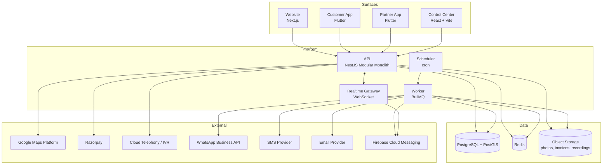

# 08 — System Architecture

| Field | Value |
|---|---|
| Document ID | AMM-SVC-DOC-08 |
| Version | 1.4 |
| Status | Approved for Design & Development |
| Owner | Engineering Lead |
| Classification | Internal — Confidential |
| Last Updated | 2026-10-21 |
| Depends On | `02`, `03`, `04`, `06`, `07` |

---

## 1. Architectural Goals

| # | Goal | How the architecture serves it |
|---|---|---|
| AG-1 | Launch fast in Odisha, scale to multi-state without a rewrite | Modular monolith with micro-ready boundaries; configuration over code for location, pricing, catalogue |
| AG-2 | Financial correctness above all | One pure, independently tested pricing/commission domain module; immutable snapshots and ledgers |
| AG-3 | Location-aware at every layer | PostGIS in the database; `branch_id` / `service_area_id` on every operational row; scope enforced in SQL |
| AG-4 | Four independent surfaces | Stateless API + CDN-hosted front ends; the API is the only stateful component |
| AG-5 | Operable on a 4 vCPU / 16 GB VPS | Monolith, managed Postgres, Redis, no service mesh, no Kubernetes, no per-service observability stack |
| AG-6 | No vendor lock-in on communications | Internal integration layer with adapter patterns for Maps, Payments, Telephony, WhatsApp, SMS, Email, Push |
| AG-7 | Safe to change | Contract-first APIs, immutable financial records, reversible migrations, feature flags |

---

## 2. Architecture Style

> **Decision: Modular Monolith with Micro-Ready Extraction Boundaries.**

### 2.1 Why not microservices (yet)

| Factor | Microservices | Modular monolith |
|---|---|---|
| Team size | Requires a platform team, per-service CI/CD, per-service observability | One team, one pipeline, one on-call |
| Operational cost on 4 vCPU / 16 GB | Container orchestration or ~8 deployables to babysit | 2–3 deployables |
| Transactional integrity | Requires sagas + eventual consistency for booking→invoice→commission | **Local ACID transaction** |
| Debugging | Distributed tracing mandatory | Stack traces + one database |
| Time to Phase 1 | Weeks of platform build before any user value | Days |
| Scale profile | Per-service scaling | Horizontal scaling of the whole API (sufficient to Phase 4) |

For a pre-scale marketplace, microservices convert *engineering time* (the scarcest resource) into
*operational overhead* before the business has validated demand. That is the wrong trade today.

### 2.2 Why not a naive monolith

A naive monolith becomes unmaintainable because of **accidental coupling**: a pricing rule writes
into a booking table, a controller knows about settlement, and a schema change touches eight
features. The fix is not microservices — it is **enforced module boundaries**.

### 2.3 The rule

> **Modularity is enforced by structure, not by intention.**

Each module owns its tables. Cross-module writes go through the owning module's public interface
or through a domain event. There are no shared ORM entities, no cross-module table joins in
application code, and no `common` grab-bag module.

### 2.4 Module Boundary Contract

| Rule | Statement |
|---|---|
| MB-01 | A module may **read** another module's tables only through a published read-model/view it declares as a dependency. |
| MB-02 | A module may **write** only its own tables. Cross-module writes use the owning module's application service or a domain event. |
| MB-03 | Cross-module dependencies are declared in `module.manifest.ts` and validated by an architecture test in CI. |
| MB-04 | Each module exposes a typed contract (`index.ts` barrel). Anything not exported is private. |
| MB-05 | Each module owns its migrations and its tables' lifecycle. |
| MB-06 | Modules communicate asynchronously for anything that can be deferred (notifications, analytics, settlement accrual, reporting). |
| MB-07 | Synchronous cross-module calls are permitted only when the caller genuinely needs an immediate answer (e.g. price quote at booking). |

---

## 3. System Context



---

## 4. Module Map

| # | Module | Responsibility | Owns (tables) | Depends on |
|---|---|---|---|---|
| 1 | `identity` | Authentication, OTP, sessions, refresh rotation | `users`, `user_roles`, `sessions`, `otp_requests` | — |
| 2 | `rbac` | Roles, permissions, scope assignment, policy evaluation | `roles`, `permissions`, `role_permissions`, `user_scopes` | identity |
| 3 | `organization` | States, cities, branches, partner orgs, zones, service areas, territory allocation | `states`, `cities`, `branches`, `partner_orgs`, `zones`, `service_areas`, `territory_allocations` | identity |
| 4 | `catalog` | Categories, services, variants, skills, price book entries, local overrides | `categories`, `services`, `service_variants`, `skills`, `price_book_entries`, `branch_price_overrides` | organization |
| 5 | `workflow` | Workflow templates, versions, instances, step execution, checklist items, evidence | `workflow_templates`, `workflow_versions`, `workflow_instances`, `workflow_steps`, `workflow_evidence` | catalog |
| 6 | `partner` | Technician onboarding, KYC, documents, availability, service-area pins, scoring | `technicians`, `technician_documents`, `technician_skills`, `technician_area_pins`, `technician_availability`, `technician_scores` | organization, catalog |
| 7 | `booking` | Booking lifecycle, offers, acceptance, assignment, reschedule, cancellation | `bookings`, `booking_offers`, `booking_events`, `booking_assignments` | catalog, workflow, partner, pricing |
| 8 | `pricing` | Price resolution, snapshots, coupon validation, tax computation | `price_snapshots`, `coupons`, `coupon_redemptions`, `tax_registrations`, `tax_rates` | catalog, organization |
| 9 | `billing` | Invoices, invoice lines, payments, refunds, adjustments | `invoices`, `invoice_lines`, `payments`, `refunds`, `adjustments` | booking, pricing |
| 10 | `commission` | Commission accrual, ledger, settlement generation, settlement lines, partner payouts | `commission_ledger`, `settlement_statements`, `settlement_lines`, `partner_payouts` | billing, pricing, organization |
| 11 | `support` | Call logs, support tickets, escalation, CSAT, complaint handling | `call_logs`, `support_tickets`, `ticket_events`, `csat_responses` | booking, identity |
| 12 | `notification` | Template registry, channel dispatch, preferences, delivery log | `notification_templates`, `notification_preferences`, `notification_deliveries` | — |
| 13 | `realtime` | Presence, technician location, booking status channels | `realtime_presence` (Redis only) | booking, partner |
| 14 | `reporting` | Read models, aggregates, report definitions, exports | `report_definitions`, `report_snapshots` | all (read-only) |
| 15 | `audit` | Immutable audit trail, hash chain, override log | `audit_events`, `audit_override_log` | — |
| 16 | `integration` | Adapters for Maps, Payments, Telephony, WhatsApp, SMS, Email, Push | `integration_outbox`, `webhook_inbox` | — |

> **Note on `pricing` vs `billing` vs `commission`.** These are three modules because they have three
> different owners (Product, Finance, Finance), three different change cadences, and three different
> risk profiles. `pricing` is a **pure** module with no I/O side effects — it is the single most
> heavily unit-tested component in the system.

---

## 5. Request & Data Flows

### 5.1 Booking Creation (write-heavy, transactional)

```
Client
  │ POST /v1/bookings  (Idempotency-Key)
  ▼
[Booking Module]
  ├─ 1. Validate service availability (catalog → organization)
  ├─ 2. Resolve location → service_area (PostGIS point-in-polygon)
  ├─ 3. Resolve price snapshot  ───────────► [Pricing Module] (pure)
  │      ├─ price book resolution (state → city → branch → override)
  │      ├─ coupon validation (scope, window, caps, funding)
  │      ├─ tax computation (place of supply, registration)
  │      └─ commission estimate (versioned rate)
  ├─ 4. Validate slot & candidate eligibility (partner module)
  ├─ 5. BEGIN TRANSACTION
  │      ├─ INSERT booking (status = REQUESTED)
  │      ├─ INSERT price_snapshot (immutable)
  │      ├─ INSERT booking_events
  │      └─ INSERT coupon_redemption (unique constraint)
  │    COMMIT
  ├─ 6. Dispatch offer (direct or feed)  ──► [notification] via outbox
  └─ 7. Return booking + price breakdown
```

**Critical property:** the snapshot, the booking and the coupon redemption are written in **one
database transaction**. A coupon can never be double-redeemed, and a booking can never exist
without a price snapshot.

### 5.2 Job Completion → Commission → Settlement

```
Technician taps "Complete"
  ▼
[Workflow Module] validates all mandatory steps + evidence
  ▼
[Billing Module]
  ├─ Build final invoice from snapshot + adjustments (single transaction)
  ├─ INSERT invoice + invoice_lines (gapless sequence)
  └─ Emit domain event: booking.completed
        │
        ├──► [Commission Module] (async worker)
        │      ├─ compute eligible labour per funding rules
        │      ├─ commission = eligible × rate (pinned version)
        │      ├─ INSERT commission_ledger (unique per booking)
        │      └─ bucket into the ISO-week accrual period
        │
        ├──► [Notification Module] → push / SMS / WhatsApp / email
        │
        └──► [Reporting Module] → refresh read models
```

Weekly (Monday, scheduled job):

```
[Commission Module]
  ├─ SELECT un-settled ledger entries for (partner_org, branch, ISO week)
  ├─ Build settlement statement + lines
  ├─ INSERT settlement (immutable) — unique (partner_org, branch, period)
  ├─ Generate commission invoice + GST (immutable, gapless number)
  └─ Enqueue notification + email delivery to the partner
```

### 5.3 Realtime Tracking

```
Technician app: POST /v1/technicians/me/location  (throttled: 15 s / 25 m)
  → API stores last position in Redis (fast path), persists to Postgres every 5 min
  → API publishes to Redis pub/sub channel booking:{id}:track
        ↓
Realtime Gateway (WebSocket) subscribes → pushes to subscribed customer devices
  → fallback: client polls GET /v1/bookings/:id/track
```

### 5.4 Support Call → Ticket

```
Telephony provider webhook (call.initiated / call.ivr.entered / call.routed)
  → Integration module: verify signature, dedupe by (provider_call_id, event)
  → Support module: upsert call_log
  → route via smart-routing rules → queue
  → agent console subscribes via WebSocket to the queue
```

---

## 6. Deployment Topology

### 6.1 Environments

| Environment | Purpose | Data | Hosting |
|---|---|---|---|
| `local` | Developer machine | Seeded | Docker Compose |
| `dev` | Integration | Synthetic | Shared VPS (small) |
| `staging` | Pre-release verification | Anonymised production clone | Shared VPS |
| `prod` | Live | Real | Production VPS |

> **These four rows are deploy targets, not the platform mode.** `38` defines a separate,
> database-resident state (`TESTING` / `PRODUCTION`) that decides whether data may be destroyed. The
> two are orthogonal and that is the hazard: `prod` infrastructure whose mode row is absent resolves to
> `TESTING` by `38` PM-03, i.e. the live deployment of the platform protecting none of its customers'
> data. `38` PM-04 makes that combination a refused boot rather than an discovered accident, and
> `20` §9 carries the disambiguation. Nothing in §6.1 is changed by this note; no environment listed
> here exists on this workspace.

### 6.2 Production (Phase 1–2 target)

```
                        ┌─────────────────────────────┐
   Cloudflare/DNS  ───► │  Caddy / Nginx (TLS, HTTP/2) │  ◄── static front ends via CDN
                        └──────────────┬──────────────┘
                                       │
                     ┌─────────────────┼─────────────────┐
                     ▼                 ▼                 ▼
              ┌────────────┐    ┌────────────┐    ┌────────────┐
              │ api (pm2)  │    │ worker     │    │ realtime   │
              │ 2 instances│    │ 1 instance │    │ 1 instance │
              └─────┬──────┘    └─────┬──────┘    └─────┬──────┘
                    │                 │                 │
                    └────────┬────────┴─────────────────┘
                             ▼
              ┌──────────────────────────────┐
              │  PostgreSQL 16 + PostGIS     │  (managed or self-hosted w/ PITR)
              │  Redis 7                     │
              │  Object storage (S3-compatible)│
              └──────────────────────────────┘
```

**Sizing (4 vCPU / 16 GB)**

| Component | vCPU | RAM | Notes |
|---|---:|---:|---|
| API (×2) | 1 each | 2 GB each | PM2 cluster |
| Worker | 1 | 2 GB | BullMQ concurrency tuned |
| Realtime | 0.5 | 1 GB | Socket.IO with Redis adapter |
| PostgreSQL | 1 | 6 GB | `shared_buffers=2GB`, `work_mem=16MB` |
| Redis | 0.5 | 2 GB | `maxmemory-policy allkeys-lru` for cache; AOF for queues |
| OS + monitoring | 0.5 | 1 GB | node_exporter, promtail, Loki |
| **Total** | **4.5** | **16 GB** | Slight overshoot → right-size to 4 vCPU / 16 GB with the API on 1.5 and Postgres on 1 |

> The initial VPS is a **floor, not a ceiling**. Phase 3 exit criteria require a load test proving
> the topology serves the Phase 3 target (`13` §2.3); if it does not, the database is moved to a
> managed instance and the API is scaled horizontally **before** any module is extracted.

### 6.3 Scale-Up Path

```
Phase 1–2:  1 VPS, monolith, managed or self-hosted Postgres
Phase 3:    Managed Postgres (or a second node + streaming replica)
            API scaled to 2–3 instances behind the load balancer
            Redis separated
Phase 4:    Extract `notification` and `reporting` as separate deployables (see §8)
            Extract `realtime` as a dedicated service
            CDN for all static assets and media
```

---

## 7. Cross-Cutting Concerns

| Concern | Approach |
|---|---|
| **Authentication** | OTP (customer/technician) → short-lived access JWT (15 min) + rotating refresh token. Central staff → OIDC/SSO. Enforced by an API gateway guard. |
| **Authorisation** | RBAC + scope guards applied in the API layer; scope predicates pushed into SQL. (`03` §6) |
| **Validation** | Schema-first validation at the boundary (DTO + OpenAPI). Business-rule validation in the domain layer. |
| **Errors** | A single error envelope with a stable machine code and a human message. (`10` §6) |
| **Transactions** | One transaction per use case, owned by the use-case's module. No distributed transactions. |
| **Idempotency** | `Idempotency-Key` on all `POST` endpoints that create money or bookings. Gateway callbacks deduped by provider reference. |
| **Concurrency** | Optimistic locking via a `version` column on `bookings`, `tickets`, `technician_availability`. |
| **Events** | Transactional **outbox** → BullMQ → consumers. Guarantees an event is published iff the transaction committed. |
| **Scheduling** | BullMQ repeatable jobs (settlement, document expiry, SLA timers, reports) with a distributed lock so only one instance runs each job. |
| **Caching** | Redis, TTL-based, with explicit invalidation on writes. Cache keys are namespaced by scope. Never cache a price computation longer than the price's effective window. |
| **Observability** | Structured JSON logs (pino) with `requestId`/`traceId`; OpenTelemetry traces; Prometheus metrics; Grafana dashboards; Loki logs. |
| **Audit** | Hash-chained `audit_events` for all state-changing operations on sensitive entities. (`13` §5) |
| **Files** | Object storage with presigned URLs; the API never proxies large binaries. |
| **Feature flags** | A `feature_flag` table evaluated server-side; flags can target a branch, a role or a percentage. **Not** the platform mode (`38`): a flag is an operator-switchable behaviour gate, the mode is a guarded, dual-controlled, audited database state (`20` §9 disambiguates the two). |
| **Localisation** | Message catalogues per locale; `en` / `or` / `hi`. |
| **Time** | All timestamps stored in UTC (`timestamptz`), rendered in the branch's `Asia/Kolkata` local time. |

---

## 8. Extraction Readiness

A module may be extracted to a separate service when **all** of the following are true:

| # | Gate | Test |
|---|---|---|
| ER-01 | The module owns its tables exclusively | No other module writes them |
| ER-02 | The module is entered only through its published contract | No direct table access from other modules |
| ER-03 | The module has no synchronous callers on the hot path, or its calls are already async | Dependency graph shows no synchronous inbound edge |
| ER-04 | The module's events are published on the bus | Consumers subscribe via event, not direct call |
| ER-05 | The module has independent load characteristics | Measured p95 latency/CPU justify separation |
| ER-06 | The module has a single writer | No concurrent writers to migrate |

### 8.1 Recommended Extraction Order

| Order | Module | Trigger |
|---|---|---|
| 1st | `reporting` | Read-heavy, scales independently, no transactional coupling |
| 2nd | `notification` | Already async; high I/O to external providers |
| 3rd | `realtime` | Connection-heavy, needs its own scaling profile |
| 4th | `integration` | Vendor adapters churn independently |
| 5th | `commission` | Only after multi-partner scale justifies the distributed-transaction cost |
| Never (v1) | `booking`, `pricing`, `billing` | These must stay in one transactional boundary |

### 8.2 Strangler-Fig Migration (When Triggered)

```
1. Extract the module's reads behind a contract interface in the monolith.
2. Move reads to a service; the monolith calls it via HTTP with a circuit breaker.
3. Migrate writes: dual-write to both, reconcile, then cut over.
4. Remove the monolith's tables (archived, read-only) after the reconciliation window.
```

---

## 9. Monorepo Layout

```
ammpal-service/
├── apps/
│   ├── api/                      # NestJS modular monolith
│   │   └── src/modules/{identity,rbac,organization,catalog,workflow,partner,
│   │                      booking,pricing,billing,commission,support,
│   │                      notification,realtime,reporting,audit,integration}/
│   ├── worker/                   # BullMQ workers (same package as api)
│   ├── web/                      # Next.js  — website
│   ├── control-center/           # React + Vite — admin dashboards
│   ├── customer-app/             # Flutter
│   └── partner-app/              # Flutter
├── packages/
│   ├── contracts/                # Shared DTOs, zod schemas, OpenAPI types
│   ├── design-tokens/            # Colour, spacing, typography (web + apps)
│   ├── config/                   # ESLint, TS, prettier, editorconfig
│   └── testing/                  # Test helpers, fixtures, factories
├── docs/                         # ← this directory
├── infra/                        # Terraform/Ansible, Docker, nginx, systemd
├── scripts/                      # codegen, migrations, seeds
└── .github/workflows/
```

**Rule ML-01** — `packages/contracts` contains **types and schemas only**. No business logic, no
framework imports. It is the contract between all surfaces.

> **Two open questions sit on this tree, and §9 resolves neither (`DEC-07`).** **`OD-DOC-38`
> `[BLOCKER]`** asks whether the framework above is NestJS at all: the owner's 2026-10-21 direction
> requests a FastAPI backend, `ADR-011` is **Accepted** and names NestJS, and the same tree is written
> into `14` §2 and `27` §6 as well. **`OD-DOC-39` `[IMPORTANT]`** is a divergence *between those three
> copies*: this section puts the BullMQ processors at a top-level `apps/worker/` marked "same package as
> api", while `14` §2 puts them at `apps/api/src/workers/`. `16` §5's deployable units and §6.3's
> extraction gate read differently depending on which copy an implementer opened first — which is exactly
> what `35`'s rule `PS-01` (this suite has **one** canonical tree, `14` §2, and every other rendering is
> a view of it) is written to prevent. Neither side was edited into the other. The **interiors** of
> `apps/web`, both Flutter apps, `control-center`, `design-tokens`, and the backend under either
> framework are documented in **`35`**; nothing in §9 was re-listed there, and nothing here was re-drawn.
>
> **Scaffold status, 2026-10-21 — and it is a finding, not a footnote.** On the owner's "scaffold as base on
> docs" the repository now holds **221 empty directories** (164 leaves, each with a `.gitkeep`; `README` §16) built from `14` §2 + `35`
> §3/§5–§8, which means the disk took the `OD-DOC-39` side **`14` §2** chose: the workers exist as
> `apps/api/src/workers/`, and the top-level `apps/worker/` drawn at §388 above **was not created**. That
> is `PS-01` operating as designed — one canonical tree, the others views of it — but it is *de facto*, not
> decided: `OD-DOC-39` stays open, §9 above stays as issued (`DEC-07`), and the empty folder is reversible
> with a `mv` because nothing imports it yet. Same for `OD-DOC-38`: the skeleton is `ADR-011`'s NestJS
> shape because that is the only **Accepted** backend decision, not because the FastAPI instruction was
> withdrawn.

**Rule ML-02** — The two Flutter apps share a `packages/contracts`-derived API client. Generated from
the OpenAPI document, never hand-written.

---

## 10. Caching Strategy

| Data | Cache | TTL | Invalidation |
|---|---|---|---|
| Service catalog (public) | Redis | 30 min | On publish |
| Price book (by geography) | Redis | 10 min | On price change |
| Branch/service-area tree | Redis | 1 h | On territory change |
| Technician candidate list (by service + area) | Redis | 2 min | On availability change |
| Customer profile | Redis | 5 min | On profile update |
| Booking detail | Redis | 30 s | On status change |
| Tax registrations | Redis | 1 h | On registration change |
| Tracking positions | Redis | 60 s | Continuous overwrite |

**Rule CS-01** — A price is **never** served from cache when computing a new booking snapshot. The
snapshot is always computed from the source of truth to guarantee the customer is never quoted a
stale price.

---

## 11. API Conventions (Summary — full in `10`)

| Aspect | Convention |
|---|---|
| Base path | `/v1` |
| Style | REST + JSON; long-lived resources |
| Auth | `Authorization: Bearer <JWT>` |
| Idempotency | `Idempotency-Key` header on `POST` creates |
| Pagination | Cursor-based (`?cursor=&limit=`) |
| Errors | RFC 7807-inspired envelope with a stable `code` |
| Real-time | WebSocket `/ws` with a subscription handshake |
| Docs | OpenAPI 3.1 generated from decorators; published at `/docs` (internal) and `/openapi.json` |
| Versioning | URL major version; additive changes only within a major |

---

## 12. Open Points

| ID | Question | Owner | Deadline |
|---|---|---|---|
| OD-08-01 | Self-hosted PostgreSQL vs managed (RDS/Razorpay/Supabase) for the production database? Managed is preferred for RPO but costs more. | Engineering + Founder | Phase 0 |
| OD-08-02 | Is the Control Center a separate SPA, or served inside the Next.js website under `/admin`? Separate SPA is cleaner; a single app is simpler to deploy. | Engineering | Phase 0 |
| OD-08-03 | Do we need multi-region (e.g. Mumbai + Delhi) for the API in Phase 4, or single-region with a standby? | Engineering | Phase 3 |
| OD-08-04 | Should technician live location be persisted at 5-minute intervals, or only in Redis for the duration of the job? | Engineering + Privacy | Phase 1 |
| OD-08-05 | Which object storage — S3-compatible (MinIO on the same VPS) or a managed provider? | Engineering | Phase 0 |

---

## Revision History

| Version | Date | Author | Summary | Sections changed |
|---|---|---|---|---|
| 1.4 | 2026-10-21 | Architect (scaffold and git-baseline pass) | Scaffold and git-baseline pass, same date: the owner directed a folder structure and a `git init`, so the tree above was created on disk and the workspace became a git repository on branch `main` at baseline commit `0cc6910`. §9 now carries a **"Scaffold status, 2026-10-21 — and it is a finding, not a footnote"** note: the 221 directories are empty (`.gitkeep` in the 164 leaves only), nothing in them builds, so `P0-03` is unmet; and the disk sided with `14` §2 — `apps/api/src/workers/` exists, `apps/worker/` does not — which is a **de facto state, not a decision**, so `OD-DOC-39` stays open at `[IMPORTANT]` and `OD-DOC-38` stays open at `[BLOCKER]`. **No component, boundary, port or deployable was changed, added or renamed, and §9’s tree was not redrawn.** | §9 |
| 1.3 | 2026-10-21 | Architect (platform-mode pass) | A distinction the architecture had not drawn: **an environment is a deploy target and a mode is database state**, and the two can disagree. §6.1's environment table gained a blockquote recording that a `prod` deployment can legitimately resolve `TESTING`, and that when it does, the delete guard is **unarmed** while live data is present — the hazard `38` §10 and `19` `R-49` score. §7's feature-flag row now separates flags (per-tenant, per-release, safely toggleable) from the platform mode (one value for the whole deployment, changed only through an audited ceremony), because a reader who conflates them will build the guard as a flag and lose the property the owner asked for. **No component, boundary, port or deployable was changed, added or renamed.** | §6.1, §7 |
| 1.2 | 2026-10-21 | Engineering Lead + Architect (design-engineering structure pass) | §9’s tree was **annotated, not redrawn** (`DEC-07`): a note now names the two open questions sitting on it — `OD-DOC-38` `[BLOCKER]`, because the owner’s 2026-10-21 direction asks for a FastAPI backend while `ADR-011` is Accepted and names NestJS, and `OD-DOC-39` `[IMPORTANT]`, because **this section puts the BullMQ workers at a top-level `apps/worker/` where `14` §2 puts them at `apps/api/src/workers/`** — and it says which reading `16` §5 and §6.3 each imply. No module, boundary, port, dependency arrow or deployable was changed; the 16 modules are still the 16 modules; and the note points at `35` for the **interior** of every surface instead of drawing a fourth tree. The suite’s canonical layout is `14` §2 by rule `PS-01`, which exists because these three copies were triplicated before anybody noticed they disagreed. | §9, Revision History, header |
| 1.1 | 2026-10-21 | Product Lead + Engineering Lead | Documentation audit and consolidation. Recorded the VPS planning envelope and the backup-storage separation; cross-referenced the ADRs, the extraction gates and the two-layer booking model. | All |
| 1.0 | 2026-10-21 | Product Lead | Initial issue. | All |
