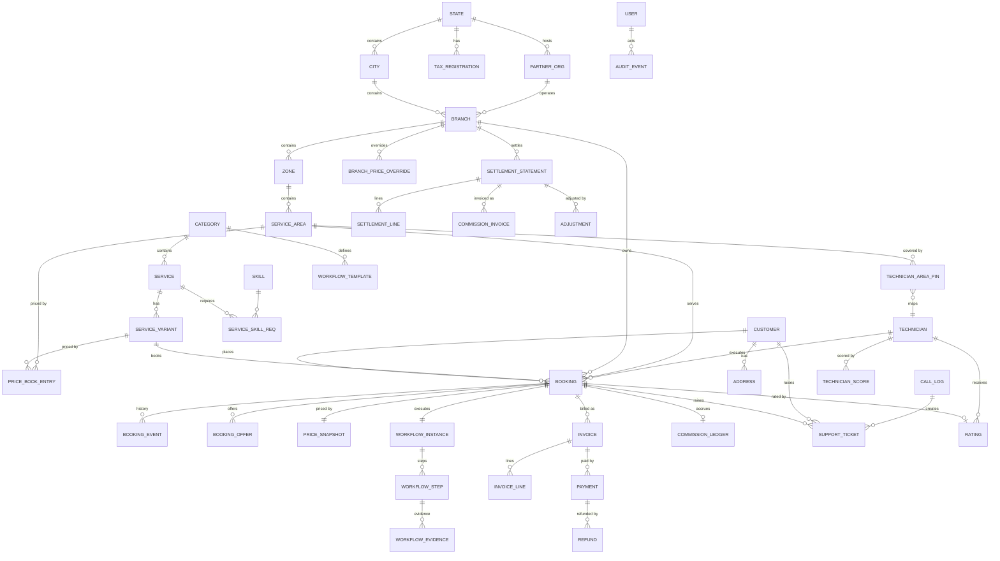

# 09 — Data Model

| Field | Value |
|---|---|
| Document ID | AMM-SVC-DOC-09 |
| Version | 1.5 |
| Status | Approved for Design & Development |
| Owner | Engineering Lead + Data Lead |
| Classification | Internal — Confidential |
| Last Updated | 2026-10-21 |
| Depends On | `02`, `03`, `04`, `06`, `07`, `10`, `13`, `23`, `24` |
| Database | PostgreSQL 16 + PostGIS 3.4 |

---

## 1. Conventions

| Aspect | Rule |
|---|---|
| Naming | `snake_case` for tables, columns and indexes. Plural for collections, singular for entities. |
| Primary key | `id UUID PRIMARY KEY DEFAULT gen_random_uuid()` (UUIDv4). Public-facing codes are separate, human-readable columns. |
| Money | `BIGINT` minor units (paise). Column names end with `_paise` or are in a `*_amount` context where the unit is documented. **Never `FLOAT`, `REAL` or `NUMERIC` for money.** |
| Rates | `INTEGER` basis points (1500 = 15.00%). Column names end with `_bps`. |
| Time | `TIMESTAMPTZ`, stored UTC. Business dates are `DATE` (India local). |
| Soft delete | `deleted_at TIMESTAMPTZ NULL` on business entities; `is_active BOOLEAN` on configuration entities. |
| Record origin | `record_origin` — `TEST` or `LIVE`, stamped on insert from the platform mode, write-once (`38` PM-12/PM-13, Rule DB-30). Present on transaction tables so that test data held in the live schema can be excluded from reporting, settlement and invoicing. |
| Optimistic lock | `version INTEGER NOT NULL DEFAULT 1` on mutable aggregates. |
| Audit columns | `created_at`, `updated_at`, `created_by`, `updated_by` on every business table. |
| Tenancy | `branch_id UUID` on every operational table (see §3). |
| JSONB | Used only for: price snapshots, workflow template definitions, localised labels, extensible attributes. Never for queryable business fields. |
| Enums | Native PostgreSQL `ENUM` types where the value set is closed and stable; lookup tables where it may grow. |
| Indexes | Every FK indexed. Partial indexes on hot filters (e.g. `WHERE status = 'REQUESTED'`). |
| Migrations | Forward-only, reversible, one per module, applied via `prisma migrate`/`node-pg-migrate` in CI. |

---

## 2. Tenancy Strategy

**Single database, shared schema, discriminated by `branch_id`.**

| Rationale | Detail |
|---|---|
| Simplicity | One backup, one restore, one migration path, one connection pool. |
| Transactional integrity | Booking → invoice → commission accrue in **one** transaction. |
| Cross-branch queries | Analytics and finance reporting need cross-branch reads — trivial in a single schema. |
| Scale | Adequate to Phase 4 (see `13` §2.3). Partitioning by `branch_id` is the documented escape hatch. |

**Isolation is enforced by the application + database:**
1. Every scoped query filters by the caller's scope (`03` §6, SEC-02).
2. `branch_id` has a **not-null** constraint and a FK on operational tables.
3. PostgreSQL **Row-Level Security** is enabled on the most sensitive tables (settlement, commission ledger, invoice) as defence-in-depth. `[PROPOSED]` — see OD-09-01.

---

## 3. Core ERD

---

## 4. Entity Catalogue

### 4.1 Organization

#### `states`
| Column | Type | Notes |
|---|---|---|
| `id` | UUID PK | |
| `code` | VARCHAR(2) UNIQUE | `OD`, `WB`, `MH` |
| `name` | VARCHAR(80) | |
| `name_local` | VARCHAR(80) | Local-language name |
| `gstin` | VARCHAR(15) | Platform's GST registration in this state |
| `is_active` | BOOLEAN | |
| `created_at` / `updated_at` | TIMESTAMPTZ | |

#### `cities`
| Column | Type | Notes |
|---|---|---|
| `id` | UUID PK | |
| `state_id` | UUID FK → states | |
| `code` | VARCHAR(3) | `BBI`, `CTC`, `PUR` — unique per state |
| `name`, `name_local` | VARCHAR | |
| `latitude`, `longitude` | NUMERIC(9,6) | City centroid for distance fallback |
| `geo_polygon` | GEOGRAPHY(POLYGON, 4326) | Optional city boundary |
| `is_active` | BOOLEAN | |

#### `partner_orgs`
| Column | Type | Notes |
|---|---|---|
| `id` | UUID PK | |
| `code` | VARCHAR(16) UNIQUE | `PT-OD-0042` |
| `name` | VARCHAR(160) | Legal entity name |
| `legal_name`, `pan`, `gstin` | VARCHAR | |
| `contact_name`, `contact_email`, `contact_phone` | VARCHAR | |
| `bank_account_encrypted` | BYTEA | Encrypted at rest; decrypt only in the payout module |
| `settlement_cycle` | ENUM | `WEEKLY` (default), `BIWEEKLY`, `MONTHLY` |
| `commission_contract_ref` | VARCHAR | Contract reference |
| `status` | ENUM | `PENDING`, `ACTIVE`, `SUSPENDED`, `CLOSED` |
| `approved_by`, `approved_at` | UUID, TIMESTAMPTZ | Operator/Super Admin |
| `created_at` / `updated_at` / `created_by` / `updated_by` | | |

#### `branches`
| Column | Type | Notes |
|---|---|---|
| `id` | UUID PK | |
| `code` | VARCHAR(24) UNIQUE | `OD-BBI-001`, `PT-OD-0042` |
| `name` | VARCHAR(120) | |
| `type` | ENUM | `COMPANY` \| `PARTNER` |
| `partner_org_id` | UUID FK NULL | Required when `type = PARTNER` |
| `legal_entity_id` | UUID FK NOT NULL | **The invoicing party. A branch holds no GST identity of its own** (`ADR-003`, BR-09) |
| `city_id`, `state_id` | UUID FK | |
| `timezone` | VARCHAR(64) | Default `Asia/Kolkata` |
| `status` | ENUM | `PENDING`, `ACTIVE`, `INACTIVE`, `CLOSED` |
| `approved_by`, `approved_at` | UUID, TIMESTAMPTZ | |
| `settings` | JSONB | Category enablement, SLA overrides, advance rules |
| **CHECK** | | `(type = 'PARTNER') = (partner_org_id IS NOT NULL)` |

> **Rule DB-13** — `branches` has **no** `gstin` column. Tax identity lives on
> `tax_registrations`, which belongs to a legal entity and a state.

#### `legal_entities`
| Column | Type | Notes |
|---|---|---|
| `id` | UUID PK | |
| `code` | VARCHAR(24) UNIQUE | `LE-PLAT-001`, `LE-OD-0042` |
| `name` | VARCHAR(160) | Display name |
| `legal_name` | VARCHAR(200) | Registered legal name as per the tax record |
| `entity_type` | ENUM | `PLATFORM` \| `PARTNER_ORG` |
| `pan` | VARCHAR(10) | Encrypted at rest |
| `bank_account_encrypted` | BYTEA | Decrypt only in the payout module |
| `address_line1`, `address_line2`, `city`, `state_id`, `pincode` | | Registered address |
| `status` | ENUM | `PENDING`, `ACTIVE`, `SUSPENDED`, `CLOSED` |
| audit cols | | |

#### `tax_registrations`
| Column | Type | Notes |
|---|---|---|
| `id` | UUID PK | |
| `legal_entity_id` | UUID FK | The registration holder |
| `state_id` | UUID FK | The state of registration |
| `gstin` | VARCHAR(15) | |
| `tax_rate_bps` | INT | Default rate for this registration |
| `is_ecommerce` | BOOLEAN | E-commerce operator obligations flag |
| `effective_from` | TIMESTAMPTZ | |
| `effective_to` | TIMESTAMPTZ NULL | |
| **UNIQUE** | | `(legal_entity_id, state_id)` where `effective_to IS NULL` |

> **Rule DB-14** — The **supplier resolution** for a customer invoice is:
> `booking.branch_id` → `branches.legal_entity_id` → `tax_registrations` for the **place of supply**
> (the customer's state). If no active registration exists, the invoice **cannot be issued** —
> a hard block, not a warning (`ADR-003-05`). The resolved `legal_entity_id` and
> `tax_registration_id` are written onto the invoice and are immutable thereafter.

#### `zones`
`id`, `code` (unique), `name`, `branch_id` FK, `geo_polygon` GEOGRAPHY, `capacity_target` INT, `is_active`, audit cols.

#### `service_areas`
| Column | Type | Notes |
|---|---|---|
| `id` | UUID PK | |
| `code` | VARCHAR(32) UNIQUE | `OD-BBI-001-Z03-A02` |
| `name` | VARCHAR(120) | |
| `zone_id` | UUID FK | |
| `branch_id` | UUID FK | Denormalised for scoping (see §5) |
| `geo_polygon` | GEOGRAPHY(POLYGON, 4326) | GIST indexed |
| `radius_km` | NUMERIC(5,2) | Alternative coverage model |
| `is_active` | BOOLEAN | |

#### `territory_allocations`
`id`, `service_area_id`, `branch_id`, `valid_from`, `valid_to`, `allocated_by`, `override_reason` NULL, `is_overridden` BOOL.
**UNIQUE** on `service_area_id` where `valid_to IS NULL` (one live owner per area).

### 4.2 Identity & Access

#### `users`
`id`, `phone` (unique, E.164), `email`, `password_hash` NULL (central staff), `full_name`, `avatar_url`,
`account_type` ENUM(`CUSTOMER`,`TECHNICIAN`,`INTERNAL`,`PARTNER_BRANCH`,`CREW`),
`status` ENUM(`PENDING`,`ACTIVE`,`SUSPENDED`,`LOCKED`,`DEACTIVATED`),
`customer_id` NULL, `technician_id` NULL, `last_login_at`, `failed_attempts`, `locked_until`,
audit cols.

> A `users` row is the **login**. `customers` and `technicians` are the **business profiles**.
> This separation lets an internal user, a customer and a technician share a phone number safely.

#### `user_roles`
`user_id` FK, `role_code` ENUM, `assigned_by`, `assigned_at`, `reason` — PK `(user_id, role_code)`.

#### `user_scopes`
`user_id` FK, `scope_type` ENUM(`GLOBAL`,`STATE`,`BRANCH`,`SERVICE_AREA`,`SELF`), `state_id`/`branch_id`/`service_area_id` NULL, `role_code` — PK `(user_id, role_code, scope_type)`.

#### `roles` / `permissions` / `role_permissions`
`roles(code PK, name, description, is_system, is_active)`.
`permissions(code PK, domain, resource, action, description)`.
`role_permissions(role_code FK, permission_code FK)` — PK composite.

#### `otp_requests`
`id`, `phone`, `purpose` ENUM(`LOGIN`,`VERIFY`,`SENSITIVE_ACTION`), `code_hash`, `attempts`, `expires_at`, `consumed_at`, `ip`, `created_at`.
**INDEX** on `(phone, created_at DESC)` for rate limiting.

#### `sessions`
`id`, `user_id`, `refresh_token_hash`, `family_id` UUID, `device_id`, `ip`, `user_agent`, `expires_at`, `revoked_at`, `created_at`.

> `family_id` is what makes the `13` §5.1 reuse-detection rule implementable: a refresh token is
> rotated on use and every successor carries the **same** `family_id`. Presenting a token that is
> already rotated (a replay) revokes every `sessions` row with that `family_id`, which is the whole
> force-log-out-the-device action. Without the family key the rule can only revoke the one row it
> saw, and a stolen token stays valid on the rest of the family. **INDEX** `(family_id) WHERE
> revoked_at IS NULL`.

### 4.3 Catalog & Pricing

> **There is no media column in this section, and no document says how an approved image would be served.** `categories`, `services` and `service_variants` below carry `name_local`, price and commission fields but nothing that references an asset, so `31`’s category and service imagery has nowhere to be pointed at from the API. The two halves of that gap are storage (`09` has no §4.3 media field or media table) and delivery (`13` §5.2 sets `img-src 'self'`, `16` §5.2 routes `www.` to a static bundle, and `24` §11 forbids any publicly readable bucket, prefix or object — so a signed-URL design and a same-origin static design are both consistent with the documents and they are not the same design). Registered as `OD-DOC-26`; **no table, column or type was added here**, because inventing a schema field would look like a decision. `OD-DOC-34` `[BLOCKER]` now compounds this: the owner has asked for Cloudinary as **primary** media storage with several providers selectable by a super admin, which needs at minimum somewhere to hold a provider identifier, an object or public ID and a version per media row, plus a store for provider **credential references only** (never a secret — `14` `ENV-03` puts production secrets in the server's secret store or vault, and `16` §5.6's backup table treats that vault as snapshotted-on-change and retained 12 months). None of that exists in §4 or anywhere else in this document, and none of it has been added: designing a media table before `OD-DOC-34` closes would bake one of the two competing delivery designs into the schema. The `24` §11 and `13` §5.2 sides of the conflict are annotated there (`DEC-07`).

#### `categories`
`id`, `code` UNIQUE, `name`, `name_local`, `workflow_family`, `default_commission_bps`, `requires_parts` BOOL, `is_active`, audit cols.

#### `services`
`id`, `category_id` FK, `code` UNIQUE, `name`, `name_local`, `description`, `requires_diagnosis` BOOL, `default_advance_pct` INT, `warranty_days` INT, `is_active`, audit cols.

#### `service_variants`
`id`, `service_id` FK, `code` UNIQUE, `name`, `attributes` JSONB, `is_active`, audit cols.

#### `skills`
`id`, `code` UNIQUE, `name`, `category_id` FK, `max_level` INT (default 4).

#### `service_skill_requirements`
`service_id` FK, `skill_id` FK, `min_level` INT — PK `(service_id, skill_id)`.

#### `price_book_entries`
| Column | Type | Notes |
|---|---|---|
| `id` | UUID PK | |
| `service_variant_id` | UUID FK | |
| `scope_type` | ENUM | `STATE` \| `CITY` \| `ZONE` \| `SERVICE_AREA` |
| `scope_id` | UUID FK | Polymorphic reference |
| `min_paise`, `max_paise`, `default_paise` | BIGINT | |
| `visiting_charge_paise` | BIGINT | |
| `diagnostic_charge_paise` | BIGINT | |
| `transport_charge_paise` | BIGINT | |
| `parts_pricing_rule` | ENUM | `MRP` \| `ALLOWED_MARGIN` |
| `parts_margin_bps` | INT | |
| `effective_from` | TIMESTAMPTZ | |
| `effective_to` | TIMESTAMPTZ NULL | |
| **CHECK** | | `min_paise <= default_paise AND default_paise <= max_paise` |
| **EXCLUDE** | | GiST exclusion on `scope_id` with `tstzrange(effective_from, effective_to)` to prevent overlapping windows |

#### `branch_price_overrides`
`id`, `branch_id` FK, `service_variant_id` FK, `price_paise` BIGINT, `visiting_charge_paise` NULL, `diagnostic_charge_paise` NULL, `effective_from`, `effective_to` NULL, `set_by`, `reason` NULL.
**CHECK** — enforced by trigger against the active price book band → `PRICE_OUT_OF_RANGE`.

#### `coupons`
| Column | Type | Notes |
|---|---|---|
| `id` | UUID PK | |
| `code` | VARCHAR(24) UNIQUE | `AMM-PLAT-8FK2M` |
| `funding_type` | ENUM | `PLATFORM` \| `PARTNER` \| `SHARED` |
| `funding_entity_id` | UUID NULL | Partner org for partner-funded |
| `scope_type` / `scope_id` | | Where it applies |
| `category_id` / `service_id` / `service_variant_id` | FK NULL | Applicability filters |
| `discount_type` | ENUM | `FLAT` \| `PERCENT` |
| `discount_value` | BIGINT / INT | Flat in paise, percent in bps |
| `min_order_paise`, `max_discount_paise` | BIGINT | Bounds |
| `valid_from`, `valid_to` | TIMESTAMPTZ | |
| `max_uses_total`, `max_uses_per_technician`, `max_uses_per_customer` | INT NULL | |
| `reserved_count` | INT NOT NULL DEFAULT 0 | Live reservations held by `coupon_reservations`; **CHECK** `>= 0` |
| `used_count` | INT NOT NULL DEFAULT 0 | Completed redemptions; **CHECK** `>= 0` |
| **CHECK** | | `reserved_count + used_count <= max_uses_total` when `max_uses_total IS NOT NULL` |
| `requires_technician_optin` | BOOL | |
| `stackable` | BOOL | Default false |
| `partner_allocation_bps` | INT | For `SHARED` funding |
| `affects_commission_base` | BOOL | Derived from funding type; stored for query efficiency |
| `status` | ENUM | `DRAFT`\|`ACTIVE`\|`PAUSED`\|`EXPIRED` |
| `created_by` | UUID | |

#### `coupon_redemptions`
`id`, `coupon_id` FK, `booking_id` FK, `customer_id` FK, `technician_id` FK, `branch_id` FK, `discount_paise`, `funding_type`, `created_at`.
**UNIQUE** on `booking_id` (one coupon per booking) and `(coupon_id, technician_id, customer_id)` where applicable.

#### `tax_registrations`

**Defined once in §4.1** (`legal_entity_id` + `state_id`, `UNIQUE (legal_entity_id, state_id)` where
`effective_to IS NULL`). An earlier draft of this section carried a second, polymorphic definition
(`entity_type` ∈ `PLATFORM|PARTNER_ORG|BRANCH` with a generic `entity_id`); it is **removed** because
it violates Rule DB-13, cannot enforce the open-interval uniqueness, and lets a branch carry an
implied tax identity.

A partner organisation carries its own tax identity the same way: `legal_entities.entity_type` includes
`PARTNER_ORG` (§4.1), so a partner org that is a supplier in its own right gets a `legal_entities` row
and therefore a `tax_registrations` row through the normal FK. **A branch never does** — `ADR-003`
removes that possibility, and `Rule DB-13` removes the column. Which party is tax-identified on the
commission invoice still depends on `OD-07-03` (principal or agent) and `OD-COM-05` (contracting
counterparty) and stays `[OPEN]`; what is settled is that the answer is expressed by adding
`legal_entities` rows, never by weakening this table.

#### `tax_rates`
`id`, `scope_type`/`scope_id`, `category_id` NULL, `rate_bps`, `tax_type` ENUM(`CGST`,`SGST`,`IGST`), `effective_from`, `effective_to` NULL, `is_active`.

### 4.4 Partners & Technicians

#### `technicians`
| Column | Type | Notes |
|---|---|---|
| `id` | UUID PK | |
| `code` | VARCHAR(32) UNIQUE | `TECH-OD-BBI-001-0132` |
| `user_id` | UUID FK | Login link |
| `branch_id` | UUID FK | **Home branch** (registration authority) |
| `partner_org_id` | UUID FK NULL | For partner-branch technicians |
| `full_name`, `photo_url`, `bio` | | |
| `phone`, `email` | | |
| `experience_years` | INT | |
| `verification_state` | ENUM | `DRAFT`,`PENDING_VERIFICATION`,`APPROVED`,`REJECTED`,`ACTIVE`,`INACTIVE`,`SUSPENDED` |
| `rating_avg` | NUMERIC(3,2) | Denormalised cache; source is `ratings` |
| `jobs_completed` | INT | Denormalised cache |
| `accepting_jobs` | BOOL | |
| `max_jobs_per_day` | INT | Capacity |
| `current_lat`, `current_lng` | NUMERIC(9,6) | Live position cache |
| `current_location_updated_at` | TIMESTAMPTZ | |
| `is_verified` | BOOL | Badge |
| `status` | ENUM | `ACTIVE`,`INACTIVE`,`SUSPENDED`,`DEACTIVATED` |
| audit cols | | |

#### `technician_documents`
`id`, `technician_id` FK, `doc_type` ENUM(`AADHAAR`,`PAN`,`GST_CERTIFICATE`,`POLICE_VERIFICATION`,`ADDRESS_PROOF`,`BANK_ACCOUNT`,`QUALIFICATION`,`OTHER`), `file_url`, `document_number_encrypted`, `issued_on`, `expires_on` NULL, `verification_state` ENUM(`PENDING`,`VERIFIED`,`REJECTED`), `verified_by`, `verified_at`, `rejection_reason`.

#### `technician_skills`
`technician_id` FK, `skill_id` FK, `level` INT (1–4), `verified_by` NULL, `verified_at` NULL — PK `(technician_id, skill_id)`.

#### `technician_area_pins`
`id`, `technician_id` FK, `service_area_id` FK, `pin_type` ENUM(`POLYGON`,`RADIUS`), `radius_km` NULL, `is_primary` BOOL, `approved_by`, `approved_at`, audit cols.

#### `technician_availability`
`id`, `technician_id` FK, `day_of_week` INT 0–6, `start_time`, `end_time`, `slot_minutes` INT, `is_active`. Unique `(technician_id, day_of_week, start_time)`.

#### `technician_time_off`
`id`, `technician_id` FK, `starts_at`, `ends_at`, `reason`, `created_by`.

#### `technician_scores`
`id`, `technician_id` FK, `period` (YYYY-MM), `rating_component`, `completion_rate`, `punctuality_rate`, `acceptance_rate`, `complaint_count`, `penalty_count`, `final_score` NUMERIC(5,2), `computed_at`.
**UNIQUE** on `(technician_id, period, rating_component)`.

### 4.5 Customers

#### `customers`
`id`, `code`, `user_id` FK UNIQUE, `full_name`, `email`, `phone`, `avatar_url`, `dob` NULL, `gender` ENUM NULL, `customer_score` NUMERIC(5,2) DEFAULT 0, `is_blocked` BOOL, `marketing_optin` BOOL, `created_at`.

#### `addresses`
`id`, `customer_id` FK, `label` (`HOME`,`WORK`,`OTHER`), `line1`, `line2`, `landmark`, `city_id` FK, `state_id` FK, `pincode`, `latitude`, `longitude`, `service_area_id` FK NULL, `is_default`, audit cols.

### 4.6 Booking

#### `bookings`
| Column | Type | Notes |
|---|---|---|
| `id` | UUID PK | |
| `code` | VARCHAR(24) UNIQUE | `AMM-20261021-K7M2QX` |
| `customer_id` | UUID FK | |
| `branch_id` | UUID FK | **Fixed at creation** (`02` JD-02) |
| `service_area_id` | UUID FK | |
| `service_variant_id` | UUID FK | |
| `category_id` | UUID FK | Denormalised for reporting |
| `technician_id` | UUID FK NULL | Null until accepted |
| `status` | ENUM | `REQUESTED`,`ACCEPTED`,`EN_ROUTE`,`STARTED`,`COMPLETED`,`CLOSED`,`CANCELLED_BY_CUSTOMER`,`CANCELLED_BY_TECHNICIAN`,`REJECTED`,`EXPIRED`,`NO_SHOW`,`RESCHEDULED`,`REFUND_PENDING`,`REFUNDED`,`DISPUTED` |
| `status_code` | SMALLINT | The canonical numeric code (1–15) |
| `phase` | VARCHAR(32) | The **inner phase** of the two-layer model (`ADR-002`): `AWAITING_ADVANCE_PAYMENT`, `AWAITING_PARTNER`, `CONFIRMED`, `PARTNER_EN_ROUTE`, `ARRIVED`, `DIAGNOSIS`, `AWAITING_CUSTOMER_APPROVAL`, `IN_PROGRESS`, `AWAITING_PAYMENT`, `RATING_PENDING`, `REVIEWED`, `REASSIGNING`, `SUSPENDED` |
| `phase_code` | SMALLINT | Canonical numeric phase, for the client contract |
| `source` | ENUM | `APP`,`WEB`,`CALL`,`ADMIN`,`COORDINATOR` |
| `address_snapshot` | JSONB | Immutable copy of the address at booking |
| `address_geo` | GEOGRAPHY(POINT,4326) | Immutable geo point |
| `scheduled_start`, `scheduled_end` | TIMESTAMPTZ | |
| `actual_start`, `actual_end` | TIMESTAMPTZ | |
| `customer_notes` | TEXT | |
| `internal_notes` | TEXT | |
| `cancelled_reason` | TEXT NULL | |
| `cancellation_penalty_paise` | BIGINT DEFAULT 0 | |
| `refund_paise` | BIGINT DEFAULT 0 | |
| `reschedule_count` | INT DEFAULT 0 | |
| `technician_change_count` | INT DEFAULT 0 | |
| `rating_prompted_at` | TIMESTAMPTZ NULL | |
| `parent_booking_id` | UUID FK NULL | Rebooking link |
| `warranty_days` | SMALLINT NULL | Copied from `services.warranty_days` at completion. `01` FR-JOB-08 requires the warranty to be "stored on the booking" and shown to the customer; a snapshot of the window belongs to the job, not to the catalogue row, which can be edited afterwards. |
| `warranty_expires_at` | TIMESTAMPTZ NULL | `actual_end + warranty_days`, computed once at completion and then immutable, like every other snapshot on this row. |
| `is_warranty_job` | BOOL DEFAULT false | `06` Rule `PR-03` makes a warranty visit commission-free and pays the technician a flat fee; that exception cannot be evaluated without a flag on the booking. `[PROPOSED]` — the flat fee itself is `OD-06-*` territory. |
| `version` | INT DEFAULT 1 | Optimistic lock |
| audit cols | | |

**Indexes**
- `idx_bookings_status_branch (status, branch_id, created_at DESC)`
- `idx_bookings_customer (customer_id, created_at DESC)`
- `idx_bookings_technician_open (technician_id, scheduled_start) WHERE status IN ('ACCEPTED','EN_ROUTE','STARTED')`
- `idx_bookings_service_area_open (service_area_id, category_id) WHERE status = 'REQUESTED'`
- `idx_bookings_phase_awaiting_partner (service_area_id, category_id, created_at) WHERE status = 'REQUESTED' AND phase_code IN (<AWAITING_PARTNER>, <REASSIGNING>)` — the dispatch and reoffer sweep
- GIST on `address_geo`
- `idx_bookings_address_trgm GIN ( (address_snapshot->>'line1') gin_trgm_ops )` — a trigram expression index on the immutable JSONB address copy; `pg_trgm` must be enabled in the migration. Prefix matching is useless here because a customer types a landmark, not the start of the line

> **Rule DB-29** — `status` and `phase` are **both** stored, because `ADR-002` defines a two-layer
> model and `23` §3 writes every one of the 37 transitions as `(from status, from phase) → (to status,
> to phase)`. A schema that stores only `status` cannot express `T-02`, `T-12`–`T-16`, `T-21` or `T-35`,
> which all change the phase while leaving the status alone — and `T-35` (suspend) explicitly must not
> change the status. The pair is validated against the transition table by the same architecture test
> that enforces `23` §3, and `phase` is written in the same transaction as the `booking_events` row.

#### `booking_events`
`id`, `booking_id` FK, `seq` INT, `from_status`, `to_status`, `event_type`, `actor_type` ENUM(`CUSTOMER`,`TECHNICIAN`,`SYSTEM`,`STAFF`,`GATEWAY`), `actor_id`, `reason_code`, `metadata` JSONB, `created_at`.
**UNIQUE** on `(booking_id, seq)` — the audit trail of the state machine.

#### `booking_offers`
`id`, `booking_id` FK, `technician_id` FK, `offer_type` ENUM(`DIRECT`,`FEED`), `rank` INT, `distance_km` NUMERIC(6,2), `offered_at`, `expires_at`, `responded_at`, `response` ENUM(`PENDING`,`ACCEPTED`,`REJECTED`,`EXPIRED`), `reject_reason`, `offered_earning_paise`, `offered_visit_time`.

#### `booking_assignments`
`id`, `booking_id` FK, `technician_id` FK, `assigned_at`, `unassigned_at` NULL, `reason` NULL, `sequence` INT.
Historical assignment chain (supports technician changes).

#### `booking_adjustments`
`id`, `booking_id` FK, `type` ENUM(`PARTS_ACTUAL`,`TECH_CHANGE_FEE`,`LATE_CANCEL_PENALTY`,`DIAGNOSTIC`,`POST_DISCOUNT`,`WARRANTY_ADJUSTMENT`,`OTHER`), `amount_paise`, `affects_commission_base` BOOL, `reason`, `created_by`, `created_at`.

### 4.7 Workflow

#### `workflow_templates`
`id`, `code` UNIQUE, `name`, `category_id` FK, `current_version_id` UUID NULL, `status` ENUM(`DRAFT`,`PUBLISHED`,`RETIRED`), `created_by`, `created_at`.

#### `workflow_versions`
`id`, `template_id` FK, `version` INT, `definition` JSONB (steps, evidence, SLA), `published_at` NULL, `published_by` NULL, `is_current` BOOL — **UNIQUE** `(template_id, version)`; versions are immutable once published.

#### `workflow_instances`
`id`, `booking_id` FK UNIQUE, `workflow_version_id` FK, `status` ENUM(`PENDING`,`ACTIVE`,`PAUSED`,`TIMED_OUT`,`COMPLETED`,`CANCELLED`), `started_at`, `completed_at`.

#### `workflow_steps`
`id`, `instance_id` FK, `step_key`, `sequence`, `type`, `status` ENUM(`PENDING`,`ACTIVE`,`COMPLETED`,`SKIPPED_WITH_OVERRIDE`,`BLOCKED`,`TIMED_OUT`), `started_at`, `completed_at`, `completed_by`, `override_reason` NULL, `data` JSONB, `due_at`.

#### `workflow_step_items`
`id`, `step_id` FK, `item_code`, `type` ENUM(`CHECK`,`TEXT`,`PHOTO`,`PARTS`,`NUMBER`), `value` JSONB, `status` ENUM(`PENDING`,`DONE`,`NA`), `is_mandatory` BOOL, `completed_at`.

#### `workflow_evidence`
`id`, `instance_id` FK, `step_id` FK NULL, `kind` ENUM(`BEFORE`,`AFTER`,`DOCUMENT`,`SIGNATURE`,`GEO`), `file_url`, `mime_type`, `size_bytes`, `uploaded_by`, `created_at`.

### 4.8 Pricing Snapshot

#### `price_snapshots`
| Column | Type | Notes |
|---|---|---|
| `id` | UUID PK | |
| `booking_id` | UUID FK UNIQUE | |
| `currency` | CHAR(3) | `INR` |
| `lines` | JSONB | Itemised components with provenance |
| `discounts` | JSONB | Funding type + affects_commission_base |
| `tax` | JSONB | CGST/SGST/IGST breakdown, place of supply |
| `totals` | JSONB | subtotal, tax, grand_total, advance, balance |
| `commission` | JSONB | rate_bps, eligible_labour, estimated commission, rate_version_id |
| `provenance` | JSONB | default → state → city → branch chain |
| `snapshot_version` | INT DEFAULT 1 | |
| `computed_at` | TIMESTAMPTZ | |

**Rule DB-01** — `price_snapshots` has `ON UPDATE`/`ON DELETE` **RESTRICT** triggers. It is immutable.
**Rule DB-02** — The snapshot is written in the **same transaction** as the booking.

### 4.9 Billing

#### `invoices`
| Column | Type | Notes |
|---|---|---|
| `id` | UUID PK | |
| `code` | VARCHAR(24) UNIQUE | `INV-20261021-K7M2QX` |
| `number` | VARCHAR(32) | Gapless sequence per entity + FY |
| `fiscal_year` | SMALLINT | The Indian FY marker the gapless sequence is keyed on |
| `booking_id` | UUID FK UNIQUE | |
| `branch_id` | UUID FK | |
| `customer_id` | UUID FK | |
| `entity_type` / `entity_id` | | Who is the supplier |
| `place_of_supply_state_id` | UUID FK | |
| `subtotal_paise`, `tax_paise`, `total_paise` | BIGINT | |
| `advance_paid_paise`, `balance_paise` | BIGINT | |
| `status` | ENUM | `ISSUED`,`PART_PAID`,`PAID`,`CANCELLED`,`REFUNDED`,`PARTIALLY_REFUNDED` |
| `tax_breakdown` | JSONB | Per-line tax |
| `issued_at`, `due_at`, `paid_at` | TIMESTAMPTZ | |
| `version` | INT | |

**CHECK** — `subtotal_paise + tax_paise = total_paise`
**UNIQUE** — `(entity_type, entity_id, fiscal_year, number)`

> `fiscal_year` is a stored column (`SMALLINT`, the Indian FY end-mark, e.g. `2026` for
> Apr-2026–Mar-2027), not a generated expression, because the gapless-number sequence in `13` RI-05
> is allocated **per entity + fiscal year** and the counter row must be lockable on exactly those two
> keys. `code` is the display identifier and is unique on its own; `number` is unique only within
> `(entity_type, entity_id, fiscal_year)`.

#### `invoice_lines`
`id`, `invoice_id` FK, `line_no` INT, `code` ENUM(`LABOUR`,`VISITING`,`DIAGNOSTIC`,`PARTS`,`TRANSPORT`,`DISCOUNT`,`TAX`,`PENALTY`,`FEE`,`ROUNDING`), `description`, `quantity` NUMERIC(10,3), `unit_paise` BIGINT, `amount_paise` BIGINT, `tax_rate_bps` INT, `tax_paise` BIGINT, `affects_commission_base` BOOL, `metadata` JSONB, `sort_order` INT.

#### `payments`
`id`, `booking_id` FK, `invoice_id` FK NULL, `provider` ENUM(`RAZORPAY`,`MANUAL`,`ADJUSTMENT`), `provider_ref` VARCHAR(128), `method` ENUM(`UPI`,`CARD`,`NETBANKING`,`WALLET`,`CASH`), `amount_paise` BIGINT, `status` ENUM(`CREATED`,`PENDING`,`SUCCESS`,`FAILED`,`REFUNDED`), `purpose` ENUM(`ADVANCE`,`BALANCE`,`FEE`,`REFUND`), `captured_at`, `created_at`, `metadata` JSONB.
**UNIQUE** on `(provider, provider_ref)` — idempotent gateway reconciliation.

> **Rule DB-25** — `provider` and `method` are **different axes** and were conflated in an earlier
> draft. `provider` is *who settled the money* (`RAZORPAY`, or `MANUAL` for a technician- or
> coordinator-collected cash/UPI payment under `OD-BK-04` and `11` §4.3); `method` is *the instrument
> the customer used*. A gateway payment and a cash payment can share a `method`, so any query that
> needs "gateway-collected" must filter `provider`, never `method`. A `MANUAL` row requires a receipt
> reference in `metadata` and raises a finance ticket.
>
> `payments.status` is the **domain** status. The adapter-level provider status is a different, finer
> enum — the total mapping between them is in `24` §13.1. No module outside `integration` may read
> the provider enum (`11` IN-6). A partial refund never changes the payment row; it adds a `refunds`
> row and moves the **invoice** to `PARTIALLY_REFUNDED`.

#### `refunds`
`id`, `payment_id` FK, `booking_id` FK, `invoice_id` FK, `provider_ref` UNIQUE, `amount_paise` BIGINT, `reason_code`, `status` ENUM(`REQUESTED`,`APPROVED`,`PROCESSING`,`COMPLETED`,`FAILED`,`REJECTED`), `requested_by`, `approved_by`, `approved_at`, `completed_at`, `failure_reason`.

#### `adjustments`
`id`, `adjustment_type` ENUM(`CREDIT`,`DEBIT`), `reason_code`, `amount_paise` BIGINT, `target_type` ENUM(`BOOKING`,`INVOICE`,`SETTLEMENT`), `target_id` UUID, `settlement_statement_id` UUID FK NULL, `notes`, `created_by`, `created_at`, `status` ENUM(`PROPOSED`,`APPROVED`,`APPLIED`,`REJECTED`), `approved_by`, `approved_at`.

### 4.10 Commission & Settlement

#### `commission_ledger`
| Column | Type | Notes |
|---|---|---|
| `id` | UUID PK | |
| `booking_id` | UUID FK | **UNIQUE** — a booking accrues at most once |
| `branch_id` | UUID FK | |
| `partner_org_id` | UUID FK | |
| `technician_id` | UUID FK | |
| `eligible_labour_paise` | BIGINT | |
| `rate_bps` | INT | Pinned |
| `rate_version_id` | UUID FK | `commission_rate_versions` |
| `commission_paise` | BIGINT | |
| `tax_rate_bps`, `tax_paise` | INT, BIGINT | |
| `net_paise` | BIGINT | Commission + tax payable |
| `accrual_period` | CHAR(8) | ISO week `2026-W43` |
| `settlement_statement_id` | UUID FK NULL | Set when settled |
| `created_at` | TIMESTAMPTZ | |

**Rule DB-03** — `commission_ledger` is append-only. UPDATE is restricted to setting `settlement_statement_id` (via a stored procedure) — everything else is blocked by trigger.

#### `commission_rate_versions`
`id`, `scope_type` ENUM(`PLATFORM`,`CATEGORY`,`BRANCH`,`PARTNER_ORG`), `scope_id`, `rate_bps` INT, `basis` ENUM(`LABOUR_ONLY`,`LABOUR_PLUS_PARTS`,`GROSS`), `min_commission_paise` BIGINT DEFAULT 0, `cap_paise` BIGINT NULL, `tax_rate_bps` INT, `effective_from`, `effective_to` NULL, `created_by`.

#### `settlement_statements`
`id`, `code` UNIQUE, `branch_id` FK, `partner_org_id` FK, `period` CHAR(8), `period_start`, `period_end`, `issued_at`, `due_at`, `status` ENUM(`GENERATED`,`ISSUED`,`PART_PAID`,`PAID`,`DISPUTED`,`CLOSED`), `jobs_count` INT, `total_labour_paise`, `total_commission_paise`, `total_tax_paise`, `adjustments_paise`, `net_paise`, `paid_paise`, `generated_by`, `issued_by`, `approved_by`.
**UNIQUE** on `(partner_org_id, branch_id, period)` — idempotent generation.
**Rule DB-04** — Once `status` leaves `GENERATED`, all monetary fields are immutable.

#### `settlement_lines`
`id`, `settlement_statement_id` FK, `booking_id` FK, `job_date`, `service_code`, `customer_label` (masked), `eligible_labour_paise`, `commission_paise`, `tax_paise`, `net_paise`, `disputed` BOOL DEFAULT FALSE, `dispute_reason`.

#### `commission_invoices`
`id`, `code` UNIQUE, `settlement_statement_id` FK UNIQUE, `number` VARCHAR(32), `fiscal_year` SMALLINT, `partner_org_id` FK, `tax_registration_id` UUID FK, `subtotal_paise`, `tax_paise`, `total_paise`, `issued_at`, `due_at`, `status`, `document_url`.
**UNIQUE** on `(partner_org_id, fiscal_year, number)` — **not** on `number` alone. `13` RI-05 makes the
gapless sequence per entity + financial year, so two partner organisations may each legitimately issue
`CINV-…-0001` in the same year; a global unique on `number` would reject the second one and is a
constraint bug, not a business rule.

#### `partner_payouts`
`id`, `settlement_statement_id` FK, `partner_org_id` FK, `amount_paise`, `method` ENUM(`BANK_TRANSFER`,`UPI`,`WALLET`,`CASH`), `reference` VARCHAR, `received_at`, `reconciled_by`, `reconciled_at`, `status` ENUM(`PENDING`,`RECEIVED`,`MATCHED`,`UNMATCHED`,`FAILED`).

#### `ledger_accounts` / `ledger_entries`
Double-entry general ledger.
`ledger_accounts(id, code, name, type ENUM(ASSET,LIABILITY,EQUITY,REVENUE,EXPENSE), partner_org_id NULL, is_active)`.
`ledger_entries(id, entry_group_id, account_id, direction ENUM(DEBIT,CREDIT), amount_paise, description, source_type, source_id, branch_id, created_at)`.
**Rule DB-05** — Each `entry_group_id` must balance (Σdebits = Σcredits). Enforced by a deferred constraint trigger at commit.

### 4.11 Support

#### `call_logs`
`id`, `provider_call_id` VARCHAR UNIQUE, `provider`, `caller_number`, `customer_id` NULL, `branch_id` NULL, `language` ENUM(`en`,`or`,`hi`), `ivr_path` JSONB, `reason_code` ENUM (from `05` §3.3), `queue`, `agent_id` NULL, `started_at`, `answered_at` NULL, `ended_at` NULL, `duration_seconds` INT, `recording_ref` VARCHAR NULL, `recording_expires_at`, `disposition`, `ticket_id` UUID NULL, `csat` SMALLINT NULL, `created_at`.

#### `support_tickets`
`id`, `code` UNIQUE, `category` ENUM (from `05` §6.1), `priority` ENUM(`P1`,`P2`,`P3`), `status` ENUM(`NEW`,`TRIAGED`,`IN_PROGRESS`,`PENDING_CUSTOMER`,`ESCALATED`,`RESOLVED`,`CLOSED`), `source` ENUM(`CALL`,`APP`,`WEB`,`WHATSAPP`,`EMAIL`,`AUTO`), `customer_id` NULL, `booking_id` NULL, `call_log_id` NULL, `branch_id` FK, `assigned_team`, `assigned_to` UUID NULL, `sla_response_due_at`, `sla_resolution_due_at`, `resolved_at`, `closed_at`, `resolution_code`, `resolution_note`, `rework_booking_id` UUID NULL, `refund_id` UUID NULL, `version` INT, audit cols.

#### `ticket_events`
`id`, `ticket_id` FK, `event_type`, `from_status`, `to_status`, `actor_id`, `note`, `metadata` JSONB, `created_at`.

### 4.12 Ratings & Penalties

#### `ratings`
`id`, `booking_id` FK UNIQUE, `customer_id` FK, `technician_id` FK, `stars` SMALLINT CHECK 1–5, `review_text` TEXT, `attributes` JSONB (punctuality, professionalism, quality, value), `is_moderated` BOOL, `moderation_note`, `created_at`.

#### `penalties`
`id`, `technician_id` FK NULL, `customer_id` FK NULL, `booking_id` FK NULL, `type` ENUM(`LATE_CANCEL`,`NO_SHOW`,`REJECTION_ABUSE`,`QUALITY_BREACH`,`COMPLAINT_UPHELD`), `amount_paise` BIGINT, `reason`, `status` ENUM(`PROPOSED`,`APPLIED`,`WAIVED`,`REVERSED`), `applied_to_booking_id` UUID NULL, `created_by`, `created_at`.

### 4.13 Notifications

#### `notification_templates`
`id`, `code` UNIQUE, `channel` ENUM(`PUSH`,`SMS`,`WHATSAPP`,`EMAIL`,`IN_APP`), `locale` CHAR(2), `title`, `body`, `variables` JSONB, `is_active`, `version` INT.

#### `notification_preferences`
`id`, `user_id` FK, `channel`, `category` ENUM, `enabled` BOOL — PK `(user_id, channel, category)`.

#### `notification_deliveries`
`id`, `template_code`, `user_id` NULL, `phone`/`email` NULL, `booking_id` NULL, `ticket_id` NULL, `channel`, `dedupe_key` VARCHAR(128) UNIQUE, `status` ENUM(`QUEUED`,`SENT`,`DELIVERED`,`FAILED`,`DEAD_LETTER`), `provider_ref`, `attempts` INT, `error` TEXT, `sent_at`, `delivered_at`, `created_at`.

> `dedupe_key` is required, not optional. Rule `13` RI-07 says every job runs **at-least-once** with an
> idempotent handler, and `11` IN-3 says every outbound call is queued and retried — without a unique
> key per (event, recipient, channel) a retried job produces a second WhatsApp message to the customer.
> The key is derived, never supplied by the caller: `<event_code>:<entity_id>:<channel>:<locale>`, so a
> re-delivery of the same logical event is a no-op insert.

### 4.14 Audit & Integrations

#### `audit_events`
`id`, `seq` BIGSERIAL, `actor_id` UUID NULL, `actor_role`, `actor_scope`, `action` VARCHAR, `entity_type`, `entity_id`, `before` JSONB, `after` JSONB, `ip`, `user_agent`, `request_id`, `occurred_at`, `prev_hash` CHAR(64), `hash` CHAR(64).
**Rule DB-06** — Hash chain: `hash = SHA256(prev_hash || canonical_json(event))`. A verification job checks continuity daily.

#### `audit_override_log`
`id`, `actor_id`, `actor_role`, `rule_code`, `entity_type`, `entity_id`, `original_value` JSONB, `override_value` JSONB, `reason`, `financial_impact_paise` BIGINT NULL, `created_at`.

#### `integration_outbox`
`id`, `topic`, `event_key`, `payload` JSONB, `status` ENUM(`PENDING`,`PUBLISHED`,`FAILED`), `attempts`, `available_at`, `published_at`, `created_at`.

#### `webhook_inbox`
| Column | Type | Notes |
|---|---|---|
| `id` | UUID PK | |
| `provider` | VARCHAR(32) | `RAZORPAY`, `TWILIO`, `META_WA`, `MSG91`, … (`ADR-019`) |
| `provider_event_id` | VARCHAR(128) | The provider's own event identifier |
| `event_type` | VARCHAR(64) | Provider-native name, translated at the adapter boundary (`11` IN-6) |
| `payload` | JSONB | The **raw** body as received, before translation |
| `headers` | JSONB NULL | Signature, timestamp and idempotency headers needed for replay |
| `signature_valid` | BOOL | Persisted even when invalid — a rejected signature is evidence |
| `process_status` | ENUM | `RECEIVED`\|`PROCESSED`\|`DUPLICATE`\|`FAILED`\|`DEAD_LETTERED` |
| `processed_at` | TIMESTAMPTZ NULL | |
| `attempts` | INT NOT NULL DEFAULT 0 | Queue retries after the acknowledge (`10` §7) |
| `dead_lettered_at` | TIMESTAMPTZ NULL | Replayable from the Control Center by `provider_event_id` |
| `error` | TEXT NULL | |
| `received_at` | TIMESTAMPTZ | Partition key |
| **UNIQUE** | | `(provider, provider_event_id)` |

> **Rule DB-24** — `integration.webhook_inbox` is the **one** durable store for every inbound provider
> event across all nine providers. `24` refers to the same table as `integration.provider_event`; that
> name is retired — the canonical name is `webhook_inbox`. A row is written **before** the 2xx
> acknowledge and before any business mutation, so dedupe, replay and the `PAY-02`/`IN-4` guarantees
> all rest on this one constraint. Nothing else may hold raw provider payloads.

#### `feature_flags`
`id`, `key` UNIQUE, `description`, `enabled` BOOL, `targeting` JSONB (roles, branches, percentage), `created_by`, `created_at`.

#### `notifications_outbox` → covered by `integration_outbox`.

### 4.15 Entities Added by the Documentation Audit

These entities were identified as missing during the documentation audit. Each closes a gap
identified in the master project requirements.

#### `idempotency_keys`
| Column | Type | Notes |
|---|---|---|
| `id` | UUID PK | |
| `key` | VARCHAR(128) | The client-supplied `Idempotency-Key` |
| `scope` | VARCHAR(64) | `METHOD:PATH:USER_ID` — the operation the key applies to |
| `request_hash` | CHAR(64) | SHA-256 of the canonical request body |
| `status` | ENUM | `IN_PROGRESS`, `COMPLETED` |
| `response_status` | INT NULL | Replayed status code |
| `response_body` | JSONB NULL | Replayed response |
| `resource_id` | UUID NULL | The created resource |
| `expires_at` | TIMESTAMPTZ | Default 24 h |
| `created_at` | TIMESTAMPTZ | |
| **UNIQUE** | | `(scope, key)` |

**Rule DB-15** — Reusing a key with a **different** request hash returns `409 IDEMPOTENCY_MISMATCH`.
A key whose operation is still `IN_PROGRESS` returns `409` with a retry hint rather than executing twice.

#### `quotes`
| Column | Type | Notes |
|---|---|---|
| `id` | UUID PK | |
| `quote_ref` | VARCHAR(32) UNIQUE | Short reference returned to the client |
| `customer_id` | UUID FK NULL | Null for an anonymous quote |
| `service_variant_id` | UUID FK | |
| `address_id` | UUID FK NULL | |
| `address_geo` | GEOGRAPHY(POINT,4326) | |
| `coupon_code` | VARCHAR(24) NULL | |
| `lines`, `discounts`, `tax`, `totals`, `commission` | JSONB | Same shape as the price snapshot |
| `provenance` | JSONB | Resolution chain |
| `valid_until` | TIMESTAMPTZ | Default 15 min |
| `consumed_booking_id` | UUID FK NULL | The booking that used it, if any |
| `created_at` | TIMESTAMPTZ | |

**Rule DB-16** — A quote is **advisory**, not binding. The authoritative snapshot is created with the
booking. The quote is retained for analytics (conversion, price-shopping behaviour) and for
dispute explanation.

#### `customer_approvals`
| Column | Type | Notes |
|---|---|---|
| `id` | UUID PK | |
| `booking_id` | UUID FK | |
| `workflow_step_id` | UUID FK NULL | The approval gate in the workflow |
| `approval_type` | ENUM | `ESTIMATE`, `ADDITIONAL_WORK`, `PARTS`, `TECHNICIAN_CHANGE`, `PRICE_VARIATION`, `RESCHEDULE_FEE` |
| `requested_amount_paise` | BIGINT | The amount the customer is approving |
| `snapshot_amount_paise` | BIGINT | The snapshot amount at request time |
| `variance_paise` | BIGINT | The difference |
| `status` | ENUM | `PENDING`, `APPROVED`, `REJECTED`, `TIMED_OUT` |
| `approved_by` | UUID NULL | The customer who approved |
| `approval_method` | ENUM | `OTP`, `IN_APP`, `CALL` |
| `expires_at` | TIMESTAMPTZ | Default 60 min |
| `responded_at` | TIMESTAMPTZ NULL | |
| `notes` | TEXT NULL | |
| `created_at` | TIMESTAMPTZ | |

**Rule DB-17** — Chargeable work beyond the agreed scope requires an approved row. Completion is
blocked without it (`23` T-13 → T-14).

#### `booking_transfers`
| Column | Type | Notes |
|---|---|---|
| `id` | UUID PK | |
| `booking_id` | UUID FK | |
| `from_branch_id` | UUID FK | |
| `to_branch_id` | UUID FK | |
| `status` | ENUM | `REQUESTED`, `APPROVED`, `REJECTED`, `EXECUTED` |
| `reason` | TEXT | Mandatory |
| `requested_by`, `approved_by` | UUID | Operator / Admin |
| `requested_at`, `approved_at`, `executed_at` | TIMESTAMPTZ | |
| `accrual_split_note` | TEXT | Notes on how already-accrued commission is treated |

**Rule DB-18** — A transfer never moves commission that has already accrued (`ADR-005-04`). See `23` §7.

#### `coupon_reservations`
| Column | Type | Notes |
|---|---|---|
| `id` | UUID PK | |
| `coupon_id` | UUID FK | |
| `booking_id` | UUID FK | |
| `status` | ENUM | `RESERVED`, `RELEASED`, `CONVERTED`, `EXPIRED` |
| `reserved_at` | TIMESTAMPTZ | |
| `expires_at` | TIMESTAMPTZ | Default 15 min |
| `released_at` | TIMESTAMPTZ NULL | |
| `converted_at` | TIMESTAMPTZ NULL | |
| `release_reason` | VARCHAR(64) NULL | `CANCELLED`, `TIMEOUT`, `PAYMENT_FAILED` |
| **UNIQUE** | | `(coupon_id, booking_id)` |

**Rule DB-19** — Counters on `coupons` (`reserved_count`, `used_count`) are incremented and decremented
**in the same transaction** as the booking and the reservation row (`ADR-008`). The coupon row is
locked first (`SELECT … FOR UPDATE`), so two concurrent bookings can never both take the last
available use; a reservation that would exceed `max_uses_total` fails with `COUPON_EXHAUSTED` rather
than going negative.

#### `call_events`
| Column | Type | Notes |
|---|---|---|
| `id` | UUID PK | |
| `call_log_id` | UUID FK | |
| `event_type` | VARCHAR(48) | `initiated`, `ivr.entered`, `routed`, `connected`, `transferred`, `held`, `completed`, `missed`, `recording.available` |
| `sequence` | INT | Gapless per call |
| `payload` | JSONB | Raw provider payload, redacted |
| `occurred_at` | TIMESTAMPTZ | |
| `provider_event_id` | VARCHAR(128) NULL | For deduplication |

**Rule DB-20** — The event log is the audit trail of the IVR path. It is append-only and
partitioned by month.

#### `callbacks`
| Column | Type | Notes |
|---|---|---|
| `id` | UUID PK | |
| `call_log_id` | UUID FK NULL | The missed call that triggered it |
| `customer_id` | UUID FK NULL | |
| `phone` | VARCHAR(20) | Masked in exports |
| `reason_code` | VARCHAR(48) NULL | |
| `status` | ENUM | `REQUESTED`, `SCHEDULED`, `COMPLETED`, `CANCELLED`, `NO_ANSWER` |
| `scheduled_for` | TIMESTAMPTZ | |
| `assigned_to` | UUID NULL | The agent who will call back |
| `completed_at` | TIMESTAMPTZ NULL | |
| `outcome` | VARCHAR(64) NULL | |
| `created_at` | TIMESTAMPTZ | |

#### `whatsapp_conversations`
| Column | Type | Notes |
|---|---|---|
| `id` | UUID PK | |
| `customer_id` | UUID FK NULL | |
| `phone` | VARCHAR(20) | |
| `provider` | VARCHAR(32) | `WHATSAPP_CLOUD` |
| `provider_conversation_ref` | VARCHAR(128) NULL | |
| `status` | ENUM | `OPEN`, `CLOSED`, `ESCALATED` |
| `last_message_at` | TIMESTAMPTZ | |
| `linked_booking_id` | UUID FK NULL | |
| `linked_ticket_id` | UUID FK NULL | |
| `escalated_to_user_id` | UUID NULL | When a human takes over |
| `created_at` | TIMESTAMPTZ | |

#### `whatsapp_messages`
| Column | Type | Notes |
|---|---|---|
| `id` | UUID PK | |
| `conversation_id` | UUID FK | |
| `direction` | ENUM | `OUTBOUND`, `INBOUND` |
| `message_type` | ENUM | `TEMPLATE`, `TEXT`, `INTERACTIVE`, `MEDIA` |
| `template_code` | VARCHAR(64) NULL | |
| `template_version` | INT NULL | The version in force at send time |
| `provider_message_ref` | VARCHAR(128) NULL | |
| `body` | TEXT NULL | |
| `payload` | JSONB | Interactivity definition, media refs |
| `status` | ENUM | `QUEUED`, `SENT`, `DELIVERED`, `READ`, `FAILED` |
| `error` | TEXT NULL | |
| `sent_at`, `delivered_at`, `read_at` | TIMESTAMPTZ | |
| `created_at` | TIMESTAMPTZ | |

**Rule DB-21** — A WhatsApp message is a **notification**, never a record of payment or booking state
(`ADR-014`). Payment state is established only by a verified gateway callback. Message bodies are
retained for the period required by the provider and the privacy policy, then purged.

#### `waitlist_entries`
| Column | Type | Notes |
|---|---|---|
| `id` | UUID PK | |
| `customer_id` | UUID FK NULL | |
| `phone`, `email` | | Contact for notification |
| `address_geo` | GEOGRAPHY(POINT,4326) | |
| `service_area_id` | UUID FK NULL | Null if the address did not resolve |
| `service_variant_id` | UUID FK | The interest |
| `reason_code` | VARCHAR(48) | The serviceability failure reason |
| `status` | ENUM | `WAITING`, `NOTIFIED`, `CONVERTED`, `EXPIRED`, `CANCELLED` |
| `notified_at` | TIMESTAMPTZ NULL | |
| `converted_booking_id` | UUID FK NULL | |
| `expires_at` | TIMESTAMPTZ | Default 90 days |
| `created_at` | TIMESTAMPTZ | |

**Rule DB-22** — The waitlist is demand data: it feeds the coverage dashboard and the city-expansion
decision (`ADR-017`). `[PROPOSED]` — scope pending `21`.

#### `customer_consents`
| Column | Type | Notes |
|---|---|---|
| `id` | UUID PK | |
| `customer_id` | UUID FK | |
| `purpose` | VARCHAR(64) | `SERVICE_DELIVERY`, `MARKETING`, `WHATSAPP`, `SMS`, `LOCATION`, `RECORDING`, `ANALYTICS` |
| `granted` | BOOLEAN | |
| `policy_version` | VARCHAR(24) | The notice version consented to |
| `channel` | VARCHAR(24) | How consent was given |
| `granted_at` | TIMESTAMPTZ | |
| `revoked_at` | TIMESTAMPTZ NULL | |
| `evidence` | JSONB | IP, app version, locale |

**Rule DB-23** — A consent is **versioned**. A policy version change requires re-consent for
affected purposes. Marketing and campaign sends check the consent at send time, not at booking time.

#### `platform_mode` — one row, and it is the whole state
| Column | Type | Notes |
|---|---|---|
| `id` | SMALLINT PK | **`CHECK (id = 1)`** — the table physically cannot hold a second row, which is the cheapest possible defence against two surfaces disagreeing about the mode (`38` PM-01/PM-06) |
| `mode` | VARCHAR(16) | `TESTING` \| `PRODUCTION` — an enum kept as text so a new mode is a migration, not a type change (`09` §2 conventions) |
| `set_at` | TIMESTAMPTZ NOT NULL | |
| `set_by` | UUID FK NULL | The `SUPER_ADMIN` account that completed the ceremony; NULL only for the seeded initial row |
| `reason` | TEXT NULL | Required on every transition made by a human (`03` `FL-08` pattern) |
| `transition_id` | UUID FK NULL | The `platform_mode_transitions` row that produced this state |
| `updated_at` | TIMESTAMPTZ | |

> **Rule DB-30** — `platform.platform_mode` is **one row**, its `UPDATE` path is a stored procedure
> reachable only by the transition service (`38` PM-24), and nothing — including a migration — may
> `DELETE` it. Its history table `platform_mode_transitions` is append-only by the same mechanism
> `DB-03` uses for `commission_ledger`. **Read order:** the mode is read from this table at request
> entry and carried for the unit of work (`38` PM-08); an application variable, a `.env` value or a
> client header may seed row 1 exactly once and never override it (`14` `ENV-07`). Absent row ⇒
> `TESTING`, and on production infrastructure that combination **fails closed** (`38` PM-23).
> `record_origin` is stamped in the repository layer, not by a trigger, so that the value a row carries
> is the mode the API saw, not the mode the database was in when a later job replayed the insert.

#### `platform_mode_transitions` — append-only history
| Column | Type | Notes |
|---|---|---|
| `id` | UUID PK | |
| `from_mode` | VARCHAR(16) NULL | NULL for the initial seed |
| `to_mode` | VARCHAR(16) | |
| `actor_id` | UUID FK | The `SUPER_ADMIN` who requested it |
| `ack_by` | UUID FK | The second account that acknowledged it (`03` §3.3, `38` PM-20) |
| `reason` | TEXT NOT NULL | |
| `verification_method` | VARCHAR(24) | `EMAIL_OTP` \| `TOTP` \| `BOOTSTRAP_EXCEPTION` — the factor is `OD-DOC-42`, the column is not |
| `verified_at` | TIMESTAMPTZ NULL | When the OTP actually passed, not when it was requested |
| `precondition_report` | JSONB | The §4-of-`38` checks and their outcome, retained so a promotion can be re-examined after the fact |
| `created_at` | TIMESTAMPTZ | |
| **UNIQUE** | | `(to_mode, created_at)` — advisory; the real dedupe is the transition token |

> `TEST`-origin rows are **transaction rows only**. Master data, catalogue, price book, zones, service
> areas and workflow templates created during setup are live configuration and are classified
> `INTERNAL` below exactly as before — otherwise `38` PM-17 would exclude the very data the first
> city launch depends on (`17` P0-08/P0-09).

---

## 5. Denormalisation & Derived Data

| Denormalised field | Source | Refresh |
|---|---|---|
| `technicians.rating_avg` | `ratings` | On rating insert (transactional) |
| `technicians.jobs_completed` | `bookings` | On booking close |
| `bookings.status_code` | `bookings.status` | Trivial mirror for the canonical code |
| `bookings.category_id` | `service_variants → services → categories` | Written at booking |
| `service_areas.branch_id` | `zones → branches` | Written at creation / on reallocation |
| `commission_ledger.settlement_statement_id` | Settlement run | Set during settlement |

**Rule DB-07** — Denormalised fields are always written in the same transaction as the source change.
They are never recomputed by a periodic job (except report snapshots).

---

## 6. Partitioning & Retention

| Table | Strategy | Notes |
|---|---|---|
| `audit_events` | Monthly range partitions | High write volume; old partitions archived |
| `notification_deliveries` | Monthly range partitions | Purged after 90 days |
| `booking_events` | Range by `created_at` if volume grows | Keep 24 months hot |
| `webhook_inbox` | Monthly partitions | Raw payload purged after 30 days. The **domain** rows it created (`payments`, `refunds`, `settlement_statements`, `call_logs`) are permanent and carry the financial retention period below — purging the inbox never deletes a payment. Replay is only possible inside the 30-day window, which is why `13` §4.1 sets the provider replay window at 7 days |
| `call_logs` | Monthly partitions | Recording refs purged per retention policy |
| `commission_ledger` | Range by `accrual_period` if volume grows | Immutable; never updated in place |
| `workflow_step_items` | Range by `created_at` at Phase 3 | Highest row-count table after `audit_events` |
| Live tracking buffer | Redis, TTL-bounded — **not** a Postgres table | `08` §8 keeps the rolling position in Redis; only `technicians.current_lat/current_lng` is durable. 90-day privacy ceiling on any persisted trail (see §8) |

**Retention**

| Data | Retention | Basis |
|---|---|---|
| Financial records (invoice, settlement, ledger, adjustment) | 8 years | Statutory book retention |
| Booking & job records | 8 years | Dispute window + statutory |
| Audit events | 8 years (summary) / 24 months (full payload) | |
| Call recordings | 90 days (extendable on dispute) | Policy |
| Notification deliveries | 90 days | Operational |
| Technician location history | 90 days | Privacy (DPDP) |
| Customer PII on erasure request | Deleted after statutory retention | DPDP Act 2023 |
| Webhook inbox | 30 days | Operational |

> **Mode interaction (`38` §6).** Every purge named in §6 above is a **class-D** operation: permitted
> in `PRODUCTION`, defined as a named job in code, never assembled by an operator. **Class A** —
> operator-initiated hard deletes — is what `PRODUCTION` mode refuses. **Class C**, statutory DPDP
> erasure, is the row this suite cannot reconcile with an absolute prohibition: this table promises
> deletion of customer PII on request, `03` §7.3 promises it in the identity state machine, and `38`
> PM-09 promises the opposite. The conflict is `OD-DOC-40` (`[BLOCKER]`) and is **not** resolved by a
> schema choice; neither reading is implemented in this workspace.

---

## 7. Index Catalogue

The entity catalogue above defines **columns**; this section defines how the tables are actually
read. Every index below exists to serve a query that a document already specifies — the endpoint
list in `10`, the booking search budget `PF-01` (`13` §2.1: 800 ms p95 for
location → candidates → ranked results), the Control Center grids in `12`, and the settlement run in
`07` §7.3. An index that serves no specified query is not created.

**Rule DB-26** — Every foreign key column in §4 is indexed. Postgres does not index an FK
automatically, and an unindexed FK turns a parent-row `DELETE` or a scope-filtered join into a
sequential scan of the child table. The per-table lists below call out only the **non-obvious**
composite, partial and expression indexes; FK-only indexes are implied by this rule and are not
repeated per table.

**Rule DB-27** — A partial index is the default for anything that filters on an **open** booking
state, because an open booking is a small fraction of the table and the fraction shrinks every month.
The `WHERE status IN (…)` predicates below use the canonical six statuses from `04` §2 and must be
updated in the same change as any status addition (`23` §3).

### 7.1 Location, catalogue and serviceability

| Table | Index | Serves |
|---|---|---|
| `states`, `cities`, `zones`, `service_areas` | `UNIQUE(code)`; `cities(state_id)`; `zones(city_id)` | the address cascade in `02` §3 |
| `zones`, `service_areas` | `GIST(geo_polygon)` | the PostGIS containment test behind `ADR-004` condition 1 and the zone-overlap check (TA-03) — a spatial index scan, never a scan of the table |
| `service_areas` | `(branch_id) WHERE is_active`; `(city_id, is_active)` | branch resolution at booking; the coverage grid in `12` |
| `branches` | `(city_id, status)`; `(state_id, status)`; `(partner_org_id) WHERE type = 'PARTNER'`; `(legal_entity_id)` | the branch pickers, the city-activation gate `ADR-017`, and the supplier resolution in DB-14 |
| `legal_entities` | `UNIQUE(code)`; `(entity_type, status)` | the entity register |
| `tax_registrations` | `UNIQUE(legal_entity_id, state_id) WHERE effective_to IS NULL`; `UNIQUE(gstin)`; GiST exclusion on `tstzrange(effective_from, effective_to)` | DB-14 must resolve exactly one active registration per entity per state — a silent duplicate here produces a wrong GSTIN on an invoice |
| `territory_allocations` | `UNIQUE(service_area_id) WHERE valid_to IS NULL`; `(branch_id, valid_from)` | one live owner per area, enforced in the schema, not in code |
| `categories` | `UNIQUE(code)`; `(is_active, workflow_family)` | the catalogue landing screen |
| `services` | `UNIQUE(code)`; `(category_id, is_active)`; partial `(requires_diagnosis) WHERE is_active` | `GET /catalog/services` at 150 ms p95 |
| `service_variants` | `UNIQUE(code)`; `(service_id, is_active)`; `GIN(attributes)` | the variant picker, and attribute filtering in `06` §2 |
| `price_book_entries` | `(scope_type, scope_id, service_variant_id) WHERE effective_to IS NULL`; `BRIN(effective_from)`; the §4.3 GiST exclusion already declared | the price-band resolution and precedence chain in `07` §3.4 — the hottest catalogue read, and the reason the chain is resolved index-first rather than in application code |
| `branch_price_overrides` | `(branch_id, service_variant_id) WHERE effective_to IS NULL` | band validation on write (the §4.3 trigger) |
| `tax_rates` | `(scope_type, scope_id, category_id) WHERE is_active AND effective_to IS NULL` | tax computation per line, without a scan |
| `service_skill_requirements` | `UNIQUE(service_id, skill_id)`; `(skill_id)` | candidate filtering `06` §5.1 |
| `skills` | `UNIQUE(code)`; `(category_id)` | — |

### 7.2 Partners, technicians and availability

| Table | Index | Serves |
|---|---|---|
| `partner_orgs` | `UNIQUE(code)`; `(status)` | the partner list |
| `technicians` | `(branch_id, verification_state)`; `(partner_org_id)`; `(user_id)`; `BRIN(current_location_updated_at)`; partial `(accepting_jobs, branch_id) WHERE status = 'ACTIVE' AND accepting_jobs` | the candidate search starts from *active and accepting*, which is a small and shrinking slice; the BRIN supports the stale-location sweep and the offline detection in `04` TRK-02 |
| `technician_documents` | `UNIQUE(technician_id, doc_type)`; `(expires_on) WHERE verification_state = 'VERIFIED'` | the `ADR-004` document-validity gate, and the daily expiry job that must find soon-to-expire documents without reading the table |
| `technician_skills` | `UNIQUE(technician_id, skill_id)`; `(skill_id, level)` | the hard skill filter, and the reverse "who can do this" query |
| `technician_area_pins` | `UNIQUE(technician_id, service_area_id)`; partial `(technician_id) WHERE is_primary` | the pinned-area filter, `SR-06` |
| `technician_availability` | `UNIQUE(technician_id, day_of_week, start_time)`; `(day_of_week, is_active)` | the slot picker and `ADR-004` condition 4 |
| `technician_time_off` | `(technician_id, starts_at, ends_at)`; GiST exclusion `tstzrange(starts_at, ends_at)` per technician | availability exclusion, and rejecting an overlapping leave request |
| `technician_scores` | `UNIQUE(technician_id, period, rating_component)`; `(technician_id, period DESC)` | the ranking read — one indexed point lookup per candidate, never a join chain |

### 7.3 Identity, sessions and access

| Table | Index | Serves |
|---|---|---|
| `users` | `UNIQUE(phone)`; `(email)` where set; `(account_type, status)`; `(customer_id)`; `(technician_id)` | login by phone is the single hottest auth read; the two profile FKs are the lookup behind every scoped request |
| `otp_requests` | `(phone, created_at DESC)` (already declared); `(phone) WHERE consumed_at IS NULL` | the 5-attempt / 15-minute lockout check must be one index scan, not a table scan — it sits on the booking-critical path |
| `user_roles` | PK `(user_id, role_code)`; `(role_code)` | the reverse "who holds this role" query is what the quarterly least-privilege review in `13` §5.1 actually runs |
| `user_scopes` | PK `(user_id, role_code, scope_type)`; `(scope_type, branch_id)`; `(scope_type, service_area_id)`; `(state_id)` | scope enforcement in SQL (`03` §6) — the scope predicate is applied to nearly every query, so each scope column needs its own index |
| `roles`, `permissions` | PK on `code`; `permissions(domain, resource)` | the permission-matrix load |
| `sessions` | `UNIQUE(refresh_token_hash)`; `(user_id) WHERE revoked_at IS NULL`; `(family_id) WHERE revoked_at IS NULL`; `(expires_at)` | refresh rotation and reuse detection (`13` §5.1) — a reuse check is a **family** lookup, and the sweep that clears expired rows needs the last index |

### 7.4 Bookings, workflow and offers

| Table | Index | Serves |
|---|---|---|
| `bookings` | the §4.6 set, plus `UNIQUE(code)`; `BRIN(created_at)`; `(customer_id, created_at DESC) WHERE status IN (the six non-terminal)`; `(branch_id, scheduled_start)`; `(technician_id, scheduled_start)`; `(service_variant_id, created_at DESC)` | the branch day-grid, the technician job list, the customer "my jobs" list, and `GET /bookings/{id}/track` at 80 ms p95 |
| `bookings` | partial `(service_area_id, category_id, created_at) WHERE status = 'REQUESTED' AND phase_code IN ('AWAITING_PARTNER','REASSIGNING')` | the **offer dispatch and reoffer sweep** (`23` T-01, T-08, T-29) — the job that finds unowned open bookings must stay index-only while the table grows for 8 years |
| `bookings` | partial `(phase_code, rating_prompted_at) WHERE status = 'COMPLETED'` | the `T-20`/`T-21` overdue-invoice and rating-timeout sweeps |
| `bookings` | `(parent_booking_id)`; GiST on `address_geo`; the `pg_trgm` expression index on `address_snapshot->>'line1'` declared in §4.6 | the rework chain (`23` T-37), the serviceability point-in-polygon test, and fuzzy address search — **trigram, not prefix**: customers type a landmark, not a prefix |
| `booking_offers` | `UNIQUE(booking_id, technician_id)`; `(technician_id, expires_at) WHERE response = 'PENDING'`; `(booking_id, rank)` | the partner app "open offers" badge, the `T-07` offer-expiry job, and the ranked rotation in `T-08` |
| `booking_events` | `UNIQUE(booking_id, seq)`; `(event_type, created_at)` | the timeline read, and the transition audit that proves `23` §3 was followed |
| `booking_assignments` | `UNIQUE(booking_id, sequence)`; partial `(technician_id) WHERE unassigned_at IS NULL` | the current-owner lookup behind the exclusive-ownership rule `ADR-005` |
| `booking_adjustments` | `(booking_id)`; `(type, created_at)` | invoice assembly, and the adjustment-volume report |
| `booking_transfers` | `(booking_id, requested_at)`; `(to_branch_id, status)` | the transfer audit and the accrual split in `23` §7 / DB-18 |
| `quotes` | `UNIQUE(quote_ref)`; `(customer_id, created_at DESC)`; `(valid_until)`; `BRIN(created_at)` | quote history and the 15-minute expiry sweep; quotes are never updated, so no other index is justified |
| `customer_approvals` | `(booking_id, status)`; `(expires_at) WHERE status = 'PENDING'`; `(workflow_step_id) WHERE status = 'PENDING'` | the `WF-06` / `T-15` approval-timeout escalation sweep |
| `workflow_instances` | `UNIQUE(booking_id)`; `(status, started_at)` | one instance per job, and the stale-instance report |
| `workflow_steps` | `UNIQUE(instance_id, sequence)`; `(instance_id, status)`; `(due_at) WHERE status IN ('ACTIVE','BLOCKED')` | the partner app renders only the current step; the SLA timer reads `due_at` |
| `workflow_step_items` | `UNIQUE(step_id, item_code)` | checklist validation on complete |
| `workflow_evidence` | `(instance_id, kind)`; `(step_id)`; `UNIQUE(file_url)` | the before/after photo gate in `06` §3.1 and the upload dedupe |
| `waitlist_entries` | `(service_area_id, status)`; `(phone)`; `BRIN(created_at)`; GiST on `address_geo` | the demand signal behind `ADR-023` and the city-expansion report; there is no `city_id` column, so the report groups through `service_area_id → zones → cities` |

### 7.5 Money

| Table | Index | Serves |
|---|---|---|
| `price_snapshots` | `UNIQUE(booking_id)` | one snapshot per booking (`ADR-006`), read on every invoice and commission computation |
| `invoices` | `UNIQUE(code)`; `UNIQUE(entity_type, entity_id, fiscal_year, number)` — the gapless-number guarantee (RI-05); `(branch_id, status, fiscal_year)`; `(customer_id, issued_at DESC)`; `(place_of_supply_state_id, fiscal_year)`; `(booking_id)` (already UNIQUE) | the invoice register, the GST report by place of supply, and the RI-09 reconciliation assertion |
| `invoice_lines` | `UNIQUE(invoice_id, line_no)`; `(invoice_id, code)`; partial `(invoice_id) WHERE affects_commission_base` | line-item tax reports, and the commission-base filter without a per-line scan |
| `payments` | `UNIQUE(provider, provider_ref)` (idempotent gateway reconciliation); `(booking_id)`; `(invoice_id)`; `(status, created_at) WHERE status = 'PENDING'`; `(provider, captured_at)` | the webhook upsert, and the daily `PAY-07` reconciliation of stale pendings |
| `refunds` | `UNIQUE(provider_ref)`; `(booking_id)`; `(status, created_at) WHERE status IN ('REQUESTED','APPROVED','PROCESSING')` | the refund worklist and the `T-24` completion path |
| `adjustments` | `(target_type, target_id)`; `(settlement_statement_id) WHERE status = 'APPROVED'`; `(created_at, created_by)` | credit/debit notes against a statement, and the who-adjusted-what review |
| `commission_ledger` | `UNIQUE(booking_id)` — **double accrual is impossible (RI-03)**; `(branch_id, partner_org_id, accrual_period)`; `(settlement_statement_id)`; `BRIN(accrual_period)` | the weekly settlement run, and the per-booking accrual guard |
| `commission_rate_versions` | `(scope_type, scope_id, effective_from)`; partial `(scope_type, scope_id) WHERE effective_to IS NULL`; `UNIQUE(scope_type, scope_id, effective_from)` | the effective-dated rate pinned at completion (`07` §7.1) — one live version per scope |
| `settlement_statements` | `UNIQUE(partner_org_id, branch_id, period)` — **RI-04**, exactly as §4.10 declares it; `(status, period_end)`; `(branch_id, issued_at DESC)` | generation idempotency and the Accountant worklist |
| `settlement_lines` | `UNIQUE(settlement_statement_id, booking_id)`; `(booking_id)` | statement assembly, and the reverse "which statement is this job on" question a dispute always asks |
| `commission_invoices` | `UNIQUE(code)`; `UNIQUE(partner_org_id, fiscal_year, number)`; `(partner_org_id, due_at, status)`; `(settlement_statement_id)` (already UNIQUE) | the 7-calendar-day due-date follow-up (`07` §7.3 step 4) |
| `partner_payouts` | `(settlement_statement_id)`; `(partner_org_id, received_at)`; `(status) WHERE status IN ('PENDING','RECEIVED','UNMATCHED')` | the payout reconciliation worklist. **Whether this table is populated at all is governed by `OD-DOC-01`** |
| `ledger_accounts`, `ledger_entries` | `ledger_accounts UNIQUE(code)`, `(type, is_active)`; `ledger_entries (entry_group_id)`, `UNIQUE(entry_group_id, account_id, direction)`, `(account_id, created_at)`, `(source_type, source_id)` | the DB-05 deferred balance trigger groups by `entry_group_id`; RI-09 sums by account and period; `(source_type, source_id)` is the drill-down from a report tile to the entries behind it |

### 7.6 Coupons, support, notifications, audit and integration

| Table | Index | Serves |
|---|---|---|
| `coupons` | `UNIQUE(code)`; `(status, valid_to)`; partial `(valid_from, valid_to) WHERE status = 'ACTIVE'` | redemption validation on the booking path — the partial index is what keeps `ADR-008`'s reserve check off the growing history of expired campaigns |
| `coupon_reservations` | `UNIQUE(coupon_id, booking_id)`; `(expires_at) WHERE released_at IS NULL` | the `ADR-008` reserve/release sweep and the stale-reservation job |
| `coupon_redemptions` | `UNIQUE(booking_id)`; `(coupon_id, technician_id, customer_id)` | the per-customer and per-technician caps, without counting rows at read time |
| `support_tickets` | `UNIQUE(code)`; `(status, priority, sla_resolution_due_at)`; `(assigned_to, status)`; `(booking_id)`; `(customer_id, created_at DESC)`; `(call_log_id)`; `(branch_id, created_at DESC)`; `BRIN(created_at)` | the CCO queue is sorted by the **SLA clock**, not by creation (`05` §6), so the driving index leads on `status, priority, sla_resolution_due_at`; the remaining rows are the screen-pop, "my tickets", and the branch view |
| `ticket_events` | `UNIQUE(ticket_id, seq)`; `(ticket_id, created_at)` | the ticket timeline |
| `call_logs` | `UNIQUE(provider_call_id)`; `(started_at, agent_id)`; `(customer_id)`; `(booking_id)` (already UNIQUE); `(ticket_id)`; `BRIN(started_at)` | the CCO screen-pop on click-to-call (`TEL-05`), the recording sweep before `recording_expires_at`, and the call-volume report |
| `call_events` | `UNIQUE(call_log_id, sequence)`; `UNIQUE NULLS NOT DISTINCT(provider_event_id)` | the IVR path replay, and event dedupe before `webhook_inbox` even sees the row |
| `callbacks` | `(status, scheduled_for)`; `(call_log_id)`; `(phone)` | the callback SLA job (`TEL-06`) |
| `whatsapp_conversations` | `(phone, status)`; `(customer_id, last_message_at DESC)`; `(linked_booking_id)`; `(linked_ticket_id)` | the 24-hour customer-service window check (`WA-02`) is a per-`phone` lookup. **Not** unique on an open conversation — `11` §6.1 explicitly lets a closed conversation reopen, so more than one row per customer must be possible |
| `whatsapp_messages` | `UNIQUE(provider_message_ref)`; `(conversation_id, created_at)`; `(template_code, template_version)` | the conversation thread view, and the `WA-03` "which template version produced this" question |
| `ratings` | `UNIQUE(booking_id)`; `(technician_id, created_at DESC)` | one rating per booking; the score recompute reads by technician and period |
| `penalties` | `(technician_id, created_at)`; `(booking_id)`; `(status, created_at) WHERE status = 'PROPOSED'` | the penalty history in the partner earnings view, and the approval worklist |
| `notification_deliveries` | `UNIQUE(dedupe_key)`; `(booking_id)`; `(ticket_id)`; `(channel, status, created_at)`; `(provider_ref)`; `BRIN(created_at)` | the `RI-07` at-least-once guarantee (the unique key is what makes a retry a no-op) and the delivery-status webhook update (`WA-06`) |
| `notification_preferences` | PK `(user_id, channel, category)`; `(user_id, channel)` | the consent check before any non-transactional send |
| `audit_events` | `(entity_type, entity_id, seq DESC)`; `(actor_id, occurred_at DESC)`; `(action, occurred_at DESC)`; `BRIN(occurred_at)`; `UNIQUE(seq)` | the object-level trail walks `seq` **descending** because the row count only ever grows; the `UNIQUE(seq)` from the BIGSERIAL is what the DB-06 hash-chain verification job scans in order, so the chain check is one index walk rather than a sort |
| `audit_override_log` | `(rule_code, created_at DESC)`; `(actor_id, created_at DESC)`; `(entity_type, entity_id)` | the override report required by WF-05 |
| `webhook_inbox` | `UNIQUE(provider, provider_event_id)` (the dedupe constraint itself); `(provider, process_status, received_at)`; `(event_type, received_at)`; `BRIN(received_at)` | `WS-8`/`PAY-02` dedupe, the dead-letter worklist, and the reconciliation replay window |
| `integration_outbox` | `UNIQUE(topic, event_key)`; `(status, available_at) WHERE status <> 'PUBLISHED'` | the `RI-08` outbox drain — the publisher's poll must be index-only, and `available_at` is the backoff gate |
| `idempotency_keys` | `UNIQUE(scope, key)` (as §4.15 declares); `(expires_at)`; `(resource_id)` | the `10` §7 idempotency contract, the expiry sweep, and "which booking did this key create" when a client retries after a lost response |

---

## 8. Privacy Classification per Entity

Rule `13` §5.1 requires PII to be redacted in logs and encrypted at the column level for bank
details and document numbers. That instruction cannot be implemented without naming **which** columns
carry which class, so the classification below is the input to three things: the logger redaction
list, the `pgcrypto`/KMS column-encryption list, and the DPDP erasure routine.

**Rule DB-28** — Every column is in exactly one class. A column not listed here is `PUBLIC`-by-default
only if it belongs to a table listed as `INTERNAL`; **no column is public by default in a table that
holds personal or financial data** — an unlisted column in those tables is `RESTRICTED` until
classified, and the classification job fails closed.

| Class | Meaning | Handling |
|---|---|---|
| `PUBLIC` | Non-personal reference data | Cacheable, indexable, may appear in logs |
| `INTERNAL` | Operational data, not personal | Never in a client-facing payload |
| `PERSONAL` | Direct or indirect PII | Redacted in logs; masked in exports; in scope for DPDP erasure. Whether a **branch** sees the customer's name and phone on a settlement line is undecided (`OD-09-02`) — design nothing that assumes either answer |
| `SENSITIVE` | PII that can be abused directly — credentials, financial instruments, identity documents | Column-level encryption at rest; never logged, ever; access is audited |
| `FINANCIAL` | Money amounts and the references that prove them | Append-only (`ADR-015`); row-level security per `OD-09-01`; immutable once issued |

| Entity group | Class | Notes |
|---|---|---|
| `states`, `cities`, `zones` and `service_areas` boundaries, `categories`, `services`, `service_variants`, `skills`, `service_skill_requirements` | `PUBLIC` / `INTERNAL` | Reference data; the catalogue is customer-visible |
| `price_book_entries`, `branch_price_overrides`, `tax_rates`, `commission_rate_versions` | `INTERNAL` | A price band and a commission rate are commercial terms — never exposed to a customer, and only to the partner's own rows |
| `users.email`, `users.phone`, `user_scopes` | `PERSONAL` | Phone is the login identifier — it is *never* printed in full in a log line |
| `otp_requests.*`, `sessions.refresh_token*`, password hashes | `SENSITIVE` | OTP values and token material are redacted from every sink; hashes are Argon2id and never logged (`13` §5.1) |
| `customers.*` (`full_name`, `email`, `phone`, `dob`), `addresses.line1`, `addresses.line2`, `addresses.landmark`, `addresses.latitude`, `addresses.longitude` | `PERSONAL` | The geo point on a `HOME` address is `SENSITIVE` — a home coordinate is not an operating detail, it is where someone lives |
| `technicians.full_name`, `technicians.phone`, `technicians.email`, `technicians.photo_url`, `technicians.current_lat`, `technicians.current_lng`, `technician_documents.document_number_encrypted`, `technician_documents.file_url` | `SENSITIVE` | Document numbers are already encrypted at rest in the schema (`§4.4`); the live position is the column a leak would expose a technician's movements from |
| `bookings.address_snapshot` (whole JSONB), `bookings.address_geo`, `bookings.customer_notes`, and the Redis live-tracking buffer | `PERSONAL` | The snapshot is an immutable **copy** of a `PERSONAL` address, so it inherits that class — a copy of PII is still PII. Whether it is masked on partner-facing settlement lines is open (`OD-09-02`); tracking history is purged at 90 days and never exported to a partner (`OD-INT-04`) |
| `workflow_evidence.file_url`, `workflow_evidence.mime_type`, `whatsapp_messages.body`, `whatsapp_messages.payload` | `PERSONAL` | Job photos can contain a person and their home; purge per `11` §6 WA-12 |
| `payments.*`, `refunds.*`, `invoices.*`, `invoice_lines.*`, `commission_ledger.*`, `settlement_statements.*`, `settlement_lines.*`, `commission_invoices.*`, `ledger_entries.*`, `price_snapshots.*`, `adjustments.*`, `partner_payouts.*` | `FINANCIAL` | Append-only; the money path is never edited in place (`ADR-015`, FP-03) |
| `legal_entities.pan`, `legal_entities.bank_account_encrypted`, `partner_payouts.reference` | `SENSITIVE` | `§4.1` already encrypts the bank column; the payout **reference** reveals an account and is masked everywhere except the Accountant payout screen |
| `tax_registrations.gstin`, `legal_entities.legal_name`, `legal_entities.code` | `SENSITIVE` | Registration numbers are abuse targets, not public identifiers |
| `support_tickets.resolution_note`, `ticket_events.note`, `ticket_events.metadata`, `call_logs.ivr_path`, `call_logs.recording_ref`, `callbacks.phone`, `callbacks.outcome` | `PERSONAL` | A complaint resolution note routinely quotes the customer and names third parties; a callback `phone` is stored even when no customer row exists |
| `call_logs.caller_number` | `SENSITIVE` | Masked in every export (`TEL-03`) |
| `audit_events.before`, `audit_events.after`, `audit_override_log.original_value`, `audit_override_log.override_value` | `SENSITIVE` | An audit before/after image can capture **any** field, including a `SENSITIVE` one — these are encrypted, and the value is redacted **before** the audit row is written, not on read |
| `webhook_inbox.payload`, `webhook_inbox.headers`, `call_events.payload`, `quotes.*`, `notification_deliveries.phone`, `notification_deliveries.email`, `notification_deliveries.provider_ref` | `SENSITIVE` → `PERSONAL` | Raw provider bodies and header sets routinely echo a phone number, an OTP or a token; redact at ingestion (`13` §5.1), then purge the inbox at 30 days |
| `feature_flags`, `notification_templates`, `roles`, `permissions`, `role_permissions`, `workflow_templates`, `workflow_versions` | `INTERNAL` | Configuration, not data |
| `platform_mode`, `platform_mode_transitions` | `INTERNAL` (the row) / `SENSITIVE` for the actor identities and reasons it records | `38` §3. The mode itself is not secret — it is displayed on every surface (`PM-16`) — but the transition history is evidence about who tried to disarm a guard, and is never exported |

---

## 9. Open Points

| ID | Question | Owner | Deadline |
|---|---|---|---|
| OD-09-01 | Enable PostgreSQL Row-Level Security as defence-in-depth on financial tables? (adds complexity; the app-layer guard may suffice) | Engineering + Security | Phase 1 |
| OD-09-02 | Should customer PII (name, address) be masked in partner-facing settlement lines, or fully visible to the branch that served the customer? | Legal + Finance | Phase 2 |
| OD-09-03 | Do we need a separate `customer_consents` table for DPDP consent capture with versioned purposes? | Legal | Phase 1 |
| OD-09-04 | Should the general ledger (`ledger_accounts`/`ledger_entries`) be in scope for v1.0, or is the commission ledger sufficient? | Finance | Before Phase 2 |
| OD-09-05 | Is a `partner_invoices` table needed for **customer-facing** invoices where the partner is the supplier (OD-07-03)? | Finance + Legal | Before Phase 2 |
| OD-09-06 | `FR-CAT-07` ("a service can be **paused per service area** without a deployment") has no home: `services.is_active` is global and there is no `service_area_services` join table. Add the join table, or downgrade the requirement to a global pause. | Product + Engineering | Before Phase 1 |
| OD-09-07 | `08` §4 module 14 (`reporting`) names `report_definitions` and `report_snapshots`, and `28` FR-FIN-13 traces to `report_snapshots`, but neither table is declared here. `13` §2 sets the paged-report budget to 300 ms median / 900 ms p95 / 2 s p99 **"cached aggregates"**, which implies materialisation, so the model and the NFR budget are asserting different designs. Are reports computed on read or materialised? | Engineering + Data | Before Phase 2 |

---

## Revision History

| Version | Date | Author | Summary | Sections changed |
|---|---|---|---|---|
| 1.5 | 2026-10-21 | Data Owner + Security Owner (platform-mode pass) | Two tables and one column rule. §4.15 added **`platform_mode`** (a single row guarded by `CHECK (id = 1)`, holding the mode, who set it, when, the reason, the verification reference and the transition it belongs to) and **`platform_mode_transitions`** (append-only history: from/to mode, actor, acknowledger, reason, verification method, verified-at, the pre-condition report, unique per pending transition) — the first tables in this model whose purpose is to gate other tables. **Rule `DB-30`** written: the history row is never updated or deleted, and the write-once origin marker cannot be rewritten after insert. §2 gained the **Record origin** row (`TEST`/`LIVE`, defaulted by the server at insert, immutable), §6's retention note now names the three deletion classes that coexist with the guard and marks the statutory-erasure question `[OPEN]` (`OD-DOC-40`), and §8 classifies the mode as `INTERNAL` while classifying a transition's actor evidence as `SENSITIVE`. **Table count measured, not asserted: 84 → 86 headings, 86 → 88 distinct names; `record_origin` is a column on existing tables, not a table.** No existing table, column, constraint or index was altered. | §2, §4.15 (new), §6, §8 |
| 1.4 | 2026-10-21 | Engineering Lead + Data Owner (palette and storage pass) | The §4.3 blockquote extended for `OD-DOC-34` (`[BLOCKER]`): the owner has asked for Cloudinary as primary media storage with a super-admin-selectable provider, which needs a place to hold a provider identifier, an object or public ID and a version per media row, and a store for provider **credential references** — never secret material, which `14` `ENV-03` puts in the server secret store and `16` §5.6 snapshots as an encrypted vault. **Again no table, column, constraint, index or type was added.** The note states why: designing a media table before `OD-DOC-34` closes bakes one of the two competing delivery designs (`24` §11's private pre-signed objects versus `13` §5.2's `img-src 'self'` same-origin) into the schema, and both documents now carry the mirror annotation under `DEC-07`. | §4.3, header, Revision History |
| 1.3 | 2026-10-21 | Engineering Lead + Data Owner (design-system and asset pass) | One blockquote added under §4.3. **No table, column, constraint, index or type was added, renamed or removed** — inventing a media column would have looked like a decision the owner has not taken. The note records that `categories`, `services` and `service_variants` carry no field that can reference an asset, so the imagery `31` and `33` plan has nowhere to be pointed at from the API, and that the delivery half is equally open: `13` §5.2 `img-src 'self'`, `16` §5.2's static bundle for `www.`, and `24` §11's rule that no bucket, prefix or object is publicly readable are each consistent with a signed-URL design *and* with a same-origin static design, and those are not the same design. Registered as `OD-DOC-26`. | §4.3, header, Revision History |
| 1.2 | 2026-10-21 | Engineering Lead + Data Lead | Audit pass 3. **Added §7 (Index Catalogue)** — 90+ indexes, each tied to the query it serves, plus Rules DB-26/DB-27, and **§8 (Privacy Classification per Entity)** with Rule DB-28, which `13` §5.1 and the DPDP erasure routine both required and neither could previously execute. **Schema gaps closed:** `bookings.phase`/`phase_code` (the two-layer model of `ADR-002` and all 37 transitions of `23` §3 were unrepresentable without them — Rule DB-29), `invoices.fiscal_year`, `coupons.reserved_count`/`used_count` (referenced by DB-19 but never declared), `sessions.family_id` (required by the refresh-reuse rule in `13` §5.1), `notification_deliveries.dedupe_key` (required by the at-least-once rule RI-07). **Contradictions fixed:** the second, polymorphic `tax_registrations` definition in §4.3 is removed as a DB-13 violation; `payments.provider` no longer doubles as `method` (new Rule DB-25) and the adapter-vs-domain status mapping points to `24` §13.1; `commission_invoices.number` was globally unique against a per-entity-per-FY gapless sequence (RI-05) and is now `UNIQUE(partner_org_id, fiscal_year, number)`; `webhook_inbox` is declared the one inbound-event store (new Rule DB-24) and `24`'s `integration.provider_event` name is retired; §6 partitioning now states that purging the inbox never purges a payment. | §4.2, §4.3, §4.6, §4.9, §4.10, §4.13, §4.14, §6, §7, §8 |
| 1.1 | 2026-10-21 | Product Lead + Engineering Lead | Documentation audit and consolidation. Removed `gstin` from `branches` and added `legal_entity_id`; added the `legal_entities` and `tax_registrations` entities with the supplier-resolution rule; added the 11 audit-identified entities (idempotency_keys, quotes, customer_approvals, booking_transfers, coupon_reservations, call_events, callbacks, whatsapp_conversations, whatsapp_messages, waitlist_entries, customer_consents) with rules DB-15..DB-23; corrected `tax_registrations.entity_type` to reference legal entities. | All |
| 1.0 | 2026-10-21 | Product Lead | Initial issue. | All |
