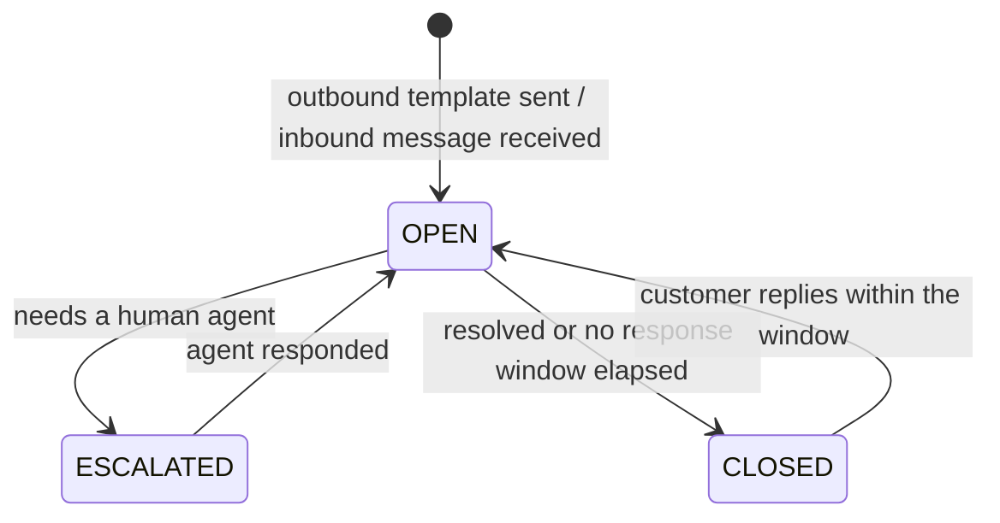

# 11 — Integrations & Notifications

| Field | Value |
|---|---|
| Document ID | AMM-SVC-DOC-11 |
| Version | 1.2 |
| Status | Approved for Design & Development |
| Owner | Engineering Lead + Growth Lead |
| Classification | Internal — Confidential |
| Last Updated | 2026-10-21 |
| Depends On | `04` §7, `05`, `08` §4 |

---

## 1. Integration Principles

| # | Principle and consequence |
|---|---|
| IN-1 | **The adapter pattern.** Every external vendor sits behind an internal interface. Swapping a provider must not touch business logic. |
| IN-2 | **No vendor call on the request path for non-critical flows.** A WhatsApp outage must never fail a booking. |
| IN-3 | **All outbound calls are queued, retried and observable.** |
| IN-4 | **All inbound calls are verified, deduplicated and persisted before processing.** |
| IN-5 | **Every integration has a manual fallback.** The business must be able to operate when a provider is down. |
| IN-6 | **Vendor payloads never leak into the domain model.** They are translated at the adapter boundary. |
| IN-7 | **Cost is a first-class concern.** Every integration has a per-unit cost tracked against volume. |

---

## 2. Integration Inventory

| # | Provider | Purpose | Direction | Criticality | Fallback |
|---|---|---|---|---|---|
| 1 | **Google Maps Platform** | Geocoding, reverse geocoding, places, distance matrix, directions, map display, live tracking | Both | **Critical** | Manual address + pincode fallback |
| 2 | **Razorpay** | Payments (UPI, card, netbanking), refunds, webhooks, settlement reconciliation | Both | **Critical** | Cash/UPI offline collection with manual recording |
| 3 | **Cloud Telephony (Indian provider)** | Toll-free voice, IVR, call routing, call recording, click-to-call, miss-call | Both | High | In-app chat / callback |
| 4 | **WhatsApp Business Platform** | Transactional + template messages, inbound customer messages, interactive replies | Both | High | SMS fallback |
| 5 | **SMS provider** | OTP, transactional alerts | Outbound | **Critical** (OTP) | Voice OTP call |
| 6 | **Email provider** | Invoices, statements, receipts, reports | Outbound | Medium | In-app download |
| 7 | **Firebase Cloud Messaging** | Push notifications | Outbound | High | SMS/WhatsApp fallback |
| 8 | **Object storage (S3-compatible)** | Photos, documents, invoices, recordings index | Both | High | Local disk + backup |
| 9 | **Identity provider (OIDC)** | Central staff SSO | Inbound | Medium | Local password + OTP fallback |

### 2.1 Cost Levers

| Lever | Impact |
|---|---|
| Use SMS only for OTP and critical alerts; push/WhatsApp for the rest | Large saving; SMS is the most expensive per message |
| Cache geocoding results (address → lat/lng) for 30+ days | Large saving; addresses repeat heavily |
| Prefer Distance Matrix over per-call Directions for ETA | Cheaper and faster |
| Batch settlement document generation | Reduces email + storage churn |
| Use FCM for all push; no third-party push vendor | Included in the FCM free tier at launch scale |

---

## 3. Google Maps Platform

### 3.1 APIs Used

| API | Use | Notes |
|---|---|---|
| Geocoding | Address → lat/lng | Cached; the result is snapshotted onto the booking |
| Reverse Geocoding | lat/lng → address | Used for technician location display |
| Places (Autocomplete) | Address search in the app | Debounced; session tokens for billing control |
| Distance Matrix | ETA for candidate ranking | Batched per search |
| Directions | Technician navigation | Deep link into Google Maps / a third-party nav app |
| Roads / Routes | Live traffic ETA | Optional; can be added at Phase 3 |

### 3.2 Rules

| # | Rule |
|---|---|
| MAP-01 | The booking stores an **immutable geo snapshot**. A later geocoder change never alters a historical job. |
| MAP-03 | Geocoding results are cached for 30 days and keyed by the normalised address string. |
| MAP-04 | The service-area polygon check uses **PostGIS**, not the Maps API — it is free, faster and always available. |
| MAP-05 | A Maps API failure never blocks a booking. The system falls back to pincode → city mapping and flags the booking `geo_unverified`. |
| MAP-06 | Map keys are restricted by API and by referrer/IP where supported; quotas are set per environment. |
| MAP-07 | The technician's navigation deep link opens the customer's address in the preferred navigation app, not necessarily Google Maps. |

---

## 4. Payments (Razorpay)

### 4.1 Flows

**Advance payment**

```
Customer → POST /bookings (paymentMode=ADVANCE)
  → API creates a Razorpay Order (amount, currency=INR, receipt=booking.code, notes)
  → API returns the order id + a hosted checkout link
  → Customer completes payment on Razorpay
  → Razorpay webhook: payment.captured
  → API verifies the signature (HMAC of order_id|payment_id with the webhook secret)
  → Idempotently records the payment, advances the booking, dispatches the offer
```

**Balance collection** (after service)

```
Technician → POST /bookings/{id}/collect-payment
  → API creates an order for the invoice balance
  → Payment link is sent to the customer (push + WhatsApp + SMS)
  → On capture → invoice becomes PAID → booking becomes CLOSED
```

**Refund**

```
Customer/CCO → refund request
  → Policy check → ACCOUNTANT approval (above the CCO limit)
  → Razorpay refund API
  → webhook payment.refunded → refund marked COMPLETED → booking → REFUNDED
```

### 4.2 Rules

| # | Rule |
|---|---|
| PAY-01 | **No card data ever touches AmmPal servers.** The gateway hosts the payment UI. |
| PAY-02 | Every webhook is verified with the shared secret and deduplicated by `provider_event_id`. |
| PAY-03 | The booking amount sent to the gateway is **always** the server-computed amount. A client-supplied amount is never trusted. |
| PAY-04 | The `receipt` field carries the booking code, so gateway reconciliation is a direct join. |
| PAY-05 | A payment whose booking is already `CLOSED` is recorded as a **duplicate/refundable** transaction, never silently dropped. |
| PAY-06 | A payment for a booking that was cancelled is auto-flagged for refund. |
| PAY-07 | A daily job reconciles gateway settlements against recorded payments; mismatches raise a finance-alert ticket. |
| PAY-08 | Webhook processing is **at-least-once**; all handlers are idempotent. |

### 4.3 Offline / Manual Collection

| Situation | Handling |
|---|---|
| Gateway down at the customer site | The technician records a manual payment (method = `CASH`/`UPI`, reference captured). A finance ticket is raised. |
| Technician collects cash | Recorded against the invoice; the technician's collected amount is reconciled weekly. `[PROPOSED]` — see OD-BK-04 |
| Manual entry by the branch coordinator | Requires a receipt reference and is audited as `MANUAL_PAYMENT`. |

---

## 5. Cloud Telephony & IVR

See `05` §7 for the event contract. Integration-specific points:

| # | Rule |
|---|---|
| TEL-01 | AmmPal owns the **flow logic** (which menu, which queue) and delegates the **media plane** (ringing, DTMF capture, recording) to the provider. |
| TEL-02 | The provider's IVR engine is configured to **call back** into AmmPal with the collected digits, so menu changes do not require a provider console change. |
| TEL-03 | Recording retrieval uses a signed, expiring URL. AmmPal stores only the reference. |
| TEL-04 | Recording retention follows `09` §6. Dispute-linked recordings are extended. |
| TEL-05 | Click-to-call from the app/web is supported; the caller identity is passed as a verified parameter so the CCO sees the customer immediately. |
| TEL-06 | Missed calls trigger a callback request and an automatic SMS with the call-back number. |
| TEL-07 | DND / TRAI compliance: the platform's outbound campaign calls are suppressed against DND registries; transactional calls are not. |

---

## 6. WhatsApp Business Platform

| # | Rule |
|---|---|
| WA-01 | **Template messages** are used for all business-initiated notifications. Templates must be pre-approved by WhatsApp. |
| WA-02 | **Free-form messages** are permitted only inside the 24-hour customer service window opened by the customer's message. |
| WA-03 | A template change is versioned; the version in force at send time is recorded on the delivery record. |
| WA-04 | Interactive messages (buttons / lists) are used for: confirm technician arrival, approve work & parts, reschedule options, pay now, rate now. |
| WA-05 | Inbound customer messages create a support ticket when they match a service keyword, or are queued for the CCO. |
| WA-06 | Delivery status webhooks update `notification_deliveries`. |
| WA-07 | A template rejection by WhatsApp triggers an alert and a fallback to SMS for that template. |
| WA-08 | All templates are localised (`en`, `or`, `hi`) and each variant must be separately approved — templates are approved per language. |
| WA-09 | **A WhatsApp message is never proof of payment or booking state** (`ADR-014`, BR-18). Payment is established only by a verified gateway callback; booking state only by the API. |
| WA-10 | Conversation and message records are persisted in `whatsapp_conversations` and `whatsapp_messages` (`09` §4.15), linked to the customer, booking and ticket. |
| WA-11 | An inbound message that needs a human is **escalated**: the conversation is flagged, the ticket is assigned, and the customer is told to expect a reply. |
| WA-12 | Message bodies are retained for the period the provider and the privacy policy require, then purged (`09` §6). |

### 6.1 Conversation lifecycle



| Trigger | Effect |
|---|---|
| An outbound transactional message | The conversation is created or reopened and linked to the booking |
| An inbound customer message | The conversation is opened; a ticket is created if the message matches a service keyword |
| Escalation to a human | The conversation is flagged, the ticket is assigned, the agent is notified |
| The customer replies to a **closed** conversation | The conversation reopens within the provider's customer-service window |

---

## 7. Push (FCM), SMS & Email

### 7.1 Channel Selection Policy

| Event | Push | SMS | WhatsApp | Email | In-app |
|---|:--:|:--:|:--:|:--:|:--:|
| OTP | — | ✔ | — | — | — |
| Booking created | ✔ | ✔ | ✔ | — | ✔ |
| Offer received (technician) | ✔ | ✔ | — | — | ✔ |
| Technician accepted | ✔ | — | ✔ | — | ✔ |
| En route + map link | ✔ | — | ✔ | — | ✔ |
| Customer OTP for start | ✔ | ✔ | ✔ | — | ✔ |
| Completed | ✔ | — | ✔ | ✔ | ✔ |
| Invoice issued | ✔ | — | ✔ | ✔ | ✔ |
| Payment received | ✔ | — | ✔ | ✔ | ✔ |
| Rating requested | ✔ | — | ✔ | — | ✔ |
| Cancelled / rescheduled | ✔ | ✔ | ✔ | ✔ | ✔ |
| Settlement issued | ✔ | — | ✔ | ✔ | ✔ |
| Ticket update | ✔ | — | ✔ | ✔ | ✔ |
| Marketing campaign | ✔ (opt-in) | ✖ (DND) | ✔ (opt-in) | ✔ (opt-in) | ✔ |

**Rule NTF-01** — SMS is reserved for OTP and genuinely critical messages. This is the single biggest controllable cost.
**Rule NTF-02** — Transactional messages ignore marketing preferences.
**Rule NTF-03** — Every message carries a deep link back to the exact relevant screen.

### 7.2 Template Registry

```jsonc
{
  "code": "BOOKING_TECHNICIAN_ASSIGNED",
  "channel": "PUSH",
  "locale": "or",
  "title": "ଆପଣଙ୍କ ଟେକନିସିଆନ ନିର୍ବାର୍ତ୍ତ ହେଉଛନ୍ତି",
  "body": "{serviceName} — {scheduledTime} | বুকিং {bookingCode}",
  "variables": ["serviceName", "scheduledTime", "bookingCode", "trackUrl"],
  "deeplink": "ammpal://booking/{bookingId}",
  "version": 3,
  "is_active": true
}
```

**Rules**
- NTF-04 — Every template has a `code`, a per-channel body and a per-locale body.
- NTF-05 — Templates are **versioned**; a change creates a new version. The version used is recorded on the delivery.
- NTF-06 — A missing variable fails the send in a controlled way (dead-letter), never sends a broken message.
- NTF-07 — Template changes require Admin approval and are audited.

---

## 8. Notification Dispatch Pipeline

```
Domain event → Notification module → resolve recipients + preferences
             → render template (locale)
             → enqueue per channel (BullMQ)
             → worker: rate-limit → provider adapter → send
             → record delivery + provider ref
             → provider webhook → update status
```

### 8.1 Delivery Guarantees

| Concern | Policy |
|---|---|
| At-least-once | Retries with exponential backoff (1 min, 5 min, 15 min, 1 h, 6 h) |
| Ordering | Per-recipient ordering is preserved within a booking; across bookings it is not guaranteed |
| Dead letter | After 5 failed attempts → `DEAD_LETTER` + alert. A `POST /admin/notifications/{id}/retry` replays |
| Idempotency | The delivery record is keyed by (template_code, booking_id, recipient, version) to avoid duplicate sends |
| Rate limiting | Per-provider quotas and per-recipient caps (e.g. max 5 marketing pushes/day) |
| Fallback chain | WhatsApp → SMS → in-app, when a channel fails permanently |
| Quiet hours | Marketing messages are suppressed between 21:00 and 08:00 local; transactional messages are not |

### 8.2 Preference Model

| Scope | Behaviour |
|---|---|
| Transactional (booking, payment, security) | Always delivered on the required channel; preferences do not apply |
| Operational (job status, SLA, ticket updates) | Delivered on the required channel; optional channels respect preferences |
| Marketing (offers, campaigns) | Opt-in only; suppressed by quiet hours and frequency caps |

---

## 9. Webhook & Callback Security

| Control | Implementation |
|---|---|
| Signature | HMAC-SHA256 over the raw body with a per-provider secret |
| Timestamp | Requests older than 5 minutes are rejected (replay defence) |
| Constant-time compare | `timingSafeEqual` for signature comparison |
| Deduplication | Unique `(provider, provider_event_id)` in `webhook_inbox` |
| Persistence | The raw payload is stored before processing, so a failed handler can be replayed |
| Fast acknowledgement | Persist + enqueue + `202 Accepted`; processing happens asynchronously |
| Dead-letter replay | `GET /admin/webhooks/dead-letters` + `POST /admin/webhooks/{id}/replay` |
| Isolation | Provider endpoints are rate-limited and IP-allow-listed where the provider supports it |

---

## 10. Provider Adapter Interfaces

```ts
// Contracts only — implementation detail

interface PaymentGateway {
  createOrder(input: { amountPaise: number; currency: string; receipt: string;
                       notes?: Record<string, string>; customer?: CustomerRef }): Promise<Order>;
  createPaymentLink(orderId: string): Promise<{ url: string }>;
  refund(input: { paymentRef: string; amountPaise: number; reason: string }): Promise<Refund>;
  verifyWebhook(rawBody: Buffer, headers: Record<string, string>): PaymentEvent | null;
  fetchPayment(providerRef: string): Promise<Payment>;
}

interface MapsProvider {
  geocode(address: string): Promise<GeoPoint | null>;
  reverseGeocode(point: GeoPoint): Promise<Address | null>;
  autocomplete(input: string, sessionToken: string): Promise<PlaceSuggestion[]>;
  distanceMatrix(origins: GeoPoint[], destinations: GeoPoint[]): Promise<Leg[]>;
  navigationUrl(destination: GeoPoint): string;
}

interface TelephonyProvider {
  initiateCall(input: { to: string; from?: string; customerRef?: string }): Promise<CallSession>;
  hangUp(callId: string): Promise<void>;
  fetchRecording(callId: string): Promise<{ url: string; expiresAt: string }>;
}

interface MessagingProvider {
  sendTemplate(input: { to: string; templateName: string; language: string;
                         params: Record<string, string> }): Promise<SendResult>;
  sendFreeform(input: { to: string; body: string }): Promise<SendResult>;
}

interface PushProvider {
  send(input: { tokens: string[]; title: string; body: string;
                data?: Record<string, string>; deepLink?: string }): Promise<void>;
}
```

**Rule INT-01** — Every adapter implements a `isConfigured()` check. If a provider is not configured in an environment, the module degrades gracefully (e.g. push disabled) rather than throwing at call time.

---

## 11. Observability & Cost Tracking

| Metric | Purpose |
|---|---|
| `integration_call_total{provider, operation, outcome}` | Success/failure rate per provider |
| `integration_call_duration_seconds{provider, operation}` | Latency per provider |
| `integration_cost_estimate{provider, channel, month}` | Projected spend against the budget |
| `webhook_lag_seconds{provider}` | Inbound event delay |
| `notification_delivery_rate{channel, template}` | Delivery success per template |
| `notification_dead_letter_total{channel}` | Failed sends needing attention |
| `maps_cache_hit_ratio` | Geocoding cache effectiveness |

Every provider call is logged with `provider`, `operation`, `duration_ms`, `outcome`, and a
**redacted** request/response reference — never raw PII or secrets.

---

## 12. Open Points

| ID | Question | Owner | Deadline |
|---|---|---|---|
| OD-INT-01 | Which Indian cloud-telephony provider — evaluate for DND compliance, IVR depth, per-minute cost, and Odia support? | Support + Engineering | Phase 0 |
| OD-INT-02 | Do we use the official WhatsApp Business Platform (paid conversation) or a BSP aggregator? | Growth | Phase 0 |
| OD-INT-03 | Is a second SMS provider needed for failover? | Engineering | Phase 2 |
| OD-INT-04 | Should live technician location be shared with a third-party fleet-tracking product? | Product | Phase 3 |
| OD-INT-05 | Do we need email-with-invoice attachment, or a signed download link only? | Finance | Phase 2 |
| OD-INT-06 | Which object storage — self-hosted MinIO on the same VPS, or a managed S3 provider? | Engineering | Phase 0 |
| OD-INT-07 | Is a KYC/verification vendor (e.g. Aadhaar offline KYC, DigiLocker) integrated, or manual-only at launch? | Partner Ops | Phase 2 |

---

## Revision History

| Version | Date | Author | Summary | Sections changed |
|---|---|---|---|---|
| 1.2 | 2026-10-21 | Engineering Lead | Render-integrity fix, no rule changed: §1's header declared a third **Consequence** column that none of IN-1…IN-7 supplied. The header now names the single column the rows carry. Found by a suite-wide table-column scan. | §1 |
| 1.1 | 2026-10-21 | Product Lead + Engineering Lead | Documentation audit and consolidation. Added the WhatsApp conversation lifecycle, the escalation rule, the message-persistence entities and the explicit rule that a WhatsApp message is never proof of payment or booking state (ADR-014). | All |
| 1.0 | 2026-10-21 | Product Lead | Initial issue. | All |
