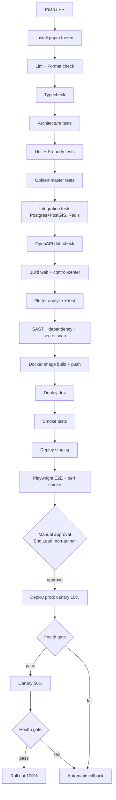

# 16 — DevOps, CI/CD & Infrastructure

| Field | Value |
|---|---|
| Document ID | AMM-SVC-DOC-16 |
| Version | 1.5 |
| Status | Approved for Design & Development |
| Owner | Engineering Lead + Infrastructure Owner |
| Classification | Internal — Confidential |
| Last Updated | 2026-10-21 |
| Depends On | `08`, `13`, `14` §9 |

---

## 1. Principles

| # | Principle and consequence |
|---|---|
| IN-1 | **Everything is reproducible.** The same commit produces the same artefact. |
| IN-2 | **No manual production changes.** Production is only changed by a pipeline. |
| IN-3 | **Deploy often, deploy safely.** Small, frequent, reversible releases. |
| IN-4 | **Database changes are not code changes.** Migrations ship independently and are backward-compatible. |
| IN-5 | **Observe before you optimise.** Instrumentation is part of the definition of done. |
| IN-6 | **Fail fast, fail loud.** A broken deployment must be detected and rolled back automatically. |
| IN-7 | **The runbook exists before the incident.** Every service has a runbook. |

---

## 2. Environments

| Environment | Purpose | Data | Deploy trigger | Access |
|---|---|---|---|---|
| `local` | Development | Seeded synthetic | — | Developers |
| `dev` | Integration | Synthetic, reset nightly | Merge to `main` | Whole engineering team |
| `staging` | Release verification, performance, E2E | Synthetic at production-like volume | Merge to `main` | Whole team + QA + product |
| `prod` | Live | Real | Manual approval after staging passes | Engineering + ops, via the pipeline |

### 2.1 Environment Configuration

| Aspect | `dev` | `staging` | `prod` |
|---|---|---|---|
| API instances | 1 | 1 | 2 (PM2 cluster) |
| Worker | 1 | 1 | 1 |
| Realtime | shared | shared | 1 |
| Postgres | Container, same version | Container, production-like data | VPS (self-hosted) or managed |
| Redis | Container | Container | Same host |
| Vendor adapters | Mock mode | Mock + sandbox nightly | Live |
| Log level | debug | info | info (+ sampled trace) |
| Feature flags | All on | As prod | Conservative default-off |
| Platform mode (`38`) | `TESTING` | `TESTING` unless deliberately promoted for a rehearsal | **Refuses to serve staff mutations
in `TESTING`** without a recorded bootstrap exception; the deploy fails on the assertion, not the day (`38` PM-04, `14` `ENV-07`) |
| Rate limits | Relaxed | Prod-like | Prod |
| CORS | localhost + preview | Preview domains | Production domains only |

### 2.2 Data Isolation

- `dev` and `staging` never hold real customer data.
- `staging` holds a synthetic dataset shaped like production.
- A sanitised, tokenised production snapshot may be loaded into `staging` for performance testing under an explicit approval.

---

## 3. Repository & CI

### 3.1 Repository

One monorepo (`ammpal-service`) — see `14` §2. A single repository guarantees that the API contract,
the web clients, the Flutter clients and the docs change together.

| Aspect | Detail |
|---|---|
| Branching | Trunk-based; `main` is always deployable |
| Pull request | ≥ 1 approval, CI green, linked ticket |
| Merge | Squash-merge, Conventional Commits |
| Release tag | `v<semver>` on `main` triggers the release pipeline |
| Hotfix | `hotfix/<slug>` from `main` → `main` → back-merge to the release branch |

### 3.2 CI Pipeline



### 3.3 Pipeline Gates

| Stage | Gate | Fails the build |
|---|---|---|
| Lint | ESLint error level, Prettier check | ✔ |
| Typecheck | `tsc --noEmit` for api, web, control-center; `flutter analyze` | ✔ |
| Architecture | Module boundary test | ✔ |
| Unit | Coverage threshold | ✔ |
| Golden master | Any diff | ✔ |
| Integration | Any failure | ✔ |
| OpenAPI | Any drift | ✔ |
| SAST | Critical or high | ✔ |
| Dependencies | Critical or high | ✔ |
| Secrets | Any finding | ✔ |
| Docker | Build failure | ✔ |

### 3.4 GitHub Actions Workflows

| Workflow | Trigger | Purpose |
|---|---|---|
| `pr.yml` | PR opened/synchronised | All CI gates |
| `main.yml` | Merge to `main` | Deploy dev → staging → smoke → E2E |
| `release.yml` | Tag `v*` | Production deploy (manual approval) |
| `nightly.yml` | Cron (02:00 IST) | Performance suite, DAST, fuzzing, full E2E on staging, security scan |
| `seed.yml` | Manual / nightly | Reset and reseed dev/staging |
| `docs.yml` | Changes in `Docs/` | Lint the docs (link check, structure check, Mermaid syntax) |

---

## 4. Continuous Deployment

### 4.1 Artefacts

| Artefact | Built by | Registry |
|---|---|---|
| `api` Docker image | GitHub Actions | GitHub Container Registry (GHCR) |
| `worker` Docker image | Same build, different entrypoint | GHCR |
| `realtime` Docker image | Same build, third entrypoint | GHCR |
| `web` static bundle | GitHub Actions | Built into the `web` image, or pushed to a CDN |
| `control-center` static bundle | GitHub Actions | As above |
| `customer-app` AAB/APK | GitHub Actions on tag | Firebase App Distribution (internal) + Play Store |
| `partner-app` AAB/APK | GitHub Actions on tag | Firebase App Distribution + Play Store |
| `openapi.json` | Generated in CI | Published to the API host and to `packages/contracts` |

**Rule DEP-01** — Images are tagged with the git SHA (immutable) and `latest` (mutable). Deploys pin the SHA.

### 4.2 Deploy Strategy

| Environment | Strategy | Rationale |
|---|---|---|
| `dev` | Rolling (replace) | Speed |
| `staging` | Rolling | Fidelity to production |
| `prod` | **Canary 10% → 50% → 100%**, with an automated health gate between steps | Limits blast radius; auto-rollback |

**Health gate (evaluated after each canary step, over 5 minutes)**

| Signal | Pass condition |
|---|---|
| HTTP 5xx rate | < 1% |
| p95 latency | < 1.5× the pre-deploy baseline |
| Error rate by route | No route more than 2× its baseline |
| Queue depth | Not growing |
| Worker error rate | < 1% |
| Health check | `/health/ready` green |

If any condition fails, the pipeline halts and rolls back automatically. The engineer on call is paged.

### 4.3 Database Migrations

```
Expand → Migrate → Contract
```

| Stage | Action | Safe with the old code running? |
|---|---|---|
| **Expand** | Add the new column/table/index as nullable | ✔ |
| **Deploy** | Ship code that writes both old and new | ✔ |
| **Migrate** | Backfill in batches (background job, rate-limited) | ✔ |
| **Switch** | Read from the new; keep writing both | ✔ |
| **Contract** | Drop the old column in a later release | ✔ |

| Rule | Detail |
|---|---|
| MIG-01 | A migration must be backward-compatible with the currently deployed application version. |
| MIG-02 | `CREATE INDEX CONCURRENTLY` in production. |
| MIG-03 | Adding a `NOT NULL` column requires a default or a two-phase approach. |
| MIG-04 | A migration that will lock a large table must be reviewed by the DB owner. |
| MIG-05 | Every migration has a documented rollback or compensating plan. |
| MIG-06 | Migrations run as a separate pipeline step **before** the app deploy, not inside the app startup. |
| MIG-07 | Backfills run in batches of ≤ 1,000 rows with a pause, to avoid lock contention and replication lag. |
| MIG-08 | The migration step is idempotent and safe to re-run. |

### 4.4 Feature Flags

| Rule | Detail |
|---|---|
| FLAG-01 | Flags live in the database, evaluated server-side, with targeting by role, branch and percentage. |
| FLAG-02 | A flag defaults to **off** in production. |
| FLAG-03 | Flags are removed within 2 releases of the feature reaching 100%. |
| FLAG-04 | Flag names are prefixed by the module: `pricing.newCouponEngine`, `booking.openFeed`. |
| FLAG-05 | Every flag has an owner and an expiry date recorded. |

---

## 5. Infrastructure

### 5.1 Provisioning

| Tool | Use |
|---|---|
| Ansible | VPS provisioning (users, packages, systemd units, TLS, firewall, backups) |
| Docker / Docker Compose | Local development and staging services |
| Terraform | Managed cloud resources if the platform moves to a managed provider (Phase 3) |
| Caddy or Nginx | TLS termination, reverse proxy, static file serving, WebSocket upgrade |
| systemd | Service supervision for the API, worker and realtime processes (simpler than Kubernetes for this scale) |

### 5.2 Production Host Layout (Phase 1–2)

**Capacity envelope of the initial host** — a **planning target, not a performance or availability
guarantee** (`13` §2.4):

| Resource | Planning target | Notes |
|---|---|---|
| vCPU | **4** | See the sizing table in `08` §6.2 for the per-component allocation |
| RAM | **16 GB** | Postgres is the largest consumer |
| Storage | **200 GB NVMe** | Application, database, logs, local object-storage fallback |
| Bandwidth | **16 TB / month** | CDN-fronted static assets keep this well below the cap |

**Backup storage is separate and not counted in the 200 GB** — it must live on a different failure
domain from the primary host, and its size is driven by the retention policy in `09` §6 (notably the
8-year retention of financial records and booking history). Backup storage sizing is an open item in
`21`.

> **Rule INF-13** — The 4 vCPU / 16 GB / 200 GB / 16 TB figure is a **starting envelope for a
> single-city launch**. It is not a multi-state design target and must not be presented as a capacity
> guarantee to a customer, a partner or an investor. The Phase 3 load test (`13` §2.4) is the gate
> for scaling.
>
> **Rule INF-14** — The envelope above assumes API, worker, PostgreSQL, Redis and the realtime
> gateway co-reside on one host **only because Phase 1 volume makes that affordable, not because it
> is safe**. Before provisioning production, the co-location must be evaluated against the Phase 3
> targets in `13` §2.3; database, Redis and the realtime gateway are the first three components to
> move to separate hosts, and the failure of a single host must never take the database and the API
> down together once more than one city is live. `[PROPOSED]` — the split-point is an open decision
> (`21` OD-INF-01).

```
/opt/ammpal/
├── apps/api/           # released artefacts (versioned directories + `current` symlink)
├── apps/worker/
├── apps/realtime/
├── apps/web/           # static bundle
├── apps/control-center/
├── shared/env/         # production env files (0600, deploy-user owned)
├── shared/uploads/     # local fallback for object storage
├── logs/               # structured logs → shipped to Loki
└── scripts/            # deploy, rollback, backup, restore scripts

/etc/systemd/system/
├── ammpal-api.service
├── ammpal-worker.service
└── ammpal-realtime.service
```

### 5.3 Service Units (Summary)

```ini
[Unit]
Description=AmmPal API
After=network.target postgresql.service redis.service

[Service]
Type=simple
User=ammpal
WorkingDirectory=/opt/ammpal/apps/api/current
EnvironmentFile=/opt/ammpal/shared/env/api.env
ExecStart=/usr/bin/node dist/main.js
Restart=always
RestartSec=5
StandardOutput=journal
StandardError=journal

[Install]
WantedBy=multi-user.target
```

| Rule | Detail |
|---|---|
| INF-01 | Services run as a **non-root** dedicated user. |
| INF-02 | `Restart=always` with a `RestartSec` backoff; combined with the health gate, a crash loop is caught by monitoring. |
| INF-03 | The release layout uses versioned directories plus a `current` symlink, so a rollback is a symlink swap (seconds). |
| INF-04 | Logs go to journald and are shipped to Loki. |

### 5.4 Reverse Proxy

| Route | Target |
|---|---|
| `api.ammpalservice.com/v1/*` | API cluster |
| `api.ammpalservice.com/ws` | Realtime gateway (WebSocket upgrade) |
| `api.ammpalservice.com/openapi.json`, `/docs` | API (internal network / basic auth in production) |
| `www.ammpalservice.com/*` | Static web bundle |
| `admin.ammpalservice.com/*` | Control Center bundle |

| Rule | Detail |
|---|---|
| INF-05 | TLS 1.2+ with HSTS; certificates auto-renewed. |
| INF-06 | `X-Request-Id` is generated at the edge if absent and forwarded. |
| INF-07 | Request bodies are limited to 1 MB (uploads use presigned object-storage URLs). |
| INF-08 | The API's `/health/*` and the metrics endpoint are exposed on an internal port only, not publicly. |
| INF-09 | Rate limiting at the edge (per IP) in addition to the application-level limits. |

### 5.5 Firewall

| Port | Exposure |
|---|---|
| 22 (SSH) | Allow-listed IPs + bastion; key-only authentication |
| 80 / 443 | Public |
| 5432 (Postgres) | Local only |
| 6379 (Redis) | Local only |
| 9100 (Node exporter) | Local / monitoring only |
| 9090 (Prometheus) | Local only |

### 5.6 Backups

| What | How | Frequency | Retention | Restore test |
|---|---|---|---|---|
| PostgreSQL | `pg_basebackup` + WAL archiving | Continuous WAL + nightly full | 30 days rolling + 1 monthly archive | Monthly automated |
| Object storage | Provider versioning + a nightly sync to a second bucket | Nightly | 30 days | Quarterly |
| Configuration (`/opt/ammpal/shared/env`, `infra/`) | Encrypted copy to a separate bucket on every release | Per release | 12 months | Quarterly |
| Audit log | Included in the database backup | — | 8 years (per policy) | Monthly |
| Secrets | Encrypted vault snapshot | On change | 12 months | Quarterly |

| Rule | Detail |
|---|---|
| INF-10 | Backups are encrypted at rest with a key stored separately from the backup. |
| INF-11 | A backup that has not been restore-tested is not a backup. The monthly test restores into an isolated instance and asserts row counts and a reconciliation pass. |
| INF-12 | The backup job failing raises a **P0** alert and is paged by phone, matching this document's own alert catalogue (§6.3) and `25` §27 (`AL-06`). A backup that has not run within 26 h is treated as failed. |

> `INF-13` and `INF-14` — the launch-envelope and host-co-location rules — are **not** backup rules and
> are stated where they belong, in §5.2. They are numbered here so the register has no gap.

> **What this table does not say, `[OPEN]` (`OD-DOC-23`).** Every row above governs *how long* a copy
> lives and *whether it restores*. Nothing here governs **who may read one**. A `pg_basebackup` is the
> whole database — customers, technicians, partner bank details (app-encrypted), audit content — and the
> monthly `INF-11` restore-test instance is a full production copy in an isolated place with no stated
> access list, masking rule or destruction clock. `13` §6.1's erasure flow anonymises the live database
> only, so a restore from any copy inside the retention window can resurrect data a subject asked to
> erase, and the 8-year audit retention means that is true for audit content for eight years. The owner
> decision is not taken; this document does not assume an answer.

---

## 6. Observability

### 6.1 Stack

| Signal | Tool | Retention |
|---|---|---|
| Logs | pino → journald → Promtail → Loki | 30 days hot |
| Metrics | Prometheus (scrape) → Grafana | 15 months (downsampled) |
| Traces | OpenTelemetry → Tempo (or a vendor) | 7 days |
| Alerts | Alertmanager → email, WhatsApp (on-call), phone (P0) | — |
| Uptime | Blackbox exporter + external monitor | — |
| Errors | Sentry (API, web, apps) | 90 days |

### 6.2 Golden Signals

| Service | Latency | Traffic | Errors | Saturation |
|---|---|---|---|---|
| API | p50/p95/p99 per route | req/s per route | 5xx rate per route | CPU, memory, event-loop lag, DB pool usage |
| Worker | Queue wait time, job duration | Jobs/s | Job failure rate | Queue depth, concurrency |
| Realtime | Connection count, message latency | Messages/s | Disconnect rate | Connections, memory |
| DB | Query p95, lock waits | Queries/s | Deadlocks, replica lag | CPU, I/O, connections, cache hit ratio |
| Redis | Latency | Ops/s | Evictions | Memory, evictions, replication lag |
| Vendor calls | Latency per provider | Calls/s | Error rate per provider | Rate-limit headroom |

### 6.3 Alert Catalogue

| Alert | Condition | Severity | Route |
|---|---|---|---|
| API 5xx | > 2% for 5 min | P0 | Phone + WhatsApp |
| API latency | p95 > 2× baseline for 10 min | P1 | WhatsApp |
| DB connections | > 80% of the pool for 5 min | P1 | WhatsApp |
| DB replication lag | > 30 s | P1 | WhatsApp |
| Redis evictions | Any sustained | P1 | WhatsApp |
| Queue depth | > 10,000 for 10 min | P1 | WhatsApp |
| Settlement job | Failed, or not run by Monday 08:00 | P0 | Phone + WhatsApp |
| Reconciliation | Any mismatch | P0 | Phone + WhatsApp |
| Payment webhook failures | > 5% for 10 min | P0 | Phone |
| Booking creation failure | > 3% for 5 min | P0 | Phone |
| Backup | Failed, or not run in 26 h | P0 | Phone |
| Disk | > 80% / > 90% | P2 / P1 | WhatsApp |
| Certificate expiry | < 14 days | P2 | Email |
| Vendor failure | Any provider down > 15 min | P2 | WhatsApp |
| Security | Repeated `SCOPE_VIOLATION`, or a signature failure spike | P1 | Phone |

**Rule OBS-01** — Every alert links to a runbook in `ops/runbooks/`. An alert without a runbook is deleted.
**Rule OBS-02** — P0 alerts are phoned, not emailed.

---

## 7. Environments & Secrets Management

| Class | Store | Rotation |
|---|---|---|
| Database credentials | Server env file (0600) | 90 days |
| Vendor API keys | Server env file (0600) | 90 days; webhook secrets on rotation with a dual-secret grace period |
| JWT signing keys | Server env file; a JWKS endpoint for verification | 90 days, with a key-id header so old tokens stay valid during rotation |
| Object storage keys | Server env file | 90 days |
| CI/CD secrets | GitHub Actions secrets | 90 days |
| Third-party (OAuth) | Vendor console → env file | Per vendor policy |

**Rule SEC-03** — Secrets are never printed to a log, never in a Git repository, and never in a
support ticket. Rotation is scripted and rehearsed.

---

## 8. Disaster Recovery Runbook (Summary)

Full runbook: `ops/runbooks/disaster-recovery.md`.

| Step | Action | Target |
|---|---|---|
| 1. Declare | Confirm the incident; page the on-call and the founder | < 15 min |
| 2. Assess | Determine the blast radius (data loss? full outage? partial?) | < 30 min |
| 3. Contain | Fail over or roll back | < 60 min |
| 4. Recover | Restore from backup + WAL replay if needed | < 2 h |
| 5. Verify | Health checks, reconciliation, a test booking | < 30 min |
| 6. Reconcile | Compare gateway settlements against recorded payments | < 4 h |
| 7. Communicate | Notify affected customers and partners | < 2 h from declaration |
| 8. Review | Post-mortem within 5 working days | — |

---

## 9. Deployment Calendar

| Environment | Deploy frequency | Window |
|---|---|---|
| `dev` | On every merge | Any time |
| `staging` | On every merge | Any time |
| `prod` | Daily (a batch window) or on demand for a P0/P1 fix | Tue–Thu, 10:00–16:00 IST for planned releases; any time for hotfixes |

| Rule | Detail |
|---|---|
| DEP-02 | No production deploy on Friday evening or before a public holiday — the on-call coverage is thinner. |
| DEP-03 | A release that requires a migration rehearsal cannot ship on a Friday. |
| DEP-04 | Each release has a changelog and a rollback plan attached. |

---

## 10. Open Points

| ID | Question | Owner | Deadline |
|---|---|---|---|
| OD-DEV-01 | Managed Postgres (RDS/Razorpay/Supabase) vs self-hosted on the VPS for production? Managed gives PITR and failover; self-hosted is cheaper. Recommend managed from Phase 2. | Engineering + Founder | Phase 0 |
| OD-DEV-02 | Managed Redis vs self-hosted? Recommend managed or a dedicated small instance. | Engineering | Phase 0 |
| OD-DEV-03 | CI runner: GitHub-hosted (slow, costlier at scale) vs a self-hosted runner on the VPS? | Engineering | Phase 0 |
| OD-DEV-04 | Which error-tracking and crash-reporting vendor (Sentry vs alternatives)? | Engineering | Phase 0 |
| OD-DEV-05 | Self-hosted MinIO on the VPS vs a managed S3 provider for object storage? | Engineering | Phase 0 |
| OD-DEV-06 | Do we need a WAF (Cloudflare) in front of the API? | Security + Engineering | Phase 1 |
| OD-DEV-07 | Is a separate staging environment needed from Phase 2 (cost vs risk)? | Leadership | Phase 1 |

---

## Revision History

| Version | Date | Author | Summary | Sections changed |
|---|---|---|---|---|
| 1.5 | 2026-10-21 | DevOps Lead (platform-mode pass) | §2.1's environment table gained a **Platform mode (`38`)** row stating that mode is independent of environment and that the pipeline's assertion is what fails — **the deploy, not the day**. An operator discovering the mismatch after go-live is the failure `19` `R-49` scores; discovering it in the pipeline costs a red build. **No stage, secret, host, artifact or credential was changed**, and no provider credential is claimed to be bound to a mode (`24` records sandboxes for nightly runs only). | §2.1 |
| 1.4 | 2026-10-21 | Engineering Lead | Render-integrity fix, no rule changed: §1's header declared a third **Consequence** column that none of IN-1…IN-7 supplied. Found by a suite-wide table-column scan. | §1 |
| 1.3 | 2026-10-21 | Engineering Lead + Operations Lead | Audit pass 3 (continued). A **what this table does not say** note added to §5.6: the retention rows state how long copies are kept and not who may read them, whether the `INF-11` monthly restore-test instance carries production's access control, or what happens to a subject's data in the WAL stream and the monthly archive when `13` §6.1 grants erasure. Registered as `OD-DOC-23` and left open — this document does not decide it. No retention period, recovery objective or infrastructure rule was changed. | §5.6, Revision History |
| 1.2 | 2026-10-21 | Engineering Lead + Operations Lead | Audit pass 3. §3.2 pipeline diagram now draws the **three canary steps** that §4's deployment table specifies (10% → health gate → 50% → health gate → 100%, with a rollback edge from each gate) — previously the diagram showed one step and the table three, so the pipeline as drawn could not fail the way the policy says it should. The approval node names its holder (`Eng Lead, non-author`), consistent with Rule `SOD-1`/`SOD-4` in `29` §2 — this document previously said "manual approval" without saying who. `INF-12` raised from **P1 to P0** for a failed backup job, resolved against this document's own §6.3 alert row and `25` §27 (`AL-06`) rather than decided here, because a backup that has not run is already data at risk. `INF-13`/`INF-14` de-duplicated: the two rules existed both as §5.2 prose and as §5.6 table rows with the same IDs; the numbered statements stay in §5.2 and §5.6 keeps a pointer so the register has no gap. Added `INF-14`, the host co-location trigger, tied to `21` `OD-INF-01`. | §3.2, §5.2, §5.6 |
| 1.1 | 2026-10-21 | Product Lead + Engineering Lead | Documentation audit and consolidation. Added the production capacity envelope (4 vCPU / 16 GB RAM / 200 GB NVMe / 16 TB bandwidth) with the explicit statement that it is a planning target, not a guarantee, and that backup storage is separate and excluded from the 200 GB. | All |
| 1.0 | 2026-10-21 | Product Lead | Initial issue. | All |
