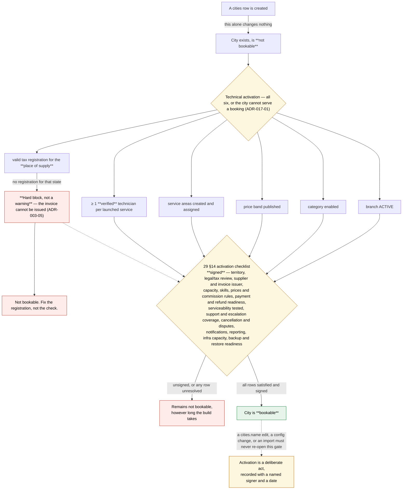

# 22 — Architecture Decision Records

| Field | Value |
|---|---|
| Document ID | AMM-SVC-DOC-22 |
| Version | 1.6 |
| Status | Approved for Design & Development |
| Owner | Engineering Lead |
| Classification | Internal — Confidential |
| Last Updated | 2026-10-21 |
| Depends On | `08`, `09`, `10`, `21` |

---

## 1. Purpose

This document is the **decision log** for the AmmPal Service platform. It records decisions that
have been taken, the evidence behind them, the alternatives that were rejected, and the
consequences that follow.

| Rule | Detail |
|---|---|
| ADR-01 | A decision that changes a business rule, an architecture boundary, a financial formula, a data model, a permission model or a security control **must** have an ADR. |
| ADR-02 | An ADR is immutable once `Accepted`. A change to an accepted decision creates a **new** ADR that supersedes it. The original is retained with a `Superseded by` line. |
| ADR-03 | An ADR records the **decision**, not the deliberation transcript. Alternatives are summarised, not narrated. |
| ADR-04 | Every ADR carries a status: `Proposed` · `Accepted` · `Superseded` · `Rejected` · `Deprecated`. |
| ADR-05 | An ADR that depends on an external party (tax advisor, legal counsel, a vendor) is marked `Accepted — DEPENDENT` and the dependency is named. |
| ADR-06 | Nothing in this document may be marked `Implemented` unless the implementation exists in source code. **No application source code exists in this repository.** |
| ADR-07 | If an ADR and a document in `Docs/` disagree, the ADR wins and the document must be corrected. |

---

## 2. ADR Index

| ADR | Title | Area | Status | Date | Supersedes / Depends On |
|---|---|---|---|---|---|
| [ADR-001](#adr-001) | Modular monolith with micro-ready extraction boundaries | Architecture | Accepted | 2026-10-21 | — |
| [ADR-002](#adr-002) | Two-layer booking state model (canonical status + operational phase) | Domain | Accepted | 2026-10-21 | Reconciles the End-to-End Workflow infographic with the master-prompt candidate model |
| [ADR-003](#adr-003) | A branch is not a legal entity; supplier identity is resolved separately | Domain / Legal | Accepted | 2026-10-21 | — |
| [ADR-004](#adr-004) | Serviceability is a backend-resolved property, not a proximity test | Domain | Accepted | 2026-10-21 | — |
| [ADR-005](#adr-005) | Booking ownership is exclusive to one branch at any instant | Domain | Accepted | 2026-10-21 | — |
| [ADR-006](#adr-006) | The price snapshot is immutable and is the sole basis of the final invoice | Finance | Accepted | 2026-10-21 | — |
| [ADR-007](#adr-007) | Commission is calculated on eligible labour only | Finance | Accepted | 2026-10-21 | — |
| [ADR-008](#adr-008) | Coupon usage is reserved at booking and released on cancellation | Finance | Accepted | 2026-10-21 | — |
| [ADR-009](#adr-009) | Settlement is weekly, per branch, with an immutable statement | Finance | Accepted | 2026-10-21 | — |
| [ADR-010](#adr-010) | Service categories are configured through a versioned workflow engine | Domain | Accepted | 2026-10-21 | — |
| [ADR-011](#adr-011) | TypeScript across the stack; Flutter for both mobile applications | Technology | Accepted | 2026-10-21 | — |
| [ADR-012](#adr-012) | The API is the contract; all clients are generated from OpenAPI | Technology | Accepted | 2026-10-21 | — |
| [ADR-013](#adr-013) | The backend is the only source of truth for state, price and payment | Security | Accepted | 2026-10-21 | — |
| [ADR-014](#adr-014) | WhatsApp messages are never proof of payment or booking state | Integration | Accepted | 2026-10-21 | — |
| [ADR-015](#adr-015) | Financial records are append-only and immutable once issued | Finance / Legal | Accepted | 2026-10-21 | — |
| [ADR-016](#adr-016) | Support agents have bounded financial permissions | Security | Accepted | 2026-10-21 | — |
| [ADR-017](#adr-017) | A city becomes bookable only via an explicit activation gate | Operations | Accepted | 2026-10-21 | — |
| [ADR-018](#adr-018) | Documentation in `Docs/` is the source of truth; code follows documentation | Process | Accepted | 2026-10-21 | — |
| [ADR-019](#adr-019) | Single database, shared schema, discriminated by `branch_id` | Data | Accepted | 2026-10-21 | — |
| [ADR-020](#adr-020) | Third-party providers sit behind adapter interfaces and are never trusted as a source of truth | Integration | Accepted | 2026-10-21 | — |
| [ADR-021](#adr-021) | Partner web dashboard is a conditional surface pending scope approval | Product | Proposed | 2026-10-21 | — |
| [ADR-022](#adr-022) | Central fallback team may operate only explicitly approved territories | Operations | Proposed | 2026-10-21 | — |
| [ADR-023](#adr-023) | Non-serviceable locations enter a waitlist rather than a confirmed booking | Product | Proposed | 2026-10-21 | — |
| [ADR-024](#adr-024) | Financial, supplier and tax conclusions require professional review before production | Legal / Finance | Accepted — DEPENDENT | 2026-10-21 | — |
| [ADR-025](#adr-025) | Implementation status cannot be asserted without an inspectable artifact | Process | Accepted | 2026-10-21 | — |
| [ADR-026](#adr-026) | Platform mode gates destructive data operations; promotion requires a super-admin step-up | Security / Data | **Proposed** | 2026-10-21 | Depends on `OD-DOC-40`…`44`, `OD-SEC-01`, `OD-MAIL-01`; interacts with `ADR-013`, `ADR-015`, `ADR-019` |

---

## 3. Decision Records

<a id="adr-001"></a>
### ADR-001 — Modular monolith with micro-ready extraction boundaries

| Field | Value |
|---|---|
| Status | **Accepted** |
| Date | 2026-10-21 |
| Deciders | Engineering Lead, Founder |
| Affects | `08` §2, §6, §8; `09` §2; `16` §5 |

**Context.** The platform must launch in Odisha within months, run on a 4 vCPU / 16 GB VPS, and later
scale to multiple cities, branches and states. The founder asked for an "advanced" architecture.

**Decision.** Implement the backend as a **single NestJS deployable** (modular monolith) in which each
of the 16 modules owns its tables exclusively, exposes a typed public contract, and communicates
asynchronously through a transactional outbox. Module boundaries are **enforced by an architecture
test in CI**, not by convention.

**Alternatives rejected.**

| Alternative | Why rejected |
|---|---|
| Microservices | Requires a platform team, per-service CI/CD and per-service observability; converts engineering time into operational overhead before demand is validated; breaks the single-transaction guarantee across booking → invoice → commission accrual. |
| Single unstructured application | Accidental coupling; a pricing rule writes into booking tables; schema changes ripple across features. |

**Consequences.**
- Booking, pricing, billing and commission remain inside **one** transactional boundary (ADR-019).
- Extraction to microservices remains possible without a rewrite, gated by the six readiness tests in `08` §8.
- Extraction order is prescribed: `reporting` → `notification` → `realtime` → `integration` → `commission`.
- `booking`, `pricing` and `billing` are explicitly never extracted in v1.

**Status note.** `[PROPOSED]` — no implementation exists. The architecture test, the module boundaries
and the outbox are all designed, not built.

---

<a id="adr-002"></a>
### ADR-002 — Two-layer booking state model

| Field | Value |
|---|---|
| Status | **Accepted** |
| Date | 2026-10-21 |
| Deciders | Product Lead, Engineering Lead |
| Affects | `04` §4; `23` (full tables); `09` §4.6; `10` §5 |

**Context — the conflict.** Two sources describe the booking lifecycle:

- **Source A — the End-to-End Workflow infographic** (project asset, `visualize-image-of-project/`)
  defines six canonical status codes: `Requested`, `Accepted`, `En Route`, `Started`, `Completed`,
  `Closed`, plus a `Booking Status Flow` panel showing the same six.
- **Source B — the master project prompt** proposes a finer candidate model:
  `requested → awaiting_partner → confirmed → partner_en_route → arrived → diagnosis →
  awaiting_customer_approval → in_progress → completed`, and states it is "a starting model, not an
  exhaustive list".

These two models are **not isomorphic**: Source B has states (`arrived`, `diagnosis`,
`awaiting_customer_approval`) that Source A compresses into `STARTED`, and Source A has
`CONFIRMED` where Source B separates `awaiting_partner` from `confirmed`.

**Decision.** Adopt a **two-layer model** that satisfies both without discarding either source.

| Layer | Field | Purpose | Cardinality |
|---|---|---|---|
| **Layer 1 — canonical status** | `bookings.status` + `bookings.status_code` | The externally visible, persisted lifecycle. Exactly the six codes from Source A (1–6), plus the nine exception codes (7–15). | 1 status per booking |
| **Layer 2 — operational phase** | `bookings.phase` | The fine-grained execution position. Contains every Source B state plus additional operational detail (arrival, diagnosis, approval wait, in-progress, dispatch window). | 1 phase per booking |

**Rules.**
- A valid `(status, phase)` pair is defined in `23-Workflow-State-Machines-and-Transition-Tables.md` §3.
- `phase` **refines** `status`; it never contradicts it. `phase` is not independently assignable by a client.
- All authoritative transitions are recorded in `booking_events` with `from_status`, `to_status`,
  `from_phase`, `to_phase`.
- The canonical status codes from Source A are **preserved unchanged** — they are the codes the
  business, the partner app and the reporting layer already speak.

**Consequences.**
- Source A's six codes remain the reporting and customer-facing vocabulary.
- Source B's granularity becomes available for SLA timers, support tooling and operational dashboards.
- A new status requires a new ADR plus an update to `04` §4, `23` and `09` §4.6.

---

<a id="adr-003"></a>
### ADR-003 — A branch is not a legal entity; supplier identity is resolved separately

| Field | Value |
|---|---|
| Status | **Accepted** |
| Date | 2026-10-21 |
| Deciders | Founder, Finance, Engineering Lead |
| Affects | `02` §2; `07` §6; `09` §4.1, §4.9; `23` §6 |

**Context.** The master prompt requires the documentation to distinguish *platform/legal entity*,
*branch*, *partner organisation*, *GST registration and tax jurisdiction*, and states explicitly:
**"A branch is not automatically a separate legal entity or GST registration."**

The pre-audit data model placed `gstin` directly on `branches`, which incorrectly implied a
one-to-one branch-to-registration relationship.

**Decision.** Introduce a first-class `legal_entities` table.

```
legal_entity (the invoicing party)
   └── tax_registration (entity × state, holds the GSTIN)
          ▲
          │  references (0..n)
     branch (an operating unit; carries NO tax identity of its own)
```

| Rule | Statement |
|---|---|
| ADR-003-01 | A `branch` references a `legal_entity`. It does not carry a GSTIN. |
| ADR-003-02 | A `tax_registration` belongs to a legal entity and a state, and holds the GSTIN. A legal entity may hold many registrations across states. |
| ADR-003-03 | The **supplier on a customer invoice** is resolved from the booking's owning branch → its legal entity → the registration applicable to the place of supply. |
| ADR-003-04 | A partner organisation is a separate legal entity. A partner branch is operated by a partner organisation and bills through it, subject to ADR-024. |
| ADR-003-05 | If the resolved legal entity has **no** registration for the place of supply, the invoice cannot be issued. This is a hard block, not a warning, and it must be caught at city activation (ADR-017). |
| ADR-003-06 | A branch may be re-pointed to a different legal entity (e.g. a new partner entity takes over a branch). Historical invoices keep the legal entity resolved at issue time, stored immutably on the invoice. |

**Consequences.**
- The `branches.gstin` column is removed in favour of `legal_entity_id`.
- Supplier resolution becomes a query with a defined failure mode (ADR-003-05).
- This is the technical expression of the unresolved question in `21` (OD-07-03, agent vs principal);
  the model supports either outcome, but the invoice *layout* still depends on that decision.

---

<a id="adr-004"></a>
### ADR-004 — Serviceability is a backend-resolved property, not a proximity test

| Field | Value |
|---|---|
| Status | **Accepted** |
| Date | 2026-10-21 |
| Deciders | Product Lead, Engineering Lead |
| Affects | `02` §6; `04` §3.1; `23` §5; `06` §5.3 |

**Context.** The master prompt is explicit: *"Google Maps proximity alone does not prove
serviceability or availability."* A platform that shows a service because a technician is 2 km away
will fail at execution — the technician may lack the skill, the category may not be enabled in the
area, the branch may not hold a registration for that state, or the technician may be at capacity.

**Decision.** Introduce **serviceability** as a distinct, named, backend-computed boolean with an
explicit reason code. Proximity is an *input* to availability, never a substitute for serviceability.

**Serviceability resolution order** (all conditions must hold):

| # | Condition | Failure reason code |
|---|---|---|
| 1 | The address geocodes to a point inside a known service area | `ADDRESS_NOT_GEOGRAPHABLE` |
| 2 | The service area is active and owned by exactly one branch | `AREA_INACTIVE`, `AREA_UNASSIGNED` |
| 3 | The owning branch is `ACTIVE` and the category is enabled for that branch | `BRANCH_INACTIVE`, `CATEGORY_NOT_ENABLED` |
| 4 | The owning branch's legal entity holds a tax registration for the place of supply | `NO_TAX_REGISTRATION` |
| 5 | The service is published for that area and has a valid price band | `SERVICE_NOT_OFFERED`, `NO_PRICE_BAND` |
| 6 | At least one technician passes every hard eligibility filter (§ `06` §5.1) for that area and service | `NO_ELIGIBLE_TECHNICIAN` |

**Rules.**
- ADR-004-01 — Serviceability is evaluated **server-side only**. The client may never assert it.
- ADR-004-02 — When serviceability fails, the API returns `422 SERVICE_NOT_AVAILABLE` with the reason code, and the booking is **not** created. A confirmed booking for a non-serviceable location is impossible.
- ADR-004-03 — The customer-facing message must explain the limitation and offer an approved alternative (a different service, a waitlist entry, or a callback) — never a bare error.
- ADR-004-04 — Google Maps proximity contributes only to the *availability* leg of condition 6 and to technician ranking. It never satisfies conditions 1–5.
- ADR-004-05 — Serviceability is re-evaluated on every booking creation and re-checked on territory change, so that a reallocation cannot silently invalidate live bookings.

---

<a id="adr-005"></a>
### ADR-005 — Booking ownership is exclusive to one branch at any instant

| Field | Value |
|---|---|
| Status | **Accepted** |
| Date | 2026-10-21 |
| Deciders | Product Lead, Engineering Lead |
| Affects | `02` §5; `04`; `09` §4.6; `23` §7 |

**Context.** The master prompt requires: *"Do not permit two branches or territories to
independently own the same booking unless an explicitly designed transfer or shared-ownership
process allows it."*

**Decision.**

| Rule | Statement |
|---|---|
| ADR-005-01 | `bookings.branch_id` is the **single owner** of a booking and is set once, at creation, by serviceability resolution (ADR-004). |
| ADR-005-02 | A booking is never co-owned. There is no shared-ownership mode in v1. |
| ADR-005-03 | Reassignment of a **service area** to a different branch moves only bookings still in `REQUESTED`, `ACCEPTED`, `EN_ROUTE` or `STARTED`. Completed and closed bookings keep their original owning branch for commission and P&L. |
| ADR-005-04 | A booking transfer between branches (a deliberate operation on a live booking) is a distinct, audited action: `booking_transfers`. It requires Operator authority, a reason, and creates an immutable transfer record linking the from-branch and to-branch. |
| ADR-005-05 | A transfer does not move money that has already accrued. Commission already accrued stays with the original branch; future accrual follows the new owner. |
| ADR-005-06 | A booking whose owning branch is suspended moves to a branch under ADR-022 (central fallback) only if that fallback territory is approved for the relevant category and place of supply; otherwise it is cancelled with customer notification and full advance refund. |

---

<a id="adr-006"></a>
### ADR-006 — The price snapshot is immutable and is the sole basis of the final invoice

| Field | Value |
|---|---|
| Status | **Accepted** |
| Date | 2026-10-21 |
| Deciders | Finance, Engineering Lead |
| Affects | `07` §3.3; `09` §4.8; `10` §5.1–5.3 |

**Decision.**
- The complete itemised price — labour, visiting, diagnostic, transport, emergency, parts estimate,
  discounts with funding type, tax lines, totals, advance, balance, and the commission estimate —
  is computed **once** at booking and frozen in `price_snapshots`.
- The snapshot is written in the **same database transaction** as the booking and the coupon redemption.
- The final invoice is derived from the snapshot plus **explicit, itemised adjustments** (`booking_adjustments`). It is never recomputed from live configuration.
- A price-book or tax-rate change is effective-dated and applies only to bookings created after it.
- The snapshot records a **provenance chain** (`DEFAULT → STATE → CITY → BRANCH`) so any displayed price can be explained.

**Consequences.** Configuration changes can never silently alter the terms of a confirmed booking
(this is the master prompt's requirement that configuration changes "must not silently rewrite the
terms of an already confirmed booking").

---

<a id="adr-007"></a>
### ADR-007 — Commission is calculated on eligible labour only

| Field | Value |
|---|---|
| Status | **Accepted — DEPENDENT** (rate is confirmed at 15%; tax treatment pending ADR-024) |
| Date | 2026-10-21 |
| Deciders | Founder, Finance |
| Affects | `07` §4.4, §4.5, §7; `09` §4.10 |

**Decision.** The commission base is **eligible labour**. Excluded from the base: GST, visiting and
inspection fees, transport, spare parts (unless an approved policy says otherwise), and cancelled or
refunded labour. The default rate is **15%**, versioned and pinned on each ledger entry.

| Discount funding | Effect on the commission base | Effect on partner earnings |
|---|---|---|
| Platform-funded | Unchanged (commission computed on pre-discount labour) | Unchanged |
| Partner-funded | Reduced | Reduced |
| Shared-funded | Reduced by the partner's allocation share | Reduced by the same share |

**Illustrative only.** Eligible labour ₹1,000 → commission ₹150 → illustrative 18% tax ₹27 →
illustrative total ₹177. The 18% figure is **not** a confirmed legal rate and must not be treated as one.

**Dependency.** Whether TDS under Section 194C applies, and whether the platform acts as principal or
agent, are unresolved (`21`: OD-07-02, OD-07-03). The commission ledger design supports either outcome.

---

<a id="adr-008"></a>
### ADR-008 — Coupon usage is reserved at booking and released on cancellation

| Field | Value |
|---|---|
| Status | **Accepted** |
| Date | 2026-10-21 |
| Deciders | Product, Finance, Engineering Lead |
| Affects | `07` §5; `09` §4.3; `10` §7 |

**Context.** The master prompt requires the coupon model to define *"reservation and release of
coupon usage"* and *"cancellation treatment"*. A naive counter permits oversubscription under
concurrency and permanently consumes a coupon on a cancelled booking.

**Decision.**

| Rule | Statement |
|---|---|
| ADR-008-01 | At booking confirmation, a `coupon_reservation` row is created and the coupon's usage counters are incremented **inside the same transaction** as the booking. |
| ADR-008-02 | A reservation has a TTL (default 15 minutes) and is auto-released if the advance payment is not completed. |
| ADR-008-03 | On booking cancellation, the reservation is **released** and the counters are decremented. The coupon becomes usable again. |
| ADR-008-04 | On booking completion, the reservation is converted to a `coupon_redemption` and is permanent. |
| ADR-008-05 | The redemption of a **partner-funded** discount on a completed job still reduces the partner's earnings (ADR-007); releasing a coupon on cancellation restores the partner's base, because the labour was never delivered. |
| ADR-008-06 | Usage counters are enforced by a conditional update (`WHERE used_count < max_uses`) inside the booking transaction. A concurrent oversubscription attempt fails the transaction and returns `422 COUPON_USAGE_LIMIT_REACHED`. |
| ADR-008-07 | A platform-funded discount on a **completed** job is never clawed back from the partner, regardless of later cancellation of a *subsequent* booking. |

---

<a id="adr-009"></a>
### ADR-009 — Settlement is weekly, per branch, with an immutable statement

| Field | Value |
|---|---|
| Status | **Accepted — DEPENDENT** (granularity pending OD-07-05) |
| Date | 2026-10-21 |
| Deciders | Founder, Finance |
| Affects | `07` §7; `09` §4.10; `16` §6.3 |

**Decision.**
- Accrual period: **Monday–Sunday IST**, keyed as an ISO week (`2026-W43`).
- Statement preparation: the **following Monday**.
- Payment due: within **7 calendar days** of the statement being issued, subject to applicable statutory requirements.
- Partner dispute window: **5 business days** from statement issue.
- The statement is keyed `(partner_org_id, branch_id, period)` with a unique constraint, making generation idempotent.
- Once issued, a statement is **immutable**. Corrections are credit/debit notes (`adjustments`), never edits.

**Dependency.** Consolidation across a partner's multiple branches is possible but not enabled by
default; the pending decision is `21` (OD-07-05).

---

<a id="adr-010"></a>
### ADR-010 — Service categories are configured through a versioned workflow engine

| Field | Value |
|---|---|
| Status | **Accepted** |
| Date | 2026-10-21 |
| Deciders | Product Lead, Engineering Lead |
| Affects | `06`; `09` §4.7; `12` §3 |

**Context.** The founder's model states that a partner is *typed by service* — a home-appliance
partner follows the home-appliance repair workflow, a beautician partner follows the beauty workflow.
The master prompt forbids hardcoding one universal workflow for all service types and requires
versioned service configuration.

**Decision.**
- Each service category maps to a **workflow template** with immutable, effective-dated versions.
- A booking binds to a **workflow instance** created from the template version in force at booking.
- A later template change creates a new version and never alters an in-flight job.
- Checklist content, required evidence, SLA timers, customer-approval gates, parts rules and warranty
  terms are all template properties — not code branches.

**Consequences.** A new service category is a configuration exercise: template + price book + tax rule
+ skill requirements. This is the mechanism that keeps scope bounded (ADR-018, `17` §11).

---

<a id="adr-011"></a>
### ADR-011 — TypeScript across the stack; Flutter for both mobile applications

| Field | Value |
|---|---|
| Status | **Accepted** |
| Date | 2026-10-21 |
| Deciders | Founder, Engineering Lead |
| Affects | `14` §1; `08` §9 |

**Decision.** Next.js + React + TypeScript (public website); Flutter (Customer App and Partner App);
React + Vite + TypeScript (Control Center, and the conditional Partner dashboard per ADR-021);
NestJS + TypeScript (backend); PostgreSQL 16 + PostGIS; Redis 7 + BullMQ; S3-compatible object storage.

**Acknowledged limitation.** Flutter is Dart, so the two mobile apps **cannot share TypeScript types**
with the API. The compensation is ADR-012: the OpenAPI document is the contract bridge and the Dart
clients are generated from it, never hand-written.

> **`[CONTESTED — not superseded]`** On 2026-10-21 the owner asked, in the design-engineering pass, for
> **"a backend FastAPI folder and files structure"** to be documented so that design and engineering
> follow it. That instruction names a different framework than the **NestJS** line of the Decision above,
> and it is recorded as `[REPORTED]` — the owner's direction, not an approved requirement (`DEC-03`). Its
> status here is registered, **not** resolved: this ADR remains **Accepted**, its Deciders unchanged, and
> nothing in the Decision block was rewritten to fit the instruction (`DEC-07`). The question is
> **`OD-DOC-38` `[BLOCKER]`** in `21` §7 and risk **`R-48`** in `19` §2, and the consequence of leaving it
> ambiguous is stated there rather than here. Resolving it **in favour of Python** is not an edit to this
> row: under `22` §5 it takes a **new ADR that supersedes this one's backend line**, which then forces
> matching changes in one change (`DC-04`) to `14` §1/§1.1/§2/§2.1, `08` §2/§9, `27` §6, `15` §2, `16`
> §5/§9 and `README` §3, reopens `OD-14-01` (Prisma and Kysely are TypeScript-only), replaces BullMQ,
> class-validator and Supertest, and rewrites the architecture test. Resolving it **in favour of NestJS**
> withdraws the instruction, and this row stands exactly as written. Both trees are documented meanwhile —
> the NestJS interior in `14` §2.1, the contingent Python one in `35` §4 — so that neither outcome
> silently loses the 16 module boundaries, the `ES-01` purity rule or ADR-012's contract bridge.
>
> **Follow-up, same date.** Asked which backend the Phase 0 scaffold should use, the owner answered,
> verbatim — *"Currently backend create folder strture, means scaffold as base on docs. also make sure
> when this backend pogramming then will be advance with best technology"*. That is an instruction to
> follow **the documents**, so the folder skeleton created on 2026-10-21 is this ADR's side: `14` §2 and
> §2.1, `35` §3/§5–§8, 221 empty directories (164 leaves), **no `package.json`, no source file, no dependency**
> (`README` §16). **"Advance with best technology when programming" is a deferral, not a ratification** —
> it neither withdraws the FastAPI instruction nor confirms this row in the owner's own words, so
> `OD-DOC-38` stays `[BLOCKER]`, this ADR stays **Accepted-with-`[CONTESTED]`-marker**, and the first
> source file remains the point where a decision of record is actually required. **ADR-011 was not
> amended, superseded or re-dated by this note.**

---

<a id="adr-012"></a>
### ADR-012 — The API is the contract; all clients are generated from OpenAPI

| Field | Value |
|---|---|
| Status | **Accepted** |
| Date | 2026-10-21 |
| Deciders | Engineering Lead |
| Affects | `10`; `14` §2.1, §6 |

**Decision.**
- The OpenAPI 3.1 document is **generated from the NestJS decorators** and committed. CI fails on drift.
- The web client, the Control Center client and the Dart clients are **generated** from it.
- `packages/contracts` holds schemas and types only — no business logic, no framework imports.
- Within a major version, changes are additive only. A breaking change requires `/v2`.

**Consequences.** A schema change breaks the compiler in every surface simultaneously rather than
failing at runtime. This is the mechanism that satisfies the master prompt's requirement that
frontend-provided values cannot override authoritative prices, commission, booking state, permissions
or payment status — the clients have no field for those values, and the API ignores any that arrive.

---

<a id="adr-013"></a>
### ADR-013 — The backend is the only source of truth for state, price and payment

| Field | Value |
|---|---|
| Status | **Accepted** |
| Date | 2026-10-21 |
| Deciders | Engineering Lead, Security Owner |
| Affects | `04` §9; `08` §5.3; `10` §11 |

**Decision.**
- The API owns booking state, price, commission, permissions and payment status. A client may **request** a transition; it may never assert one.
- The client cannot supply a price, a commission rate, a tax amount, a role, a scope or a status. Any such field in a request body is rejected by the boundary validator.
- **Authoritative state changes are persisted before realtime updates are broadcast.** The transactional outbox guarantees an event is published if and only if the transaction committed.
- Status updates are lost in transit are recoverable by re-fetching; the client never assumes an update succeeded.

**Consequences.** Every client is eventually consistent, never authoritative. Realtime is an
optimisation for latency, not a source of truth.

---

<a id="adr-014"></a>
### ADR-014 — WhatsApp messages are never proof of payment or booking state

| Field | Value |
|---|---|
| Status | **Accepted** |
| Date | 2026-10-21 |
| Deciders | Engineering Lead, Finance |
| Affects | `11` §6; `09` §4.13 |

**Decision.**
- A WhatsApp message is a **notification channel**, never a system of record.
- Payment confirmation is established **only** by a verified gateway callback (ADR-020). A WhatsApp reply saying "I have paid" changes nothing.
- Booking status in a message always carries the booking code so the customer can verify it in the app or web.
- The backend is authoritative; a message that disagrees with the backend is wrong, and the backend wins.
- All outbound business-initiated messages use **pre-approved templates**; free-form text is confined to the customer-service window.

**Dependency.** Template approval and the provider account are `DEPENDENT` (ADR-024, `24` §18).

---

<a id="adr-015"></a>
### ADR-015 — Financial records are append-only and immutable once issued

| Field | Value |
|---|---|
| Status | **Accepted** |
| Date | 2026-10-21 |
| Deciders | Finance, Engineering Lead |
| Affects | `07` §8; `09` §4.9, §4.10; `19` §4 |

**Decision.**
- Invoices, commission invoices, settlement statements, commission ledger entries and adjustments are **immutable once issued**.
- There is no `UPDATE` or `DELETE` on an issued financial document. Corrections are credit/debit notes that reference the original.
- Audit events are hash-chained (`hash = SHA256(prev_hash || canonical_json(event))`) and verified daily; a break is a P1 incident.
- All monetary arithmetic uses integer paise; rates use basis points. No floating point in the money path.
- Rounding is defined once and applies everywhere (RND-01…RND-06 in `07` §8).

---

<a id="adr-016"></a>
### ADR-016 — Support agents have bounded financial permissions

| Field | Value |
|---|---|
| Status | **Accepted** |
| Date | 2026-10-21 |
| Deciders | Finance, Support Lead, Security Owner |
| Affects | `03` §4.1; `05` §3.5; `10` §11 |

**Context.** The master prompt states: *"Support agents must not receive unrestricted financial
permissions merely because they can view a booking."*

**Decision.**

| Capability | CCO | Account | Notes |
|---|---|---|---|
| View booking price breakdown | Yes (read) | Yes | |
| Issue a payment link for a pending invoice | Yes | Yes | The money still moves through the gateway |
| Raise a refund request | Yes, up to a configured limit | Yes | Above the limit → `ACCOUNTANT` approval |
| Approve a refund | No, except within the goodwill limit | Yes | Above the goodwill limit → `ADMIN` |
| Change a price or price band | No | No | `ADMIN` only |
| Change a commission rate | No | No | `ADMIN` + Founder |
| Issue or approve a settlement statement | No | Yes | Issued and approved by different accounts |
| Change a technician's verification state | No | No | `OPERATOR` |

**Rule ADR-016-01** — Every refund, commission adjustment and partner suspension is an audited,
attributed action with a reason. Financial capabilities are never inherited from "can view the booking".

---

<a id="adr-017"></a>
### ADR-017 — A city becomes bookable only via an explicit activation gate

| Field | Value |
|---|---|
| Status | **Accepted** |
| Date | 2026-10-21 |
| Deciders | Founder, Operations Lead |
| Affects | `17`; `29` §14; `02` §3 |

**Context.** The master prompt: *"A new city or territory must not become bookable simply because a
city name is added."*

**Decision.** Adding a `cities` row creates nothing bookable. A city becomes bookable only when every
row of the activation checklist in `29` §14 is satisfied and signed. The checklist requires, at minimum:
approved operating territory; legal and tax review complete; the correct legal supplier and invoice
issuer configured; partner or employee capacity; verified skills and categories; approved prices and
commission rules; payment and refund readiness; serviceability testing; support and escalation coverage;
cancellation and dispute processing; notification configuration; operational reporting; infrastructure
capacity; backup and restore readiness.

**Rule ADR-017-01** — The technical activation is the combination of: branch `ACTIVE`, category
enabled, price band published, service areas created and assigned, at least one verified technician
per launched service, and a valid tax registration for the place of supply. All other checklist rows
are organisational gates, but the system will not enforce them — hence the **signed** checklist.



The diagram is the ADR restated graphically; it adds no gate and relaxes none. The point the ADR makes
in prose and the picture makes faster is the top edge — **creating a city record is not activating a
city** — and the left-hand block, where a missing state registration stops an invoice rather than
merely warning about one.

> **Which city, and when, is still open.** The ADR names Bhubaneswar as launch with Cuttack and Puri
> "subject to readiness"; `17` and `26` disagree about whether Cuttack is a Phase and a date, and
> neither the go-live date (OD-RM-03) nor Cuttack's phase (OD-DOC-08) has been decided. The gate above
> is the same for every city, so nothing here waits on those decisions — but the *order* the gate is
> exercised in does.

**Initial geography.** Bhubaneswar (launch), then Cuttack and Puri subject to readiness. The founder
has not fixed a go-live date — see `21` (OD-RM-03).

---

<a id="adr-018"></a>
### ADR-018 — Documentation in `Docs/` is the source of truth; code follows documentation

| Field | Value |
|---|---|
| Status | **Accepted** |
| Date | 2026-10-21 |
| Deciders | Founder, Product Lead |
| Affects | All documents; `27` |

**Decision.**
- Business rules, workflows, financial formulas, permissions and data contracts are **specified in `Docs/` before they are implemented**.
- A change to a rule is made in the document first, then in code, in the same change.
- The documentation set is version-controlled and each document carries a version, a status and a revision history.
- An AI coding agent or engineer may not change a business rule silently. A rule change requires a decision (ADR) or an open-decision entry.

**Consequences.** `Docs/` is the onboarding curriculum for the whole team (`27` §4), and the reviewable
artefact for anyone auditing the platform without access to a previous conversation.

---

<a id="adr-019"></a>
### ADR-019 — Single database, shared schema, discriminated by `branch_id`

| Field | Value |
|---|---|
| Status | **Accepted** |
| Date | 2026-10-21 |
| Deciders | Engineering Lead |
| Affects | `09` §2; `08` §4 |

**Decision.** One PostgreSQL database. Every operational table carries `branch_id`. Scope is enforced
by the application (scope predicate pushed into SQL) with PostgreSQL Row-Level Security as
defence-in-depth on the most sensitive financial tables.

**Rationale.** A single transaction across booking → invoice → commission accrual; one backup and
restore path; cross-branch finance reporting without an ETL hop; adequate to the Phase 4 target.

**Escape hatch.** Range partitioning by `branch_id` on the highest-volume tables when growth requires it.

---

<a id="adr-020"></a>
### ADR-020 — Third-party providers sit behind adapter interfaces and are never trusted as a source of truth

| Field | Value |
|---|---|
| Status | **Accepted** |
| Date | 2026-10-21 |
| Deciders | Engineering Lead |
| Affects | `11`; `24` |

**Decision.**
- Every external vendor is accessed through an internal adapter interface. Business logic never imports a vendor SDK directly.
- AmmPal stores the provider's identifier as a canonical key and reconciles via webhooks. Webhooks are deduplicated by `(provider, provider_event_id)`.
- Webhook signatures are verified over the **raw body**; unverified payloads are rejected and logged as a security event.
- Processing is **at-least-once**; every handler is idempotent.
- No critical vendor call sits on the synchronous request path for non-essential flows. A WhatsApp or telephony outage must not fail a booking.
- Every integration has a documented manual fallback so the business can operate when the provider is down.

**Consequences.** A provider swap is an adapter replacement plus a conformance re-run (`24` §17), and requires a new ADR.

---

<a id="adr-021"></a>
### ADR-021 — Partner web dashboard is a conditional surface pending scope approval

| Field | Value |
|---|---|
| Status | **Proposed — OPEN** |
| Date | 2026-10-21 |
| Deciders | Founder (pending) |
| Affects | `12` §1; `08` §9; `26` |

**Context.** The master prompt lists five applications: AmmPal Service, AmmPal Partner, AmmPal
Control Center, **Partner dashboard** ("a separate web dashboard where included in the approved
scope"), and the public website.

**Decision.** The partner web dashboard is modelled as a **fifth surface, conditionally included**.
It is not assumed to be in the initial delivery scope. When included, it is React + Vite + TypeScript,
branch-scoped, and shares the Control Center's component library and RBAC model with a distinct
permission set (`partner:self` scope rather than staff scope).

**Open.** Whether the partner dashboard is in the initial scope, and which of its capabilities
(earnings, settlement viewing, technician roster, coupon creation) are included.

---

<a id="adr-022"></a>
### ADR-022 — Central fallback team may operate only explicitly approved territories

| Field | Value |
|---|---|
| Status | **Proposed — OPEN** |
| Date | 2026-10-21 |
| Deciders | Founder, Finance, Legal (pending) |
| Affects | `02`; `03` §2; `19` §3 |

**Context.** The master prompt: *"A central fallback team may handle only explicitly approved
territories that satisfy applicable legal, tax, partner, and operational readiness requirements."*

**Decision.** A central operations team may act as the operating branch for a territory only where
that territory has been explicitly approved for central operation. Approval requires, per territory:
a legal entity holding a tax registration for the place of supply; a defined contract position with
the technicians served; a published price band and commission rule; and an operational readiness sign-off.

**Consequence if unapproved.** A territory without a compliant branch is not bookable (ADR-004). It
enters a waitlist (ADR-023) and its enquiries are held for a future city launch.

---

<a id="adr-023"></a>
### ADR-023 — Non-serviceable locations enter a waitlist rather than a confirmed booking

| Field | Value |
|---|---|
| Status | **Proposed — OPEN** |
| Date | 2026-10-21 |
| Deciders | Product Lead (pending) |
| Affects | `04` §3.1; `06`; `26` |

**Decision.** When serviceability fails (ADR-004), the platform must not create a confirmed booking.
The approved alternatives are:

| Option | Behaviour | Status |
|---|---|---|
| **A — Explain and offer another service** | Show the reason code in plain language and offer categories that are available at that address | `[PROPOSED]` — recommended, always available |
| **B — Waitlist entry** | Capture contact + address + service interest; notify the customer when a technician becomes available in that area | `[PROPOSED]` — recommended; the waitlist also feeds the coverage dashboard and the expansion decision |
| **C — Callback request** | Offer a call-back when the location is expected to become serviceable | `[PROPOSED]` — depends on the telephony integration |
| **D — Enquiry only** | Record the demand without a commitment | `[PROPOSED]` — minimum viable fallback |

**Open.** Which of B and C are in the initial release scope, and whether the waitlist generates
marketing outreach (which interacts with DPDP consent).

---

<a id="adr-024"></a>
### ADR-024 — Financial, supplier and tax conclusions require professional review before production

| Field | Value |
|---|---|
| Status | **Accepted — DEPENDENT** |
| Date | 2026-10-21 |
| Deciders | Founder, Finance |
| Affects | `07` §6; `19` §3; `26` §4 |

**Decision.** The following are **not** decided by this documentation and must not be asserted by any
implementer or agent:

| # | Question | Register |
|---|---|---|
| 1 | Exact GST treatment — CGST/SGST vs IGST, and the place-of-supply rule for intra-branch service | OD-07-01 |
| 2 | Whether partner commission is subject to TDS under Section 194C, and consequent Form 16A obligations | OD-07-02 |
| 3 | Whether the platform acts as **principal** or **commission agent** — this determines who appears as the supplier on the customer invoice | OD-07-03 |
| 4 | Whether any category is sold tax-inclusive (MRP) | OD-07-04 |
| 5 | Whether a **single** GSTIN is used platform-wide or a separate registration per state | OD-07-01 |
| 6 | E-commerce operator obligations and any e-invoicing / e-way bill thresholds | `19` §3 |
| 7 | Statutory retention periods for booking and financial records | OD-NFR-06 |

**Rule.** Until a qualified Indian GST practitioner and legal counsel have answered in writing, the
system must not issue a production customer invoice. Development and staging use clearly-labelled
non-production data.

---

<a id="adr-025"></a>
### ADR-025 — Implementation status cannot be asserted without an inspectable artifact

| Field | Value |
|---|---|
| Status | **Accepted** |
| Date | 2026-10-21 |
| Deciders | Founder, Engineering Lead |
| Affects | All documents; `27` §6 |

**Context.** The master prompt states: *"Do not mark a feature as implemented merely because its
documentation exists"* and *"Do not claim that any of these are implemented unless the repository or
configuration proves it."*

**Decision.**

| Rule | Statement |
|---|---|
| ADR-025-01 | The tag `[IMPLEMENTED]` may only be applied where an inspectable artifact exists in the repository or deployment configuration — source code, a migration, a CI configuration, a deployed manifest. |
| ADR-025-02 | **As of 2026-10-21 there is no application source code in this repository.** The repository contains documentation and four PNG diagrams only. Therefore **nothing in this project is implemented**, and no document may carry the `[IMPLEMENTED]` tag. |
| ADR-025-03 | A future document may carry `[IMPLEMENTED]` only with a citation to the artifact — file path, migration name, or commit. |
| ADR-025-04 | "Designed", "specified", "documented" and "implemented" are four distinct states. This suite uses the first three. |

**Verification.** Executable at the start of every documentation audit:

```powershell
# ADR-025-02 conformance check — expect NO results
Get-ChildItem "C:\MyWorkspace\Ammpal-Service" -Recurse -File `
  -Include *.ts,*.tsx,*.dart,*.js,*.java,*.go,*.cs,package.json,pubspec.yaml `
  | Where-Object { $_.FullName -notlike "*Docs*" }
```

> **Note added 2026-10-21 by the design-system and asset pass — the decision is unchanged; the check was
> not reproducible as written.** Two categories of file now exist in this workspace that ADR-025-02's
> "documentation and four PNG diagrams only" did not anticipate: eight **Python checkers** that
> validate the documents and the asset registers — until 2026-10-21 they sat at the workspace root, they
> now live in `maintenance/scripts/`, and they were **relocated, not deleted**, because they are the only
> way any figure in this suite can be re-measured — and `design-assets/` with its two register files. Both
> are documentation tooling and product-agnostic data, not application source — so `*.py` has been dropped
> from the glob above, exactly as in `README` §12.4 and `27` §2, and the check again returns nothing on a
> machine where the claim is true. **ADR-025-02 still holds**: no module, migration, pipeline or deployment
> manifest exists, `[IMPLEMENTED]` remains unusable, and a `.py` that counts table rows is not a service.
> **The empty scaffold created the same day does not change that verdict** — 221 directories, its 164 leaves holding one
> `.gitkeep` each, compile nothing, import nothing and deploy nothing, and a folder named
> `apps/api/src/modules/booking/domain/` is not a domain module any more than an empty drawer is a filing
> system. The check above still returns nothing; run it, do not read this note instead.
> A later ADR should restate the decision's *evidence* sentence to name these two categories; until then
> this note is the correction, and the ADR text is left as issued.


### ADR-026 — Platform mode gates destructive data operations; promotion requires a super-admin step-up

| Field | Value |
|---|---|
| Status | **Proposed** — `[PROPOSED]`, not accepted |
| Date | 2026-10-21 |
| Deciders | Founder (business rule) + Engineering Lead (technical) + Security Owner (control) — **none has signed** |
| Affects | `01` §4.11; `03` §3.2/§3.3/§5; `08` §6.1/§7; `09` §2/§4.15/§6/§8; `10` §4.3/§6.1/§11; `13` §5.1; `14` §11; `15` §16; `16` §5; `20` §8/§9; `25`; `27` §7/§9; `29` §4/§7; `38` |

**Context.** The owner directed on 2026-10-21 (`[REPORTED]`): two modes, test and production; test data
stored in the database; **default test**; promotion gated by super-admin email OTP; and the purpose —
"test model all data will be deleted but production mode data not able to delete from database". The
suite already contained three constraints that this instruction pulls against: the DPDP erasure promise
(`09` §6, `03` §7.3), the gapless-and-immutable statutory document series (`FR-CMP-05`, `ADR-015`), and
a `delete` verb already defined as soft-delete-only (`03` §3.2). It also assumes a step-up channel the
platform has not bought (`24` P-06 transactional email: **NOT YET PROCURED**, `24` §15 A-06 **NOT
STARTED**) and an MFA factor type that is undecided (`OD-SEC-01`).

**Decision (proposed).**

| Rule | Statement |
|---|---|
| ADR-026-01 | One platform-global mode per database, `TESTING` or `PRODUCTION`, stored in `platform.platform_mode` (`09` Rule DB-30) and readable from nowhere else at runtime. |
| ADR-026-02 | The mode is state, not configuration: an environment variable may seed it once and never override it (`14` `ENV-07`). Default `TESTING`, and production infrastructure that resolves to `TESTING` **fails closed** (`38` §10). |
| ADR-026-03 | `PRODUCTION` refuses operator-initiated destruction (hard delete, `TRUNCATE`, data-destructive DDL). Soft delete and the code-defined retention purge continue. Enforced at the service layer **and** by database privilege — a screen-only check is explicitly rejected as insufficient (`38` §7). |
| ADR-026-04 | Every transition requires a step-up verification, a reason, a second-account acknowledgement, and is written to an append-only history plus a hash-chained audit event. |
| ADR-026-05 | Rows carry `record_origin`; live reporting, settlement and invoicing exclude `TEST` unless a labelled diagnostic run opts in. |
| ADR-026-06 | `TESTING` does not consume the live statutory document number series. |

**Alternatives rejected.** *Per-branch mode* — rejected: `ADR-019` makes the schema shared and the
guard would then be a scope filter, which is not a data-lifecycle control. *Environment variable
only* — rejected: invisible in the audit trail, and two surfaces can disagree. *Feature flag* —
rejected: an operator-flippable switch with no ceremony defeats the stated purpose. *Trigger-only
implementation* — rejected: it blocks class-D purges and statutory erasure indiscriminately, which
`09` §6 shows must keep running. *UI-only* — rejected (`ADR-013`): the same actor holds a database
connection.

**Consequences.** A fourth database role is implied (`38` §7 L3), which touches `14` §11, `16` §5,
`24` §12 and every runbook in `25`. `03` §4's token inventory stays at 92 — the permission token is
**not** allocated here (`OD-10-06`, `OD-DOC-44`). Migrations become mode-aware. The `record_origin`
column must exist **before** the first seeded transaction, which puts this in Phase 0 work
(`17` P0-08/P0-09) rather than Phase 1.

**Status note.** `[PROPOSED]`. **`OD-DOC-40`** (statute vs absolute protection) and **`OD-DOC-41`**
(test rows vs statutory numbering) are `[BLOCKER]`s that this ADR cannot close by proposing — they are
Founder + compliance + tax-advisor decisions under `ADR-024`. `OD-DOC-42`/`43`/`44` are `[IMPORTANT]`
and `[NICE]`. Adoption also needs the `01` §8 charter amendment and the `26` §3.2 written scope change.
**Nothing in this ADR is implemented: no code, no migration, no table, no directory exists**
(`ADR-025-02`), and `OD-DOC-38` still gates any repository scaffold, including the one this feature
would be written into.

---

## 4. Conflicts Resolved During the Documentation Audit

The following conflicts existed between the pre-audit documentation and the master project prompt.
Each was resolved against the source assets and the approved business model, and each is now recorded
in the documents named.

| # | Conflict | Resolution | ADR | Documents updated |
|---|---|---|---|---|
| C-01 | Booking state model: 6 canonical codes (infographic) vs. a 9-phase candidate model (prompt) | Two-layer model — canonical status + operational phase | ADR-002 | `04` §4, `09` §4.6, `23` (new) |
| C-02 | A branch carried its own `gstin`, implying branch = legal entity = GST registration | `legal_entities` + `tax_registrations`; a branch references an entity | ADR-003 | `02` §2, `09` §4.1/§4.9 |
| C-03 | Serviceability was implied by coverage and technician proximity | Serviceability is a named, backend-resolved property with 6 ordered conditions and reason codes | ADR-004 | `02` §6, `04` §3.1, `23` §5 |
| C-04 | Booking ownership across branches was undefined | `branch_id` is exclusive; transfers are an audited operation | ADR-005 | `02` §5, `23` §7 |
| C-05 | Coupon usage was a counter with no reservation/release | Reservation at booking, release on cancellation, conversion on completion | ADR-008 | `07` §5, `09` §4.3 |
| C-06 | Price components omitted emergency/night charges and gateway fees | Both added as distinct components with explicit commission-base treatment | ADR-006 | `07` §3, `09` §4.8 |
| C-07 | No entity modelled a quote, a customer approval, a callback, a call event, a WhatsApp conversation, or an idempotency key | Nine entities added | ADR-012 | `09` §4 (new subsections), `10` §7 |
| C-08 | Four surfaces assumed; the prompt lists a conditional fifth | Partner dashboard modelled as a conditional surface | ADR-021 | `12` §1, `26` §3 |
| C-09 | No launch-readiness gate prevented a city being bookable by configuration alone | A signed activation checklist is required | ADR-017 | `29` §14 (new) |
| C-10 | No MFA, no per-document revision history, no status taxonomy | Added to `13` §5, every document header, and `README` §4 | ADR-025 | All documents |
| C-11 | VPS sizing lacked storage and bandwidth figures | 4 vCPU / 16 GB / 200 GB NVMe / 16 TB bandwidth recorded as a planning target | — | `08` §6.2, `13` §11, `16` §5 |
| C-12 | Commercial and delivery terms were entirely absent | New commercial document created | — | `26` (new) |

---

## 5. ADR Process

| Step | Activity | Owner |
|---|---|---|
| 1 | A change is identified that alters a rule, boundary, formula, model, permission or control | Anyone |
| 2 | A draft ADR is raised with context, decision, alternatives, consequences | Proposer |
| 3 | It is reviewed by the affected owner (Finance for financial rules, Security for access rules, Product for business rules) | Owner |
| 4 | Status becomes `Accepted` (or `Rejected`, with the reasoning recorded) | Founder for business rules; Engineering Lead for technical |
| 5 | The affected documents in `Docs/` are updated in the same change | Proposer |
| 6 | The ADR index in §2 is updated; the change log in the affected document records it | Proposer |

**Template**

```markdown
### ADR-NNN — Title

| Field | Value |
|---|---|
| Status | Proposed \| Accepted \| Accepted — DEPENDENT \| Superseded \| Rejected \| Deprecated |
| Date | YYYY-MM-DD |
| Deciders | |
| Affects | doc § section list |

**Context.** The forces, constraints and the conflict (if any) that made a decision necessary.

**Decision.** What is decided, stated as rules that can be implemented and tested.

**Alternatives rejected.** Table of option → why not.

**Consequences.** What becomes possible, what becomes harder, what must change elsewhere.

**Status note.** [PROPOSED] / [DEPENDENT] — what does not yet exist, and what it depends on.
```

---

## 6. Revision History

| Version | Date | Author | Summary | Sections changed |
|---|---|---|---|---|
| 1.6 | 2026-10-21 | Engineering Lead (scaffold and git-baseline pass) | `ADR-011` gained a **"Follow-up, same date"** paragraph inside its existing `[CONTESTED]` block: it quotes the owner’s scaffold direction verbatim, records that the instruction is **answered for the folder structure and still open as a decision of record**, and names "advance with best technology" a deferral rather than a ratification. The Decision block is untouched — the ADR remains **Accepted**, its Deciders unchanged, `OD-DOC-38` keeps its `[BLOCKER]`/`[CONTESTED]` marks, and superseding this line still takes a new ADR under §5 (`DC-04`). `ADR-025`’s note now names `maintenance/scripts/`, says the checkers were **relocated, not deleted**, and adds **the empty scaffold created the same day does not change that verdict**: no module, migration, pipeline or deployment manifest exists and `[IMPLEMENTED]` remains unusable. **No ADR was superseded, re-statused or rewritten.** | §ADR-011 note, §ADR-025 note |
| 1.5 | 2026-10-21 | Engineering Lead (tooling and backup relocation) | **No decision was taken, reversed, amended or superseded, and no ADR was added.** `ADR-011` and `ADR-026` are untouched. `ADR-025`'s 2026-10-21 note was corrected to name `maintenance/scripts/` as the tooling's location and to say plainly that the eight checkers were **relocated, not deleted**, because they are the suite's only re-measurement path. `ADR-025-02` still holds: no module, migration, pipeline or deployment manifest exists, `[IMPLEMENTED]` remains unusable, and its PowerShell evidence check still returns nothing on a machine where the claim is true. | §ADR-025 note |
| 1.4 | 2026-10-21 | Architect + Security Owner (platform-mode pass) | **`ADR-026` — Platform mode gates destructive data operations; promotion requires a super-admin step-up**, Status **Proposed** (deciders: *none has signed*). Six decision rules, and **five alternatives recorded as rejected with reasons** — including the two tempting ones: trigger-only enforcement (a trigger cannot see the reason, the actor or the ceremony, and it fires inside the pipeline's own migration) and UI-only enforcement (bypassed by `psql`, a script, or the same account that requested the transition). Consequences name the cost rather than hiding it: a fourth database connection identity (`OD-DOC-43`), the Phase-0 sequencing that `17` `P0-15` carries, and the two `[BLOCKER]` collisions. The status note makes acceptance conditional on `OD-DOC-40`/`41`/`42`, on `ADR-024`, on the `01` §8 charter route and on `26` §3.2's written scope change, and it points at `OD-DOC-38` as the upstream gate on any scaffold. §2's index and §7's unresolved list updated. **ADR count measured 25 → 26 (`ADR-001`…`ADR-026`, no gap); `ADR-011` was not touched.** | §2, §7, ADR-026 |
| 1.3 | 2026-10-21 | Founder + Engineering Lead (annotated by the design-engineering structure pass) | **No decision was taken, changed, superseded or reversed, and no ADR was added — the count stays 25.** `ADR-011` gained a `[CONTESTED — not superseded]` annotation, which matters because this document is step **1** of every reading order and an unannotated Accepted row is how an agent scaffolds the wrong framework: the owner’s 2026-10-21 FastAPI instruction is recorded as `[REPORTED]`, while Status, Date, Deciders and Decision text are untouched, and the annotation spells out the two lawful outcomes — a **new ADR superseding the backend line**, with the `DC-04` cascade that forces (`14`, `08`, `27`, `15`, `16`, `README` §3, plus `OD-14-01` reopened because Prisma and Kysely are TypeScript-only), or the instruction withdrawn and this row standing as written. Neither was done here (`DEC-03`, `DEC-07`). `ADR-012` is unaffected and is named in the annotation as the reason a framework change stays inside `apps/api`. | ADR-011, Revision History, header |
| 1.2 | 2026-10-21 | Engineering Lead (design-system and asset pass) | **No decision was taken, reversed or amended.** A note was added under `ADR-025`'s verification block because the check had stopped being reproducible: the workspace now holds eight root-level Python scripts that validate this suite and its asset registers, and `design-assets/` holds two register files, so a glob that included `*.py` returned those eight paths and contradicted the "expect NO results" comment while proving nothing about implementation. `*.py` is removed from the command here and in `README` §12.4 and `27` §2, and the corrected command was **run** — it returns 0 files. `ADR-025-02`'s own wording ("documentation and four PNG diagrams only") is left exactly as issued; the note names the two file categories it did not anticipate and recommends that a future ADR restate the evidence sentence. The ADR count remains **25**. | ADR-025, §6 |
| 1.1 | 2026-10-21 | Engineering Lead + Operations Lead | Audit pass 3 (continued). **ADR-017 gained an activation-gate flowchart** drawing the six technical conditions of `ADR-017-01`, the `29` §14 signed checklist, and the hard block where a missing place-of-supply registration stops an invoice rather than warning about one (`ADR-003-05`). The diagram adds no gate and relaxes none; a note records that *which city, and when* is still open (`OD-RM-03`, `OD-DOC-08`) while the gate itself is not. No ADR status, decision, decider or consequence changed. | ADR-017, Revision History |
| 1.0 | 2026-10-21 | Engineering Lead | Initial ADR register. Records 25 decisions, 12 conflicts resolved during the documentation audit, and the ADR process. | All |

---

## 7. Unresolved Decisions Affecting This Document

| ID | Question | Owner | Deadline |
|---|---|---|---|
| OD-08-01 | Managed vs self-hosted Postgres for production | Eng Lead + Founder | Phase 0 |
| OD-DOC-40 | Does the `PRODUCTION` delete guard yield to statutory DPDP erasure, or is it absolute? (`ADR-026`, `38` §6.3) | Founder + compliance owner, with counsel (`ADR-024`) | Before any guard code exists |
| OD-DOC-41 | How do `TESTING`-origin transactions coexist with gapless statutory numbering? (`38` §8.3) | Founder + Accountant + tax advisor | Before the first invoice-sequence migration |
| OD-DOC-42 | Is demotion gated as hard as promotion, and by which factor — email OTP (`24` P-06, unprocured) or TOTP (`OD-SEC-01`)? (`38` §5.1) | Founder + Security Owner | Before the transition service is built |
| OD-08-02 | Control Center as a separate SPA or a Next.js route | Eng Lead | Phase 0 |
| OD-14-01 | Prisma vs Kysely/Drizzle data layer | Eng Lead | Phase 0 |
| OD-07-01 | Exact GST treatment and place-of-supply rule | Finance + tax advisor | Before Phase 2 |
| OD-07-02 | TDS applicability under Section 194C | Finance + tax advisor | Before Phase 2 |
| OD-07-03 | Principal vs commission agent — supplier identity on the customer invoice | Legal + Finance | Before Phase 2 |
| OD-07-05 | Settlement granularity: per branch vs consolidated per partner organisation | Finance | Phase 2 |
| OD-LOC-01 | Cross-branch technician acceptance | Product | Phase 2 |
| OD-SUP-01 | Native telephony integration in the Control Center | Support + Eng | Phase 2 |
| OD-INT-02 | WhatsApp official platform vs BSP aggregator | Growth | Phase 2 |
| OD-NFR-03 | SOC 2 / ISO 27001 readiness programme | Leadership | Phase 4 |

See `21-Open-Decisions-and-Questions.md` for the full register.
