# 23 — Workflow State Machines & Transition Tables

| Field | Value |
|---|---|
| Document ID | AMM-SVC-DOC-23 |
| Version | 1.1 |
| Status | Approved for Design & Development |
| Owner | Product Lead + Engineering Lead |
| Classification | Internal — Confidential |
| Last Updated | 2026-10-21 |
| Depends On | `04`, `06`, `09`, `22` (ADR-002, ADR-004, ADR-005) |

---

## 1. Purpose

This document is the **authoritative reference for every state machine** in the AmmPal Service
platform: the booking lifecycle, the workflow engine, technician onboarding, partner and branch
approval, coupons, invoices, refunds, settlements and support tickets.

It exists because state machines are the highest-risk part of a marketplace platform. A transition
that is missing, unguarded or client-triggered produces financial loss, double-booking, or a
customer who was told one thing and charged for another.

| Rule | Detail |
|---|---|
| SM-01 | **Every state change is backend-enforced.** No client may assert a status. |
| SM-02 | **Every transition is a row in a transition table** with a defined actor, guard, side effect, notification and audit event. An undocumented transition is a defect. |
| SM-03 | **Authoritative state is persisted before realtime broadcast** (ADR-013). The transactional outbox guarantees an event is published if and only if the transaction committed. |
| SM-04 | **Guards are evaluated server-side at the moment of the transition**, not at the moment the UI was rendered. |
| SM-05 | Every transition increments `bookings.version` (optimistic lock). A stale update returns `409 STATE_CONFLICT`. |
| SM-06 | Every transition writes an immutable row to the aggregate's event table (`booking_events`, `workflow_step_events`, `ticket_events`, …). |
| SM-07 | An illegal transition attempt is a **client-visible error**, not a silent no-op. |

---

## 2. The Two-Layer Booking Model (ADR-002)

### 2.1 Layers

| Layer | Field | Visibility | Cardinality |
|---|---|---|---|
| **Layer 1 — canonical status** | `bookings.status` (+ `status_code`) | Customer-facing, reported, used by the partner app and Control Center | Exactly one per booking |
| **Layer 2 — operational phase** | `bookings.phase` | Internal + support tooling; used for SLA timers | Exactly one per booking |

### 2.2 Relationship

`phase` **refines** `status`. Every phase belongs to exactly one status. A status change always
implies a phase change; a phase change may occur without a status change.

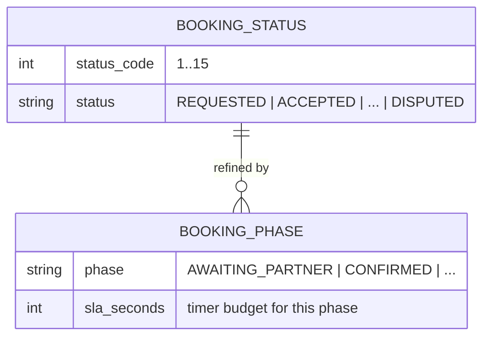

### 2.3 Canonical Status Codes (Layer 1)

| Code | Status | Terminal | Meaning |
|---|---|:--:|---|
| 1 | `REQUESTED` | No | Booking created; awaiting partner acceptance and/or advance payment |
| 2 | `ACCEPTED` | No | Partner accepted; job not yet started |
| 3 | `EN_ROUTE` | No | Partner travelling to the customer |
| 4 | `STARTED` | No | Work in progress (customer arrival confirmed) |
| 5 | `COMPLETED` | No | Work finished; invoice issued; balance pending |
| 6 | `CLOSED` | **Yes** | Payment settled, rating window open, commission accrued |
| 7 | `CANCELLED_BY_CUSTOMER` | **Yes** | Cancelled by the customer |
| 8 | `CANCELLED_BY_TECHNICIAN` | **Yes** | Cancelled by the assigned partner |
| 9 | `REJECTED` | No | Partner declined the offer; re-offer follows |
| 10 | `EXPIRED` | No | No partner accepted within the window |
| 11 | `NO_SHOW` | **Yes** | Nobody attended. **In this table the only transition that enters it is `T-31`, whose guard is customer-side absence** — see §3.4 (`OD-DOC-12`) for the technician-side gap |
| 12 | `RESCHEDULED` | No | Temporary; returns to `REQUESTED` or `ACCEPTED` |
| 13 | `REFUND_PENDING` | No | Refund requested, awaiting processing |
| 14 | `REFUNDED` | **Yes** | Money returned to the customer |
| 15 | `DISPUTED` | No | Under complaint/dispute review |

### 2.4 Operational Phases (Layer 2)

| Phase | Parent status | Meaning | Default SLA |
|---|---|---|---|
| `AWAITING_ADVANCE_PAYMENT` | `REQUESTED` | Booking created, advance required and not yet paid | 15 min |
| `AWAITING_PARTNER` | `REQUESTED` | Advance settled (or not required); offer dispatched to the partner | 5 min direct · 10 min feed |
| `CONFIRMED` | `ACCEPTED` | Partner accepted; awaiting departure | — |
| `PARTNER_EN_ROUTE` | `EN_ROUTE` | Partner travelling | Per zone arrival SLA |
| `ARRIVED` | `EN_ROUTE` | Partner on site; arrival recorded; awaiting OTP | 10 min |
| `DIAGNOSIS` | `STARTED` | Fault being diagnosed; estimate being formed | Per category |
| `AWAITING_CUSTOMER_APPROVAL` | `STARTED` | Estimate or additional work presented; awaiting customer | 60 min |
| `IN_PROGRESS` | `STARTED` | Approved work under way | Per category |
| `AWAITING_PAYMENT` | `COMPLETED` | Invoice issued; balance outstanding | Per policy |
| `RATING_PENDING` | `CLOSED` | Awaiting the customer's rating | 7 days |
| `REVIEWED` | `CLOSED` | Rated; the booking is fully settled | — |
| `REASSIGNING` | any non-terminal | Partner change or re-offer in progress | 10 min |
| `SUSPENDED` | any non-terminal | Held by an operator (fraud, safety, quality investigation) | Manual release |

> `ARRIVED` and `AWAITING_CUSTOMER_APPROVAL` are the two phases the master prompt's candidate model
> introduces explicitly (`arrived`, `awaiting_customer_approval`). Both are now first-class,
> SLA-bearing positions rather than implicit attributes.

### 2.5 Status ↔ Phase Validity Matrix

Only the pairs below are legal. Any other combination is a data-integrity defect.

| Status | Legal phases |
|---|---|
| `REQUESTED` | `AWAITING_ADVANCE_PAYMENT`, `AWAITING_PARTNER` |
| `ACCEPTED` | `CONFIRMED`, `REASSIGNING`, `SUSPENDED` |
| `EN_ROUTE` | `PARTNER_EN_ROUTE`, `ARRIVED`, `REASSIGNING`, `SUSPENDED` |
| `STARTED` | `DIAGNOSIS`, `AWAITING_CUSTOMER_APPROVAL`, `IN_PROGRESS`, `SUSPENDED` |
| `COMPLETED` | `AWAITING_PAYMENT` |
| `CLOSED` | `RATING_PENDING`, `REVIEWED` |
| `CANCELLED_BY_CUSTOMER` | — (terminal) |
| `CANCELLED_BY_TECHNICIAN` | — (terminal) |
| `REJECTED` | `REASSIGNING` |
| `EXPIRED` | `REASSIGNING` |
| `NO_SHOW` | — (terminal) |
| `RESCHEDULED` | `AWAITING_PARTNER` |
| `REFUND_PENDING` | — |
| `REFUNDED` | — (terminal) |
| `DISPUTED` | `SUSPENDED` |

---

## 3. Booking Transition Table

**Actors:** `CUST` = customer · `TECH` = assigned partner · `SYS` = system/job · `CCO` = support agent ·
`COORD` = branch coordinator · `OPER` = platform operator · `ADMIN` = platform admin ·
`ACCT` = accountant · `GATEWAY` = payment provider callback.

| # | From status | From phase | Event | To status | To phase | Actor | Guard | Side effects | Notification | Audit / event |
|---|---|---|---|---|---|---|---|---|---|---|
| T-01 | — | — | `booking.create` | `REQUESTED` | `AWAITING_ADVANCE_PAYMENT` or `AWAITING_PARTNER` | CUST / COORD / CCO | Serviceability passes (ADR-004); slot valid; price snapshot computed; branch resolved | Insert booking + price snapshot + coupon reservation in one transaction; dispatch offer | Push + SMS + WhatsApp to customer; offer to partner | `booking_events` `created`; `audit_events` |
| T-02 | `REQUESTED` | `AWAITING_ADVANCE_PAYMENT` | `advance.paid` | `REQUESTED` | `AWAITING_PARTNER` | GATEWAY | Signature verified; amount == expected advance; booking code matches receipt | Mark payment `SUCCESS`; release the advance reservation; dispatch offer | Push to customer; push to partner | `booking_events` `advance_paid` |
| T-03 | `REQUESTED` | `AWAITING_ADVANCE_PAYMENT` | `advance.failed` | `REQUESTED` | `AWAITING_ADVANCE_PAYMENT` | GATEWAY | — | Mark payment `FAILED`; keep the booking for the retry window | SMS to customer with a retry link | `booking_events` `advance_failed` |
| T-04 | `REQUESTED` | `AWAITING_ADVANCE_PAYMENT` | `advance.timeout` | `EXPIRED` | — | SYS | Retry window elapsed | Release coupon reservation; auto-refund any captured advance | Notify customer + partner | `booking_events` `advance_timeout` |
| T-05 | `REQUESTED` | `AWAITING_PARTNER` | `offer.accept` | `ACCEPTED` | `CONFIRMED` | TECH | Offer not expired; technician still eligible; assignment row not taken by another partner | Insert `booking_assignments`; set `technician_id`; create the workflow instance from the template version | Push + WhatsApp to customer; push to partner | `booking_events` `accepted` |
| T-06 | `REQUESTED` | `AWAITING_PARTNER` | `offer.reject` | `REJECTED` | `REASSIGNING` | TECH | Reason provided | Record the rejection reason; rotate to the next candidate | Push to customer (reassignment in progress) | `booking_events` `rejected` |
| T-07 | `REQUESTED` | `AWAITING_PARTNER` | `offer.expire` | `EXPIRED` | `REASSIGNING` | SYS | Acceptance window elapsed | Rotate to the next candidate | — | `booking_events` `offer_expired` |
| T-08 | `REJECTED` / `EXPIRED` | `REASSIGNING` | `reoffer` | `REQUESTED` | `AWAITING_PARTNER` | SYS | A further eligible candidate exists | Dispatch the next offer | — | `booking_events` `reoffered` |
| T-09 | `REJECTED` / `EXPIRED` | `REASSIGNING` | `candidates.exhausted` | `EXPIRED` | — | SYS | Candidate pool empty | Alert the branch; offer a callback / waitlist entry (ADR-023) | Push + SMS to customer | `booking_events` `candidates_exhausted` |
| T-10 | `ACCEPTED` | `CONFIRMED` | `partner.start_route` | `EN_ROUTE` | `PARTNER_EN_ROUTE` | TECH | — | Start location broadcast | Push + WhatsApp (map link) to customer | `booking_events` `en_route` |
| T-11 | `EN_ROUTE` | `PARTNER_EN_ROUTE` | `partner.arrive` | `EN_ROUTE` | `ARRIVED` | TECH | — | Record arrival timestamp and geo point | Push to customer ("partner arrived") | `booking_events` `arrived` |
| T-12 | `EN_ROUTE` | `ARRIVED` | `otp.verified` | `STARTED` | `DIAGNOSIS` | TECH | Customer OTP valid and unexpired | Record OTP verification; activate the workflow instance; start the diagnosis step | Push + SMS to customer | `booking_events` `started`; OTP event |
| T-13 | `STARTED` | `DIAGNOSIS` | `estimate.submitted` | `STARTED` | `AWAITING_CUSTOMER_APPROVAL` | TECH | The estimate exceeds the snapshot by more than the configured threshold, or the template requires approval | Create the approval record; send the approval link | Push + WhatsApp (approval request) to customer | `booking_events` `estimate_submitted` |
| T-14 | `STARTED` | `AWAITING_CUSTOMER_APPROVAL` | `customer.approve` | `STARTED` | `IN_PROGRESS` | CUST | Approval record is pending and within its TTL | Mark the approval `APPROVED`; apply the approved additions as `booking_adjustments` | Push to partner | `booking_events` `approved` |
| T-15 | `STARTED` | `AWAITING_CUSTOMER_APPROVAL` | `approval.timeout` | `STARTED` | `DIAGNOSIS` | SYS | The approval TTL elapsed | Escalate to the branch; the partner cannot complete | Notify customer + branch | `booking_events` `approval_timeout` |
| T-16 | `STARTED` | `AWAITING_CUSTOMER_APPROVAL` | `customer.reject` | `STARTED` | `DIAGNOSIS` | CUST | — | Mark the approval `REJECTED`; notify the partner | Push + WhatsApp to partner | `booking_events` `approval_rejected` |
| T-17 | `STARTED` | `IN_PROGRESS` | `job.complete` | `COMPLETED` | `AWAITING_PAYMENT` | TECH | All mandatory checklist items and evidence satisfied; no blocked step remains | Issue the invoice from the snapshot + adjustments; accrue commission (async); open the rating window | Push + WhatsApp + email to customer | `booking_events` `completed`; `invoice.issued` |
| T-18 | `STARTED` | `IN_PROGRESS` | `job.partial_complete` | `COMPLETED` | `AWAITING_PAYMENT` | TECH | The template allows partial completion; the completed portion is itemised | Issue a partial invoice; record the uncompleted scope | Notify customer; open a support ticket if required | `booking_events` `partially_completed` |
| T-19 | `COMPLETED` | `AWAITING_PAYMENT` | `payment.captured` | `CLOSED` | `RATING_PENDING` | GATEWAY / TECH | Signature verified; amount == invoice balance | Mark the invoice `PAID`; accrue commission if not already accrued | Push + WhatsApp + email to customer and partner | `booking_events` `paid` |
| T-20 | `COMPLETED` | `AWAITING_PAYMENT` | `invoice.due_elapsed` | `COMPLETED` | `AWAITING_PAYMENT` | SYS | Outstanding-balance policy elapsed | Flag for the collection workflow; open a finance ticket | SMS reminder to customer | `booking_events` `invoice_overdue` |
| T-21 | `COMPLETED` | `AWAITING_PAYMENT` | `rating.timeout` | `CLOSED` | `REVIEWED` | SYS | The rating window elapsed without a rating | Close the booking without a rating | — | `booking_events` `rating_timeout` |
| T-22 | `CLOSED` | `RATING_PENDING` | `customer.rate` | `CLOSED` | `REVIEWED` | CUST | Within the rating window; no complaint suppresses it | Insert the rating; recompute the technician score | Push to partner | `booking_events` `rated` |
| T-23 | `COMPLETED` | `AWAITING_PAYMENT` | `refund.request` | `REFUND_PENDING` | — | CUST / CCO | Refund policy eligibility passes | Create the refund record (`REQUESTED`); if above the CCO limit, route to `ACCT` | Notify customer | `booking_events` `refund_requested` |
| T-24 | `REFUND_PENDING` | — | `refund.completed` | `REFUNDED` | — | GATEWAY / ACCT | Provider confirms the refund | Mark the refund `COMPLETED`; reverse the accrual via a credit note in the next period | Push + SMS to customer | `booking_events` `refunded` |
| T-25 | `REFUND_PENDING` | — | `refund.rejected` | `COMPLETED` | `AWAITING_PAYMENT` | ACCT | Policy does not permit the refund | Mark the refund `REJECTED` with a reason | Notify customer with the reason | `booking_events` `refund_rejected` |
| T-26 | any non-terminal | any | `cancel.by_customer` | `CANCELLED_BY_CUSTOMER` | — | CUST / CCO | Cancellation policy permits it at the current elapsed time | Compute the penalty and the refundable advance **from the tier table in `04` §6.1** (the elapsed-time bands, the 50% band and the ₹100-or-10% cap live there, not here); release the coupon reservation; cancel the workflow instance; notify the partner | Push + SMS + WhatsApp to customer and partner | `booking_events` `cancelled_by_customer` |
| T-27 | `ACCEPTED` / `EN_ROUTE` | any | `cancel.by_technician` | `CANCELLED_BY_TECHNICIAN` | — | TECH | Reason provided | Compute the penalty **from `04` §6.1**; release the coupon reservation; re-route to another partner; record the technician's rejection metric | Notify customer + branch | `booking_events` `cancelled_by_technician` |
| T-28 | `ACCEPTED` / `EN_ROUTE` | any | `change_technician.request` | `RESCHEDULED` | `REASSIGNING` | CUST / CCO | The eligibility window permits it; the fee (if any) is disclosed and accepted | Cancel the current assignment; dispatch a new offer | Notify customer + both partners | `booking_events` `technician_change_requested` |
| T-29 | `RESCHEDULED` | `REASSIGNING` | `reoffer` | `REQUESTED` | `AWAITING_PARTNER` | SYS | — | Dispatch the offer | — | `booking_events` `reoffered` |
| T-30 | `ACCEPTED` / `EN_ROUTE` | any | `reschedule.request` | `RESCHEDULED` | `AWAITING_PARTNER` | CUST / COORD / CCO | The rescheduling policy permits it; the fee (if any) is disclosed | Release the slot; re-dispatch the offer | Notify customer + partner | `booking_events` `rescheduled` |
| T-31 | `EN_ROUTE` | `ARRIVED` | `no_show` | `NO_SHOW` | — | SYS / COORD | **The customer** did not attend and the wait threshold elapsed; see §3.4 — there is no counterpart for a technician who does not attend | Apply the no-show penalty; compute the refundable advance **from `04` §6.1** | Notify customer + branch | `booking_events` `no_show` |
| T-32 | any non-terminal | any | `dispute.open` | `DISPUTED` | `SUSPENDED` | CUST / CCO | A support ticket exists | Freeze the rating prompt; open the ticket; suppress auto-close | Notify the branch + partner | `booking_events` `disputed` |
| T-33 | `DISPUTED` | `SUSPENDED` | `dispute.resolve` | `CLOSED` | `REVIEWED` or `REFUND_PENDING` | CCO / ADMIN | A resolution is recorded | Apply the resolution (rework booking, refund, or close) | Notify customer + partner | `booking_events` `dispute_resolved` |
| T-34 | any non-terminal | any | `transfer.request` | — | unchanged | OPER / ADMIN | Target branch is `ACTIVE` and holds a tax registration for the place of supply | Create a `booking_transfers` record; move `branch_id`; split future accrual | Notify customer + both branches | `booking_events` `transferred`; `audit_events` |
| T-35 | any non-terminal | any | `suspend` | unchanged | `SUSPENDED` | OPER / ADMIN | A reason is supplied | Freeze all transitions except cancellation and admin resolution | Notify customer + branch + partner | `booking_events` `suspended`; `audit_events` |
| T-36 | any non-terminal | any | `unsuspend` | unchanged | previous phase | OPER / ADMIN | A reason is supplied | Restore the prior phase | Notify customer + branch | `booking_events` `unsuspended`; `audit_events` |
| T-37 | `CLOSED` / `REFUNDED` / `CANCELLED_*` / `NO_SHOW` | — | `reopen` | `RESCHEDULED` | `REASSIGNING` | ADMIN | A reason is supplied | Reopen for rework; the original history is preserved | Notify customer + partner | `booking_events` `reopened`; `audit_events` |

### 3.1 Terminality Rule

`CLOSED`, `REFUNDED`, `CANCELLED_BY_CUSTOMER`, `CANCELLED_BY_TECHNICIAN` and `NO_SHOW` are terminal.
The **only** transition out of a terminal status is `reopen` (T-37), which is `ADMIN`-only, requires a
reason, and is recorded in `audit_events`. This preserves history while allowing genuine rework.

### 3.2 Idempotency and Concurrency

| Scenario | Protection | Result if violated |
|---|---|---|
| Duplicate booking submission | `Idempotency-Key` header + `idempotency_keys` row | The original booking is returned; no second booking |
| Duplicate payment callback | `payments` unique on `(provider, provider_ref)` | The second callback is a no-op; the state change happens once |
| Concurrent partner acceptance | `booking_assignments` partial unique index on `booking_id` where `unassigned_at IS NULL` | One partner wins; the other receives `409 STATE_CONFLICT` |
| Concurrent coupon redemption | Conditional update `WHERE used_count < max_uses` inside the transaction | `422 COUPON_USAGE_LIMIT_REACHED` |
| Complete + cancel race | Optimistic lock on `bookings.version` | One transition wins; the invoice exists iff the job completed |
| Stale client update | `If-Match: <version>` | `412 PRECONDITION_FAILED` |
| Network loss during a status update | Client re-fetches the booking; the transition is idempotent by event key | The client converges to server truth (ADR-013) |

### 3.3 Recovery and Timeout Summary

| Timer | Default | On expiry | Escalation |
|---|---|---|---|
| Advance payment window | 15 min | T-04 → `EXPIRED` | Notify customer; release the coupon reservation |
| Direct acceptance window | 5 min | T-07 → `EXPIRED` → T-08 | Next candidate |
| Feed acceptance window | 10 min | T-07 → `EXPIRED` → T-08 | Next candidate; alert the branch if exhausted |
| Arrival SLA | P1 60 min · P2 4 h · P3 24 h (by zone) | Alert the branch; customer notified | `ADMIN` if breached by > 2× |
| OTP validity | 10 min `[OPEN]` (`OD-DOC-24` — `21` `OD-SMS-03` recommends 5 min) | Re-issue | — |
| Approval TTL | 60 min | T-15 → back to `DIAGNOSIS` | Branch |
| Rating window | 7 days | T-21 → `CLOSED`/`REVIEWED` | — |
| Invoice due | Per policy | T-20 → finance ticket | `ACCT` |
| Refund SLA | 72 h | Finance alert | `ACCT` → `ADMIN` |

### 3.4 Gaps in this table (registered, not resolved)

The audit found two places where a real event has no transition. Neither is decided here — both are
owner questions registered in `21` §7, and the recommended direction is `[PROPOSED]` so the shape can
be reviewed before anyone builds it.

| # | Gap | Why it is not covered today | Registered as |
|---|---|---|---|
| 1 | **A technician who does not attend.** The customer waits, nobody arrives, and nothing changes state. | `T-31` is guarded on *customer* absence. `T-27` needs the technician to actively press cancel, so a technician who simply does not turn up produces no event at all. `TRK-02` (`04` §3.5) covers an *offline* technician while `EN_ROUTE` for 20+ minutes — a connectivity condition, not an attendance one. The booking stays in `EN_ROUTE` with no clock and no owner. | `OD-DOC-12` `[BLOCKER]` — `[PROPOSED]` direction: a job-level `TECH_NO_SHOW` exception entered by a timer on the Arrival SLA breach plus a customer report, with four effects: re-dispatch (`T-28` shape), full advance refund regardless of the `04` §6.1 tier, a technician penalty, and an automatic `P1` `QUALITY_COMPLAINT` ticket |
| 2 | **The `EN_ROUTE` → `ARRIVED` clock.** §3.3's "Arrival SLA" row raises an alert and notifies the customer, but names no transition, so the breach is invisible to the state machine and cannot be reported as a missed appointment. | Every other timer in §3.3 resolves to a `T-xx`. This one resolves to a notification. | `OD-DOC-12` (same root cause — the missing attendance state) |

> **Timer-to-transition rule.** A timer that appears in §3.3 **must** name the transition it fires.
> A timer whose expiry produces only a notification is monitoring, not workflow, and belongs in `13`
> (observability) rather than in this table. `EN_ROUTE` currently violates this rule and is exempted
> only until `OD-DOC-12` closes.

---

## 4. Booking State Diagram

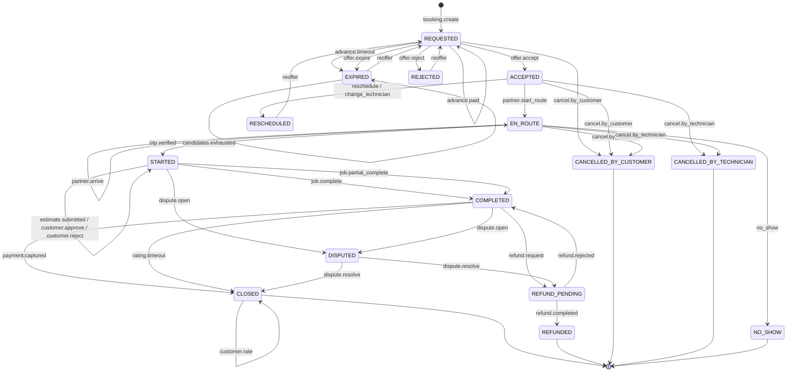

---

## 5. Serviceability Resolution (ADR-004)

This is **not** a state machine but a gate that every booking creation passes through. It is
documented here because it shares the same guard machinery.

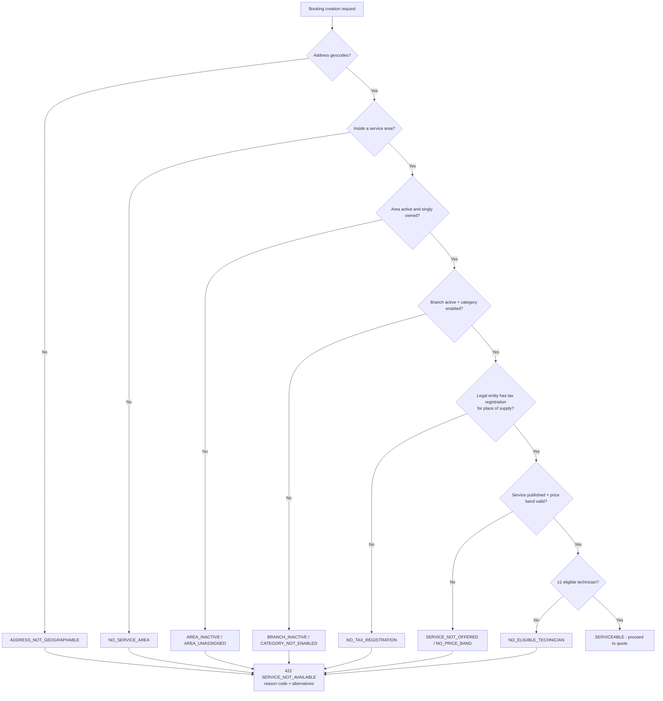

**Rule** — a confirmed booking for a non-serviceable location is **impossible**. The API returns
`422 SERVICE_NOT_AVAILABLE` with the reason code; the customer-facing message explains the limitation
and offers the approved alternatives in ADR-023 (explain and offer another service, waitlist entry,
callback request, enquiry).

---

## 6. Workflow Engine State Machine

The workflow engine drives the *execution* of a job inside a booking. It is separate from the
booking state machine and runs concurrently with it.

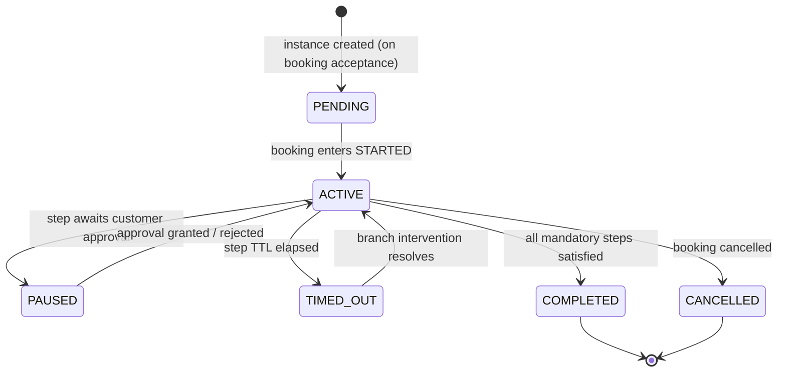

### 6.1 Step State Machine

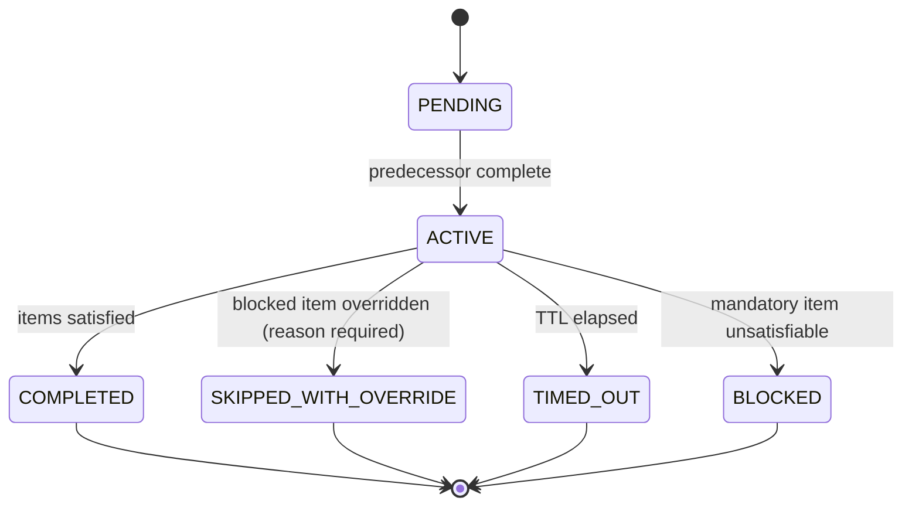

| Rule | Statement |
|---|---|
| WS-01 | A step cannot be completed before its predecessor is complete. |
| WS-02 | A mandatory step blocks `COMPLETED` on the booking until satisfied. |
| WS-03 | A non-mandatory step may be skipped only with a reason, which is audited and visible to the branch. |
| WS-04 | `SKIPPED_WITH_OVERRIDE` requires `job:override` and a reason; it is flagged in the QA report. |
| WS-05 | A `BLOCKED` step cannot be overridden by the technician — it requires branch intervention. |
| WS-06 | Template versions are immutable; a change creates a new effective-dated version. In-flight instances keep the version captured at booking (ADR-010). |

---

## 7. Booking Transfer State Machine

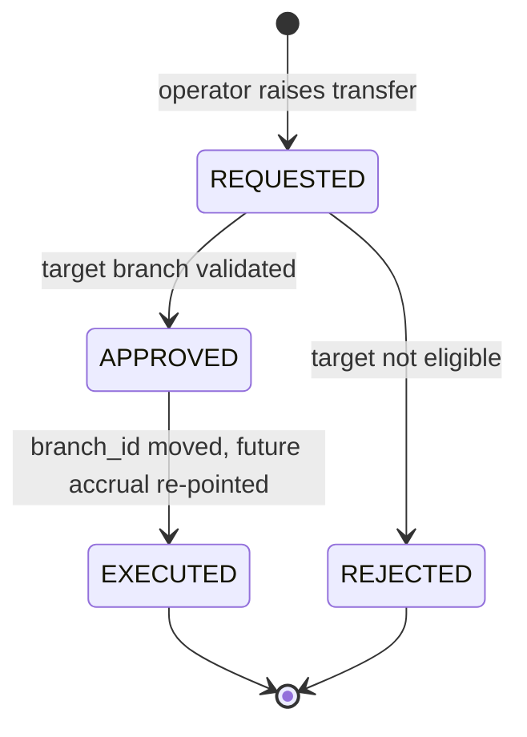

| Rule | Statement |
|---|---|
| TR-01 | Only `OPERATOR` or `ADMIN` may raise a transfer. |
| TR-02 | The target branch must be `ACTIVE`, own the service area, or hold an explicit cross-branch agreement, and must hold a tax registration for the place of supply. |
| TR-03 | A transfer is permitted only while the booking is non-terminal. |
| TR-04 | Commission already accrued is **not** moved. Future accrual follows the new owning branch. |
| TR-05 | The customer and both branches are notified. |
| TR-06 | Every transfer writes a `booking_transfers` row and an `audit_events` entry with the reason. |

---

## 8. Technician Onboarding State Machine

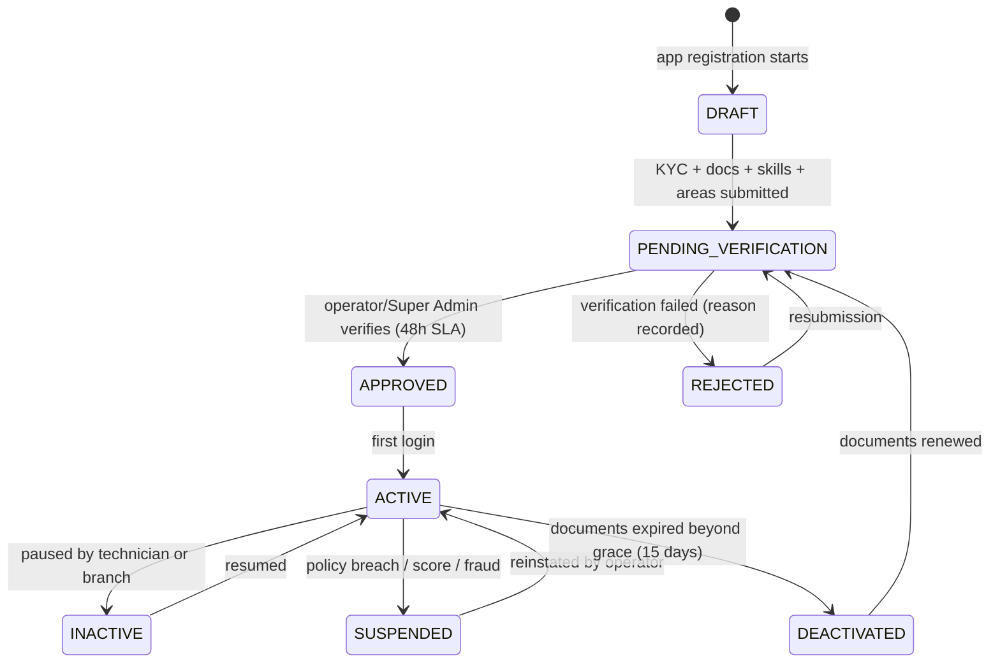

| Rule | Statement |
|---|---|
| TC-01 | A technician in a state other than `ACTIVE` cannot accept an offer. |
| TC-02 | `SUSPENDED` does not cancel jobs already assigned; those continue or are reassigned by the branch. |
| TC-03 | Document expiry beyond the 15-day grace auto-transitions `ACTIVE → DEACTIVATED` via a scheduled job. |
| TC-04 | Verification approval SLA is 48 hours, escalating to `ADMIN` at 72 hours. |

---

## 9. Partner & Branch Approval State Machine

```mermaid
stateDiagram-v2
    [*] --> PENDING: application submitted
    PENDING --> UNDER_REVIEW: operator picks up
    UNDER_REVIEW --> APPROVED: KYC, tax registration, territory, pricing all valid
    UNDER_REVIEW --> REJECTED: fails a readiness criterion
    UNDER_REVIEW --> NEEDS_INFO: additional documents required
    NEEDS_INFO --> UNDER_REVIEW: applicant responds
    REJECTED --> PENDING: re-application
    APPROVED --> ACTIVE: accounts provisioned, territory allocated
    ACTIVE --> SUSPENDED: emergency suspension
    SUSPENDED --> ACTIVE: reinstated
    ACTIVE --> CLOSED: branch closed; settlements finalised
    SUSPENDED --> CLOSED: terminated
```

| Rule | Statement |
|---|---|
| PA-01 | Only `OPERATOR` or `SUPER_ADMIN` may approve or reject a partner organisation or branch (ADR-017). |
| PA-02 | Self-approval is blocked (`403 SELF_APPROVAL_BLOCKED`). |
| PA-03 | A branch cannot become `ACTIVE` without: a legal entity, a tax registration for the place of supply, an allocated territory, a published price band, and a signed readiness checklist (ADR-017). |
| PA-04 | Termination requires settling all outstanding statements and issuing a final settlement before `CLOSED`. |

---

## 10. Coupon State Machine

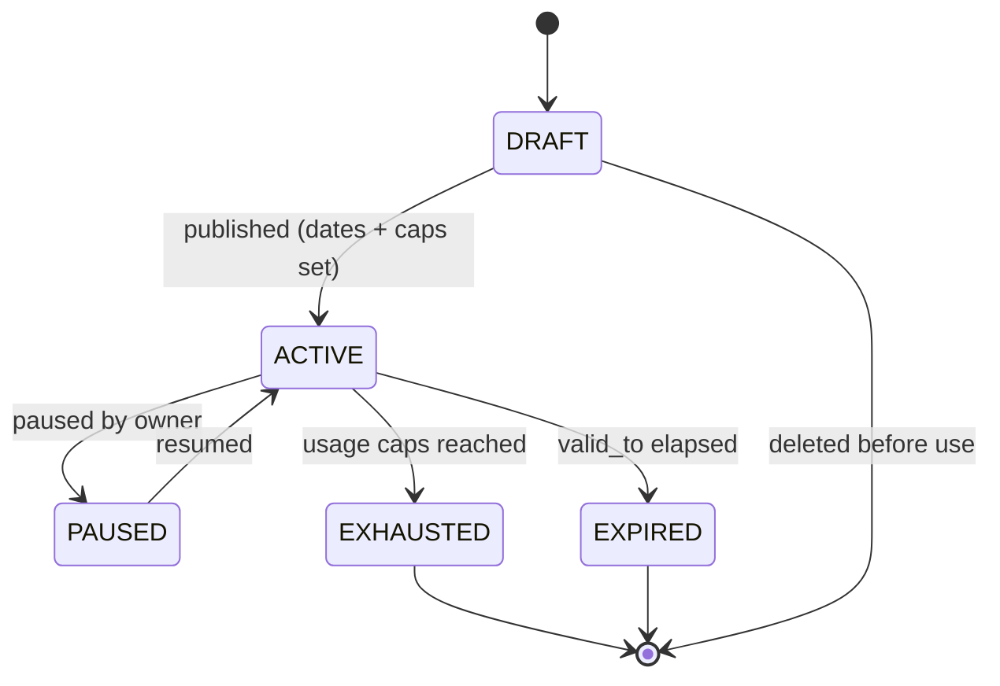

| Rule | Statement |
|---|---|
| CP-01 | A coupon may only be redeemed in `ACTIVE`. |
| CP-02 | `EXHAUSTED` and `EXPIRED` coupons remain visible to their owner for reporting but cannot be redeemed. |
| CP-03 | Editing an `ACTIVE` coupon's value, funding type or caps creates a **new version**; bookings already redeemed keep the terms in force at redemption time. |

---

## 11. Invoice, Payment and Refund State Machines

### 11.1 Invoice

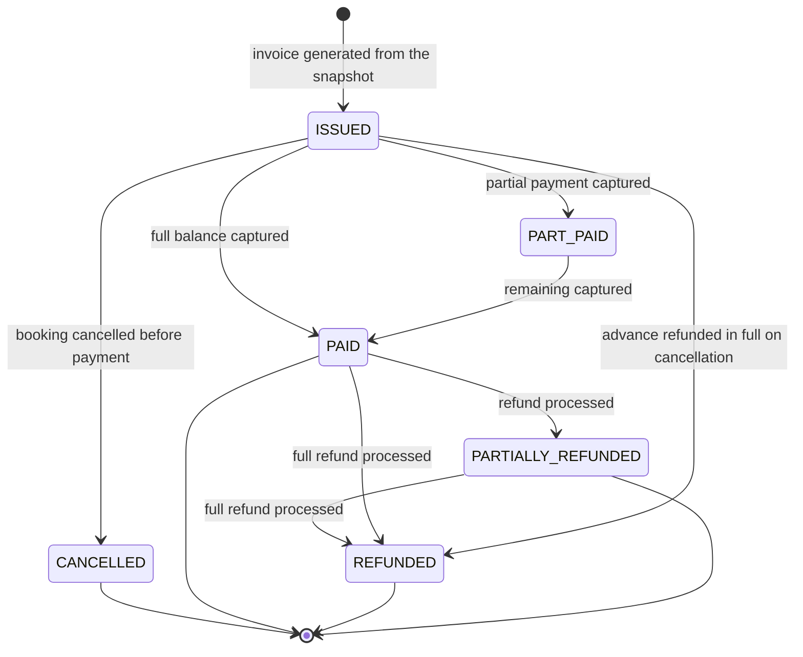

### 11.2 Payment

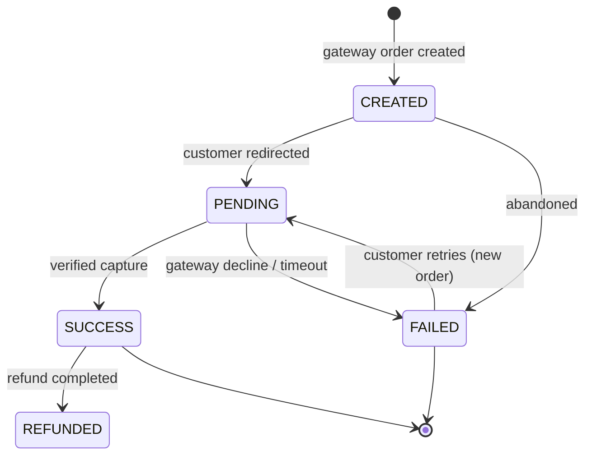

### 11.3 Refund

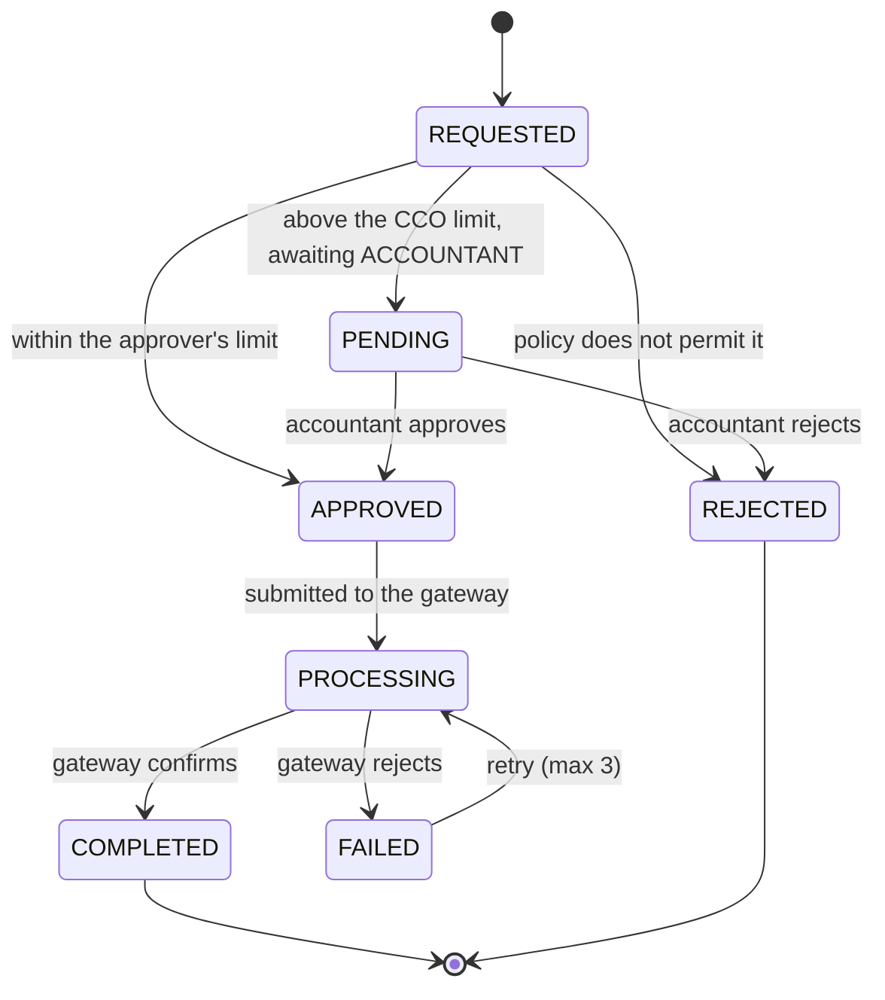

| Rule | Statement |
|---|---|
| FP-01 | A refund is always linked to the original `payment_id`. Unlinked credits are not permitted. |
| FP-02 | A refund above the CCO's goodwill limit cannot be approved by a CCO (ADR-016). |
| FP-03 | A refund never edits the original invoice. It creates a refund record and moves the invoice to `PARTIALLY_REFUNDED` / `REFUNDED`. |
| FP-04 | Commission accrued on a refunded booking is reversed by a **credit note in the next settlement period**, never by editing the ledger. |

---

## 12. Commission & Settlement State Machine

```mermaid
stateDiagram-v2
    [*] --> ACCRUED: job completed, commission accrued
    ACCRUED --> SETTLED: included in an issued statement
    ACCRUED --> ADJUSTED: credit/debit note applied before settlement
    SETTLED --> DISPUTED: partner disputes a line (within 5 business days)
    DISPUTED --> SETTLED: dispute resolved without change
    DISPUTED --> ADJUSTED: dispute upheld; credit note issued
    SETTLED --> PAID: partner payment received and matched
    SETTLED --> OVERDUE: due date passed without payment
    OVERDUE --> PAID: payment received late
    SETTLED --> CLOSED: reconciliation complete
    PAID --> CLOSED: reconciliation complete
    CLOSED --> [*]
```

| Rule | Statement |
|---|---|
| CS-01 | A statement is `GENERATED → ISSUED` at most once per `(partner_org_id, branch_id, period)`. |
| CS-02 | Once `ISSUED`, the statement's monetary fields are immutable (ADR-015). |
| CS-03 | `OVERDUE` triggers a reminder at D+5 and an escalation at D+7. |
| CS-04 | `CLOSED` requires the reconciliation pass to report zero differences. |

---

## 13. Support Ticket State Machine

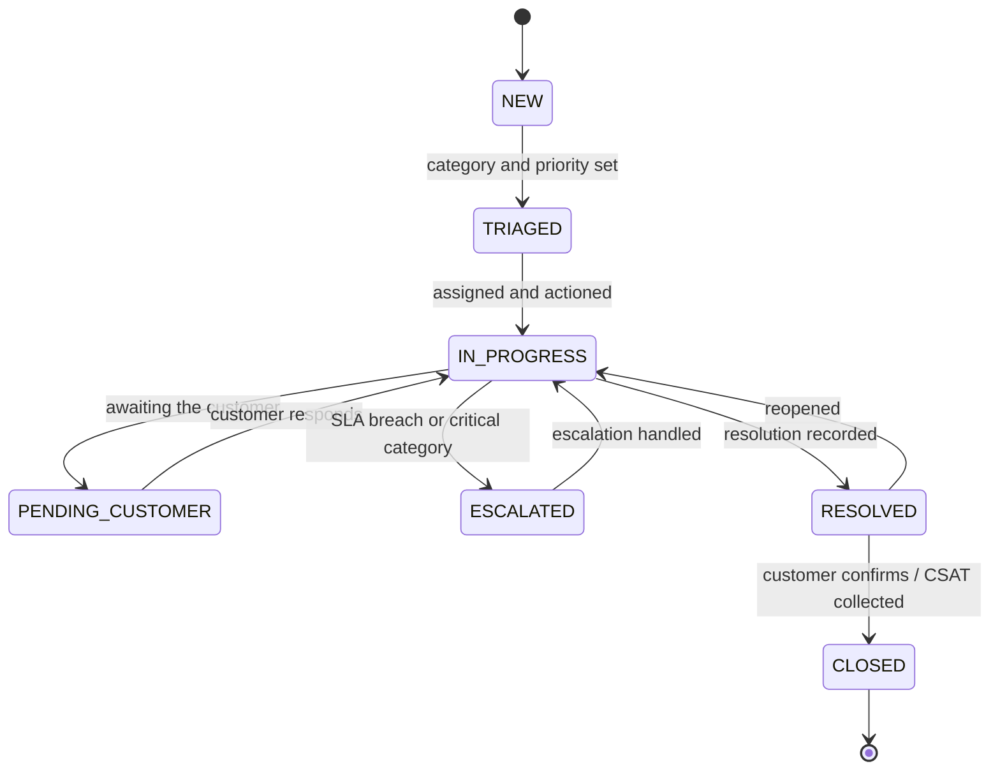

| Rule | Statement |
|---|---|
| TK-01 | The SLA response clock starts at `NEW`; the resolution clock starts at `TRIAGED`. |
| TK-02 | A `P1` ticket escalates to `ADMIN` immediately on creation, bypassing the queue. |
| TK-03 | A complaint suppresses the booking's automatic rating prompt until the ticket closes (`05` §5 Use Case E, rule E-03). |
| TK-04 | A ticket may not be deleted. It is closed with a resolution. |

---

## 14. Transition Audit Record

Every transition writes one row.

```
booking_events
  id             UUID PK
  booking_id     UUID FK -> bookings
  seq            INTEGER          -- gapless, monotonic per booking
  from_status    ENUM (nullable)  -- null on creation
  to_status      ENUM
  from_phase     ENUM (nullable)
  to_phase       ENUM
  event_type     VARCHAR(64)      -- matches the transition table event name
  actor_type     ENUM(CUSTOMER, TECHNICIAN, SYSTEM, STAFF, GATEWAY, PARTNER)
  actor_id       UUID (nullable)
  reason_code    VARCHAR(64) (nullable)
  metadata       JSONB            -- amounts, penalty values, override details
  created_at     TIMESTAMPTZ
  UNIQUE (booking_id, seq)
```

**Rules**
- AE-01 — `seq` is gapless. A gap indicates data loss and is a P1 incident.
- AE-02 — The event log is append-only. `UPDATE` and `DELETE` are blocked by trigger.
- AE-03 — Replaying the event log in `seq` order must reproduce the current `(status, phase)` — asserted by a nightly job.
- AE-04 — Monetary transitions carry the amounts in `metadata` so the financial audit does not require joining the invoice tables.

---

## 15. Cross-Reference

| Machine | Primary document | Related |
|---|---|---|
| Booking status + phase | `04` §4, this document §2–§3 | `09` §4.6, `10` §5 |
| Serviceability gate | This document §5 | `02` §6, ADR-004 |
| Workflow engine | `06` §3 | This document §6, `09` §4.7 |
| Booking transfer | This document §7 | `02` §5, ADR-005 |
| Technician onboarding | `03` §7.2 | This document §9 |
| Partner/branch approval | `03` §2.2 | This document §10, ADR-017 |
| Coupon | `07` §5 | This document §11, ADR-008 |
| Invoice / payment / refund | `07` §6–§7 | This document §12 |
| Commission / settlement | `07` §7 | This document §13, ADR-009 |
| Support ticket | `05` §6 | This document §14 |

---

## 16. Revision History

| Version | Date | Author | Summary | Sections changed |
|---|---|---|---|---|
| 1.1 | 2026-10-21 | Product Lead + Engineering Lead | Audit pass 3. **§3.4 Gaps in this table (registered, not resolved)** added: `T-31 no_show` and the `NO_SHOW` status are **customer-side only** — the table has no technician failure-to-attend state, no transition and no consequence chain (re-route, advance refund, penalty, ticket), registered as `OD-DOC-12`; and nothing in the arrival sequence is driven by a clock once `EN_ROUTE` is entered, for which the **Timer-to-transition rule** now states the principle (every timeout in §3.3 names the transition it fires, and a timer with no transition is not a control). §2.3 and §3 annotated so `NO_SHOW`/`T-31` cannot be read as covering the technician. `TK-03` re-cited to `05` §5 Use Case E. The `04` tracking rules referenced here were renamed `TRK-01…03` in `04` v1.2 to end the collision with §7's `TR-xx` transfer rules. | §2.3, §3, §3.3, §3.4, §13, Revision History |
| 1.0 | 2026-10-21 | Product Lead + Engineering Lead | Initial consolidated state-machine reference. Introduces the ADR-002 two-layer model, 37 booking transitions, and transition tables for 9 further machines. | All |
