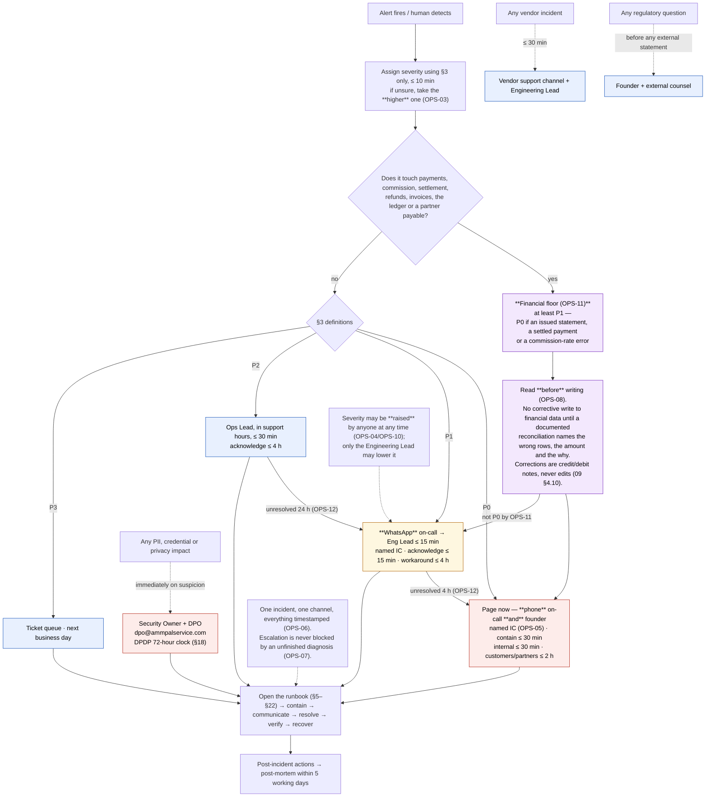

# 25 — Operations Runbooks & Incident Response

| Field | Value |
|---|---|
| Document ID | AMM-SVC-DOC-25 |
| Version | 1.3 |
| Status | Approved for Design & Development |
| Owner | Engineering Lead + Operations Lead |
| Classification | Internal — Confidential |
| Last Updated | 2026-10-21 |
| Depends On | `13`, `16`, `19` |

---

## 1. Purpose

This document defines **how AmmPal Service is operated when things break**: the severity model, the on-call model, eighteen scenario runbooks, disaster recovery, backup and restore, database maintenance, and the supporting artefacts (alert catalogue, handoff template, post-mortem template, maintenance policy).

**Scope** — Infrastructure, application services, data stores, third-party integrations, and financial operations (payment reconciliation, commission accrual, settlement).
**Out of scope** — Support ticket handling (`05`), marketing crisis comms, and HR/legal process beyond the notification path in §18.

**Rule OPS-01** — *Nothing in this document has been executed.* There is no application source code, no deployed environment, no running monitoring stack and no operational history in this repository — it contains documentation and four PNG diagrams only. Every runbook below is a **designed procedure with no execution history**; every command, query and threshold is a **proposal to be validated at the first game-day**, not an observed fact.

**Rule OPS-02** — A runbook is never marked "verified" until it has been executed (a game-day result or a real incident). Until then every runbook carries the marker *"designed procedure; no execution history"*.

---

## 2. How to Use a Runbook

### 2.1 The eleven-part template

| Part | Purpose |
|---|---|
| **Trigger** | The alert or detection condition that opens the runbook |
| **Severity** | The starting severity and the rule for raising/lowering it |
| **Impact assessment** | The questions answered in the first 5 minutes |
| **Diagnosis** | Ordered, concrete steps — commands, SQL, UI paths |
| **Containment** | Steps that stop the bleeding without fixing the cause |
| **Communication** | Who is told, what is said, on which channel, by when |
| **Resolution** | The actual fix |
| **Verification** | Proof it is fixed — health checks, a test booking, a reconciliation pass |
| **Recovery / rollback** | Returning to full service, or undoing a bad change |
| **Post-incident actions** | Ticketable follow-ups with owners and dates |
| **Known pitfalls** | The traps that make this incident worse |

### 2.2 Severity-first triage

```
Alert fires → Severity assigned (≤10 min) → Runbook opened → Impact assessed (5 min)
→ Contain (P0 ≤30 min) → Communicate → Resolve → Verify → Recover → Learn
```

| Rule | Statement |
|---|---|
| OPS-03 | Severity is assigned **within 10 minutes** using §3 only. If unsure, choose the higher severity. |
| OPS-04 | Severity may be **raised at any time** without a conversation; lowered only by the Engineering Lead. |
| OPS-05 | Every P0/P1 gets a **named incident commander (IC)**. The IC coordinates and communicates; they do not debug alone. |
| OPS-06 | One incident, one channel. All commands, findings and decisions go into the incident channel, timestamped. |
| OPS-07 | Escalation is **never** blocked by an unfinished diagnosis. Escalating late is a correctness failure; escalating early is free. |

### 2.3 The financial-incident rule

> **Rule OPS-08 — Diagnose before acting on a financial incident.**
> For any incident touching **payments, commission, settlement, refunds, invoices, the general ledger or a partner payable**, the responder must **read before writing**. No destructive or corrective write to financial data (deleting a ledger row, editing an issued statement, manually marking a payment captured, re-running a settlement) is permitted until the diagnosis step has produced a **documented reconciliation** showing exactly which rows are wrong, by how much, and why. A financial incident "fixed" without a reconciliation is a second incident.

This exists because AmmPal financial records are designed to be **append-only and immutable** (`09` §4.10: `commission_ledger` is append-only; a settlement statement is immutable once it leaves `GENERATED`). A well-meaning `UPDATE` destroys the audit trail that reconciliation and disputes depend on. Corrections are made with **credit and debit notes (`adjustments`)**, never with edits. `[CONFIRMED]` — the immutability rules; `[PROPOSED]` — the on-call control that enforces them.

### 2.4 Escalation paths

| Situation | Escalate to | Within |
|---|---|---|
| P0, any hour | On-call engineer **and** the founder (phone) | Immediately |
| P1, any hour | On-call engineer (WhatsApp) → Engineering Lead | 15 min |
| P2 | Operations Lead, during support hours | 30 min |
| Any financial impact | Finance Lead / Accountant | With the first internal update |
| Any PII, credential or privacy impact | Security Owner + DPO (`dpo@ammpalservice.com`) | Immediately on suspicion |
| Any vendor incident | Vendor support channel + the Engineering Lead | 30 min |
| Any regulatory question | Founder + external counsel | Before any external statement |

### 2.5 Placeholders

No real credentials, hostnames, IPs, phone numbers or customer data appear here.

| Placeholder | Meaning | Placeholder | Meaning |
|---|---|---|---|
| `<api-instance>` | The Linux VPS running API, worker and realtime | `<db-host>` | PostgreSQL 16 primary |
| `<db-replica>` | PostgreSQL streaming replica (if provisioned) | `<redis-host>` | Redis 7 instance |
| `<objstore-bucket>` | S3-compatible object-storage bucket | `<prom-host>` / `<loki-host>` | Prometheus / Loki |
| `<release-id>` | A versioned directory under `/opt/ammpal/apps/*/releases/` | `<db-name>` / `<app-user>` | Application database and least-privilege login |
| `oncall@ammpalservice.com` | On-call engineer's alias | `support@ammpalservice.com` | Customer support desk |
| `partners@ammpalservice.com` | Partner support desk | `finance@ammpalservice.com` | Finance / Accountant |
| `dpo@ammpalservice.com` | Data Protection Officer `[PROPOSED]` — OD-RSK-02 | `founder@ammpalservice.com` | Founder, final escalation authority |
| `1800-XXX-XXXX` | **Placeholder** for the customer-facing toll-free number — substituted at deployment; never committed to a document | | |

**Rule OPS-09** — Secrets are read from `/opt/ammpal/shared/env/*.env` (mode `0600`, deploy-user owned). No step ever echoes a secret to stdout, a log, a chat channel or a ticket.

### 2.6 Triage, Escalation and the Two Floors, in One Path

The §2.2 pipeline is a single line of text, and the parts that are easy to skip are the branches: the
**financial floor** (OPS-08/OPS-11) and the **duration escalation** (OPS-12). This diagram states no new
rule — every node is a citation.



**The three things this path exists to make unavoidable:** an incident that touches money is *at least*
P1 before anyone looks at impact (§3 OPS-11); a financial incident is *reconciled before it is
repaired* (§2.3 OPS-08), because the schema is append-only and an `UPDATE` destroys the audit trail
disputes depend on; and an unresolved P1 or P2 promotes itself on the clock (OPS-12), so severity does
not quietly decay across a shift boundary.

---

## 3. Severity Definitions

| Level | Definition | Examples | Response target | Escalation | Communication target |
|---|---|---|---|---|---|
| **P0** | **Critical business impact.** Platform unusable, money at risk, data lost or suspected exposed, or a regulated notification clock running. | API total outage; booking-creation failure > 3% for 5 min; settlement job failed or not run by Monday 08:00; any reconciliation mismatch; payment webhook failure > 5% for 10 min; suspected PII exposure; backup job failed | Page immediately — **phone** the on-call and the founder; contain ≤ 30 min | Founder + Eng Lead + Ops Lead (+ Finance if financial) | Internal ≤ 30 min; customer/partner ≤ 2 h; regulator per §18 inside the DPDP 72-hour window |
| **P1** | **Significant impact, no workaround.** A core flow broken for many users, or a system degrading toward P0. | Elevated 5xx on a non-payment route; p95 > 2× baseline 10 min; DB pool > 80% for 5 min; replication lag > 30 s; Redis evictions; queue depth > 10,000 for 10 min; repeated `SCOPE_VIOLATION`; signature-failure spike (a certificate expiry warning is **P2** — `AL-15`; an expired certificate actually breaking TLS is triaged as the outage it causes) | Acknowledge ≤ 15 min; **WhatsApp** the on-call; workaround ≤ 4 h | Eng Lead; Ops Lead if customer-facing | Internal ≤ 60 min; customer/partner if the workaround is visible |
| **P2** | **Limited impact, a workaround exists.** One surface degraded, or a vendor down with a defined fallback. | Telephony/IVR down (web/app/WhatsApp still books); object-storage outage (local fallback); Maps down; one notification channel failing; disk > 80% | Acknowledge ≤ 4 h in support hours | Ops Lead | Partner notice if the fallback is visible |
| **P3** | **Minor.** No functional loss — cosmetic defect, non-critical report error, documentation drift. | A stale dashboard tile; a mislabelled chart | Next business day | Ticket queue | None |

**Rule OPS-10** — Any responder may raise severity; only the Engineering Lead may lower it. A P1 that becomes a P0 on the next shift does not wait.
**Rule OPS-11** — Financial floor: any incident that could under-pay a partner, over-charge a customer or corrupt a statement is at least **P1**, and **P0** if it involves an issued statement, a settled payment or a commission-rate error.
**Rule OPS-12** — Duration-based escalation: an unresolved P1 for 4 h becomes a P0; an unresolved P2 for 24 h becomes a P1.

---

## 4. On-Call Model

### 4.1 Rotation

| Slot | Composition | Hours | Contact |
|---|---|---|---|
| **P0 rotation** | **Engineering Lead + 1 on-call engineer** | 24×7 | Phone via Alertmanager (P0 route), WhatsApp fallback |
| **P1 escalation** | On-call engineer | 24×7 (callback-only out of hours) | WhatsApp via Alertmanager |
| **P2 / P3 queue** | Operations Lead + engineer on duty | **09:00–21:00 IST, 7 days** | `oncall@ammpalservice.com`, `ops-lead@ammpalservice.com` |

### 4.2 Out-of-hours behaviour

| Rule | Statement |
|---|---|
| OPS-13 | Support hours are **09:00–21:00 IST, 7 days**. Outside them the on-call is **callback-only**. |
| OPS-14 | Out of hours a **P0 pages the on-call engineer AND the founder by phone**. Both wake. The founder is not the on-call's delegate — the on-call is the founder's delegate. |
| OPS-15 | Out of hours a **P1 does not wake anyone**: acknowledge ≤ 30 min, work at 09:00 IST — unless it is trending to P0, in which case OPS-14 applies. |
| OPS-16 | Out of hours a **P2/P3 is queued** for the next support window. |
| OPS-17 | A **P0 raised outside business hours still honours the §3 communication targets**. If a customer notice cannot be drafted at 03:00, the IC sends a holding notice and the full notice at 09:00 — a late notice is still sent. |

### 4.3 Roles during an incident

| Role | Who | Responsibility | Must not |
|---|---|---|---|
| **Incident Commander** | On-call (P0: Eng Lead) | Severity, coordination, decisions, escalation | Debug alone |
| **Technical lead** | Senior engineer on the incident | Diagnosis and resolution | Communicate externally |
| **Communications lead** | Ops Lead / Support Lead | Internal and external notices | Change technical facts |
| **Scribe** | Rotating junior engineer (P0/P1) | Timestamped log, decisions, handoffs | Solve anything |
| **Finance liaison** | Finance / Accountant | Money impact, reconciliation review | Write to financial tables without §2.3 |

**Rule OPS-18** — Only the IC may declare an incident resolved, and only after the Verification section passes.
**Rule OPS-19** — Every P0/P1 not closed within one shift ends with a **written handoff** (§26). An unwritten handoff is an incident waiting to happen.

---

## 5. Runbook — API Total Outage

**Trigger** — `AL-01` API 5xx > 2% for 5 min; or the Blackbox probe failing on `https://api.ammpalservice.com/health/live`; or the public site 5xx-ing on all routes. *(Designed procedure; no execution history.)*

**Severity** — P0 by default. P1 only if the outage is confined to a single non-public route (e.g. `/v1/reports/*`) **and** a synthetic core journey still passes.

**Impact assessment (first 5 minutes)**
- Total or partial? → `curl -sS -o /dev/null -w '%{http_code}\n' https://api.ammpalservice.com/health/live` plus one booking route; `systemctl status ammpal-api` on each instance; DB or Redis the real cause? → `pg_isready -h <db-host> -U <app-user> -d <db-name>`, `redis-cli -h <redis-host> ping`.
- A deploy involved? → `readlink -f /opt/ammpal/apps/api/current` vs the last known-good release, and the CI run list; when did it start? → the first error in Loki.
- Customers actually blocked? → the synthetic journey from `www.ammpalservice.com` (search → quote → book).

**Diagnosis**
1. Reverse proxy first — a bad proxy config is more common than a bad release: `systemctl status caddy || systemctl status nginx`; `journalctl -u caddy -n 100 --since "15 min ago"`.
2. API unit: `journalctl -u ammpal-api -n 200 --since "15 min ago"`; `journalctl -u ammpal-api -p err -n 200 --since "1 hour ago"`; crash loop? → `systemctl show ammpal-api -p NRestarts`.
3. Readiness, not liveness: `curl -fsS 'https://api.ammpalservice.com/health/ready?deep=1'` (liveness green only means the process is up).
4. Dependencies in order: Postgres → Redis → object storage → vendor APIs (`pg_isready ...`; `redis-cli -h <redis-host> ping`; `curl -fsS -o /dev/null -w '%{http_code}\n' https://<objstore-endpoint>/`).
5. Signature and resources: `logcli query '{job="ammpal-api"}' --since=15m | grep -Ei 'error|ECONN|timeout|OOM|heap'`; `free -h`; `df -h / /opt/ammpal`; `journalctl -k --since "30 min ago" | grep -Ei 'oom|killed process'`.

**Containment**
- Roll back immediately if a bad release is the cause (§ Recovery). Never debug a bad release in production.
- DB unreachable → degraded/read-only mode where the flow allows; a maintenance notice on booking creation. Object storage the cause → enable the local uploads fallback `/opt/ammpal/shared/uploads`. `[PROPOSED]`
- Memory exhausted → `systemctl restart ammpal-api` clears the heap; no state is lost (all state is in Postgres). Shed load at the edge (lower the per-IP limit) while diagnosing. `[PROPOSED]`

**Communication**
- **Founder** (phone, then email every 30 min): "P0 open. API [total outage / degraded]. Cause [known/unknown]. ETA [x]. Containment [x]." **Eng + Ops** (WhatsApp incident group, now): incident opened, IC named, roles assigned.
- **Finance** (email, now) if the payment route is affected; **Support** `support@ammpalservice.com` (≤30 min): approved holding statement + FAQ.
- **Customers** (public notice on `www.ammpalservice.com` + in-app banner, ≤2 h); **Partners** (WhatsApp to branch admins, ≤2 h): "booking requests may be delayed; do not re-submit".

**Resolution**
1. Fix the identified cause (revert release, restart a failed dependency, restore connectivity, raise a pool limit, rotate a broken secret), then `systemctl restart ammpal-api ammpal-worker ammpal-realtime` and watch `journalctl -u ammpal-api -f --since "now"` for 30 s.
2. Confirm the error rate is falling: `rate(http_requests_total{status=~"5.."}[5m])`.

**Verification**
- `curl -fsS https://api.ammpalservice.com/health/live` → 200; `curl -fsS 'https://api.ammpalservice.com/health/ready?deep=1'` → all dependencies `up`.
- The synthetic journey (Control Center → Monitoring) completes a booking end-to-end; a test booking in the Customer App reaches `REQUESTED` and is readable via `GET /v1/bookings/{id}`.
- `SELECT status, count(*) FROM bookings WHERE created_at > now() - interval '1 hour' GROUP BY status;` looks plausible vs the previous hour (no `EXPIRED` spike); Grafana 5xx rate < 0.5% for 10 min; no repeating error in `logcli query '{job="ammpal-api"}' --since=10m | grep -i error`.

**Recovery / rollback**
`ls -1t /opt/ammpal/apps/api/releases/` → `ln -sfn /opt/ammpal/apps/api/releases/<previous-release-id> /opt/ammpal/apps/api/current` → `systemctl restart ammpal-api ammpal-worker ammpal-realtime` → re-check deep health. The same pattern applies to `/opt/ammpal/apps/worker/current` and `/opt/ammpal/apps/realtime/current`. If a **migration** shipped with the bad release, an app rollback alone is insufficient — use a **compensating migration** in the Expand → Migrate → Contract order (`16` §4.3), never a manual table edit.

**Post-incident actions**
- Post-mortem (§28) — Eng Lead — 5 working days; regression test reproducing the failure — Eng — 2 weeks.
- Full §24.5 restore drill if the outage exceeded 30 min — Ops Lead — 1 week; alert-threshold review — Ops Lead — 2 weeks.

**Known pitfalls**
- `/health/live` green does **not** mean the platform works; use `/health/ready?deep=1` for customer-impact decisions.
- Restarting during an in-flight deploy races the pipeline's own rollback — check pipeline state before touching `current`.
- `Restart=always` masks the original error with restart noise — capture the first crash's stack trace before restarting; never `kill -9` the API, which holds a pool slot for the timeout duration.

---

## 6. Runbook — Elevated 5xx on Booking Creation

**Trigger** — `AL-02` booking-creation error rate > 3% for 5 min; or `POST /v1/bookings` p95 > 2× baseline for 10 min. *(Designed procedure; no execution history.)*

**Severity** — P0 when the error rate exceeds 3% for 5 min (booking creation is the revenue entry point). P1 when 1–3%, or when the latency breach is isolated to one partner branch.

**Impact assessment (first 5 minutes)**
- Failing or just slow? → Grafana → API → route `POST /v1/bookings` → 5xx rate and p95, and the 4xx-vs-5xx split; all users or a segment? → break down by `branch_id`, `category_code`, `app_version`.
- Queue growing behind the booking? → `redis-cli -h <redis-host> LLEN bull:booking:wait`; a deploy in the last 30 min? → CI run list and `readlink -f /opt/ammpal/apps/api/current`.
- Bookings written but failing later? → `SELECT status, count(*) FROM bookings WHERE created_at > now() - interval '15 minutes' GROUP BY status;`

**Diagnosis**
1. Confirm the signal is real: `logcli query '{job="ammpal-api"}' | json | grep '"path":"/v1/bookings"' | tail -50`; the dominant signature: `logcli query '{job="ammpal-api"}' --since=15m | grep -oE '"(err|message)":"[^"]+"' | sort | uniq -c | sort -rn | head`.
2. Database side — booking creation writes booking → price snapshot → coupon redemption in **one transaction**: `SELECT pid, state, wait_event_type, wait_event, now() - query_start AS runtime, left(query,160) FROM pg_stat_activity WHERE state <> 'idle' AND now() - query_start > interval '5 seconds' ORDER BY query_start;`.
3. Locks and deadlocks: `SELECT a.pid, a.wait_event_type, a.wait_event, l.locktype, l.relation::regclass, left(a.query,120) FROM pg_locks l JOIN pg_stat_activity a ON a.pid = l.pid WHERE NOT l.granted;`; pool: `SELECT state, count(*) FROM pg_stat_activity GROUP BY state;` and `SHOW max_connections;`.
4. Contract break rather than infrastructure: `logcli query '{job="ammpal-api"}' --since=30m | grep -Ei 'validation|zod|schema|dto|bad_request' | head -20`; side-effect failure after the write → `SELECT topic, status, count(*), max(created_at) FROM integration_outbox WHERE created_at > now() - interval '1 hour' GROUP BY topic, status ORDER BY 3 DESC;`

**Containment**
- Bad release → roll back (`ln -sfn` to the previous release, restart `ammpal-api`); slow query → `SELECT pg_cancel_backend(<pid>);` (§25).
- Pool exhaustion → shed load via deferred/queued booking acceptance so requests are accepted and processed asynchronously. `[PROPOSED]`
- A specific category or branch at fault → disable it with a feature flag so the rest of the catalogue keeps working; a vendor call inside the booking path (Maps/geocoding) → use the cached/centroid fallback. `[PROPOSED]`

**Communication**
- **On-call + Eng Lead** (WhatsApp, ≤15 min): "P1/P0: booking-creation failures at N%. Signature: <x>. Containment: <x>."
- **Support** `support@ammpalservice.com` (≤30 min): "bookings failing for some/all customers; do not ask customers to retry repeatedly; collect details manually."
- **Partners** (WhatsApp, ≤2 h) only if offers/acceptance are affected; **Founder** (phone) for P0.

**Resolution**
1. Apply the fix identified in Diagnosis (rollback, cancel the query, raise the pool limit, fix the validation contract); a permanent pool limit change goes through the pipeline as configuration — never `ALTER SYSTEM` on production outside a reviewed change (`16` IN-2).
2. A migration involved → Expand → Migrate → Contract; the rollback is a compensating migration, never a data edit.

**Verification**
- `SELECT status, count(*) FROM bookings WHERE created_at > now() - interval '30 minutes' GROUP BY status ORDER BY 2 DESC;` → the distribution looks normal again; booking-creation 5xx < 0.5% for 10 min; `POST /v1/bookings` p95 ≤ 350 ms (the `13` §2.1 target).
- A test booking created in the Customer App is visible in the Control Center with a price snapshot, and its coupon redemption row matches the snapshot.
- `SELECT topic, status, count(*) FROM integration_outbox GROUP BY 1,2;` → `PUBLISHED` for the booking's events; the customer receives the booking confirmation on their preferred channel.

**Recovery / rollback**
- If the fix made things worse → symlink rollback (§5 Recovery); re-enable a disabled feature flag **after** verification passes, one flag at a time.
- Drain the deferred backlog after the cause is fixed: `redis-cli -h <redis-host> LLEN bull:booking:wait`, watching for a second rate spike.

**Post-incident actions**
- Post-mortem (§28) if P0, or if the same alert fired twice in a week — Eng Lead — 5 working days.
- Add the failing route to the synthetic journey suite — QA — 2 weeks; document the pool headroom rule (OPS-27) if the cause was a pool limit — Eng — 1 week.

**Known pitfalls**
- **Do not retry-hammer.** A 5xx storm amplified by client retries keeps the error rate above threshold after the cause is fixed; verify server-side.
- A spike in `EXPIRED(10)` usually means an **upstream dependency** (quote expiry, no technician), not a write failure.
- A 5xx affecting only one `app_version` is usually a client contract mismatch from a bad release; never re-run a failed booking write by hand — a manual re-insert can double-book.

---

## 7. Runbook — Payment Gateway Outage or Webhook Failures

**Trigger** — `AL-03` payment webhook failures > 5% for 10 min; or the Razorpay dashboard showing errors; or `webhook_inbox` rows accumulating with `processed_at IS NULL`. *(Designed procedure; no execution history.)*

**Severity** — P0 (`16` §6.3). The payment path carries a 99.9% target `[PROPOSED]` — OD-NFR-01.

**Impact assessment (first 5 minutes)**
- Gateway down, or only our callback path? → provider status page; a direct API call from the instance. Are webhooks arriving at all? → `SELECT provider, count(*), max(received_at) FROM webhook_inbox WHERE received_at > now() - interval '15 minutes' GROUP BY provider;`; arriving but not processed → `SELECT count(*) FROM webhook_inbox WHERE provider='RAZORPAY' AND processed_at IS NULL;`.
- Captured but not recorded here (worst case)? → `SELECT count(*), coalesce(sum(amount_paise),0) FROM payments WHERE captured_at > now() - interval '1 hour' AND status <> 'SUCCESS';`.
- Customers seeing an error, or failing silently? → customer reports; the booking status distribution; refunds affected → `SELECT status, count(*) FROM refunds WHERE created_at > now() - interval '1 hour' GROUP BY status;`

**Diagnosis**
1. Provider state first — the vendor's status page/dashboard. If the vendor is down, the diagnosis ends there and we go to containment.
2. Our inbound path: `curl -sS -o /dev/null -w '%{http_code}\n' -X POST https://api.ammpalservice.com/v1/webhooks/payment -H 'content-type: application/json' -d '{}'`; `journalctl -u caddy -n 100 --since "15 min ago" | grep -i webhook`; rows created? → `SELECT provider, event_type, count(*), max(received_at) FROM webhook_inbox WHERE received_at > now() - interval '2 hours' GROUP BY 1,2 ORDER BY 4 DESC;`.
3. Signature failures (a key-rotation mismatch, not an outage): `SELECT count(*) FROM webhook_inbox WHERE provider='RAZORPAY' AND signature_valid=false AND received_at > now() - interval '1 hour';`; processing errors → `SELECT error, count(*) FROM webhook_inbox WHERE provider='RAZORPAY' AND processed_at IS NULL GROUP BY error ORDER BY 2 DESC LIMIT 10;`; code-level errors → `logcli query '{job="ammpal-api"}' --since=30m | grep -Ei 'webhook|signature|rzsig'`.
4. Captured-but-unrecorded payments: `SELECT id, booking_id, provider, provider_ref, amount_paise, status, captured_at FROM payments WHERE provider='RAZORPAY' AND created_at > now() - interval '6 hours' ORDER BY created_at DESC LIMIT 50;`

**Containment**
- **Enable `PAY_AFTER` mode** — the documented degraded mode (`19` §6): the booking is created and the customer pays later — plus **manual UPI collection** via an agent-assisted payment link. `[CONFIRMED]` — the mode is specified; `[PROPOSED]` — the switch mechanism.
- **Stop auto-retry storms** on the webhook processor; keep the inbox rows (they are the record) and process them in order once the gateway returns.
- Our callback path broken but the gateway healthy → ask the provider to **replay failed webhooks** from the dashboard. Webhook secret rotated without updating `/opt/ammpal/shared/env/api.env` → restore the previous secret from the config backup. **Never disable signature verification.**

**Communication**
- **Founder** (phone, now): "P0: payment gateway [down / our webhook path broken]. Customer impact: bookings with payment pending. Degraded mode: PAY_AFTER enabled." **Finance** (email, now): "payments may be captured without a local record; a reconciliation pass is required once the gateway returns."
- **Support** (≤30 min): "payments temporarily unavailable; use the agent payment link; do not mark an invoice paid manually"; **Customers** (≤2 h, in-app + WhatsApp): "your booking is confirmed and you can pay later"; **Provider** (≤30 min): ticket with the failing webhook IDs.

**Resolution**
1. Vendor down → no code change; keep `PAY_AFTER` on, monitor, reconcile on return. Our path broken → deploy the fix through the pipeline (canary 10% → 50% → 100% with the health gate), never by hand-editing production.
2. Webhooks flowing again → **replay the backlog in order**; the inbox is the source of truth; run the reconciliation to bind every captured payment to a booking, then turn `PAY_AFTER` off **only** after the backlog is empty and reconciliation is clean.

**Verification**
- Backlog draining: `SELECT date_trunc('minute', received_at), count(*) FROM webhook_inbox WHERE provider='RAZORPAY' AND processed_at IS NULL GROUP BY 1 ORDER BY 1 DESC LIMIT 15;` → returns to 0.
- Captured-but-not-successful payments: `SELECT provider_ref, amount_paise, status, booking_id FROM payments WHERE provider='RAZORPAY' AND captured_at > now() - interval '24 hours' AND status <> 'SUCCESS';` → 0 rows; `signature_valid = false` for the last hour → 0.
- The gateway settlement report for the day equals `payments` by count **and** total amount; a ₹1 test payment on a test booking completes and advances the booking; `PAY_AFTER` off and a real customer payment succeeds through the normal path.

**Recovery / rollback**
- If the fix release regresses anything → symlink rollback (§5 Recovery). `PAY_AFTER` stays on until the payment path is verified; switching it off early converts a P0 into a customer-facing payment failure.
- Keep the unprocessed inbox rows — they are the reconciliation evidence; the `webhook_inbox` partition is retained 30 days (`09` §4.14).

**Post-incident actions**
- Evidenced daily reconciliation for the affected day — Finance — 1 business day; webhook-lag and gateway-reconciliation synthetic check — Eng + QA — 2 weeks.
- Review the vendor's incident report — Ops Lead — 1 week; circuit breaker + queue-depth alert for the webhook processor — Eng — 2 weeks.

**Known pitfalls**
- **Never disable webhook signature verification** as a "fix" — it converts an availability incident into a security incident and voids the audit chain (`09` DB-06).
- `provider_ref` is the idempotency key (UNIQUE on `(provider, provider_ref)`); a duplicate webhook is safe, a hand-made payment row is not.
- A "missing" webhook may simply be **late** (the provider retries) — check `received_at` before declaring a loss; `PAY_AFTER` changes the meaning of `payments.purpose` and invoice status, so reconcile `ADVANCE` and `BALANCE` rows separately, not just the totals.

---

## 8. Runbook — Payment / Reconciliation Mismatch

**Trigger** — `AL-04` reconciliation alert (**any** mismatch); `AL-29` a captured payment with no matching booking; the nightly settlement integrity job; or a manual report from Finance. *(Designed procedure; no execution history.)*

**Severity** — P0 by rule OPS-11. Any mismatch involving an issued settlement statement or a settled partner payment is P0 regardless of size — a ₹1 mismatch on an issued statement is a control failure, not a rounding artefact.

**Impact assessment (first 5 minutes)**
- Duplicate, missing, or misattributed? → the three-way query below; how much money, in whose favour? → `payments` vs gateway vs `settlement_lines`; which period, partner and branch → `period`, `partner_org_id`, `branch_id`.
- Live defect or historical? → first and last bad row timestamps; the nightly job means the defect may be up to 24 h old — widen the window.
- Are the books balanced (double-entry) even if a business total is wrong? → the `ledger_entries` balance check; a recent manual intervention? → `audit_override_log`.

**Diagnosis**
1. Classify — run all three arms; read which returns rows. Duplicate: `SELECT provider, provider_ref, count(*), sum(amount_paise) FROM payments WHERE created_at > now() - interval '30 days' GROUP BY 1,2 HAVING count(*) > 1;`. Missing: `SELECT id, provider, provider_ref, amount_paise, status, created_at FROM payments WHERE booking_id IS NULL AND provider <> 'CASH' AND created_at > now() - interval '30 days';`. Misattributed: `SELECT p.id, p.provider_ref, p.amount_paise, p.booking_id, i.total_paise, i.advance_paid_paise FROM payments p JOIN bookings b ON b.id = p.booking_id LEFT JOIN invoices i ON i.booking_id = b.id WHERE p.purpose='BALANCE' AND i.total_paise IS NOT NULL AND p.amount_paise <> i.total_paise - COALESCE(i.advance_paid_paise,0) AND p.created_at > now() - interval '30 days';`
2. Invoice arithmetic (the `09` §4.9 CHECK is `subtotal + tax = total`): `SELECT id, code, subtotal_paise, tax_paise, total_paise, advance_paid_paise, balance_paise, status FROM invoices WHERE subtotal_paise + tax_paise <> total_paise AND issued_at > now() - interval '90 days';`.
3. General-ledger balance (DB-05): `SELECT entry_group_id, sum(CASE WHEN direction='DEBIT' THEN amount_paise ELSE 0 END) AS debits, sum(CASE WHEN direction='CREDIT' THEN amount_paise ELSE 0 END) AS credits FROM ledger_entries WHERE created_at > now() - interval '7 days' GROUP BY 1 HAVING sum(CASE WHEN direction='DEBIT' THEN amount_paise ELSE 0 END) <> sum(CASE WHEN direction='CREDIT' THEN amount_paise ELSE 0 END);`.
4. Refunds requested but never completed: `SELECT status, count(*), sum(amount_paise) FROM refunds WHERE created_at > now() - interval '30 days' GROUP BY status;`; manual overrides: `SELECT * FROM audit_override_log WHERE occurred_at > now() - interval '30 days' ORDER BY occurred_at DESC;`.
5. Reconcile against the **gateway's own settlement file** — our records are only half of the truth — then run the settlement integrity assertion (§9 Diagnosis 4) for the period.

**Containment**
- **Freeze the money path for the affected scope** — stop new settlement generation and automated refunds for that partner/period (the freeze mechanism is §9 Containment). Do **not** delete, edit or re-point any payment, invoice or ledger row.
- Quarantine suspect rows read-only: flag them in the incident ticket and exclude them from partner statements pending reconciliation. `[PROPOSED]`
- A wrong customer-facing charge is corrected with a **refund** (`refunds`, `status=REQUESTED`) through the two-person approval in `09` §4.9 — never in place.

**Communication**
- **Founder + Finance** (phone + email, now): "P0 reconciliation mismatch: [duplicate/missing/misattributed], ₹X, period Y, partner Z."
- **Accountant** (email, now): request the gateway settlement file for the affected date; **Eng Lead** (WhatsApp, now): root-cause only, no writes to financial tables.
- **Partner support**: **nothing yet** — no partner contact before the amount and direction are known.

**Resolution**
1. Produce a **documented reconciliation** for the period: gateway ↔ `payments` ↔ `invoices` ↔ `refunds` ↔ `ledger_entries`, line by line, with the difference explained.
2. Correct the *business* error, not the record. Duplicate → the defect is the idempotency hole; close it with a compensating reversal entry, never a `DELETE`. Missing → create the row from the **gateway's** record via the normal reconciliation job (never by hand, so `(provider, provider_ref)` uniqueness is respected). Misattributed → a correcting entry in the affected period; never rewrite history.
3. Issue **credit/debit notes** (`adjustments`) for customer- or partner-facing corrections; re-run the reconciliation until clean and record the outcome in the incident log.

**Verification**
- Duplicate, orphan and misattributed queries (Diagnosis 1), the invoice arithmetic query, the ledger balance query and the settlement integrity query → 0 rows each.
- Gateway agreement: the gateway settlement file equals `payments` by count and by total.
- Test transaction: a ₹1 booking paid and completed appears correctly in `payments`, `invoices`, `ledger_entries` and `commission_ledger`.

**Recovery / rollback**
- Unfreeze the money path only after the reconciliation is clean and Finance has signed off; if the reconciliation itself was wrong, discard and re-run — a reconciliation is a document, not a database change, so this costs nothing.
- If a compensating ledger entry is wrong, post a **reversing** entry. Entries are never edited or deleted.

**Post-incident actions**
- Root-cause the idempotency or attribution defect and fix it in code — Eng — 1 sprint; add the failing assertion to the nightly integrity job — Eng — 1 week.
- Review double-entry coverage of the affected flow with Finance — Finance — 2 weeks; post-mortem (§28) — Eng Lead — 5 working days.

**Known pitfalls**
- A mismatch found by the **nightly** job means the defect has been live for up to 24 hours — widen the window before calling it a one-off.
- Rounding to the paisa is intentional (`RND-01`, `RND-04`); a sub-paise difference is not a mismatch. Investigate differences of **one paisa or more**.
- Never assume our ledger is right and the gateway wrong — get the gateway file; a duplicate `provider_ref` may be a legitimate re-payment, so check `purpose` and `status` first.

---

## 9. Runbook — Commission or Settlement Calculation Discrepancy

> **The highest-severity financial runbook in this document.** A wrong commission figure is paid to partners, breaches the contract and produces a wrong tax document. Read §2.3 before doing anything.

**Trigger** — Commission realisation below 100%; the settlement integrity assertion failing; a partner disputing a line; Finance reporting a wrong statement total; or the nightly job asserting `Σlines + adjustments ≠ net`. *(Designed procedure; no execution history.)*

**Severity** — **P0** (rule OPS-11). At least P1 for any commission or settlement error; **P0** when it touches an **issued** statement, an issued commission invoice, or a partner payment already made.

**Impact assessment (first 5 minutes)**
- Which period, partner and branch? → `period`, `partner_org_id`, `branch_id`; how many bookings and what value at risk → the commission delta in paise; systemic or isolated? → compare the period against a known-good period.
- Which field is wrong — `eligible_labour_paise`, `rate_bps`, `commission_paise`, or the statement total? → the queries below.
- Has a statement been **issued** and a partner **paid**? → `settlement_statements.status`, `partner_payouts.status`; a rate-version change involved? → `commission_rate_versions.effective_from` / `effective_to`; a coupon or discount involved? → `coupon_redemption` and the `price_snapshot` JSONB.

**Diagnosis**
1. **Freeze settlement generation before anything else** — never let the next run issue a statement that repeats the defect. Preferred (DB-backed feature flag, evaluated server-side): `UPDATE feature_flags SET enabled=false WHERE key='settlement.run_enabled';`. Belt and braces (pause the repeatable job in BullMQ, and **record its key** in the incident log): `redis-cli -h <redis-host> ZRANGE bull:settlement:repeat 0 -1` then `redis-cli -h <redis-host> ZREM bull:settlement:repeat <repeat-key>`. `[PROPOSED]` — the flag key and the repeat-key convention; `[CONFIRMED]` — settlement generation is a distinct, pausable job.
2. **Reconcile the commission ledger against the booking price snapshots** — the snapshot is the source of truth, the ledger is derived from it. Arithmetic: `SELECT cl.booking_id, cl.eligible_labour_paise, cl.rate_bps, cl.commission_paise, floor(cl.eligible_labour_paise * cl.rate_bps / 10000.0)::bigint AS expected, cl.commission_paise - floor(cl.eligible_labour_paise * cl.rate_bps / 10000.0)::bigint AS delta FROM commission_ledger cl WHERE cl.accrual_period='<period>' ORDER BY 6 DESC;`. Eligible-labour reconstruction: `SELECT cl.booking_id, cl.eligible_labour_paise, (ps.snapshot->>'eligible_labour_paise')::bigint AS snapshot_eligible FROM commission_ledger cl JOIN bookings b ON b.id=cl.booking_id JOIN price_snapshots ps ON ps.booking_id=b.id AND ps.version=b.snapshot_version WHERE cl.accrual_period='<period>' AND cl.eligible_labour_paise <> (ps.snapshot->>'eligible_labour_paise')::bigint;`. `[PROPOSED]` — the `price_snapshots` column names; the reconciliation **shape** is `[CONFIRMED]` by `07` §7.2.
3. Rate version pinned on each entry: `SELECT cl.rate_bps, crv.basis, crv.effective_from, crv.effective_to, count(*) FROM commission_ledger cl JOIN commission_rate_versions crv ON crv.id=cl.rate_version_id WHERE cl.accrual_period='<period>' GROUP BY 1,2,3,4 ORDER BY 5 DESC;` — two rates in one period means the version boundary was applied at the wrong time (STL-08: changes apply prospectively only).
4. Statement integrity (Σ lines + adjustments = net):
   ```sql
   SELECT s.code, s.status, s.net_paise,
          COALESCE(SUM(l.net_paise),0) AS lines_sum,
          COALESCE(SUM(a.amount_paise) FILTER (WHERE a.status='APPROVED'),0) AS adj_sum
   FROM settlement_statements s
   LEFT JOIN settlement_lines l ON l.settlement_statement_id = s.id
   LEFT JOIN adjustments a ON a.settlement_statement_id = s.id
   WHERE s.period = '<period>'
   GROUP BY s.id, s.code, s.status, s.net_paise
   HAVING s.net_paise <> COALESCE(SUM(l.net_paise),0)
                    + COALESCE(SUM(a.amount_paise) FILTER (WHERE a.status='APPROVED'),0);
   ```
5. Ledger ↔ statement coverage, both directions: `SELECT cl.booking_id FROM commission_ledger cl LEFT JOIN settlement_lines sl ON sl.booking_id=cl.booking_id WHERE cl.accrual_period='<period>' AND cl.settlement_statement_id IS NOT NULL AND sl.id IS NULL;` and the mirror query on `settlement_lines` → `commission_ledger`; duplicate accrual: `SELECT booking_id, count(*) FROM commission_ledger WHERE accrual_period='<period>' GROUP BY booking_id HAVING count(*) > 1;`.
6. Ledger pointing at a missing statement: `SELECT cl.id FROM commission_ledger cl LEFT JOIN settlement_statements s ON s.id=cl.settlement_statement_id WHERE cl.accrual_period='<period>' AND cl.settlement_statement_id IS NOT NULL AND s.id IS NULL;`; double-entry balance for the period (DB-05): the `ledger_entries` query in §8 Diagnosis 3, filtered to `source_type IN ('SETTLEMENT','COMMISSION')`.
7. **Identify the first bad period**: `SELECT accrual_period, count(*), sum(commission_paise), sum(eligible_labour_paise) FROM commission_ledger WHERE created_at > now() - interval '90 days' GROUP BY 1 ORDER BY 1 DESC;` — walk back week by week until the assertion passes.

**Containment**
- **Freeze settlement runs** (platform-wide, or at minimum the affected partner/period) using the flag and the paused repeat job above — stop issuing more wrong statements. **Freeze partner payouts** for the affected partner: keep the payout `PENDING`; do not mark it `MATCHED`; do not pay on a disputed figure.
- Do **not** issue a statement for the affected period; leave it in `GENERATED` if that is its state.
- If a statement is **already issued**, do **not** edit it — escalate to Finance + the founder immediately (STL-01 / DB-04: an issued statement is immutable).
- If a partner has **already been paid** on the wrong figure, do **not** claw back silently — escalate; the correction is a credit or debit note in a later period (STL-07). Suspend any automated commission recalculation until the root cause is known.

**Communication**
- **Founder** (**phone**, immediately): "P0 financial: commission/settlement discrepancy. Period `<period>`, partner `<partner>`, delta ₹X, statement status `<issued/not issued>`. Settlement runs frozen."
- **Finance / Accountant** (email + call, now): the full diagnostic pack — reconciliation queries, affected booking list, delta by line; **Eng Lead** (WhatsApp, now): "root-cause only; no data writes to financial tables."
- **Partner support**: **hold** — no partner contact until Finance approves the wording. **Affected partner** (WhatsApp + email, ≤2 h) only after Finance + the founder approve: the correction mechanism and the timeline; **Legal / tax advisor** (within 24 h) if an issued commission invoice carries wrong GST or a partner was paid incorrectly.

**Resolution**
1. **Freeze → reconcile → correct → re-issue.** The order is not negotiable. Produce the reconciliation: for every booking in the period show `price_snapshot → eligible labour → rate version → commission → statement line → statement total`.
2. Choose the correction path by the statement's state:

| Situation | Correction mechanism | Never do |
|---|---|---|
| Statement still `GENERATED` | Regenerate after fixing the defect; UNIQUE on `(partner_org_id, branch_id, period)` keeps it idempotent (STL-06) | Manual edits to `settlement_lines` |
| Statement `ISSUED`, not paid | **Issue a credit or debit note** (`adjustments`, `target_type='SETTLEMENT'`) in the same or next period; the original stands | Editing `net_paise`, `total_labour_paise` or any monetary field |
| Statement `ISSUED` **and paid** | Reversal entry in the general ledger + a credit/debit note in the next period; Finance decides recovery | Editing the statement; deleting the payout |
| Ledger entry itself wrong | Append a **reversing** `commission_ledger` entry referencing the original (append-only, DB-03) | Updating or deleting the original ledger row |
| Wrong commission **invoice** (GST) | Corrected invoice via Finance and the tax advisor; the original number is never reused | Editing the invoice |

3. Fix the **root cause** in code or configuration (rate-version boundary, discount allocation, rounding, duplicate accrual) and ship it through the pipeline; re-run the affected period, confirm the assertions pass, and unfreeze settlement runs only after Finance has reviewed the reconciliation **in writing**.

**Verification**
- Arithmetic, eligible-labour, statement-integrity, coverage, duplicate-accrual and double-entry queries above → 0 rows; commission realisation: Σ `commission_paise` equals Σ floor(eligible × rate / 10000) → 100%.
- Partner-facing check: open the statement in the Control Center (Settlement → statement) and re-add the lines by hand — the manual total must equal the stated total.
- Correction trail: `SELECT * FROM adjustments WHERE target_type='SETTLEMENT' AND target_id='<statement-id>';` shows a note, not an edit.

**Recovery / rollback**
- Re-enable only after Finance signs off: `UPDATE feature_flags SET enabled=true WHERE key='settlement.run_enabled';` and re-arm the job with the recorded key: `redis-cli -h <redis-host> ZADD bull:settlement:repeat <score> <repeat-key>`.
- If the fix makes things worse → revert the release (symlink rollback) and keep the freeze in place. Leaving the freeze in place is always safer than removing it early.

**Post-incident actions**
- Post-mortem (§28) with a Finance reviewer present — Eng Lead + Finance — 5 working days.
- Add the failing assertion as a **pre-issue** gate so a bad statement can never be issued — Eng — 1 sprint; a "commission realisation = 100%" daily report in the Control Center — Eng + Finance — 2 weeks.
- Review **every** statement issued since the first bad period — Finance — 3 business days; change-control gate on `commission_rate_versions` if configuration caused it — Eng + Finance — 2 weeks.

**Known pitfalls**
- **Never edit an issued statement.** `settlement_statements` monetary fields are immutable once `status` leaves `GENERATED` (DB-04); the Control Center must not offer an edit affordance on an issued statement — enforce it in API and UI.
- The default basis is **`LABOUR_ONLY`** and platform-funded discounts are **not** deducted (`07` §7.2) — a "missing deduction" is often correct behaviour.
- Commission is rounded **down** to the paisa (`RND-04`) — a systematic one-paise difference across many lines is **not** a defect; the pinned `rate_bps` is authoritative, never "correct" an entry to the *current* rate (STL-08).
- A refund **after** settlement belongs to the **next** period as a credit note (STL-07); retro-adjusting a closed period is a costly, common mistake.

---

## 10. Runbook — Settlement Job Failure or Missed Monday Run

**Trigger** — `AL-05` the settlement job failed, or it has not run by **Monday 08:00 IST**; or a statement for the expected period is missing at 08:00. *(Designed procedure; no execution history.)*

**Severity** — P0 (`16` §6.3). The cycle is Mon–Sun accrual, statement the following Monday, payment due within **7 calendar days** — a missed Monday shifts every downstream deadline.

**Impact assessment (first 5 minutes)**
- Failed, or never started? → worker logs; the job's BullMQ state; which period is due? → the ISO week (e.g. `2026-W43`) of the preceding Mon–Sun.
- Which partners/branches are affected? → branches with `COMPLETED` bookings and no statement; was anything partially written? → statements in `GENERATED` for the period.
- Is the §9 freeze active? → `SELECT * FROM feature_flags WHERE key='settlement.run_enabled';`; does the dispute window bite? → disputes must be raised within **5 business days** of issue.

**Diagnosis**
1. Worker logs: `journalctl -u ammpal-worker -n 300 --since "24 hours ago" | grep -i settlement`; `logcli query '{job="ammpal-worker"}' --since=24h | grep -i settlement`; job state: `redis-cli -h <redis-host> LLEN bull:settlement:wait`; `LLEN bull:settlement:active`; `ZRANGE bull:settlement:failed 0 -1`.
2. **Partial state** (the most important step — a failed run may have written some statements): `SELECT partner_org_id, branch_id, status, count(*), sum(net_paise) FROM settlement_statements WHERE period='<period>' GROUP BY 1,2,3 ORDER BY 4 DESC;`.
3. Branches expected but missing a statement: `SELECT b.id, b.code FROM branches b JOIN bookings bo ON bo.branch_id=b.id WHERE bo.status IN ('COMPLETED','CLOSED') AND bo.completed_at >= '<period_start>'::timestamptz AND bo.completed_at < '<period_end>'::timestamptz AND NOT EXISTS (SELECT 1 FROM commission_ledger cl WHERE cl.branch_id=b.id AND cl.accrual_period='<period>' AND cl.settlement_statement_id IS NOT NULL) GROUP BY 1,2;`.
4. Usual causes: duplicate generation blocked by idempotency (STL-06) — `SELECT partner_org_id, branch_id, period, count(*) FROM settlement_statements GROUP BY 1,2,3 HAVING count(*) > 1;`; double accrual — `SELECT booking_id, count(*) FROM commission_ledger WHERE accrual_period='<period>' GROUP BY booking_id HAVING count(*) > 1;`; ledger pointing at a missing statement — the query in §9 Diagnosis 6.
5. Resource and dependency state at run time: `journalctl -u ammpal-worker --since "24 hours ago" | grep -Ei 'timeout|ECONN|deadlock|out of memory'`; was the run **blocked by the §9 freeze**? A deliberate freeze looks exactly like a missed run to the alert.

**Containment**
- **Keep settlement frozen** if the cause is unknown or §9 is active. A wrong statement is worse than a late one; if the freeze is the cause, re-enable only after the §9 reconciliation is complete.
- Partial statements in `GENERATED` are **not** deleted — let the idempotent re-run complete or reject them.
- Notify Finance that the Monday run is delayed and the partner-payment clock is at risk; if the delay will exceed 24 h, prepare the partner communication in advance.

**Communication**
- **Founder** (phone, now): "P0: weekly settlement run for `<period>` failed/missed. Impact: <n> partners, ₹<x> deferred. Next run: <time>."
- **Finance / Accountant** (email, now): full diagnostic output; decision needed on re-run vs manual generation; **Eng Lead** (WhatsApp, now): root-cause request.
- **Affected partners** (WhatsApp + email, same day as issue) only after a successful re-run — with the confirmed due date; **Support** `partners@ammpalservice.com` (≤2 h): "settlement statements are delayed; partners will be contacted individually."

**Resolution**
1. Fix the cause (failed migration, constraint violation, timeout, missing dependency, paused job).
2. Re-run generation for the period — it is idempotent (STL-06), so a re-run is safe for branches that already have a `GENERATED` statement: `node /opt/ammpal/apps/api/current/dist/cli/settlement-generate.js --period <period> --dry-run` then without `--dry-run`. `[PROPOSED]` — the CLI surface; the idempotency guarantee is `[CONFIRMED]` (`07` STL-06).
3. Re-run the "expected but missing" query — it must return 0 rows — then run the §9 pre-issue integrity assertions **before** any statement is issued; issue statements and commission invoices — the **Accountant** issues the invoice (separation of duties, `19` §4.1); `due_at = issued_at + 7 calendar days` (STL-04).

**Verification**
- Coverage: `SELECT count(*) FILTER (WHERE settlement_statement_id IS NULL) AS unattached, count(*) AS total FROM commission_ledger WHERE accrual_period='<period>';` → `unattached = 0`; one statement per (partner, branch, period) via `SELECT branch_id, count(*), sum(net_paise) FROM settlement_statements WHERE period='<period>' GROUP BY 1;`.
- All §9 verification queries → 0 rows; one commission invoice per issued statement with a gapless number.
- The statement and its PDF are visible in the Control Center and the Partner App; `due_at = issued_at + 7 calendar days` and the D+5 reminder / D+7 escalation are scheduled (STL-04).

**Recovery / rollback**
- If the re-run produces wrong statements, keep them in `GENERATED`, fix the cause, and re-run — `GENERATED` statements are still mutable; if a statement was already issued and is wrong → §9 (credit/debit notes, never edits).
- Re-arm the paused repeat job: `redis-cli -h <redis-host> ZADD bull:settlement:repeat <score> <repeat-key>`.

**Post-incident actions**
- Alert on "no statement for the period by Monday 08:00" **per branch**, not only on job failure — Ops Lead — 2 weeks.
- Pre-issue integrity gate in the generation job — Eng — 1 sprint; automatic retry with backoff — Eng — 2 weeks; post-mortem (§28) — Eng Lead — 5 working days.

**Known pitfalls**
- "Job failed" and "job never ran" are different failures with different fixes — check the BullMQ state, not just the exit code.
- A job that appears failed may have **succeeded partially** then failed to record completion; always run the coverage query before re-running.
- Monday 08:00 IST is the alert deadline because the statement is due that day and payment within 7 calendar days — a Tuesday statement has already lost a day; never "fix" a failed run by generating statements branch-by-branch from the Control Center without the idempotency check, which can duplicate.

---

## 11. Runbook — PostgreSQL Outage or Corruption

**Trigger** — `pg_isready` failure; the API's deep readiness reporting the database `down`; a total connection failure; `pg_controldata` reporting an invalid cluster; or `FATAL: database system is shutting down` / `PANIC` in the logs. *(Designed procedure; no execution history.)*

**Severity** — P0. Postgres is the system of record: without it there is no booking, no payment, no ledger. This runbook assumes a **self-hosted single-node Postgres on the VPS** — `[DEPENDENT]` on OD-DEV-01; if production moves to a managed cluster, the failover and restore steps change.

**Impact assessment (first 5 minutes)**
- Server up or the service down? → `systemctl status postgresql`; connection failure or data corruption? → the error text.
- Automatic failover available? → `SELECT * FROM pg_stat_replication;` and the standby's status; how much data is at risk? → the last WAL file archived; the last successful backup.
- Disk full (the usual corruption trigger)? → `df -h /var/lib/postgresql`; writes or reads only? → `SELECT 1;` vs `SELECT now();`

**Diagnosis**
1. `systemctl status postgresql`; `journalctl -u postgresql -n 200 --since "30 min ago"`; the server log under `/var/lib/postgresql/16/main/log/`.
2. `pg_isready -h <db-host> -U <app-user> -d <db-name>`; `psql "postgresql://<app-user>@<db-host>/<db-name>" -c "SELECT 1;"`; `df -h /var/lib/postgresql`; `free -h`.
3. Corruption indicators: `pg_controldata /var/lib/postgresql/16/main | grep -E 'cluster state|Latest checkpoint|TimeLineID'` — a `cluster state` other than `in production` or `shut down` indicates a crash or an in-progress recovery.
4. Replication: `SELECT client_addr, state, sent_lsn, replay_lsn, pg_wal_lsn_diff(sent_lsn, replay_lsn) AS lag_bytes FROM pg_stat_replication;`.
5. `journalctl -u postgresql --since "1 hour ago" | grep -Ei 'PANIC|FATAL|corrupt|checksum|segment|no space|I/O error'`.

**Containment**
- Stop the write path — degraded/read-only mode so the API does not create a storm of failing transactions. `[PROPOSED]`
- Service down, data directory intact → `systemctl restart postgresql` and watch the log; cluster will not start and a replica exists → promote the replica (§23).
- Data directory corrupt → **do not attempt in-place repair on production**: stop, preserve the directory read-only, restore from backup (§24); preserve the evidence before any repair attempt. `[PROPOSED]`

**Communication**
- **Founder** (phone, now): "P0: Postgres [down / corrupt]. Data-loss estimate: [x] minutes. Recovery path: [restore / promote]."
- **Eng Lead** (WhatsApp, now): required for any restore decision; **Finance** (email, now): "no writes are possible; do not attempt manual entries."
- **Support + Customers** (public status + in-app, ≤2 h): "service temporarily unavailable"; **Partners** (WhatsApp, ≤2 h): "job updates paused; do not mark jobs complete manually".

**Resolution**
- Service down, data intact → restart; confirm `pg_isready`; watch for crash loops; re-check `pg_controldata` after every restart. Service down, data corrupt → restore from the latest base backup + WAL replay (§24.1/§24.2); RPO target ≤ 15 min, RTO target ≤ 2 h.
- Primary lost, replica available → promote the replica, repoint the connection string, rebuild the old primary as a replica (§23).
- Corruption localised to an index → `REINDEX` it concurrently (§25) — only after a backup and only with the damaged extent confirmed; corruption localised to a table → restore to a side instance, copy the table across, then swap (§24.1).

**Verification**
- `pg_isready` → `accepting connections`; `pg_controldata ... | grep 'cluster state'` → `in production`.
- Data integrity: `SELECT count(*) FROM bookings;` and the same for `payments`, `commission_ledger`, `settlement_statements` — consistent with the last known-good snapshot; the Postgres log shows replay to the target LSN, then promotion.
- `curl -fsS 'https://api.ammpalservice.com/health/ready?deep=1'` → all dependencies `up`; a test booking is written and readable; `SELECT state FROM pg_stat_replication;` → `streaming`.

**Recovery / rollback**
- Start the application **only after** the database has fully recovered, then re-run the outbox replay (§12) so events created during the outage are delivered.
- After a failover, roll the old primary back into the topology as a replica **before** returning it to service; never point the application at a partially recovered database.
- A restored database is **behind** — everything in the outage window (up to the RPO) is lost and must be recovered from the gateway's records (§24).

**Post-incident actions**
- Root-cause the corruption or the service exit — Eng + DBA — 1 week; run the §24.5 restore drill within 7 days — Ops Lead — 1 week.
- Review storage-level health (SMART, wear, provisioning) — Infra — 1 week; document the new topology if a failover occurred — Infra — 2 weeks.

**Known pitfalls**
- **Never run `pg_resetwal` on production** — it discards WAL and causes data loss; every use must be an Eng Lead + Founder decision recorded in the incident log.
- A crash-recovery loop (`PANIC` on start) is usually a corrupted WAL file or a full disk — check `df` first.
- After a restore, verify `sequence` values and the audit hash chain (DB-06) — both are restore-drill assertions.

---

## 12. Runbook — Redis Outage or Queue Backlog

**Trigger** — Redis `ping` failure; the API's deep readiness reporting the cache down; or a sustained queue-depth alert. *(Designed procedure; no execution history.)*

**Severity** — P1 by default (cache and queues degrade). **P0** if the queue is the payment or settlement path, or if bookings cannot be accepted. The persistence, eviction and failover behaviour below assumes a **self-hosted Redis on the same host** — `[DEPENDENT]` on OD-DEV-02.

**Impact assessment (first 5 minutes)**
- Down, or just a large backlog? → `redis-cli -h <redis-host> ping`; depth and growth of each queue → `LLEN bull:<queue>:wait` per queue, sampled twice 60 s apart.
- Which queues — `booking`, `notification`, `settlement`, `webhook`, `reporting`; dead-letter jobs? → `ZCARD bull:<queue>:failed`; evictions (memory pressure)? → `redis-cli -h <redis-host> INFO memory | grep evicted_keys`.
- What was lost? → `INFO persistence` → `rdb_last_bgsave_status`, `aof_last_write_status`.

**Diagnosis**
1. `systemctl status redis-server || systemctl status redis`; `redis-cli -h <redis-host> ping` → `PONG`; `redis-cli -h <redis-host> INFO server | grep -E 'redis_version|uptime_in_seconds'`.
2. Memory and eviction: `redis-cli -h <redis-host> INFO memory | grep -E 'used_memory_human|maxmemory_human|evicted_keys'`; `redis-cli -h <redis-host> CONFIG GET maxmemory maxmemory-policy`.
3. Persistence health (determines whether a restart loses queued jobs): `redis-cli -h <redis-host> INFO persistence | grep -E 'rdb_last_bgsave_status|aof_last_write_status|loading:'`.
4. Queue depths: `for q in booking notification settlement webhook reporting; do printf '%s wait=%s active=%s failed=%s\n' "$q" "$(redis-cli -h <redis-host> LLEN bull:$q:wait)" "$(redis-cli -h <redis-host> LLEN bull:$q:active)" "$(redis-cli -h <redis-host> ZCARD bull:$q:failed)"; done`.
5. Worker health — a backlog with an idle worker is a different failure from one with a saturated worker: `systemctl status ammpal-worker`; `journalctl -u ammpal-worker -n 200 --since "15 min ago"`; the durable source of truth: `SELECT status, count(*), min(created_at) AS oldest FROM integration_outbox GROUP BY status;`; a poison job → `redis-cli -h <redis-host> LRANGE bull:booking:wait 0 5`.

**Containment**
- **Do not flush Redis.** `FLUSHDB` destroys every queued job not persisted to Postgres. It is never the fix.
- Redis down → switch the API to synchronous, outbox-backed processing where possible; accept reduced throughput; backlog on the booking path → **deferred booking** (accept and queue) rather than rejecting. `[PROPOSED]`
- A single poison job → remove only that job, after capturing it: `redis-cli -h <redis-host> LREM bull:<queue>:wait 1 <job-id>`; scale the worker only through the pipeline (raise `WORKER_CONCURRENCY` in the env file, then restart) — never hand-edit production env (`16` IN-2).

**Communication**
- **On-call / Eng Lead** (WhatsApp, ≤15 min): "P1: Redis [down / backlog]. Depth `<n>`, growth `<n>/min`. Affected queues: `<x>`."
- **Support** (email, ≤60 min) only if bookings are affected; **Founder** (phone) if P0, or if the backlog threatens the settlement window.

**Resolution**
1. Service down → `systemctl restart redis-server`; confirm `rdb_last_bgsave_status:ok` **before** restarting so queued jobs are not lost. Memory the cause → raise `maxmemory` within the host's 16 GB RAM budget, set a dedicated eviction policy for the cache keyspace, and move the cache to a separate instance. `[PROPOSED]` — the host budget is `[CONFIRMED]` (4 vCPU / 16 GB / 200 GB NVMe / 16 TB bandwidth is a **planning target**, not a capacity guarantee).
2. Backlog draining → **do not restart the worker**; a restart interrupts the in-flight batch. Redis lost its data → **replay from the Postgres outbox**: `SELECT id, topic, event_key, payload FROM integration_outbox WHERE status IN ('PENDING','FAILED') AND available_at <= now() ORDER BY created_at;` then run the outbox relay — the outbox is the durable record; BullMQ is the transport. Add back-pressure at the API edge.

**Verification**
- `redis-cli -h <redis-host> ping` → `PONG`; `rdb_last_bgsave_status:ok`; `LLEN bull:<queue>:wait` decreasing and back to the normal range; `ZCARD bull:<queue>:failed` back to 0 (or triaged).
- `SELECT status, count(*) FROM integration_outbox GROUP BY status;` → no unbounded `PENDING`; a test booking's confirmation notification is delivered.
- `curl -fsS 'https://api.ammpalservice.com/health/ready?deep=1'` green; `GET /v1/bookings/{id}` p95 back within the `13` §2.1 target.

**Recovery / rollback**
- If a configuration change made things worse → restore `maxmemory`/eviction policy from the config backup and restart; if jobs were lost, the **outbox replay** is the recovery path — never a re-run of the business action.
- After a Redis loss assume **at-least-once** delivery and check for duplicate notifications.

**Post-incident actions**
- Move the cache keyspace to a separate Redis instance or set a strict eviction policy — Infra — 2 weeks; per-queue depth alerts with a growth-rate condition — Ops Lead — 1 week.
- An operator cheat-sheet for the outbox replay — Eng — 1 week; a dead-letter replay UI in the Control Center — Eng + Frontend — 1 sprint.

**Known pitfalls**
- **`FLUSHDB` is never the answer** — it is the single most destructive command in the platform.
- A notification backlog is not a booking backlog: triage by queue before scaling anything.
- BullMQ retries with backoff, so a "stuck" job may simply be waiting for its next attempt; cache memory is shared with the queue keyspace, so flushing the cache under pressure is acceptable (it is rebuildable) — but only that keyspace, and never as a reflex.

---

## 13. Runbook — Worker Backlog and Dead-Letter Queue Growth

**Trigger** — `AL-11` queue depth > 10,000 for 10 min; `AL-12` worker error rate > 1%; `AL-24` dead letters > 100 in an hour; `notification_deliveries` rows in `DEAD_LETTER`. *(Designed procedure; no execution history.)*

**Severity** — P1. **P0** if the queue is the booking, payment or settlement path, or if the settlement job is starved before its Monday deadline.

**Impact assessment (first 5 minutes)**
- Which queue and which job type? → the job names in the failed set; what is the oldest job? → `LRANGE bull:<queue>:wait 0 -1` plus the payload timestamp, and `SELECT min(available_at) FROM integration_outbox;`.
- Is the worker running and consuming? → `systemctl status ammpal-worker`; `LLEN bull:<queue>:active`.
- The error signature? → `journalctl -u ammpal-worker -n 300 --since "30 min ago" | grep -Ei 'error|fail|timeout|429|ECONN'`; a downstream vendor the cause? → errors naming the provider; user-visible impact? → missing confirmations, delayed reports, unprocessed webhooks.

**Diagnosis**
1. Inventory: the `for q in ...` loop from §12 Diagnosis 4, plus `ZCARD bull:<queue>:delayed` for delayed jobs.
2. Inspect failures: `redis-cli -h <redis-host> ZRANGE bull:notification:failed 0 5`; then `redis-cli -h <redis-host> HGETALL bull:notification:<job-id> | head -40`; the durable view: `SELECT template_code, channel, status, count(*), max(created_at) FROM notification_deliveries WHERE created_at > now() - interval '24 hours' GROUP BY 1,2,3 ORDER BY 4 DESC;`.
3. Worker logs: `journalctl -u ammpal-worker -n 300 --since "30 min ago" | grep -Ei 'error|fail|timeout|429|ECONN'`.
4. Poison message (one job failing repeatedly): `logcli query '{job="ammpal-worker"}' --since=1h | grep -E '"jobName":"[^"]+"' | sort | uniq -c | sort -rn | head`; vendor health: `logcli query '{job="ammpal-worker"}' --since=1h | grep -Ei 'whatsapp|fcm|sms|email|telephony|razorpay' | tail -40`; worker capacity: `top -b -n1 | head -15`; `journalctl -u ammpal-worker --since "1 hour ago" | grep -Ei 'heap|gc|concurrency'`.

**Containment**
- A vendor is failing → **pause that channel's queue** (raise the job backoff) instead of retrying hard; one job type is poison → move it to the delayed set so the others proceed.
- The worker is CPU/IO-bound → **stop adding concurrency** and let it drain; splitting makes it slower.
- Customer-visible notifications affected → switch the channel to its fallback (push → SMS/WhatsApp; SMS → voice OTP) and tell Support; protect the settlement path by raising its queue priority so the Monday deadline is not missed.

**Communication**
- **On-call / Eng Lead** (WhatsApp, ≤15 min): "P1: backlog `<n>` on `<queue>`, oldest `<age>`, error `<signature>`."
- **Support** (email, ≤60 min): "notifications delayed for `<channel>`; do not re-trigger manually"; **Founder** (phone) if the settlement queue is at risk.

**Resolution**
1. Fix the cause: a bad payload (skip and quarantine it), a vendor contract change (roll out the adapter fix), a missing dependency (restart the service), a capacity limit (raise concurrency through the pipeline).
2. Drain deliberately — do **not** restart a worker that is making progress. Replay dead-lettered jobs after the fix, oldest first, in controlled batches: `redis-cli -h <redis-host> ZRANGE bull:notification:failed 0 -1 | wc -l` then requeue. `[PROPOSED]` — a Control Center "Replay dead-letter" action is preferable to raw Redis mutation (`19` §4.2 requires an auditable path).
3. Verify the drain: `SELECT status, count(*) FROM notification_deliveries WHERE created_at > now() - interval '24 hours' GROUP BY status;`. If missed deadlines caused side effects (an expiry that should have fired), run a compensating pass for those records and tell Support which bookings were affected.

**Verification**
- `LLEN bull:<queue>:wait` back to baseline; `ZCARD bull:<queue>:failed` = 0 (or triaged and requeued).
- `notification_deliveries` shows `DELIVERED` for the affected templates; the oldest unprocessed item is inside the SLA window; the worker error rate < 1% over 30 min.
- A real notification arrives in the Customer App.

**Recovery / rollback**
- If a replay causes duplicates, accept them (at-least-once) and add deduplication by template/booking in a follow-up.
- If the fix release regresses other jobs, roll back the symlink (§5 Recovery) — the backlog survives a rollback because it lives in Redis, not in code.
- Never purge the queue to "start clean": purge only quarantined poison jobs and record each purged job id.

**Post-incident actions**
- Per-queue depth alerts with a growth-rate condition — Ops Lead — 1 week; a Control Center dead-letter viewer and replay — Frontend + Eng — 1 sprint.
- Per-job-type error budgets so one bad template cannot flood the queue — Eng — 2 weeks; review the notification channel fallback matrix (`11` §7) — Ops Lead — 2 weeks.

**Known pitfalls**
- At-least-once delivery means **duplicates are normal** — suppress them, do not panic.
- A deep `delayed` set with a healthy worker often means the backoff is working — check `available_at` before intervening.
- Raising concurrency to fix a backlog caused by a slow vendor only fails the vendor harder and trips its rate limit; the settlement queue shares the worker with notifications, so a notification storm can cause a missed settlement run. `[PROPOSED]` — separate the queues or reserve capacity.

---

## 14. Runbook — Object Storage Outage

**Trigger** — Object-storage health check failing; upload errors > 1% for 10 min; `HEAD` to `<objstore-bucket>` returning 5xx; presigned-URL generation or fetch failing. *(Designed procedure; no execution history.)*

**Severity** — P2 by default — the platform is designed to degrade to local uploads and to skip non-essential media. **P1** if the outage blocks technician job photos, dispute evidence or invoice PDFs. The versioning, replay and fallback assumptions below assume a **managed S3-compatible store** — `[DEPENDENT]` on OD-DEV-05.

**Impact assessment (first 5 minutes)**
- Provider or our credentials? → provider status page; a signed request from the instance; 403 vs 5xx distinguishes them.
- Which flows are affected — uploads, downloads, PDFs, backups? → the error signature per route.
- Is the local fallback working? → `du -sh /opt/ammpal/shared/uploads`; free disk; are statements/invoices affected (stored as PDFs)? → `document_url` values and the file store.

**Diagnosis**
1. `curl -sS -o /dev/null -w '%{http_code}\n' https://<objstore-endpoint>/<objstore-bucket>/`.
2. `logcli query '{job="ammpal-api"}' --since=30m | grep -Ei 's3|object|upload|presign|storage|bucket'`.
3. Configuration (never print the secret): `grep -E '^(S3_ENDPOINT|S3_BUCKET|S3_REGION)=' /opt/ammpal/shared/env/api.env`.
4. Local fallback volume — it shares the 200 GB NVMe with everything else: `df -h /opt/ammpal`; `du -sh /opt/ammpal/shared/uploads`.
5. Is the **backup sync** to the secondary bucket also affected? A silent backup failure is itself a P1: `journalctl -u backup-sync --since "24 hours ago" | tail -50`; audit chain intact: `SELECT count(*) FROM audit_events WHERE occurred_at > now() - interval '1 hour';`.

**Containment**
- **Enable the local fallback** (`/opt/ammpal/shared/uploads`); files are written locally and re-uploaded when the provider returns. `[PROPOSED]` — the fallback path is `[CONFIRMED]` (`16` §5.2).
- Suspend **non-essential** media writes (invoice PDF pre-generation, avatar processing) to protect the disk; statements/invoices that cannot be rendered stay in `GENERATED` — **never issue a statement with a missing PDF**.
- If the disk is filling with fallback files, escalate to §19; if the backup sync is down, raise it to P1 and disable the pruning that assumes a successful sync.

**Communication**
- **Ops Lead** (email, ≤60 min): "P2: object storage <down / degraded>. Uploads on the local fallback; re-upload queued."
- **Support** (email, ≤60 min) only if a customer is asked to re-upload a photo; **Founder** (phone) if backups are also affected (P1).

**Resolution**
1. Credentials expired → rotate them through the normal secret-management path; do not edit the env file in production (`16` IN-2). Provider degraded → wait it out with the fallback on; re-upload the backlog on return.
2. Replay the fallback files: `node /opt/ammpal/apps/api/current/dist/cli/uploads-replay.js --dry-run` then without `--dry-run` `[PROPOSED]`; verify every fallback file is present and its `document_url` is repointed; restore the backup sync and confirm a successful run.

**Verification**
- Bucket health check succeeds; a test photo upload returns a presigned URL and the object is retrievable.
- `SELECT count(*) FROM integration_outbox WHERE topic='object.upload.replay';` drains to 0.
- `df -h /opt/ammpal` below 80%; a rendered invoice PDF is downloadable from the Control Center; the last backup sync is green.

**Recovery / rollback**
- Do not disable the fallback until the replay completes and the disk is clear — the fallback is the only copy of those files.
- If the credential change was wrong, restore the previous env file from the encrypted config backup and restart the units.

**Post-incident actions**
- Move object storage to a managed provider (OD-DEV-05 / OD-08-05) — the least replaceable data must not sit on the app host — Founder + Eng — Phase 1.
- A fallback-replay queue and a "pending upload" indicator in the apps — Eng + Mobile — 1 sprint; make the backup sync a first-class alert with its own runbook — Ops Lead — 2 weeks.

**Known pitfalls**
- The local fallback shares the NVMe with Postgres logs and Loki — an object-storage outage can become a disk-pressure incident (§19).
- Never delete fallback files to free space before they are re-uploaded and verified.
- Presigned URLs expire — a long outage invalidates every URL already sent to a mobile client.

---

## 15. Runbook — Telephony / IVR Outage

**Trigger** — Telephony provider status page shows an incident; inbound call failures > 5% for 10 min; the IVR call-completion callback is not arriving; `call_logs` shows no new rows while the line looks live. *(Designed procedure; no execution history.)*

**Severity** — P2 by default — booking is still available on the web, the Customer App and WhatsApp. **P1** if the toll-free number is a primary acquisition channel for a live city, or if outbound dispatch by call fails.

**Impact assessment (first 5 minutes)**
- Provider down or our config wrong? → provider status page; a test call to the **placeholder** number `1800-XXX-XXXX`.
- Inbound failing, or only the IVR flow? → `SELECT count(*) FROM call_logs WHERE started_at > now() - interval '15 minutes';`; outbound failing (technician dispatch)? → `call_logs` rows with `started_at` but no `answered_at`; recordings arriving? → `SELECT count(*) FROM call_logs WHERE recording_ref IS NOT NULL AND started_at > now() - interval '1 hour';`.
- Which languages/IVR paths? → the `ivr_path` JSONB on recent `call_logs`; fallback volume? → `SELECT count(*) FROM support_tickets WHERE created_at > now() - interval '1 hour';`.

**Diagnosis**
1. `logcli query '{job="ammpal-api"}' --since=30m | grep -Ei 'telephony|ivr|call|sip|rtp|provider_call_id'`.
2. Call flow: `SELECT date_trunc('minute', started_at) AS minute, count(*) AS calls, count(answered_at) AS answered FROM call_logs WHERE started_at > now() - interval '2 hours' GROUP BY 1 ORDER BY 1 DESC LIMIT 30;`.
3. The provider's callback endpoint: `curl -sS -o /dev/null -w '%{http_code}\n' -X POST https://api.ammpalservice.com/v1/webhooks/call -H 'content-type: application/json' -d '{}'`; outbound dispatch: `SELECT status, count(*) FROM support_tickets WHERE created_at > now() - interval '1 hour' AND source='CALL' GROUP BY status;`.
4. Configuration (never print the secret): `grep -E '^(TELEPHONY_PROVIDER|TELEPHONY_FROM_NUMBER|IVR_NUMBER)=' /opt/ammpal/shared/env/api.env` — `TELEPHONY_FROM_NUMBER` must match the number registered with the provider; our own IVR config (a template edit referencing a deleted prompt) → `logcli query '{job="ammpal-api"}' --since=1h | grep -Ei 'ivr.*(invalid|unknown|prompt)'`.
5. A **DND/compliance suspension** with the provider presents exactly like an outage — check the provider dashboard before assuming a fault.

**Containment**
- **Switch the published fallback.** The website and apps must show "call us on WhatsApp" instead of the toll-free number so customers are not routed into a dead IVR. `[PROPOSED]` — a feature-flagged fallback banner.
- Enable **IVR callback requests** (`OD-SUP-03`) so missed callers are called back when the line returns; dispatch technicians over the **Partner App / WhatsApp** instead of by phone.
- If outbound dispatch is blocked, dispatch manually from the Control Center and record the reason code; if the outage is local (our config), restore the previous IVR configuration from the config backup rather than editing in place.

**Communication**
- **Ops Lead + Support Lead** (email + WhatsApp, ≤60 min): "P2: telephony [down]. Fallback live: WhatsApp + web/app. Missed-call callbacks queued."
- **Support** (≤60 min): the exact customer-facing script; **Customers** (≤2 h): website/app banner only.
- **Founder** (phone) if the outage exceeds 4 h or blocks dispatch.

**Resolution**
1. Provider down → no code change; keep the fallback on, monitor, process the callback queue on return. Our config wrong → restore from the `/opt/ammpal/shared/env/` backup (the previous release's encrypted config copy) and restart `ammpal-api`.
2. Provider API contract changed → fix the adapter in code, ship through the canary pipeline, confirm the IVR end-to-end; clear the callback-request queue once calls flow again.

**Verification**
- A test call to the **placeholder** toll-free number `1800-XXX-XXXX` reaches the IVR and creates a `call_logs` row; a test click-to-call from the Control Center connects and records `answered_at`.
- The recording reference appears on the call log; `SELECT count(*) FROM call_logs WHERE started_at > now() - interval '1 hour';` is non-zero again; `support_tickets` with `source='CALL'` are created.
- The fallback banner is switched back only after all of the above pass.

**Recovery / rollback**
- Keep the fallback live until the line is verified end-to-end, including recording retrieval.
- If the adapter fix regresses other integrations, roll back the symlink (§5 Recovery).

**Post-incident actions**
- Complete the vendor comparison for `OD-INT-01` and record the chosen provider's SLA — Ops + Eng — Before Phase 2.
- An IVR synthetic check (a periodic test call to a test number) — QA — 2 weeks; publish the fallback banner content in advance — Support Lead — 1 week.
- Review the 90-day recording retention vs the 8-year call-log metadata retention split — Legal — Phase 2.

**Known pitfalls**
- The toll-free number in this document is a **placeholder**. Never paste a real number into a runbook, a ticket or a chat message.
- A provider "outage" is often a **billing suspension** on the provider's side — check the dashboard before assuming a fault.
- Recording availability lags the call, so a missing recording is not a missing call; a test call must never be entered as a real customer booking or ticket.

---

## 16. Runbook — WhatsApp Template Rejection or Provider Outage

**Trigger** — The WhatsApp Business Platform console shows a template `REJECTED` or `PENDING` beyond the approval window; `notification_deliveries` shows `FAILED` for `channel='WHATSAPP'`; the API returns a template error on send. *(Designed procedure; no execution history.)*

**Severity** — P2 by default (SMS/email fallback exists). **P1** if the rejected template is transactional and the fallback is unavailable or would breach consent.

**Impact assessment (first 5 minutes)**
- Which template, which failure? → `SELECT template_code, status, count(*), max(error) FROM notification_deliveries WHERE channel='WHATSAPP' AND created_at > now() - interval '6 hours' GROUP BY 1,2,3;`.
- Rejection (permanent) or provider outage (transient)? → the provider console status vs the error code; one template or all sends? → the error signature in the logs.
- Which flows depend on it? → booking confirmation, status updates, settlement notices, OTP; is a fallback available and consented? → `notification_preferences` for the affected users; a policy issue (content category, template category, opt-in)? → the provider's rejection reason text.

**Diagnosis**
1. Rejection reason from our delivery records: `SELECT template_code, error, count(*), min(created_at) AS first_seen FROM notification_deliveries WHERE channel='WHATSAPP' AND status IN ('FAILED','DEAD_LETTER') AND created_at > now() - interval '24 hours' GROUP BY 1,2 ORDER BY 3 DESC;`.
2. Permanent vs transient from the error code: `logcli query '{job="ammpal-worker"}' --since=1h | grep -Ei 'whatsapp|template|graph|error.*code'`.
3. Our template registry (the source of truth for what we send): `SELECT code, channel, locale, version, is_active FROM notification_templates WHERE channel='WHATSAPP' ORDER BY code;`.
4. Variable rendering — a missing template variable is the most common self-inflicted rejection: `logcli query '{job="ammpal-worker"}' --since=1h | grep -Ei 'template.*variable|undefined|null'`; opt-in status: `SELECT count(*) FROM notification_preferences WHERE channel='WHATSAPP' AND enabled=false;`; provider down for everyone (status page) versus rejecting our templates only.

**Containment**
- **Disable the rejected template** — `UPDATE notification_templates SET is_active=false WHERE code='<code>';` — so the worker stops retrying it and the failure does not become a dead-letter flood.
- **Fall back to SMS** (or email) for the affected category where consent and the channel policy allow (`11` §7.1); if the message is an **OTP**, the documented fallback is the **voice OTP** call (`OD-INT-03`).
- A settlement notice → send it by **email and the Control Center**, and phone the affected partners; provider down → apply backoff so the worker does not exhaust the rate limit; do not fail over to SMS at volume without checking the SMS quota.

**Communication**
- **Ops Lead + Growth** (email + WhatsApp, ≤60 min): "WhatsApp template `<code>` [rejected / provider down]. Reason: `<reason>`. Fallback: `<channel>`."
- **Support** (≤60 min): the customer-facing wording for the fallback channel; **Founder** (phone) if a settlement or OTP message cannot be delivered.

**Resolution**
1. **Template rejection** → read the provider's reason, fix the template, submit it for re-approval. Only re-activate (`is_active=true`) after approval. A rejected template must never be sent on the hope that it will pass.
2. **Provider outage** → wait it out with the fallback active; re-activate and drain the backlog on return. **Consent issue** → stop sending to non-consenting recipients, fix the preference record and the opt-in capture flow, and do not retry.
3. Backfill missed messages through the fallback channel once the primary channel is restored; update the template registry and its version so the Control Center reflects reality.

**Verification**
- `SELECT status, count(*) FROM notification_deliveries WHERE channel='WHATSAPP' AND created_at > now() - interval '1 hour' GROUP BY status;` → `DELIVERED` dominant; no new `DEAD_LETTER` rows for the affected template.
- The provider console shows the template `APPROVED`; our registry shows `is_active=true` at the right version.
- The fallback (SMS or voice OTP) reaches a customer in a controlled test; the failed-message backlog drains to 0; `notification_preferences` matches the opt-in records.

**Recovery / rollback**
- Keep the fallback enabled until the primary channel is verified with a real delivery; if the fallback causes SMS quota problems, throttle it and prioritise transactional messages over marketing.
- If the fixed template is under re-approval, keep it inactive — activating a pending template starts a fresh rejection cycle.

**Post-incident actions**
- A template-health check in the Control Center (our active templates vs provider status) — Eng + Frontend — 1 sprint; pre-validate template variables and placeholders in CI — Eng — 2 weeks.
- Complete `OD-INT-02` (official Business Platform vs BSP) with the approval SLA documented — Growth + Eng — Before Phase 2; review the notification channel fallback matrix annually — Ops Lead — Yearly.

**Known pitfalls**
- Template **approval** is asynchronous; a queued message may be sent after approval, so "not yet sent" is not "failed".
- A rejected template left active creates a dead-letter flood and exhausts the retry budget for the whole queue.
- Marketing and transactional templates have different approval categories; moving a transactional message into a marketing template breaks delivery.
- Never substitute a promotional template for a transactional one to "get it out" — it breaches policy and risks the sender number.

---

## 17. Runbook — FCM Push Delivery Failure

**Trigger** — `AL-18` FCM delivery failure rate > 5% for 30 min; `notification_deliveries` `FAILED` for `channel='PUSH'`; a spike in `INVALID_ARGUMENT` or `UNREGISTERED` responses; users report "no notification". *(Designed procedure; no execution history.)*

**Severity** — P2 — push is one of several channels, SMS/WhatsApp fallbacks exist, and in-app messages remain visible. **P1** if push is the only channel carrying a safety- or money-critical message.

**Impact assessment (first 5 minutes)**
- All pushes or one template/app version? → break down by `template_code` and app version; the FCM service, or our payload/token handling? → the error-code distribution.
- Are the devices still registered? → the `UNREGISTERED` / `NOT_FOUND` volume; is the fallback channel working? → SMS/WhatsApp delivery for the same bookings.
- Do in-app notifications still arrive? → `GET /v1/notifications` in the Customer App.

**Diagnosis**
1. Error-code distribution: `SELECT error, count(*), min(created_at), max(created_at) FROM notification_deliveries WHERE channel='PUSH' AND status IN ('FAILED','DEAD_LETTER') AND created_at > now() - interval '6 hours' GROUP BY 1 ORDER BY 2 DESC LIMIT 20;`.
2. Correlate with FCM status/quota: `logcli query '{job="ammpal-worker"}' --since=1h | grep -Ei 'fcm|firebase|messaging|429|403'`.
3. Payload validity (over 4 KB, or an invalid key, fails silently): `logcli query '{job="ammpal-worker"}' --since=1h | grep -Ei 'payload too large|invalid.*key|malformed'`.
4. Token hygiene — stale tokens accumulate and drive failure volume: `SELECT count(*) FROM device_tokens WHERE updated_at < now() - interval '90 days';`; credential validity and sender ID (presence and permissions only, never contents): `ls -l /opt/ammpal/shared/env/`; whether the affected app version sends a different payload shape.

**Containment**
- **Switch the affected categories to SMS/WhatsApp**, respecting consent and quota; payload cause → fall back to a minimal payload (title + body, no deep-link data) and re-enqueue.
- Suppress sends to tokens failing with `UNREGISTERED` — repeated sends to a dead token waste quota and risk sender reputation; expired FCM credential → the fallback stays on until the credential is renewed.

**Communication**
- **Ops Lead** (email, ≤60 min): "P2: push delivery failing for `<version/template>`. Fallback: SMS."
- **Support** (≤60 min): "customers may not receive push; SMS will arrive instead"; **Mobile Lead** (WhatsApp, ≤60 min) if the cause is an app-version payload change.

**Resolution**
1. Payload cause → fix the serializer, ship the backend/mobile fix through the pipeline, re-enqueue the failed messages. Credential cause → renew through the normal secret path, deploy, verify a delivery. Stale tokens → run the token-cleanup job and suppress `UNREGISTERED` tokens.
2. Re-enqueue the failed messages: `SELECT id FROM notification_deliveries WHERE channel='PUSH' AND status='FAILED' AND created_at > now() - interval '24 hours';` — requeue through the notification re-queue action, never by hand-inserting rows; turn the fallback off only after push delivery is verified.

**Verification**
- A push is received on a test device running the current app version.
- No new `FAILED` rows for 30 min; `ZCARD bull:notification:failed` back to 0.
- The failed-message backlog drains to 0; the stale-token cleanup job is green.

**Recovery / rollback**
- If the payload fix regresses the app, roll back the release.
- Keep the fallback on until the app version that broke it is out of circulation.

**Post-incident actions**
- A push-delivery-rate metric and alert per channel — Ops Lead — 2 weeks.
- Automatic pruning of `UNREGISTERED` tokens — Eng — 1 sprint.
- A payload-size guard in CI — Mobile + Eng — 2 weeks.

**Known pitfalls**
- `INVALID_ARGUMENT` means a **payload** problem; `UNREGISTERED` means the **token** is dead. Different fixes.
- A push failure is invisible to the customer if the message also arrives by SMS — ask Support before escalating.
- FCM credentials expire, and a silent expiry looks like a sudden 100% failure; never "test" by sending to real customers' devices — use the internal test-device list.

---

## 18. Runbook — Data Breach / Suspected PII Exposure

**Trigger** — Any evidence of unauthorised access to personal data: an anomalous `SCOPE_VIOLATION` pattern, a credential found in a repository or log, an unexpected bulk export, an audit-chain break, a public endpoint, a misconfigured object-storage bucket, or a third-party report. *(Designed procedure; no execution history.)*

**Severity** — **P0.** Rule OPS-07 — escalate on suspicion, not on proof.

> **Requirement (subject to legal review).** AmmPal must be able to notify the Data Protection Board and affected data principals **within 72 hours** of becoming aware of a personal data breach, and must notify data principals without undue delay where the breach is likely to result in high risk to their rights and freedoms. This 72-hour path is a **design requirement** in this document, **not legal advice**; the notification decision, the notice content and the statutory interpretation must be confirmed by counsel (`OD-NFR-02`, `OD-NFR-05`, `OD-RSK-02`). `[PROPOSED]` — the requirement and its scope are subject to legal review.

**Impact assessment (first 5 minutes)**
- What data — PII, financial, credential, health, location? → the affected entities and columns; whose data — customers, technicians, partners, staff? → the affected `customer_id` / `user_id` scope; how many data subjects? → `SELECT count(DISTINCT customer_id) ...` over the affected range.
- The vector — credential compromise, insider, misconfiguration, vulnerability, third party? → the access path; ongoing? → recent `audit_events` activity; contained? → was the access path closed.
- Is a statutory clock running? → the **awareness time** (recorded explicitly, see OPS-Q-04).

**Diagnosis**
1. Establish the access path: `SELECT actor_id, actor_role, action, entity_type, count(*), max(occurred_at) FROM audit_events WHERE occurred_at > now() - interval '24 hours' GROUP BY 1,2,3,4 ORDER BY 6 DESC LIMIT 50;`.
2. Bulk reads or exports: `SELECT actor_id, action, count(*) FROM audit_events WHERE action ILIKE ANY (ARRAY['%export%','%bulk%','%download%','%list_all%']) AND occurred_at > now() - interval '7 days' GROUP BY 1,2 ORDER BY 3 DESC;`; scope violations: `SELECT actor_id, actor_role, count(*) FROM audit_events WHERE action='SCOPE_VIOLATION' AND occurred_at > now() - interval '24 hours' GROUP BY 1,2 ORDER BY 3 DESC;`.
3. Audit hash chain (DB-06): `SELECT seq, prev_hash, hash FROM audit_events WHERE seq BETWEEN <start_seq> AND <end_seq> ORDER BY seq;` and verify `hash = SHA256(prev_hash || canonical_json(event))`.
4. Credential exposure in the logs: `logcli query '{job="ammpal-api"}' --since=24h | grep -Ei 'authorization: bearer|api[_-]?key|secret|password' | head -50`; anomalous sign-ins: `SELECT actor_id, ip, count(*), max(occurred_at) FROM audit_events WHERE action IN ('LOGIN','LOGIN_FAILED','TOKEN_REFRESH') AND occurred_at > now() - interval '7 days' GROUP BY 1,2 ORDER BY 4 DESC;`.
5. Unexpected reads of sensitive columns: `SELECT entity_type, action, count(*) FROM audit_events WHERE entity_type IN ('customer','invoice','payment','technician_location') AND occurred_at > now() - interval '24 hours' GROUP BY 1,2 ORDER BY 3 DESC;`; external exposure → `aws s3api get-bucket-policy --bucket <objstore-bucket>` (read-only, no secrets).

**Containment**
- **Close the access path first**: revoke sessions, disable the account, rotate the credential, tighten the bucket policy, disable the public route.
- **Rotate secrets** that may have been exposed — API keys, webhook secrets, JWT signing keys, database passwords. Rotate in the vault, deploy, and keep the old value valid only until the deploy completes. `[PROPOSED]` — a documented rotation sequence.
- **Preserve evidence** before deleting anything: snapshot the audit rows, logs and affected records into an encrypted evidence store with a chain-of-custody note.
- **Isolate** the abused scope: disable the integration or suspend the role. `[PROPOSED]` — a role-suspension feature flag. If a third party is involved, notify the vendor and request their logs and a deletion confirmation.
- Do **not** delete audit rows, logs or affected records — deletion destroys the evidence the notification depends on.

**Communication**
- **Founder** (**phone**, immediately): "P0 security incident: suspected breach. Scope: `<n>` data subjects, `<data types>`. Contained: `<yes/no>`. Awareness time: `<t0>`."
- **Security Owner** (phone/WhatsApp, immediately): the full diagnostic pack; **DPO** `dpo@ammpalservice.com` (phone, immediately): "suspected personal data breach; awareness time `<t0>`; preparing the 72-hour assessment."
- **Counsel** (engaged by the founder, within 4 h): the statutory assessment; **Engineering Lead** (WhatsApp, immediately): "containment only; no data deletion; preserve evidence."
- **Support**: nothing yet — a premature customer message can tip off an attacker; **affected data principals**: only after counsel approves the wording, per counsel's instruction, inside the statutory window.

**Resolution**
1. Contain the access path and rotate the credentials; remediate the underlying defect (the endpoint, the permission, the misconfiguration, the vulnerable dependency); invalidate all sessions derived from a rotated credential.
2. Build the **72-hour assessment**: what data, how many data subjects, likely harm, what containment was done, what notification is required. **Counsel owns the decision; Engineering supplies the facts.**
3. If notification is required, send it within the window — the **72-hour clock starts at awareness**, not at confirmation. If a third party is involved, obtain their incident report and deletion confirmation.

**Verification**
- The abnormal access pattern has stopped — a repeat of the Diagnosis queries returns no new rows; the audit chain check is green over the affected range.
- The old credential no longer authenticates anywhere; old sessions are invalidated and a legitimate forced re-login works.
- The affected data-subject list is complete and signed off by the DPO; the notification decision, content and delivery timestamp are recorded; the defect is closed and the regression test is in CI.

**Recovery / rollback**
- Credential rotation is **not** rolled back — a rotated credential stays rotated. If it breaks something, rotate again with a new value.
- Keep the containment (disabled route, restricted bucket policy) in place until the fix is verified and counsel releases the hold.

**Post-incident actions**
- Counsel's written opinion on the 72-hour notification path and its content — Founder + Legal — 5 working days.
- A named DPO / grievance officer published with a contact channel (`OD-NFR-05`) — Legal — Phase 1; a published data-residency commitment (`OD-NFR-02`) — Legal — Phase 1.
- An audit of the whole permission model for the abused path — Security + Eng — 2 weeks; cyber insurance claim filed, if applicable (`OD-RSK-01`) — Founder — 72 h; post-mortem (§28) with the security owner present — Eng Lead — 5 working days.

**Known pitfalls**
- **Do not delete evidence.** Logs, audit rows and affected records are the basis of the notification; deleting them creates a second, larger breach of the record-keeping obligation.
- Do not communicate externally before counsel has reviewed the facts — an incorrect public statement is itself a compliance risk.
- The 72-hour clock starts at **awareness**, which may be earlier than confirmation — record the awareness time explicitly; rotating a key without invalidating derived sessions leaves the attacker in.

---

## 19. Runbook — Disk Pressure

**Trigger** — `AL-14` disk > 80% (P2) or > 90% (P1) on `/` or `/opt/ammpal`; a Postgres write failure; a failed backup because the destination is full. *(Designed procedure; no execution history.)*

**Severity** — P2 at 80%, P1 at 90%, **P0** if Postgres cannot write or the disk is at 100%.

**Impact assessment (first 5 minutes)**
- Which mount? → `df -h`; what is growing — logs, WAL, uploads, Postgres data, images, journals? → `du -sh` per path.
- Is Postgres at risk? → `df -h /var/lib/postgresql`; the WAL segment count; a log explosion? → `journalctl --disk-usage`.
- Are backups affected? → the backup job status.

**Diagnosis**
1. `df -h / /opt/ammpal /var/lib/postgresql`; `df -i /` (inode exhaustion).
2. Top consumers: `du -xh --max-depth=1 / | sort -h | tail -15`; `du -xh --max-depth=1 /var/lib/postgresql/16/main | sort -h | tail`; `du -sh /opt/ammpal/shared/uploads /var/log/journal /var/lib/docker 2>/dev/null`.
3. Journald growth (the most common cause): `journalctl --disk-usage`.
4. Postgres WAL growth (a failing replica or a long transaction stalls archiving): `ls -1 /var/lib/postgresql/16/main/pg_wal | wc -l`; `du -sh /var/lib/postgresql/16/main/pg_wal`.
5. Old releases: `du -sh /opt/ammpal/apps/*/releases`; `ls -1t /opt/ammpal/apps/api/releases | head -20`; Loki's local chunk cache and Prometheus's TSDB: `du -sh /var/lib/loki /var/lib/prometheus 2>/dev/null`; stale fallback files: `du -sh /opt/ammpal/shared/uploads`.

**Containment**
- **Trim the journal first** (safe, fast, bounded): `journalctl --vacuum-size=500M`; delete **old release directories**, keeping the current symlink target and the previous release; prune images and build cache: `docker image prune -f --filter "until=168h"`.
- If Postgres WAL is the cause → find the replication or transaction problem (§21). **Never delete WAL files by hand.**
- If uploads are the cause → move them to the object store now, or to a secondary volume, and re-enable the replay job; if Loki's local cache is the cause → reduce it and rely on the 30-day hot retention in the remote store.
- Last resort: rotate and compress old files, and delete the oldest local uploads **only after** confirming they exist in the object store.

**Communication**
- **Ops Lead** (email, ≤60 min): "P2/P1: disk at N% on `<mount>`. Consuming: `<path>`. Action: `<trim/prune>`."
- **Eng Lead** (WhatsApp, ≤30 min) if the cause is WAL or Postgres; **Founder** (phone) for P0 (Postgres cannot write).

**Resolution**
1. Free space in the safest order: journal → old releases → image cache → uploads → Loki cache; if the cause is unbounded growth (a log loop, a runaway job), fix the cause — trimming without fixing returns the incident.
2. Move durable growth paths off the volume: Loki/Prometheus data to a dedicated volume or remote store; uploads to the object store; backups off the host; add a **disk-growth forecast** alert (`predict_linear`) so the trend is caught at 20% free, not 5%.
3. Resize the volume if the host layout no longer fits — the 200 GB NVMe is a planning target, not a constraint to defend at the cost of availability. `[CONFIRMED]` — the host specification; `[PROPOSED]` — that resizing is an acceptable answer.

**Verification**
- `df -h` < 80% on every mount with headroom for the trend; `df -i` < 70% used.
- Writes succeed; `SELECT last_failed_time FROM pg_stat_archiver;` is null and archiving continues.
- `systemctl status ammpal-api ammpal-worker ammpal-realtime` → all active; the next backup job is green; the fallback upload directory is draining.

**Recovery / rollback**
- Deleted old releases cannot be restored locally — they are rebuilt from the artefact registry. Keep the current and previous release until the next deploy is verified; if a truncation was wrong, restore from the backup (§24).

**Post-incident actions**
- Move Loki/Prometheus data to a separate volume or remote store — Infra — 2 weeks; automate release pruning in the deploy pipeline — Eng — 2 weeks.
- `predict_linear` disk-forecast alerts — Ops Lead — 1 week; re-check the 200 GB sizing against actual growth — Infra — 1 sprint.

**Known pitfalls**
- **`du` on a large mount is slow** and adds I/O pressure during an incident — use `du -x` and `--max-depth=1`.
- Never delete WAL files manually to free space — it breaks the backup chain and the PITR guarantee.
- `shared/uploads` and the object-store backup can both be full — check both before concluding the disk is fine; deleting a release directory that a `current` symlink points to takes the service down — verify with `readlink -f` first.

---

## 20. Runbook — Certificate Expiry

**Trigger** — `AL-15` a TLS certificate with fewer than **14 days** remaining; a browser or `curl` TLS error; a failed Blackbox HTTPS probe. *(Designed procedure; no execution history.)*

**Severity** — P2 at < 14 days, P1 at < 3 days, **P0** on expiry with no valid replacement (full HTTPS outage).

**Impact assessment (first 5 minutes)**
- Which hostnames? → `echo | openssl s_client -servername <host> -connect <host>:443 2>/dev/null | openssl x509 -noout -subject -issuer -dates`; is the chain valid, not just the leaf? → `curl -vI https://<host> 2>&1 | grep -i 'issuer\|SSL certificate'`.
- Is auto-renewal working? → `certbot certificates`; `systemctl list-timers | grep -Ei 'certbot|acme'`; does DNS point at the right host? → `dig +short <host>`.
- Which services depend on it — API, website, Control Center, webhooks? → the reverse-proxy route list.

**Diagnosis**
1. Expiry for every public hostname: `for h in api.ammpalservice.com www.ammpalservice.com admin.ammpalservice.com; do echo "== $h"; echo | openssl s_client -servername "$h" -connect "$h:443" 2>/dev/null | openssl x509 -noout -subject -issuer -dates; done`.
2. Renewal state: `certbot certificates`; `journalctl -u certbot --since "7 days ago" | tail -50`; the decisive test: `certbot renew --dry-run`.
3. The proxy's certificate store and reload hook: `systemctl status caddy || systemctl status nginx`; the `nginx-reload` hook.
4. The certificate used for **outbound** calls (payment gateway, WhatsApp, SMS) — an expired client certificate fails in the opposite direction; ACME rate limit — repeated failed renewals are worse than an imminent expiry: `journalctl -u certbot --since "30 days ago" | grep -Ei 'rate limit|too many certificates'`.

**Containment**
- **Renew immediately** — do not wait for the timer.
- Renewal fails → issue a **temporary replacement** through a different mechanism (or a short-lived certificate) to bridge the gap. `[PROPOSED]`
- Already expired and the proxy will not start → start the proxy with a temporary self-signed certificate **only** to restore the health path, kept as short-lived as possible. `[PROPOSED]`
- If webhook delivery to a third party depends on our certificate, warn the vendor before it starts rejecting our callbacks.

**Communication**
- **Ops Lead** (email, ≤4 h): "P2: certificate for `<host>` expires in `<n>` days; renewal `<succeeded/failed>`."
- **Eng Lead** (WhatsApp, ≤1 h) if renewal failed; **Founder** (phone) for P0 (expired, service down); **Support** (email, ≤60 min) only if a public surface is affected.

**Resolution**
1. `certbot renew --cert-name <host>` then `systemctl reload nginx` (or `systemctl reload caddy`).
2. Verify the **served** certificate, not the file on disk: `echo | openssl s_client -servername <host> -connect <host>:443 2>/dev/null | openssl x509 -noout -dates`; verify the chain and the TLS configuration: `curl -vI https://<host> 2>&1 | grep -Ei 'SSL certificate verify|HTTP/'`.
3. Fix the renewal mechanism itself — a broken timer is the actual defect.

**Verification**
- `notAfter` is at least 30 days ahead; `curl -vI` reports no verification error.
- `https://api.ammpalservice.com/health/live` returns 200 over TLS; the Blackbox HTTPS probe is green for all three hosts.
- `certbot renew --dry-run` succeeds and the timer is active; the expiry alert is re-armed at the 14-day threshold.

**Recovery / rollback**
- If the new certificate breaks a client (missing intermediate, unsupported algorithm), reload the **previous** certificate and re-issue.
- Never disable certificate verification on any client to "fix" an expiry.

**Post-incident actions**
- Move to an ACME profile with a shorter lifetime, automated renewal, or a managed load balancer — Infra — 1 sprint.
- A certificate-expiry check in the monthly §29 runbook review — Ops Lead — Monthly; track the ACME rate-limit budget and alert on failed renewals — Infra — 2 weeks.

**Known pitfalls**
- Renewing is not enough if the proxy was not reloaded — verify what is **served**, not what is on disk.
- A failed renewal that goes unnoticed can exhaust the ACME rate limit, blocking renewal for a week. Watch repeated failures, not just expiry.
- Watch the **outbound** certificate too: a webhook endpoint rejecting our client certificate looks like a webhook outage (§7), not a certificate problem.

---

## 21. Runbook — PostgreSQL Replication Lag

**Trigger** — `AL-09` replication lag > 30 s; a rising `sent_lsn`/`replay_lsn` gap; a WAL archive backlog. *(Designed procedure; no execution history.)*

**Severity** — P1 by default. **P0** if the lag is unbounded and the WAL archive is falling behind, because the **RPO ≤ 15-minute** target is then at risk — with no secondary copy, a failed primary becomes data loss.

**Impact assessment (first 5 minutes)**
- What is the lag now, and is it growing? → `pg_stat_replication` sampled twice; is the replica streaming at all? → the `state` column.
- Is the primary generating WAL faster than the replica can replay? → generation vs replay rate; a long-running transaction on the primary holding a snapshot? → `pg_stat_activity`.
- Is the network the bottleneck? → the write/flush/replay timestamps; is the WAL archive healthy? → `pg_stat_archiver`.

**Diagnosis**
1. State and lag: `SELECT client_addr, state, pg_wal_lsn_diff(sent_lsn, replay_lsn) AS lag_bytes, now() - reply_time AS reply_delay FROM pg_stat_replication;`; per-stage breakdown — which stage is slow: `SELECT write_lag, flush_lag, replay_lag, now() - reply_time FROM pg_stat_replication;`.
2. Primary WAL generation: `SELECT pg_current_wal_lsn();` sampled twice, 30 s apart.
3. Long-running transactions on the primary (they block WAL cleanup and inflate the archive): `SELECT pid, state, now() - xact_start AS xact_age, left(query,120) FROM pg_stat_activity WHERE xact_start IS NOT NULL AND now() - xact_start > interval '5 minutes' ORDER BY xact_start;`.
4. Long-running queries on the replica (replay cannot advance past a conflicting query): `SELECT pid, state, now() - query_start, left(query,120) FROM pg_stat_activity WHERE state <> 'idle' ORDER BY query_start LIMIT 10;`.
5. Archive health: `SELECT archived_count, last_archived_wal, failed_count, last_failed_time, last_failed_wal FROM pg_stat_archiver;`; replica resources and logs: `df -h /var/lib/postgresql`; `free -h`; `nproc`; `journalctl -u postgresql --since "1 hour ago" | grep -Ei 'replica|streaming|recovery|conflict'`; did the workload change — a backfill, a reporting export, a batch job?

**Containment**
- **Reduce WAL pressure** on the primary: stop or throttle the batch job generating the load; cancel the specific long query or transaction: `SELECT pg_cancel_backend(<pid>);`.
- If the replica is blocked by a conflicting query, cancel it **on the replica** so replay can advance.
- If the replica has fallen too far behind to catch up quickly, **rebuild it** from a fresh base backup rather than waiting — accept the temporary loss of redundancy.
- If the archive is failing, fix `archive_command` — the PITR guarantee depends on it; **do not restart the primary** to "fix" lag — it makes it worse and removes redundancy.

**Communication**
- **Ops Lead + Eng Lead** (WhatsApp, ≤15 min): "P1: replication lag `<n>`s, `<growing/stable>`. Redundancy: `<intact/at risk>`."
- **Founder** (phone) if the lag threatens the RPO and the replica may need a rebuild; **DBA / Infra** (email, ≤60 min): the rebase/rebuild plan.

**Resolution**
1. Remove the cause of WAL pressure (the long query, the batch job, the missing index, the concurrent index build).
2. If the replica was stopped or crashed: `systemctl start postgresql`; `journalctl -u postgresql -f | grep -Ei 'consistent recovery|streaming'`.
3. If a rebuild is required — with the replica stopped: `rm -rf /var/lib/postgresql/16/main` → `pg_basebackup -h <db-host> -U <replica-user> -D /var/lib/postgresql/16/main -Fp -Xs -P` → `chown -R postgres:postgres /var/lib/postgresql/16/main` → `systemctl start postgresql`; fix the archive command if it failed and verify `last_failed_time IS NULL` and `archived_count` increasing.
4. Set `statement_timeout` for non-owner roles on the replica so a query can never stall replay again; tune `hot_standby_feedback`. `[PROPOSED]`

**Verification**
- `pg_wal_lsn_diff(sent_lsn, replay_lsn)` < 30 s and stable; `state = 'streaming'`.
- `last_failed_time IS NULL`; `archived_count` increasing.
- Row counts on the replica match the primary for the key tables; no transactions older than 5 minutes on the primary; the latest archived WAL is within the 15-minute RPO target.

**Recovery / rollback**
- A replica rebuild is not rolled back — it is a fresh copy. Restore the old replica only if the rebuild fails and its data directory is intact.
- If the primary fails while the replica is behind, the **RPO is the lag**, not the target — say so to the founder rather than quoting the 15-minute target.

**Post-incident actions**
- Alert on **lag growth rate**, not just absolute lag — Ops Lead — 1 week; `statement_timeout` for non-owner roles on the replica — Eng + DBA — 2 weeks.
- Ensure no long-lived transaction can span a reporting window — Eng — 2 weeks; document and automate the replica rebuild procedure — Infra — 1 sprint.

**Known pitfalls**
- `write_lag`, `flush_lag` and `replay_lag` are **estimates** from the primary's clock and can be negative. Use the LSN difference as the source of truth.
- A long-running **read-only** query on the replica blocks replay and stalls the whole chain.
- A `pg_basebackup` taken while the WAL archive is broken is not a usable backup — check the archive first; restarting the primary converts a replication problem into an availability problem.

---

## 22. Runbook — Security Event (Scope Violation, Signature Failures, Credential Compromise)

**Trigger** — `AL-13` repeated `SCOPE_VIOLATION` events; a spike in failed webhook signature validation; an unusual `SCOPE_VIOLATION` count from one actor; or any signal of credential compromise (a secret in a repository, an unexpected successful login from a new IP, a service token used from an unknown host). *(Designed procedure; no execution history.)*

**Severity** — P1 by default. **P0** if credentials for a privileged role (`SUPER_ADMIN`, `ADMIN`) or a production secret are compromised, or if the pattern indicates ongoing unauthorised access — then switch to §18.

**Impact assessment (first 5 minutes)**
- Which actor, role and IP? → `audit_events` grouped by actor and IP; one actor or a pattern? → 24 h counts vs the previous week; are the attempts succeeding? → `LOGIN_FAILED` vs `LOGIN` for the same actor.
- Which webhook provider is failing signatures — a key-rotation mismatch or an attack? → `signature_valid = false` by provider.
- Which credential is compromised, and what can it reach? → the secret inventory in `/opt/ammpal/shared/env/` and the vault; is there data access beyond the intended scope? → `audit_events` for `entity_type` outside the actor's scope.

**Diagnosis**
1. Scope violations by actor: `SELECT actor_id, actor_role, actor_scope, action, entity_type, count(*), min(occurred_at), max(occurred_at) FROM audit_events WHERE action='SCOPE_VIOLATION' AND occurred_at > now() - interval '24 hours' GROUP BY 1,2,3,4,5 ORDER BY 6 DESC LIMIT 50;`; baseline: `SELECT date_trunc('day', occurred_at), count(*) FROM audit_events WHERE action='SCOPE_VIOLATION' AND occurred_at > now() - interval '30 days' GROUP BY 1 ORDER BY 1;`.
2. Failed webhook signatures: `SELECT provider, event_type, count(*), min(received_at), max(received_at) FROM webhook_inbox WHERE signature_valid=false AND received_at > now() - interval '24 hours' GROUP BY 1,2 ORDER BY 3 DESC;`.
3. Distinguish a **key-rotation mismatch** (our secret is stale) from an **attack** (a forged signature): a rotation mismatch fails **all** events from a legitimate provider; an attack fails a **subset**, typically with unfamiliar event types or payloads. `logcli query '{job="ammpal-api"}' --since=1h | grep -Ei 'signature.*(invalid|mismatch|expired)'`.
4. Credential-compromise indicators: `SELECT actor_id, ip, count(*), max(occurred_at) FROM audit_events WHERE action IN ('LOGIN','LOGIN_FAILED','TOKEN_REFRESH') AND occurred_at > now() - interval '7 days' GROUP BY 1,2 ORDER BY 4 DESC;`; secrets in logs or the repository: `logcli query '{job="ammpal-api"}' --since=24h | grep -Ei 'api[_-]?key|secret|password|token' | head -40`.
5. Audit chain tampering (DB-06) — the chain check job; privilege changes: `SELECT actor_id, action, entity_type, entity_id, occurred_at FROM audit_events WHERE action ILIKE ANY (ARRAY['%ROLE%','%PERMISSION%','%GRANT%','%SCOPE%']) AND occurred_at > now() - interval '7 days' ORDER BY occurred_at DESC;`.

**Containment**
- **Suspend the offending account** (or its scope) — revoke sessions and disable sign-in; a **secret** may be compromised → rotate it now (§18): webhook secrets, API keys, JWT keys, database passwords.
- **Do not disable signature verification** to stop the noise. Reject and alert; a legitimate key-rotation mismatch → restore the correct secret from the encrypted config backup and redeploy.
- Apply a rate limit or WAF rule for the offending source (`OD-DEV-06` proposes a WAF in front of the API); if the pattern suggests ongoing unauthorised access → **switch to §18 immediately**.

**Communication**
- **Security Owner + Eng Lead** (phone/WhatsApp, ≤15 min): "P1 security: <scope violations / signature failures / credential>. Actor: `<id>`. Contained: `<action>`."
- **Founder** (phone) for P0, or anything touching production secrets; **Partner/commercial** (email, ≤60 min) if a webhook key must be re-registered with a vendor.
- **Support**: nothing unless a customer is affected.

**Resolution**
1. Establish intent: legitimate rotation, misconfiguration, or attack.
2. Legitimate rotation → restore the correct secret through the pipeline, redeploy, confirm the failures stop. Attack → full credential rotation, session invalidation, account suspension, and a review of **every** action that actor performed during the exposure window.
3. Misconfiguration → fix the permission or scope definition in code/config, correct the data-model rules, add a regression test; add the detection to the alert catalogue with a tuned threshold (§27).

**Verification**
- The 24 h scope-violation count is back to the 30-day baseline.
- `SELECT count(*) FROM webhook_inbox WHERE signature_valid=false AND received_at > now() - interval '1 hour';` → 0.
- The old secret fails; the new secret works everywhere it is needed; the audit chain check is green.
- The least-privilege claim is proven by a **negative** test (the offending role can no longer reach the out-of-scope data).

**Recovery / rollback**
- Revoked access stays revoked. If the actor is legitimate and was wrongly suspended, re-grant through the normal role-management flow, which is audited; rotated secrets stay rotated.

**Post-incident actions**
- Review the secret inventory and the rotation cadence — Security — 2 weeks; add secret scanning to the log pipeline, not only to CI — Security + Eng — 2 weeks.
- Review role definitions that allow broad reads — Security + Eng — 1 sprint; WAF decision (`OD-DEV-06`) — Security + Eng — Phase 1.

**Known pitfalls**
- A `SCOPE_VIOLATION` spike is often a **legitimate feature gap** — a support agent helping a customer across a branch boundary. Fix the workflow, not just the alert threshold.
- Rotating a webhook secret requires telling the vendor; otherwise the legitimate provider starts failing verification and the noise doubles.
- Never widen an actor's scope to stop a violation — that converts a security event into a data breach.

---

## 23. Disaster Recovery

**Scenario** — Loss of the VPS (hardware failure, provider outage, ransomware) or a regional outage of the hosting provider.

**Assumption** — The platform runs on a **single Linux VPS (4 vCPU, 16 GB RAM, 200 GB NVMe, 16 TB bandwidth)** — a **planning target, not an availability guarantee** `[CONFIRMED]`. The recovery below assumes a **warm standby VPS** and a **replica or restorable backup** `[PROPOSED]`. Path A (warm standby) is `[DEPENDENT]` on OPS-Q-05; the database steps are `[DEPENDENT]` on OD-DEV-01.

### 23.1 Recovery objectives

| Phase | Target | Owner | Notes |
|---|---:|---|---|
| **Detect** | < 15 min | Monitoring | Blackbox probe + Alertmanager; a missed probe is itself an incident |
| **Assess** | < 30 min | Eng Lead | Confirm the loss, scope it, choose the recovery path |
| **Contain** | < 60 min | Eng Lead | Stop the bleeding: DNS, key rotation, provider ticket |
| **Recover** | < 2 h | Eng Lead + Infra | Standby up, data restored, services running |
| **Verify** | < 30 min | On-call + QA | Health checks, a test booking, a reconciliation pass |
| **Reconcile** | < 4 h | Finance | Every captured payment bound to a booking; the ledger re-verified |
| **Communicate** | < 2 h | Support Lead + Founder | Internal ≤ 30 min; customer/partner ≤ 2 h |
| **Review** | < 5 working days | Eng Lead | Post-mortem (§28) and the action list |

The **RPO ≤ 15 minutes** and **RTO ≤ 2 hours** in `16` are **targets, not achieved capabilities** `[CONFIRMED]`. The windows above are measured against those targets.

### 23.2 Recovery paths

| Path | Condition | Data source | Recovery time | Data loss |
|---|---|---|---|---|
| **A — Failover to a warm standby** | The standby is running and in sync | Replication (or a recent base backup + WAL) | Fastest | Up to the replication lag |
| **B — Rebuild from backup** | The standby is absent or stale | `pg_basebackup` + WAL archive | Longer | Up to the RPO (≤ 15 min target) |
| **C — Object-store and config recovery** | Files and configuration only | Versioned buckets + encrypted config copies | Parallel to B | None for files |

### 23.3 Step-by-step procedure

| # | Step | Action | Command / check | Owner |
|---:|---|---|---|---|
| 1 | Detect | Confirm the outage is not just the monitor | `curl -fsS https://api.ammpalservice.com/health/live` from outside the VPS | On-call |
| 2 | Detect | Confirm the host is gone | Provider console / hypervisor status | On-call |
| 3 | Assess | Declare P0; open the incident channel; name the IC | — | On-call |
| 4 | Assess | Choose the recovery path (A/B/C) | Compare the standby's data timestamp to the primary's last known write | Eng Lead |
| 5 | Contain | Do not let DNS serve a dead host | Point `api.ammpalservice.com`, `www.`, `admin.` at the standby | Infra |
| 6 | Contain | If a compromise is suspected, rotate **every** secret before the standby serves traffic | JWT key, DB password, webhook secrets, vendor keys; redeploy | Security |
| 7 | Contain | Freeze settlement generation and partner payouts | `UPDATE feature_flags SET enabled=false WHERE key='settlement.run_enabled';` | Finance |
| 8 | Recover | Provision or verify the standby | `systemctl status nginx caddy postgresql redis` | Infra |
| 9 | Recover | Restore or promote the database | §24.1 (full restore) or §24.2 (PITR) | Eng Lead |
| 10 | Recover | Restore the release layout | `ln -sfn /opt/ammpal/apps/api/releases/<release-id> /opt/ammpal/apps/api/current` | Infra |
| 11 | Recover | Restore configuration and secrets | Copy the encrypted config snapshot from the vault; `chmod 600 /opt/ammpal/shared/env/*.env` | Infra |
| 12 | Recover | Start the services | `systemctl start ammpal-api ammpal-worker ammpal-realtime` | Infra |
| 13 | Recover | Start the infrastructure services | `systemctl start prometheus loki promtail grafana-server alertmanager` | Infra |
| 14 | Verify | Health checks | `curl -fsS 'https://api.ammpalservice.com/health/ready?deep=1'` | On-call |
| 15 | Verify | **Test booking** end-to-end | Create a booking, pay it, complete it | On-call + QA |
| 16 | Verify | **Reconciliation pass** | §24.5 assertions | Finance |
| 17 | Verify | Confirm the audit chain | The chain check over the recovered range | Eng Lead |
| 18 | Verify | Replay the outbox | `SELECT count(*) FROM integration_outbox WHERE status='PENDING';` → replay | Eng |
| 19 | Reconcile | Reconcile payments for the outage window | The gateway settlement file vs `payments` | Finance |
| 20 | Reconcile | Reconcile commissions for the affected period | §9 diagnosis queries | Finance + Eng |
| 21 | Communicate | Internal update every 30 min until stable | — | IC |
| 22 | Communicate | Customer and partner notice | Public notice + WhatsApp to branch admins | Support Lead |
| 23 | Communicate | Regulator notification, if a breach occurred | §18, inside the 72-hour window | Founder + DPO + counsel |
| 24 | Recover | Unfreeze settlement | Only after steps 19 and 20 are clean | Finance |
| 25 | Review | Post-mortem | §28, within 5 working days | Eng Lead |

### 23.4 Regional loss

1. Declare P0; confirm the region is unavailable (not just our VPS).
2. Fail over to the secondary region/VPS if one exists — `OD-08-03` proposes a **single region with a warm standby** `[PROPOSED]`.
3. If no secondary region exists, declare a **regional outage** and communicate proactively before customers report it.
4. Follow §23.3 from step 5 with the standby; record the recovery time against the RTO target — a regional outage is a board-level incident.
5. Post-mortem and a business-continuity review (`OD-RSK-04`).

**Rule OPS-20** — A DR invocation is an **incident**, not a project: same severity model, same communication targets, same post-mortem.

---

## 24. Backup and Restore Procedures

### 24.1 Backup inventory

| What | How | Frequency | Retention | Restore test | Target |
|---|---|---|---|---|---|
| PostgreSQL | `pg_basebackup` + continuous WAL archiving | Nightly full + continuous WAL | 30-day rolling + monthly archive | **Monthly automated** | RPO ≤ 15 min |
| Object storage | Provider versioning + a nightly sync to a second bucket | Nightly | 30 days | Quarterly | — |
| Configuration | Encrypted copy of `/opt/ammpal/shared/env` and `infra/` | Every release | 12 months | Quarterly | — |
| Secrets | Encrypted vault snapshot | On change | 12 months | Quarterly | — |
| Audit log | Inside the database backup | — | 8 years | Monthly | — |

**Rule OPS-21** — **A backup that has not been restore-tested is not a backup** (`16` INF-11). The monthly drill in §24.5 is the evidence.

### 24.2 Full database restore — use when the cluster is unrecoverable (corruption, lost filesystem, wrong-cluster restore)

| # | Step | Action | Command / check |
|---:|---|---|---|
| 1 | Stop the application | Prevent new writes | `systemctl stop ammpal-api ammpal-worker ammpal-realtime` |
| 2 | Preserve the broken directory | Do not delete evidence | `mv /var/lib/postgresql/16/main /var/lib/postgresql/16/main.broken.$(date +%F)` |
| 3 | Create the target directory | — | `install -d -o postgres -g postgres -m 700 /var/lib/postgresql/16/main` |
| 4 | Take the base backup | From the backup host | `pg_basebackup -D /var/lib/postgresql/16/main -Ft -z -P -h <backup-host> -U <backup-user>` |
| 5 | **Verify** the backup | Before trusting it | `pg_verifybackup /var/lib/postgresql/16/main` |
| 6 | Restore the configuration | `postgresql.conf`, `pg_hba.conf`, `postgresql.auto.conf` | From the config backup |
| 7 | Point the archive back | Enables WAL replay | `restore_command = 'cp /var/backups/pg/wal/%f %p'` in `postgresql.auto.conf` |
| 8 | Trigger recovery | — | `touch /var/lib/postgresql/16/main/recovery.signal` |
| 9 | Start and watch | The log shows the replay | `systemctl start postgresql && journalctl -u postgresql -f` |
| 10 | Confirm the recovery point | Replay reached the target, then promoted | `pg_controldata ... \| grep 'Latest checkpoint'` |
| 11 | Verify the data | Row counts against the last known-good snapshot | §24.5 assertions |
| 12 | Restart the application | Only after full recovery | `systemctl start ammpal-api ammpal-worker ammpal-realtime` |
| 13 | Replay the outbox | Deliver events created during the outage | The outbox relay |
| 14 | Reconcile | Payments in the gap window | §23.3 step 19 |

### 24.3 Point-in-time restore (PITR) — use when data was corrupted or deleted by an application or operator action, and the base backup is older than the damage

| # | Step | Action | Command |
|---:|---|---|---|
| 1 | Decide the target time | The moment just before the damage | Record it in the incident log |
| 2 | Stop the application | — | `systemctl stop ammpal-api ammpal-worker ammpal-realtime` |
| 3 | Take a base backup | As §24.2 step 4 | `pg_basebackup -D /var/lib/postgresql/16/main -Ft -z -P ...` |
| 4 | Restore the config and `restore_command` | As §24.2 steps 6–7 | — |
| 5 | Set the recovery target | Time, transaction id, or LSN | `recovery_target_time = '<T0>';` in `postgresql.auto.conf` |
| 6 | Set the recovery action | Promote after reaching the target | `recovery_target_action = 'promote';` |
| 7 | Trigger recovery | — | `touch /var/lib/postgresql/16/main/recovery.signal` |
| 8 | Start and watch | Replay stops at the target | `systemctl start postgresql && journalctl -u postgresql -f` |
| 9 | **Verify the target** | The damaging transaction is absent | Check the specific row and the audit chain over the range |
| 10 | Forward-fix the gap | Anything after the target is re-applied manually | §23.3 steps 18–20 |
| 11 | Verify and restart | As §24.2 steps 11–14 | — |

**Warning** — A PITR discards **all** data after the target time. Any payment captured after that moment is recoverable only from the gateway's records. Reconcile the gap explicitly.

### 24.4 Object-storage restore

| # | Step | Action | Command |
|---:|---|---|---|
| 1 | Identify the scope | Bucket, prefix, and the affected version range | — |
| 2 | List the available versions | Confirm the objects exist before restoring | `aws s3api list-object-versions --bucket <objstore-bucket> --prefix <prefix>` |
| 3 | Restore to a **staging prefix** first | Never overwrite in place | `aws s3 sync s3://<objstore-bucket>/<staging-prefix>/ s3://<objstore-bucket>/<restore-prefix>/` |
| 4 | Verify the restored objects | Count and size against the expected manifest | `aws s3 ls --recursive s3://<objstore-bucket>/<restore-prefix>/ \| wc -l` |
| 5 | Repoint the application | Update `document_url` values or the bucket prefix mapping | A migration, not a manual edit |
| 6 | Verify in the UI | A technician photo and an invoice PDF | Visible and downloadable |
| 7 | Clean up | Delete the staging prefix | — |
| 8 | Confirm versioning is still enabled | — | `aws s3api get-bucket-versioning --bucket <objstore-bucket>` |

### 24.5 Monthly restore drill — owner Ops Lead, evidence is a ticketed result with the assertion output attached

**Checklist** — 1. the drill environment exists (an isolated Postgres instance with a separate data directory and a distinct port, never the production one ☐); 2. the most recent base backup is available (`ls -1t /var/backups/pg/ \| head` ☐); 3. the backup is verified (`pg_verifybackup <backup-dir>` ☐); 4. the restore completes (§24.2 steps 3–9 ☐); 5. WAL replay reaches the target ☐; 6. the services start (`systemctl start ammpal-api ammpal-worker ammpal-realtime` with drill credentials ☐); 7. the health endpoint is green (`curl -fsS 'https://<drill-host>/health/ready?deep=1'` ☐); 8. a test booking is created — booking → price snapshot → coupon → notification ☐; 9. the reconciliation pass passes ☐; 10. the audit chain is intact ☐; 11. the drill is torn down ☐; 12. the result is recorded in a ticket ☐.

**Pass/fail assertions**

| # | Assertion | Query | Pass |
|---:|---|---|---|
| A1 | Bookings restored | `SELECT count(*) FROM bookings WHERE created_at < '<cutoff>';` | Equal to the pre-restore count captured before the drill |
| A2 | Payments restored | `SELECT count(*), sum(amount_paise) FROM payments WHERE created_at < '<cutoff>';` | Equal to the pre-restore count **and** sum |
| A3 | Commission ledger restored | `SELECT count(*), sum(commission_paise) FROM commission_ledger WHERE created_at < '<cutoff>';` | Equal to the pre-restore count **and** sum |
| A4 | Settlement statements restored | `SELECT count(*) FROM settlement_statements WHERE issued_at < '<cutoff>';` | Equal to the pre-restore count |
| A5 | **Reconciliation pass** | The settlement integrity query in §9 Diagnosis 4, over every issued statement in the restored range | 0 rows |
| A6 | Commission arithmetic | The query in §9 Diagnosis 2, over the restored range | 0 rows with a non-zero delta |
| A7 | Ledger balance | The query in §9 Diagnosis 7, over the restored range | 0 rows |
| A8 | Invoice arithmetic | The query in §8 Diagnosis 2 | 0 rows |
| A9 | Audit chain | The chain verification job over the restored range | Green |
| A10 | **Test booking** | Create a booking in the drill environment, pay it with a test gateway credential, complete it | The booking, price snapshot, payment and commission accrual all exist and are consistent |
| A11 | Restore duration | Wall-clock time of the restore | Recorded and compared against the **RTO ≤ 2 h** target |
| A12 | Data-loss window | The gap between the last archived WAL and the drill's cutoff | Recorded and compared against the **RPO ≤ 15 min** target |

**Rule OPS-22** — A drill that fails any assertion is a **P1** for the Ops Lead: the backup chain is broken and the next real restore would fail too. Every drill result is recorded, pass or fail.

---

## 25. Database Maintenance Runbook

*Designed procedure; no execution history.* All maintenance runs through the pipeline or in a reviewed maintenance window (`16` IN-2). `[PROPOSED]` — the specific thresholds.

### 25.0 The platform-mode guard, and what to do when it refuses a legitimate job

*Designed procedure; no execution history.* `[PROPOSED]` — the mode (`38`) is an owner addition of
2026-10-21 and no implementation, table or runbook for it has been executed, because nothing is
scaffolded (`22` `ADR-025-02`).

| Situation | Read it as | Action |
|---|---|---|
| A hard delete, `TRUNCATE` or a data-destructive migration `down()` is refused with `MODE_PROTECTED` | **The guard working** (`38` §6.1 class A) | Do not demote the platform to make the job pass. Find the operation's class: if it is a retention purge it belongs on the code-defined allow-list (`PM-10`); if it is statutory erasure it follows whichever reading `OD-DOC-40` selects; otherwise the job is wrong |
| A scheduled purge did **not** run, or a soft delete was refused in `PRODUCTION` | **The guard mis-implemented** | P1. `09` §6's retention promises and `03` §3.2's soft-delete contract depend on classes B and D continuing to work; raise it as a defect in the guard, not as an operational exception |
| Production infrastructure reports `TESTING` | **Unprotected live data** (`38` §10) | Treat as a security-and-data incident, not a configuration query: no staff mutations, verify the current backup (`13` §10), run the promotion ceremony when and only when `OD-DOC-40`/`41`/`42` are closed and the pre-conditions of `38` §4 hold |
| `EMAIL_CHANNEL_UNAVAILABLE` during a transition | A **dependency** failure, not a permission denial (`38` §5.1) | The email provider is not procured (`24` P-06, `24` §15 A-06, `OD-MAIL-01`). Escalate to the Security Owner; do not improvise a bypass — `OD-DOC-42` is the open decision that names the lawful break-glass, and one does not exist yet |
| A transition is requested outside a planned window | A control breach | `38` `PM-22` requires a window and a current restore drill; refuse, audit the attempt, and report it the way `FL-08` reports an override |

### 25.1 Vacuum and analyse

| Step | Action | Command / query |
|---:|---|---|
| 1 | Check the autovacuum posture | `SELECT relname, n_live_tup, n_dead_tup, last_autovacuum, last_autoanalyze FROM pg_stat_user_tables ORDER BY n_dead_tup DESC LIMIT 20;` |
| 2 | Check for long-running transactions | `SELECT pid, now() - xact_start AS age, left(query,100) FROM pg_stat_activity WHERE xact_start IS NOT NULL AND now() - xact_start > interval '5 minutes';` |
| 3 | Identify the target table — the highest dead-tuple ratio | — |
| 4 | Standard (non-blocking) vacuum | `VACUUM (ANALYZE) <schema>.<table>;` |
| 5 | Heavily bloated table → `pg_repack` (online) | `pg_repack -t <table> -d <db-name>` — needs free disk roughly equal to the table size |
| 6 | Confirm the result — dead-tuple count falls, planner statistics refreshed | — |

**Note** — `VACUUM FULL` takes an **exclusive lock** and rewrites the table. Never run it on a live production table during business hours; `pg_repack` is the online alternative.

### 25.2 Index build on a live table

| Rule | Statement |
|---|---|
| OPS-23 | Production indexes are created with `CREATE INDEX CONCURRENTLY` (`16` MIG-02). It does not block writes, takes longer, and **must not run inside a transaction block**. |
| OPS-24 | `CREATE INDEX CONCURRENTLY` fails if interrupted, leaving an **invalid** index that must be dropped and rebuilt. Check for invalid indexes after every build. |
| OPS-25 | Build on a large table during the lowest-traffic window and watch replication lag (§21) — a concurrent build generates WAL. |

```sql
CREATE INDEX CONCURRENTLY idx_bookings_branch_created_at
  ON bookings (branch_id, created_at DESC)
  WHERE created_at > '2024-01-01';          -- a partial index, if appropriate

SELECT indexrelid::regclass, indisvalid, indisready
FROM pg_index WHERE indrelid = 'bookings'::regclass;   -- verify it is valid and ready

DROP INDEX CONCURRENTLY IF EXISTS idx_bookings_branch_created_at;   -- after a failed build
```

### 25.3 Bloat

| Step | Action | Query |
|---:|---|---|
| 1 | Find bloated relations | `SELECT relname, n_live_tup, n_dead_tup, round(100.0*n_dead_tup/NULLIF(n_live_tup+n_dead_tup,0),1) AS dead_pct, pg_size_pretty(pg_total_relation_size(relid)) FROM pg_stat_user_tables WHERE n_live_tup > 1000 ORDER BY 5 DESC;` |
| 2 | Largest relations | `SELECT relname, pg_size_pretty(pg_total_relation_size(relid)) FROM pg_stat_user_tables ORDER BY pg_total_relation_size(relid) DESC LIMIT 15;` |
| 3 | Index bloat | `SELECT indexrelname, pg_size_pretty(pg_relation_size(indexrelid)) FROM pg_stat_user_index GROUP BY 1 ORDER BY 2 DESC LIMIT 15;` |
| 4 | Fix | `pg_repack -t <table> -d <db-name>` (online) or `VACUUM FULL` (blocking, off-hours) |
| 5 | Rebuild bloated indexes | `REINDEX INDEX CONCURRENTLY <index_name>;` |
| 6 | Tune autovacuum | Per-table `autovacuum_vacuum_scale_factor`, `autovacuum_vacuum_cost_delay` |

**Rule OPS-26** — `pg_repack` needs free disk roughly equal to the table being repacked. On a 200 GB NVMe (a **planning target** `[CONFIRMED]`), check `df -h` first and shrink the WAL archive window if needed. Never let a maintenance job fill the disk (§19).

### 25.4 Long-running queries

| Step | Action | Query |
|---:|---|---|
| 1 | List them | `SELECT pid, state, wait_event_type, wait_event, now() - query_start AS runtime, left(query,200) FROM pg_stat_activity WHERE state <> 'idle' AND now() - query_start > interval '10 seconds' ORDER BY query_start;` |
| 2 | Classify | A **query** (cancelable) vs a **transaction** holding a snapshot (cancelable only at the source) |
| 3 | Cancel | `SELECT pg_cancel_backend(<pid>);` |
| 4 | Terminate (last resort) | `SELECT pg_terminate_backend(<pid>);` |
| 5 | Find the source | `SELECT pid, usename, application_name, client_addr FROM pg_stat_activity WHERE pid = <pid>;` |
| 6 | Prevent recurrence | `statement_timeout` per role; a `pg_stat_statements` review in the monthly cycle |
| 7 | Check the plan | `EXPLAIN (ANALYZE, BUFFERS) <query>;` — on a copy, never on production data at scale |

```sql
-- The monthly slow-query review
SELECT calls, round(total_exec_time/1000.0,1) AS total_ms, round(mean_exec_time,1) AS mean_ms,
       rows, left(query,120) AS query
FROM pg_stat_statements ORDER BY total_exec_time DESC LIMIT 20;
```

### 25.5 Connection pool exhaustion

| Step | Action | Query |
|---:|---|---|
| 1 | Count connections | `SELECT count(*) FROM pg_stat_activity;` |
| 2 | Break down by state | `SELECT state, count(*) FROM pg_stat_activity GROUP BY state;` |
| 3 | Find the blockers | `SELECT pid, state, wait_event_type, wait_event, now() - query_start, left(query,120) FROM pg_stat_activity WHERE wait_event_type='Lock' ORDER BY query_start;` |
| 4 | Find idle-in-transaction leaks | `SELECT pid, now() - state_change AS idle_for, left(query,100) FROM pg_stat_activity WHERE state='idle in transaction' ORDER BY idle_for DESC;` |
| 5 | Check the limit | `SHOW max_connections;` and `SHOW superuser_reserved_connections;` |
| 6 | Check the application pool | The `db_pool_active` / `db_pool_waiting` metrics in Grafana |
| 7 | Terminate the leaks | `SELECT pg_terminate_backend(<pid>);` |
| 8 | Fix the cause | A missing timeout, a transaction that never commits, or a pool sized at 100% of `max_connections` |

**Rule OPS-27** — The pool must satisfy `pool_size × instances + other_clients + superuser_reserved < max_connections`, with at least **20% headroom**. A pool sized at 100% of `max_connections` guarantees exhaustion during a restart.

**Rule OPS-28** — `idle in transaction` sessions are terminated automatically by `idle_in_transaction_session_timeout`. A session holding a snapshot blocks WAL cleanup and inflates the archive (§21).

---

## 26. On-Call Handoff Template

```
## HANDOFF — <incident code> — <date> <time> IST

**Incident:** <ID>          **Severity:** <P0/P1/P2/P3>
**IC:** <name>              **Next IC:** <name>
**Runbook open:** §<n> — <title>

### Status in one paragraph
<What is broken, the current state, and what is still in progress.>

### Timeline (last shift)
| Time (IST) | Event / action | By |
|---|---|---|
| | | |

### Money / data exposure
- Payments affected: <yes/no> — count <n>, amount ₹<x>
- Commission / settlement affected: <yes/no> — period <p>, delta ₹<x>
- Settlement runs frozen: <yes/no> — flag key / repeat key: <value>
- Customer data exposed: <yes/no>

### State of the system
- API: <up / degraded / down>   - Worker: <up / backlog n / down>   - Realtime: <up / degraded>
- Postgres: <up / lag n s>       - Redis: <up / backlog n>           - Object storage: <up / fallback active>
- Deployments in flight: <yes/no — pipeline run id>

### Actions taken so far (and their results)
1. <action> → <result>
2. <action> → <result>

### Next actions (in order)
1. <action> — owner <name> — expected by <time>
2. <action> — owner <name> — expected by <time>

### Already tried that did NOT work
- <attempt> → <why it failed>   (do not repeat these)

### Open questions for the next shift
- <question> — who can answer it?

### Communications already sent
| When | Audience | Channel | Summary |
|---|---|---|---|
| | | | |

### Watch-outs
- <any trap in this incident that is not in the runbook>
```

**Rule OPS-29** — A shift change without a written handoff is treated as a handoff failure in the post-mortem. The handoff is written **before** the responder goes off shift.

---

## 27. Alert Catalogue and Runbook Mapping

**Rule OBS-01 (from `16`)** — Every alert links to a runbook. **An alert without a runbook is deleted.** `[CONFIRMED]`

| ID | Condition | Severity | Route | Runbook | Owner |
|---|---|---|---|---|---|
| `AL-01` | API 5xx > 2% for 5 min | P0 | Phone + WhatsApp | §5, §6 | On-call |
| `AL-02` | Booking-creation failure > 3% for 5 min | P0 | Phone | §6 | On-call |
| `AL-03` | Payment webhook failure > 5% for 10 min | P0 | Phone | §7 | On-call |
| `AL-04` | Reconciliation mismatch (any) | P0 | Phone | §8, §9 | Finance + On-call |
| `AL-05` | Settlement job failed, or not run by Monday 08:00 | P0 | Phone + WhatsApp | §10 | On-call + Finance |
| `AL-06` | Backup failed, or not run in 26 h | P0 | Phone | §24 | Ops Lead |
| `AL-07` | API p95 > 2× baseline for 10 min | P1 | WhatsApp | §5, §6 | On-call |
| `AL-08` | DB connections > 80% of the pool for 5 min | P1 | WhatsApp | §25.5 | On-call |
| `AL-09` | DB replication lag > 30 s | P1 | WhatsApp | §21 | On-call |
| `AL-10` | Redis evictions sustained | P1 | WhatsApp | §12 | On-call |
| `AL-11` | Queue depth > 10,000 for 10 min | P1 | WhatsApp | §12, §13 | On-call |
| `AL-12` | Worker error rate > 1% | P1 | WhatsApp | §13 | On-call |
| `AL-13` | Repeated `SCOPE_VIOLATION`, or a signature-failure spike | P1 | Phone | §22, §18 | Security |
| `AL-14` | Disk > 90% (P1) / > 80% (P2) | P1 / P2 | WhatsApp | §19 | Ops Lead |
| `AL-15` | Certificate expiry < 14 days | P2 | Email | §20 | Ops Lead |
| `AL-16` | Vendor failure — any provider down > 15 min | P2 | WhatsApp | §14, §15, §16, §17 | Ops Lead |
| `AL-17` | Object-storage error rate > 1% | P2 | WhatsApp | §14 | On-call |
| `AL-18` | FCM delivery failure rate > 5% for 30 min | P2 | WhatsApp | §17 | On-call |
| `AL-19` | WhatsApp template `REJECTED` | P2 | WhatsApp | §16 | Ops Lead |
| `AL-20` | Inbound call failure rate > 5% for 10 min | P2 | WhatsApp | §15 | Ops Lead |
| `AL-21` | Deep health check failing (`/health/ready?deep=1`) | P0 | Phone | §5 | On-call |
| `AL-22` | Blackbox probe failure (any public host) | P0 | Phone | §5 | On-call |
| `AL-23` | `integration_outbox` `PENDING` age > 30 min | P1 | WhatsApp | §12, §13 | On-call |
| `AL-24` | `notification_deliveries` dead letters > 100 in 1 h | P2 | WhatsApp | §13, §16, §17 | On-call |
| `AL-25` | Long-running transaction > 15 min on the primary | P2 | WhatsApp | §21, §25.4 | On-call |
| `AL-26` | Predicted disk exhaustion within 7 days (`predict_linear`) | P2 | Email | §19 | Ops Lead |
| `AL-27` | Audit hash-chain verification failure | P0 | Phone | §18, §22 | Security |
| `AL-28` | Restore-drill assertion failure | P1 | WhatsApp | §24.5 | Ops Lead |
| `AL-29` | `payments` captured with no matching booking | P0 | Phone | §8 | Finance |
| `AL-30` | Settlement due within 24 h and no statement | P1 | WhatsApp | §10 | Finance |

**Review rule** — Any alert that has fired **three times without a matching runbook step** is rewritten or deleted, per §29.

---

## 28. Post-Mortem Template

**Rule IR-01 (from `19`)** — A post-mortem is **blameless**. It names **systems and decisions, not people**. `[CONFIRMED]`

| # | Section | Content | Owner |
|---:|---|---|---|
| 1 | **Header** | Incident ID, title, severity, dates (detected → resolved → closed), duration, the runbook used | IC |
| 2 | **What happened** | A plain, factual timeline — no interpretation, no adjectives | IC |
| 3 | **Impact** | Users, bookings, money (amount and direction), partners affected, notifications not sent, and the **RPO/RTO impact** | IC + Finance |
| 4 | **Detection** | How it was detected; how long the impact existed first; whether the alert fired | Ops Lead |
| 5 | **Root cause** | The **technical** cause and the **organisational** cause, separately | Eng Lead |
| 6 | **What went well** | What limited the blast radius — a working fallback, a good alert, a fast escalation | IC |
| 7 | **What went poorly** | Where the response failed — a missing runbook step, an unclear command, a missing owner | IC |
| 8 | **Money reconciliation** | For any financial incident: the reconciliation performed, the assertion outputs, the correction issued (credit/debit notes) | Finance |
| 9 | **Timeline** | Every significant event with a timestamp and an actor **by role** | Scribe |
| 10 | **Actions** | Each with an owner, a due date and a ticket ID; P0/P1 actions become tickets | Eng Lead |
| 11 | **Runbook changes** | The exact edits required to this document, with a version bump | Eng Lead |
| 12 | **Rule changes** | If a business rule must change, an entry in `21` and an update to the affected documents | Product Lead |
| 13 | **Status** | Open / Actions in progress / Closed | Eng Lead |

**Rule OPS-30** — The post-mortem is due within **5 working days**; every action has a named owner and a date. An action without an owner is deleted, not carried.

---

## 29. Runbook Maintenance and Testing Policy

| # | Policy | Detail |
|---|---|---|
| 1 | **Quarterly game-day** | One scenario from §5–§22 is exercised end-to-end by the on-call rotation in a non-production environment, using the runbook as the script. It is scored on whether the runbook was sufficient **without improvisation**. `[PROPOSED]` |
| 2 | **Game-day rules** | No production data; no real payments (test gateway credentials only); the Ops Lead picks the scenario; the result is a scored gap list |
| 3 | **Monthly alert review** | Every alert that fired in the last month is mapped to a runbook. **Any alert without a runbook is deleted** (OBS-01). Any alert that fired more than three times without helping is reviewed for retuning. |
| 4 | **Monthly restore drill** | §24.5 runs monthly; the assertion output is attached to a ticket. |
| 5 | **Quarterly DR review** | The §23 procedure is walked through on paper (tabletop) at least quarterly, and after any real DR invocation. |
| 6 | **Change trigger** | Any change to the stack, the monitoring stack, a vendor, the deployment mechanism, the database schema or the settlement logic triggers a review of the affected runbooks within 5 working days. |
| 7 | **Version control** | This document is versioned with the rest of the `Docs/` set; a runbook change increments the version and adds a row to §31. |
| 8 | **Ownership** | The Eng Lead owns §5–§13 and §19–§22; the Ops Lead owns §14–§18 and §23–§29; the Finance Lead reviews §8, §9 and §10. |
| 9 | **Accuracy reviews** | A quarterly pass confirms every command, path, table name and threshold matches the implementation. Until the implementation exists this is only an **internal-consistency review**, and each pass is recorded as a **paper review**, never as an execution test. |
| 10 | **Honesty rule** | **A runbook is never marked "verified" until it has been executed.** Until then it carries the marker *"designed procedure; no execution history"*. The marker is removed only by a successful execution record (a game-day result or a real incident). |
| 11 | **Staleness** | A runbook not exercised or reviewed in 12 months is marked **stale** in the catalogue and must be reviewed before the next game-day. |
| 12 | **Single source of truth** | The runbooks live in this document, not in a wiki, a private repository or a chat history. `[CONFIRMED]` — the `Docs/` set is the single source of truth (DEC-009). |

### 29.1 Game-day scoring rubric

| Score | Meaning |
|---|---|
| **A** | The runbook was sufficient; the responder completed it without improvisation and every command worked as written. |
| **B** | Sufficient in outline, but one or more commands needed adjusting. The gaps are logged as actions. |
| **C** | Insufficient — the responder improvised in a way that materially changed the outcome. |
| **D** | Misleading or wrong. |

Any score below **B** produces a runbook revision before the next game-day.

---

## 30. Unresolved Items

| ID | Question | Impact on this document | Owner | Deadline | Severity | Status |
|---|---|---|---|---|---|---|
| `OD-DEV-01` | Managed PostgreSQL for production? | Changes §11, §21, §23 and §24 from single-host procedures to a failover design; the restore path and the RPO become provider-dependent | Eng Lead + Founder | Before provisioning prod | `[BLOCKER]` | `[DEPENDENT]` |
| `OD-DEV-02` | Managed Redis or self-hosted? | Changes §12 and §13: a managed service changes the persistence, eviction and failover behaviour the backlog procedures assume | Eng Lead | Before provisioning prod | `[IMPORTANT]` | `[DEPENDENT]` |
| `OD-DEV-03` | CI runner — hosted or self-hosted? | §29's game-days and §24.5's restore drills need a reproducible environment; a runner on the production VPS would contend with it | Eng Lead | Before the pipeline | `[IMPORTANT]` | `[DEPENDENT]` |
| `OD-DEV-04` | Error/crash reporting vendor | §5, §7, §17 and §22 assume Sentry is the error tracker; `AL-13` and `AL-27` and the detection steps depend on it | Eng Lead | Before Phase 1 | `[NICE]` | `[DEPENDENT]` |
| `OD-DEV-05` | Object storage — self-hosted MinIO or a managed S3 provider? | §14, §23 and §24.4 assume a managed, versioned, S3-compatible store; a self-hosted store on the same VPS removes the protection §14 relies on | Eng Lead + Founder | Before Phase 1 | `[BLOCKER]` | `[DEPENDENT]` |
| `OD-DEV-06` | A WAF (Cloudflare) in front of the API? | §22 containment assumes an edge rule can throttle a source; without a WAF, containment is application-level only | Security + Eng | Before Phase 1 | `[IMPORTANT]` | `[DEPENDENT]` |
| `OD-DEV-07` | A separate staging environment from Phase 2? | §29's game-days and §24.5's restore drills need an environment that is neither production nor shared with development | Leadership | Before Phase 2 | `[IMPORTANT]` | `[DEPENDENT]` |
| `OD-RSK-01` | Cyber insurance before Phase 2? | §18's containment and notification steps assume a covered incident; the claim path and the broker's notification duty must be reflected in the runbook | Founder | Before Phase 2 | `[NICE]` | `[OPEN]` |
| `OD-RSK-02` | A formal DPO / grievance officer from Day 1? | §18's 72-hour path requires a named, reachable DPO — the placeholder `dpo@ammpalservice.com` has no owner behind it | Legal | Phase 1 | `[IMPORTANT]` | `[OPEN]` |
| `OD-RSK-03` | Insurance covering partner-branch failures? | §9 and §10 assume the platform is responsible for statement correctness; the allocation of a partner-caused error is unresolved | Founder | Phase 3 | `[NICE]` | `[OPEN]` |
| `OD-RSK-04` | Business continuity insurance given the DR runbook? | §23 assumes recovery is funded by the business; the insurance terms may impose notification duties §18 does not cover | Founder | Phase 3 | `[NICE]` | `[OPEN]` |
| `OD-RSK-05` | ISO 27001 readiness for enterprise partner contracts? | §18 and §22 would need to satisfy a certification standard rather than an internal policy; the audit-evidence requirements in §18 would change | Founder | Phase 4 | `[NICE]` | `[OPEN]` |
| `OD-NFR-01` | The availability target for the payment path — 99.5% or 99.9%? | §7 and §17 set alert thresholds and degraded-mode triggers against an assumed 99.9% target; the thresholds change if the target is 99.5% | Eng Lead + Finance | Before Phase 3 | `[IMPORTANT]` | `[DEPENDENT]` |

### 30.1 Open questions raised by this document

| ID | Question | Impact | Owner | Deadline | Severity | Status |
|---|---|---|---|---|---|---|
| `OPS-Q-01` | Who authorises a settlement run — the engineer on call, or the Accountant? | §10 assumes a technical operator can run the job; the two-person control in `19` §4.1 may require Finance to authorise every run | Eng Lead + Finance | Before Phase 2 | `[IMPORTANT]` | `[OPEN]` |
| `OPS-Q-02` | Is the DPDP 72-hour notification path confirmed by counsel, and who is the "data principal" for technician location history? | §18's requirement is drafted as a design requirement only; the statutory analysis is unresolved | Legal | Before Phase 1 | `[BLOCKER]` | `[OPEN]` |
| `OPS-Q-03` | Is a second WhatsApp Business number or a second SMS provider required for failover? (`OD-INT-03` defers a second SMS provider) | §16's fallback assumes an alternative channel is available and consented | Eng Lead | Phase 3 | `[NICE]` | `[OPEN]` |
| `OPS-Q-04` | What is the authoritative "clock start" in a breach — first suspicion, first alert, or first confirmed finding? | §18's 72-hour window depends on it; the incident log must record it explicitly | Security + Legal | Before Phase 1 | `[IMPORTANT]` | `[OPEN]` |
| `OPS-Q-05` | Do we operate a warm standby VPS, and who funds it? | §23 Path A depends on it; without it, every DR invocation is Path B with the full RTO | Founder | Before Phase 1 | `[BLOCKER]` | `[OPEN]` |
| `OPS-Q-06` | Is the partner web dashboard in scope, and does it change the settlement dispute flow? | §9 and §10 assume disputes arrive through the Partner App and the Control Center | Product + Eng | Before Phase 2 | `[NICE]` | `[OPEN]` |

---

## 31. Revision History

| Version | Date | Author | Summary | Sections changed |
|---|---|---|---|---|
| 1.3 | 2026-10-21 | Ops Lead + Security Owner (platform-mode pass) | New section **§25.0 — The platform-mode guard, and what to do when it refuses a legitimate job**, because the predictable operational failure is an on-call engineer treating a correct refusal as a bug. A five-situation table separates them, and the two rules that matter are stated as rules: `424 EMAIL_CHANNEL_UNAVAILABLE` is a **dependency failure** (the channel is unprocured or down) and not a permission problem, and **do not demote to make the job pass** — a demotion is the most consequential write in the platform, needs a reason that survives an audit, and disarms the protection the feature exists to provide. **No runbook, severity band, RTO/RPO or response time was altered**, and no SLA is implied (`25` §12's `FLUSHDB` rule is untouched). | §25.0 (new) |
| 1.2 | 2026-10-21 | Engineering Lead + Operations Lead | Audit pass 3 (continued). **§2.6 added: triage, escalation and the two floors as one flowchart** — the financial floor (`OPS-11`), diagnose-before-writing (`OPS-08`) and duration-based promotion (`OPS-12`) were each stated in a table elsewhere and are easy to skip in the middle of an incident; §2.2's one-line pipeline does not show them. Every node cites the rule it comes from and the section adds none. Two inline-code pipes in the §23.3 recovery-step table were escaping cell boundaries and are now escaped, which changes rendering, not procedure. No severity, target, escalation path or runbook step changed. | §2.6, §23.3, Revision History |
| 1.1 | 2026-10-21 | Engineering Lead + Operations Lead | Audit pass 3. §3 P1 example set corrected: a **certificate expiry warning is P2** per `16` §6.3 (`AL-15`), and only an *expired* certificate that actually breaks TLS is triaged at the severity of the outage it causes — §3 previously listed "certificate expiry < 14 days" as a P1 trigger while its own alert catalogue said P2. The failed-backup case is P0 (`AL-06`) and was already excluded here. No other severity in this document changed. | §3 |
| 1.0 | 2026-10-21 | Engineering Lead + Operations Lead | Initial issue. Severity model (§3), on-call model (§4), eighteen scenario runbooks (§5–§22), disaster recovery (§23), backup and restore procedures (§24), database maintenance (§25), handoff template (§26), alert catalogue (§27), post-mortem template (§28), maintenance policy (§29), unresolved items (§30), revision history (§31). Derived from `13`, `16` and `19` and the four architecture infographics. **No procedure in this document has been executed.** | All (§1–§31) |

---

## Appendix A — Quick Reference

| Need | Command / path |
|---|---|
| Live / deep health | `curl -fsS https://api.ammpalservice.com/health/live` · `curl -fsS 'https://api.ammpalservice.com/health/ready?deep=1'` |
| API / worker / realtime logs | `journalctl -u ammpal-api -n 200 --since "15 min ago"` · `journalctl -u ammpal-worker -n 300 --since "30 min ago"` · `journalctl -u ammpal-realtime -n 200 --since "15 min ago"` |
| Current release / roll back | `readlink -f /opt/ammpal/apps/api/current` · `ln -sfn /opt/ammpal/apps/api/releases/<release-id> /opt/ammpal/apps/api/current && systemctl restart ammpal-api` |
| Env files | `/opt/ammpal/shared/env/*.env` (mode 0600) |
| Booking status mix | `SELECT status, count(*) FROM bookings WHERE created_at > now() - interval '1 hour' GROUP BY status;` |
| Unprocessed webhooks | `SELECT * FROM webhook_inbox WHERE provider='RAZORPAY' AND processed_at IS NULL;` |
| Outbox backlog | `SELECT status, count(*) FROM integration_outbox GROUP BY status;` |
| Replication lag | `SELECT state, pg_wal_lsn_diff(sent_lsn, replay_lsn) AS lag_bytes FROM pg_stat_replication;` |
| Long queries / connections | `SELECT pid, state, now()-query_start, left(query,120) FROM pg_stat_activity WHERE state <> 'idle' ORDER BY query_start;` · `SELECT count(*) FROM pg_stat_activity;` |
| Disk | `df -h / /opt/ammpal /var/lib/postgresql` |
| Redis / queues | `redis-cli -h <redis-host> ping` · `redis-cli -h <redis-host> LLEN bull:<queue>:wait` |
| Settlement freeze | `UPDATE feature_flags SET enabled=false WHERE key='settlement.run_enabled';` |
| Base backup / verify | `pg_basebackup -D /var/lib/postgresql/16/main -Ft -z -P -h <backup-host> -U <backup-user>` · `pg_verifybackup /var/lib/postgresql/16/main` |
| PITR target | `recovery_target_time = '<T0>';` + `recovery_target_action = 'promote';` in `postgresql.auto.conf` |
| Log search | `logcli query '{job="ammpal-api"}' --since=15m` |
| Metrics / alerts | `http://<prom-host>:9090` (Prometheus), Grafana dashboards; `curl -s http://<prom-host>:9090/api/v1/alerts` |
| Toll-free number | `1800-XXX-XXXX` — **placeholder only** |

---

*End of document. All procedures in this document are designed procedures with no execution history; no application source code, deployed environment or monitoring stack exists in this repository at the time of writing.*
