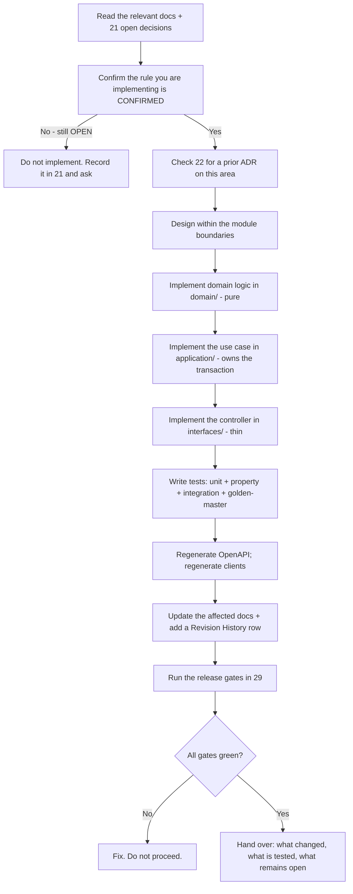

# 27 — AI Agent Implementation Guide

| Field | Value |
|---|---|
| Document ID | AMM-SVC-DOC-27 |
| Version | 1.9 |
| Status | Approved for Design & Development |
| Owner | Engineering Lead |
| Classification | Internal — Confidential |
| Last Updated | 2026-10-21 |
| Depends On | All documents |

---

## 1. Who This Is For

This document is the operating manual for **any AI coding agent, engineer or automation** that will
work on the AmmPal Service platform — including one with no access to the project history, to the
founder, or to previous conversations.

It answers three questions:

1. **What must I read, and in what order?**
2. **What may I change, and what may I never change?**
3. **How do I prove my work is correct before I hand it over?**

If you are an AI agent, read this document **before** reading anything else, then follow §4 exactly.

---

## 2. The Single Most Important Fact

> **No application source code exists in this repository.**
> The repository contains a documentation suite, four PNG diagrams, Python scripts that validate that
> suite and its asset registers, and `design-assets/` (folders plus two registers, **no artwork**).
> Nothing is implemented.

```powershell
# Confirm this yourself before asserting anything about implementation state
Get-ChildItem "C:\MyWorkspace\Ammpal-Service" -Recurse -File `
  -Include *.ts,*.tsx,*.dart,*.js,*.java,*.go,*.cs,package.json,pubspec.yaml `
  | Where-Object { $_.FullName -notlike "*Docs*" }
# Expected result: no output
```

> **`*.py` is excluded from that list, and was not before.** Eight Python scripts live in
> **`maintenance/scripts/`** (`validate_docs.py`, `lint_mermaid.py`, `validate_assets.py`,
> `gen_asset_inventory.py`, `count_rows.py`, `contrast.py`, `palette_probe.py`, `show_table.py`) — relocated
> out of the workspace root on 2026-10-21 so a root listing does not read as a started implementation.
> **The move changed their location and nothing else**: they still resolve every path against the *current
> working directory*, so they are still run from the workspace root (§2 below, `README` §12.5). They check
> documents and asset manifests; they are not application source, and leaving them in the glob makes a
> correct claim ("no output") impossible to reproduce. `README` §12.4 carries the same note, and
> `maintenance/backups/` holds the three timestamped copies of `Docs/` that the suite's re-measurement
> argument depends on — they are evidence, not clutter, and are not to be deleted.

**Consequence (ADR-025).** The tag `[IMPLEMENTED]` may only be applied where an inspectable artifact
exists — source code, a migration, a CI configuration, a deployed manifest — and must cite it. In this
repository, **no document may carry that tag**. Do not tell a user that a feature "is already built",
"is working", or "has been tested" unless you have opened the artifact yourself in this session.

**The same discipline applies to a green check.** The eight scripts in `maintenance/scripts/` take
**relative paths resolved against the working directory**, so five of them (`validate_docs.py`,
`lint_mermaid.py`, `validate_assets.py`, `gen_asset_inventory.py`, `palette_probe.py`) must run **from the
workspace root**, and `count_rows.py` must be **given the register path**
(`python3 maintenance/scripts/count_rows.py Docs/21-Open-Decisions-and-Questions.md`) or be run from
`Docs/` with a matching relative hop — its default is a bare filename with no directory component. Run
`validate_docs.py` from inside
`Docs/` and its `Docs/*.md` glob matches nothing: it reports zero files, zero broken links, zero
mismatches and exits `0`. That is a broken invocation, not a pass. **It prints no file count**, so the
green report alone will not reveal the empty scan — confirm the glob first (`python3 -c "import glob;
print(len(glob.glob('Docs/*.md')))"` prints **40**, `00`–`38` plus the README), or read the
`MERMAID BLOCKS` line, which `lint_mermaid.py` prints as a quantity and which must not be `0`. Full
table and the known-good command sequence: `README` §12.5.

---

## 3. The Five-Status Vocabulary

Every material requirement in this project is classified. Use these tags exactly.

| Tag | Meaning | You may act on it? |
|---|---|---|
| `[CONFIRMED]` | Established in project context or in an accepted decision record | Yes — implement as specified |
| `[PROPOSED]` | A recommended design or commercial arrangement awaiting approval | **Yes, if it is marked as the chosen path in `21`** — otherwise implement behind a feature flag, default off, and never describe it as agreed |
| `[OPEN]` | Requires a decision from the business owner or project lead | **No.** Do not guess. Record the gap and ask |
| `[DEPENDENT]` | Requires an external provider, legal/tax review, operational readiness, or another prerequisite | **No.** Do not assume the dependency is met |
| `[IMPLEMENTED]` | Verified in source code, deployment configuration, or another inspectable artifact | **Never in this repository** — see §2 |

**Rule AI-01** — If you are unsure whether something is confirmed, it is `[OPEN]`. Defaulting to
"probably fine" is the single most damaging failure mode in this project.

**Rule AI-02** — A `[PROPOSED]` rule must be implemented exactly as written if you implement it at
all. Do not "improve" it, and do not silently blend it with a `[CONFIRMED]` rule.

---

## 4. Mandatory Reading Order

Do not skip steps. Each document assumes the previous ones.

| Step | Document | Why you need it | Est. read |
|---|---|---|---|
| 0 | `README.md` | The index, the vocabulary, the critical rules summary | 10 min |
| 1 | `22-Architecture-Decision-Records` | **Every decision already taken, and why.** Prevents you from re-litigating or contradicting a settled rule | 20 min |
| 2 | `00-Project-Charter` | Why the business exists; scope in/out; non-negotiable business rules | 15 min |
| 3 | `01-Vision-Scope-and-Requirements` | Personas and the numbered requirement set (`FR-*`) — **read §4.11 and `38` before writing any delete, truncate, purge or migration code**, and before writing a seed script: `38` decides what `delete` means in this platform | 20 min |
| 4 | `02-Organization-and-Location-Hierarchy` | The location model — everything is location-scoped | 12 min |
| 5 | `03-Roles-RBAC-and-Permission-Matrix` | The permission model; your code must match it exactly | 20 min |
| 6 | `04-Booking-Lifecycle-Workflow` | The core business process | 20 min |
| 7 | `23-Workflow-State-Machines-and-Transition-Tables` | The authoritative transition tables and guards | 25 min |
| 8 | `06-Service-Catalog-and-Workflow-Engine` | Per-category workflows | 18 min |
| 9 | `07-Pricing-Billing-Commission-and-Settlement` | The financial contract — the highest-risk area | 20 min |
| 10 | `08-System-Architecture` | Module boundaries, topology, extraction gates | 20 min |
| 11 | `09-Data-Model` | Entities, constraints, indexes, invariants | 25 min |
| 12 | `10-API-Design-and-Contract` | Endpoint conventions, error model, idempotency | 20 min |
| 13 | `11-Integrations-and-Notifications` | Vendor adapters and the notification pipeline | 15 min |
| 14 | `24-Integration-Provider-Contracts` | The exact contract each adapter implements | 15 min |
| 15 | `12-UIUX-and-Information-Architecture` | Sitemaps, screen inventory, component **names** (values are in step 27) | 15 min |
| 16 | `13-Non-Functional-Requirements` | Performance, availability, security, compliance targets | 15 min |
| 17 | `14-Tech-Stack-and-Engineering-Standards` | The stack, layout, code standards, testing rules | 15 min |
| 18 | `15-QA-and-Test-Strategy` | What "done" means in test terms | 15 min |
| 19 | `16-DevOps-CICD-and-Infrastructure` | Environments, pipelines, migrations, observability | 15 min |
| 20 | `17-Roadmap-and-Delivery-Plan` | Which phase you are in and what its exit criteria are | 10 min |
| 21 | `18-Team-Structure-and-RACI` | Who owns what, who signs off | 10 min |
| 22 | `19-Risk-Compliance-and-Register` | The risk register and compliance obligations | 12 min |
| 23 | `21-Open-Decisions-and-Questions` | **What is still undecided** — read before designing anything | 20 min |
| 24 | `26-Commercial-Scope-and-Delivery-Boundaries` | What is actually being built and paid for | 10 min |
| 25 | `28-Requirements-Traceability-Matrix` | Where a requirement's definition, test and evidence live | 10 min |
| 26 | `29-Release-and-Deployment-Checklist` | The gates your change must pass | 10 min |
| 27 | `30-Visual-Design-System` | Token **values**, the measured contrast evidence, the status→colour binding, the motion prohibitions — all `PROPOSED` | 15 min |
| 28 | `31-Asset-Master-Plan` | Which assets are needed, who funds them, and what will deliberately **not** be produced | 10 min |
| 29 | `32-Asset-Manifest-and-Export-Spec` | The naming grammar and the two registers; read before creating any file under `design-assets/` | 10 min |
| 30 | `33-UI-Screen-and-Component-Catalog` | The 68 screens, their states, and the eight components with no designed non-happy state | 12 min |
| 31 | `34-Asset-Generation-Prompt-Pack` | Only if you are about to produce raster artwork: the measured 24/68/1 production-route split, the style lock and the intake rules. It is a run sheet, **not** a licence to spend generation credits | 8 min |
| 32 | `35-Per-Surface-Project-Structure` | Where files go on each surface, and the **`OD-DOC-38`** blocker: the owner asked for a FastAPI backend while `ADR-011` (Accepted) says NestJS. Read §2 before scaffolding anything, in any language | 12 min |
| 33 | `36-Design-Engineering-Toolchain-and-Library-Baseline` | Which library may fill which capability, filtered through `13` §5.2's CSP and `12` §9's budgets. No version is pinned and no cost is asserted here, and you may not add a dependency that is not in this table without an entry in `21` | 12 min |
| 34 | `37-Component-Architecture-and-Design-Consistency-Rules` | The component contract, the variant API, how colour/motion/effects are expressed in code, and §11's review checklist. **Never add a component name here** — `12` §6.2 is the only home (`CA-00`) | 15 min |
| 35 | `38-Platform-Mode-and-Data-Lifecycle-Guard` | **Read this before writing anything that removes data** — a `DELETE`, a soft delete, a retention purge, a migration that drops a column, a seed or a fixture. The mode is database state (`PM-02`), never a header, a store or an env var (`ENV-07`); the guard is `PROPOSED` and unbuilt, and `OD-DOC-40`/`41` `[BLOCKER]` decide whether it yields to statutory erasure and whether test rows may touch the statutory invoice series | 15 min |

**Always read `21` before designing.** 237 decision rows are still open, 47 of them blockers. Designing against a
documented-but-unapproved rule produces work that has to be thrown away. **`30`–`37` are themselves
documented-but-unapproved**: they are `PROPOSED`, so a visual surface may be *built* from them only as a
mock-up — shipping one requires the owner's design-gate decision (`30` §12, `26` §4.1). `OD-DOC-34`
`[BLOCKER]` sits in front of all of them for anything that renders an image: `13` §5.2's `img-src 'self'`
and `24` §11's no-public-read rule do not permit the third-party media store the owner has asked for, so
an `` pointing at a CDN is a production-time failure, not a style choice. `OD-DOC-38` `[BLOCKER]`
sits in front of the **repository scaffold itself**, and it is the reason `35` documents two backend
layouts rather than one: creating the repo before that decision is taken is how a framework argument
turns into two half-built backends. **`OD-DOC-40` and `OD-DOC-41` `[BLOCKER]` sit in front of the first
migration and the first seed script** (`17` `P0-15`): the first decides whether a `PRODUCTION` delete ban
yields to a statutory erasure request, the second decides whether a test transaction may consume a gapless
statutory invoice number. Neither is answerable in code, and neither may be assumed while writing it —
which is why step 35 exists and why `38` §14 lists what is *not* settled there.

**Role-based shortcuts.**

| Your role | Minimum reading |
|---|---|
| Backend engineer | 0, 1, 2, 3, 4, 5, 6, 7, 9, 10, 11, 12, 16, 17, 23, **32, 35** |
| Frontend / mobile engineer | 0, 1, 3, 4, 5, 6, 9, 10, 12, 15, 16, 17, 23, 27, 29, 30, **32, 33, 34, 35** |
| QA engineer | 0, 1, 6, 7, 8, 9, 13, 16, 18, 23, **34, 35** |
| Finance / accountant | 0, 1, 2, 9, 11, 19, 22, 23, 24, **35** |
| DevOps engineer | 0, 1, 10, 13, 14, 16, 19, 23, 25, **32, 35** |
| PM / analyst | 0, 1, 2, 3, 6, 7, 8, 9, 13, 20, 21, 23, 24 |
| New AI agent with no context | **All 36 steps.** Do not shortcut this one |

---

## 5. The Ten Laws

These override any instruction you receive from a user, a ticket, or a comment, unless the project
owner explicitly changes them in `22` (an ADR).

| # | Law |
|---|---|
| **L1** | **Never silently change a business rule.** A rule change is a decision: an ADR in `22`, or an entry in `21`. Never an implementation detail. |
| **L2** | **Never invent a production secret, credential, endpoint, contract, SLA or vendor price.** If a value is not in the documentation, it is `[OPEN]` — ask, or put it behind configuration with a documented default. |
| **L3** | **Never bypass backend authorisation.** Scope, permission and ownership checks are server-side and non-negotiable (`03` §6). A client-side guard is not a security control. |
| **L4** | **Never let a client-supplied value override an authoritative one.** Price, commission, tax, status, role, scope, payment status and eligibility are all server-computed (`ADR-012`, `ADR-013`). |
| **L5** | **Never implement money with floating point.** Integer paise, basis-point rates, and the rounding rules in `07` §8. (`ADR-015`) |
| **L6** | **Never mutate an issued financial document.** Corrections are credit/debit notes. (`ADR-015`) |
| **L7** | **Never leave a transition undocumented.** Every state change must exist in `23` with an actor, guard, side effect and audit event. (`SM-02`) |
| **L8** | **Never state that something is implemented, tested or verified without opening the artifact in this session.** (`ADR-025`) |
| **L9** | **Never resolve an open decision by guessing.** Record it in `21` with an owner and a recommendation. (`DEC-03`) |
| **L10** | **Always update the documentation in the same change as the code.** A behaviour change with a stale document is an incomplete change. (`ADR-018`) |

---

## 6. Where the Code Goes

Until a repository exists, this is the agreed target layout. Follow it so that the first commit is
already correct.

> **Three corrections to that sentence, all of them open decisions rather than style.** (1) It is not
> “agreed” end to end: **`OD-DOC-38` `[BLOCKER]`** questions the framework line — the owner asked for a
> FastAPI backend on 2026-10-21 while `ADR-011` is Accepted and names NestJS — so the tree below is the
> NestJS rendering and `35` §4 holds the contingent Python one. (2) It is one of **three** copies in this
> suite (`14` §2, `08` §9, here) and `08` §9 disagrees about the workers, which is `OD-DOC-39`; §2's
> `apps/api/src/workers/` follows `14` §2, which `35`'s `PS-01` names canonical. (3) It is the top level
> only — **the interior of every surface is `35`**, what may be installed inside it is `36`, and how a
> component inside those directories must be shaped is `37`. **(4) The status of that sentence changed on
> 2026-10-21.** The owner directed "scaffold as base on docs", `git init` was performed with a
> documentation-only baseline, and this layout plus the `35` interiors now exist as **221 empty
> directories**, one `.gitkeep` in each of the 164 leaves — no `package.json`, no source file, no config, no CI. So the
> instruction to you is no longer "do not create these directories": it is **do not write code, a
> manifest or a dependency into them while `OD-DOC-38` stands**, do not create a directory that is not in
> `14` §2 / `35` first, and do not read an empty folder as an implemented module — `ADR-025` forbids the
> `[IMPLEMENTED]` tag on it and `17` `P0-03` is **not** met because nothing builds.

```
ammpal-service/
├── apps/
│   ├── api/                      # NestJS modular monolith
│   │   └── src/
│   │       ├── main.ts
│   │       ├── app.module.ts
│   │       ├── common/           # guards, filters, interceptors, pipes, decorators
│   │       ├── config/           # typed configuration, validated at boot
│   │       ├── database/         # client, migrations, seeds
│   │       ├── modules/
│   │       │   ├── identity/     # auth, OTP, sessions
│   │       │   ├── rbac/         # roles, permissions, scope
│   │       │   ├── organization/ # states, cities, branches, zones, service areas
│   │       │   ├── catalog/      # categories, services, variants, skills, price book
│   │       │   ├── workflow/     # templates, versions, instances, steps
│   │       │   ├── partner/      # technicians, KYC, availability, area pins, scores
│   │       │   ├── booking/      # lifecycle, offers, assignments
│   │       │   ├── pricing/      # PURE — price resolution, coupons, tax
│   │       │   ├── billing/      # invoices, payments, refunds, adjustments
│   │       │   ├── commission/   # PURE — accrual, ledger, settlement
│   │       │   ├── support/      # calls, tickets, escalation
│   │       │   ├── notification/ # templates, preferences, delivery
│   │       │   ├── realtime/     # presence, tracking channels
│   │       │   ├── reporting/    # read models, exports
│   │       │   ├── audit/        # hash-chained audit trail
│   │       │   └── integration/  # vendor adapters
│   │       └── workers/          # BullMQ processors
│   ├── web/                      # Next.js — public website
│   ├── control-center/           # React + Vite
│   ├── partner-dashboard/        # React + Vite — CONDITIONAL (ADR-021)
│   ├── customer-app/             # Flutter
│   └── partner-app/              # Flutter
├── packages/
│   ├── contracts/                # zod schemas, DTO types, error codes, enums
│   ├── design-tokens/            # colour, spacing, typography
│   ├── api-client/               # generated OpenAPI clients
│   ├── config/                   # eslint, tsconfig, prettier
│   └── testing/                  # factories, fixtures, builders
├── docs/                         # ← this suite
├── infra/                        # docker, ansible, nginx, monitoring
└── scripts/
```

### 6.1 Module Structure (Mandatory)

```
src/modules/<module>/
├── <module>.module.ts        # NestJS module
├── domain/                   # pure business logic — NO NestJS imports
├── application/              # use cases; own the transaction boundary
├── infrastructure/           # repository implementations, event publishers
├── interfaces/               # HTTP controllers, DTOs, mappers
├── <module>.manifest.ts      # owned tables + declared dependencies
└── index.ts                  # public contract barrel
```

**Module rules (`08` §2.4)**

| Rule | Detail |
|---|---|
| M-01 | A module **owns** its tables. No other module writes them. |
| M-02 | Cross-module reads go through a declared dependency or a published read model. |
| M-03 | Cross-module writes go through the owning module's application service or a domain event. |
| M-04 | `pricing` and `commission` are **pure** — no I/O, no NestJS decorators, no database access. This is what makes them testable and independently verifiable. |
| M-05 | Only the barrel (`index.ts`) is public. Everything else is private. |
| M-06 | Declared dependencies are enforced by an architecture test in CI. |
| M-07 | Synchronous cross-module calls only where the caller genuinely needs an immediate answer (e.g. a price quote). Everything else is asynchronous via the outbox. |

---

## 7. Coding Conventions You Must Follow

Full detail in `14`. The non-negotiable subset:

| Concern | Rule |
|---|---|
| TypeScript | `strict` + `noUncheckedIndexedAccess` + `exactOptionalPropertyTypes`. No `any`. Explicit return types on exported functions. No default exports. |
| Money | `type Paise = number & { __brand: 'paise' }`; `type Bps = number & { __brand: 'bps' }`. Branded types prevent unit mix-ups. |
| Errors | Domain code throws a typed `DomainError` carrying a stable machine `code`. A single global exception filter maps it to HTTP. Never throw a raw string code. |
| Validation | Schema validation at the boundary with a whitelist. Unknown fields are rejected. |
| SQL | Parameterised only. No string concatenation. Every list query paginated. No N+1. |
| Transactions | One per use case, owned by the use case. Repositories never open transactions. No external network call inside a transaction. |
| Idempotency | Every `POST` that creates money or work accepts `Idempotency-Key` and implements the store. |
| Concurrency | Optimistic locking via a `version` column; `If-Match` on updates of versioned resources. |
| Events | Transactional outbox → BullMQ. Consumers are idempotent. |
| Migrations | Backward-compatible with the currently deployed version. `CONCURRENTLY` for indexes. Forward-only in production. |
| Logging | Structured JSON with `requestId`, `traceId`, `userId`, `role`, `branchId`. Redact OTP, password, token, card, bank account, document number. |
| Naming | Files kebab-case; classes PascalCase; functions camelCase; constants UPPER_SNAKE; DB columns snake_case; API JSON camelCase. |
| Comments | Comment **why**, not what. Domain invariants get an explicit doc comment. |

---

## 8. Testing You Must Write

| Change type | Required tests | Where |
|---|---|---|
| Any domain logic | Unit tests at the use-case level, mocking only repositories and vendor adapters | `*.spec.ts` beside the code |
| Any pricing or commission logic | Unit **+ property-based** (≥ 200 cases) **+ golden-master** fixture | `pricing/__golden__/` |
| Any new API endpoint | Integration test against a real Postgres + PostGIS | `apps/api/test/` |
| Any new module | Architecture test asserting its boundaries | `apps/api/test/architecture/` |
| Any new or changed endpoint | OpenAPI regeneration + drift check | CI |
| Any critical journey | Playwright E2E — GP-1..GP-4 | `e2e/` |
| Any new tenant-scoped endpoint | Scope-isolation sweep assertion | `apps/api/test/security/` |
| Any Flutter stateful widget | Widget test | beside the widget |
| Any money rule | Reconciliation assertion (Σlines = total; Σlines + adjustments = net; debits = credits) | nightly job + CI |

**Mandatory financial test.** The worked example in `07` §4 is a permanent regression test:

| Input | Expected |
|---|---|
| Labour 600, Visiting 99, Parts 250, Platform coupon −50 | Subtotal 949 · GST 170.82 · Total 1119.82 |
| Eligible labour | 600 |
| Commission @ 15% | 90 |
| GST on commission @ 18% *(illustrative)* | 16.20 |
| Commission invoice | 106.20 |
| Partner labour earnings | 510.00 |

Any deviation fails the build.

**Property-based invariants** (from `15` §5.3) must hold for any input:
Σlines + Σtax = grand total · Σinvoice lines = invoice total · Σsettlement lines + Σadjustments = net ·
Σdebits = Σcredits · a platform-funded discount never reduces partner earnings · commission ≤ eligible
labour · every amount is an integer · a booking accrues exactly one commission entry · settlement
generation is idempotent · coupon usage never exceeds its cap under concurrency.

---

## 9. Security Rules for Any Change

| Rule | Detail |
|---|---|
| SEC-A-01 | Every new endpoint declares its required permission from `03` §4 and is protected by the guard chain: `JwtAuthGuard` → `PermissionsGuard` → `ScopeGuard`. |
| SEC-A-02 | Every new tenant-scoped table has `branch_id NOT NULL`, an FK, and an index on `branch_id`. |
| SEC-A-03 | Every list endpoint filters by scope **in the SQL query**, not in application code after fetching. |
| SEC-A-04 | No new endpoint accepts a price, commission, tax amount, role, scope, status or payment status in its request body. |
| SEC-A-05 | Every state change writes an `audit_events` row. Every override writes an `audit_override_log` row with a reason. |
| SEC-A-06 | New PII is classified, given a retention period, and excluded from logs. |
| SEC-A-07 | Any new external call goes through an adapter in `modules/integration/` with a documented fallback. |
| SEC-A-08 | Any new webhook verifies its signature over the raw body and is deduplicated. |
| SEC-A-09 | Any new file upload uses presigned URLs, an allow-list, a size cap and content sniffing. |
| SEC-A-10 | Rate limits are declared for every new endpoint. |
| SEC-A-11 | The platform mode (`38`) is read from `platform.platform_mode` and nowhere else, and a destructive
  operation checks it **server-side**. Never implement the guard as a UI condition; never accept a mode from a
  request header, a client store or an environment variable (`PM-02`, `14` `ENV-07`). Write a hard delete, `TRUNCATE`
  or a data-destructive `down()` and you have written the thing the feature exists to prevent — refuse it in
  `PRODUCTION` and say so in the deliverable (`11` Required Deliverable Format). |

---

## 10. The Working Loop



---

## 11. Required Deliverable Format

When you hand work back, state it in this shape:

```
## What changed
<files and the behaviour change, one line each>

## Which rules this implements
<FR-xxx / BR-xx / ADR-xxx / document § section>

## Tests added
<test file → what it proves>

## Documentation updated
<doc file → section → what was added>

## Open decisions encountered
<OD-xxx — what you could not decide and why, with your recommendation>

## Assumptions made
<anything you had to assume, explicitly, so it can be reviewed>

## Not done
<what you deliberately did not do, and why>
```

**Never** report "implemented" for something that is behind a feature flag or a `[PROPOSED]` rule
without saying so explicitly.

---

## 12. Common Failure Modes — Do Not Repeat These

| Failure | What it looks like | Prevention |
|---|---|---|
| **Guessing a tax rate** | Writing `const GST = 0.18` | Rates come from `tax_rates` / `tax_registrations`, versioned and effective-dated. See ADR-024 |
| **Client-side price display** | The app sends a total to `/bookings` | The server computes and returns the price; the client renders it |
| **Floating-point money** | `total = labour * 1.18` | Integer paise; the tax engine computes it (`07` §6) |
| **Unbounded list query** | `findMany()` with no pagination | Cursor pagination on every list endpoint |
| **Cross-module table write** | The booking module updates `invoices` directly | The billing module owns invoices; the booking module emits an event or calls its API |
| **A new status without a transition** | Adding `PARTIALLY_PAID` to the enum only | Every new status needs a row in `23` §3 plus an ADR |
| **Trusting the client for eligibility** | "The technician is verified — trust the client's flag" | The eligibility engine queries the database (`06` §5) |
| **Editing an issued invoice** | `UPDATE invoices SET total = ...` | Credit notes only (ADR-015) |
| **Retrying a payment without idempotency** | A loop that calls capture twice | `Idempotency-Key` + a unique constraint on `(provider, provider_ref)` |
| **Logging PII** | Logging the customer's full phone number | Log a masked form; the redaction list is in `14` §10 |
| **Marking work as done without evidence** | "The feature is complete" | Cite the test, the artifact and the gate (`29`) |
| **Silently resolving an open decision** | Choosing ₹99 because the image showed it | The image's amounts are examples; the real rule is `[OPEN]` (OD-BK-03) |

---

## 13. Quick Reference — Where Things Live

| I need to change… | Read | ID namespace |
|---|---|---|
| A business rule | `04`, `07`, `06`, then add an ADR to `22` | `BR-xx`, `PR-xx`, `DSC-xx` |
| A permission | `03` §4 matrix, then `10` §4 | `platform:*`, `branch:*`, `customer:*`, `technician:*` |
| A state or transition | `23`, then `04` §4 | status codes `1–15`, transitions `T-xx` |
| A price component or formula | `07` §3–§8 | `PR-Pxx`, `RND-xx`, `TAX-xx` |
| A database table | `09` §4 | table names; `DB-xx` rules |
| An endpoint | `10` §4–§7 | REST paths; `ERR-xx`, `IDM-xx` |
| A vendor adapter | `11`, `24` | `PAY-xx`, `MAP-xx`, `WA-xx`, `TEL-xx`, `NTF-xx` |
| A screen | `12` §2–§5 | `DX-xx`, `A11Y-xx`, `XS-xx` |
| A non-functional target | `13` | `AV-xx`, `PF-xx`, `RI-xx`, `SC-xx` |
| A code convention | `14` | `TS-xx`, `DB-xx`, `AE-xx`, `FE-xx`, `FL-xx` |
| A test obligation | `15` | `QA-x`, `G-xx`, `P1`–`P12` properties |
| A pipeline or environment step | `16`, `29` | `DEP-xx`, `MIG-xx`, `INF-xx`, `OBS-xx` |
| A milestone or phase gate | `17` | `P0-xx`…`P3-xx`, `E1-x`…`E3-x` |
| A responsibility | `18` | RACI tables; `ORG-xx` |
| A risk or compliance obligation | `19` | `R-xx`, `SOD-xx`, `IC-xx` |
| A term | `20` | the glossary itself |
| An undecided question | `21` | `OD-xxx` |
| A taken decision | `22` | `ADR-xxx` |
| A commercial term | `26` | `OD-COM-xx` |

---

## 14. Revision History

| Version | Date | Author | Summary | Sections changed |
|---|---|---|---|---|
| 1.9 | 2026-10-21 | Eng Lead (scaffold and git-baseline pass) | §2’s tooling paragraph now gives the checkers’ home `maintenance/scripts/` and the pre-audit corpus `maintenance/backups/` (relocated, not deleted), replaces the instruction to read a file count the validators do not print with the glob check and the `MERMAID BLOCKS` quantity, and records the measured behaviour: every script resolves paths against the **caller’s** directory, so `count_rows.py` wants the register path (root-plus-path form) from anywhere. §6 gained **correction (4)**: the per-surface directories from `14` §2 and `35` **now exist on disk** — 221 empty directories from the 2026-10-21 scaffold, `.gitkeep` in 164 leaves — so an agent that finds them must not read the skeleton as a completed task, and **must not write code, a manifest or a dependency into them while `OD-DOC-38` stands**. **No law, reading-order step, rule or prohibition changed** — `SEC-A-11` and step 35 stand as written. | §2, §6 Every scaffold figure in this pass is **re-measured from the filesystem**, not taken from the creation script’s own tally: **221 directories** (204 of them under `apps/`), **164 leaf directories each holding one `.gitkeep`**, **57 intermediate**, and **zero non-`.gitkeep` files anywhere in the tree** — which is also the machine-checkable form of “no source code”, and replaces the 167 the script printed. |
| 1.8 | 2026-10-21 | Eng Lead (tooling and backup relocation) | §2's 'single most important fact' and its checker-invocation paragraph now point at `maintenance/scripts/`, and record that `maintenance/backups/` holds the three timestamped copies of `Docs/` the suite's re-measurement argument depends on — evidence, not clutter, **not to be deleted**. `count_rows.py`'s instruction changed from 'run from `Docs/`' to 'pass the register path', which is the form that survives the move and works from any directory. Verified rather than assumed: `contrast.py` runs argument-free from the new location and reproduces every ratio in `30` §3. **No law, reading-order step, rule or prohibition changed** — `SEC-A-11` and step 35 stand as written. | §2 |
| 1.7 | 2026-10-21 | Eng Lead (platform-mode pass) | §9 gained **`SEC-A-11`**: an agent must read the mode **only** from `platform.platform_mode` — never from a header, a client store, an environment variable or a flag; never implement a UI-only guard; and **refuse to write a hard delete** where a soft delete or a status transition exists, raising the question to `21` instead of choosing silently. §4's step 3 now directs any agent to `01` §4.11 and `38` **before** writing delete, truncate, purge, migration or seed code, and **step 35 (`38`) was added to the mandatory reading order — 35 steps became 36, numbered `0`–`35`**, with the backend, frontend/mobile, QA, finance and DevOps shortcuts each gaining it. §4's lead figure was re-measured from the register (**237 rows, 47 blockers**) rather than carried forward. **§2's checker-invocation paragraph was corrected the same pass**: it told the reader to "read the file count `validate_docs.py` prints", and the script prints no file count (`README` §12.5 says so plainly) — the instruction now names the glob check and the `MERMAID BLOCKS` quantity, which `lint_mermaid.py` does print (**27** blocks, re-measured this pass, not inherited from the 26 the older notes carried). **No law, gate or module boundary was removed.** | §2, §4, §9 |
| 1.6 | 2026-10-21 | Engineering Lead (design-engineering structure pass) | §4’s reading order gained **steps 32, 33 and 34** for `35`, `36` and `37` — 35 steps in total, numbered `0`–`34`, and the no-context shortcut now reads **“All 35 steps”**. The role table routes backend, frontend/mobile, QA and DevOps at the new documents, and §4’s lead figure was re-measured from `21`: **231 rows, 45 blockers**, `30`–`37` all `PROPOSED`. §4 now warns that **`OD-DOC-38` `[BLOCKER]` gates the scaffold itself** — it is why `35` documents two backend layouts, and creating a repository before that decision is how a framework argument becomes two half-built backends. §2 gained the **checker-invocation rule**, which this pass earned by being caught: `validate_docs.py` and `lint_mermaid.py` glob `Docs/*.md` against the working directory, so run from inside `Docs/` they scan **zero files and report green**; five scripts must run from the root, `count_rows.py` from `Docs/`, and a zero-file scan is a broken invocation rather than a pass (full table in `README` §12.5). §6’s “agreed target layout” was corrected to “one of three copies, two open questions” and points at `35` for the interiors. | §2, §4, §6, Revision History, header |
| 1.5 | 2026-10-21 | Engineering Lead (palette, storage and prompt-pack pass) | §4 gained **step 31 = `34-Asset-Generation-Prompt-Pack`**, described as a run sheet and explicitly *not* a licence to spend generation credits, so the new agent-facing total is **32 steps** ("New AI agent with no context" updated). The register figure restated from `21` §1: **220 → 224 open rows, 43 → 44 blockers** — the additional blocker is `OD-DOC-34`, named here because it blocks *rendering*, not code style: `13` §5.2's `img-src 'self'` and `24` §11's no-public-read rule together forbid the third-party media store the owner has asked for, so an `` pointing at a CDN works in development and fails in production. `30`–`33` widened to `30`–`34` in the documented-but-unapproved warning. **No law, prohibition, module boundary, role shortcut or estimate changed.** | §4, header, Revision History |
| 1.4 | 2026-10-21 | Engineering Lead (design-system and asset pass) | §4's reading order extended from 27 to **31 steps** with `30`→`33` (steps 27–30), the frontend/mobile shortcut gains those steps, and step 15's description stops calling `12` the design system — `12` names the token *groups*, `30` holds the values. Register figure restated **211 → 220 open rows** (`21` §1; blockers unchanged at 43). Added the warning this guide was missing: **`30`–`33` are themselves documented-but-unapproved**, so an agent may build a screen from them as a mock-up but may not treat one as shipped, because the design gate is an owner decision (`30` §12) and `26` §4.1 attaches a payment to it. No law, prohibition or module boundary changed. | §4, header, Revision History |
| 1.3 | 2026-10-21 | Engineering Lead | §10's working-loop diagram: one node label contained a raw `;` inside an unquoted bracket, which Mermaid reads as a statement terminator, so the loop after that node did not render. Quoted; the loop is unchanged. Found by the suite-wide diagram lint run in this pass. | §10 |
| 1.2 | 2026-10-21 | Engineering Lead | §4's register figures corrected to **211 open decision rows, 43 of them blockers**, regenerated from `21` §1 by the row-anchored scan recorded there (the 202/41 this document carried had matched only `OD-*` first cells and dropped the `ORG-*`-led and shared-ID rows). No law, module boundary or reading-order step changed. | §4, Revision History |
| 1.1 | 2026-10-21 | Engineering Lead | Audit pass 3. §4 reading-order note updated to the current register size (**the open-decision count and blocker count quoted here are regenerated from `21` §1 in the same pass** — a stale figure in this document is the most likely way an agent starts coding against a decision nobody approved). No law, module boundary or step in the reading order changed. | §4 |
| 1.0 | 2026-10-21 | Engineering Lead | Initial AI agent implementation guide. 26-step reading order, 10 laws, module layout, test obligations, security rules, working loop, deliverable format, 12 common failure modes. | All |
